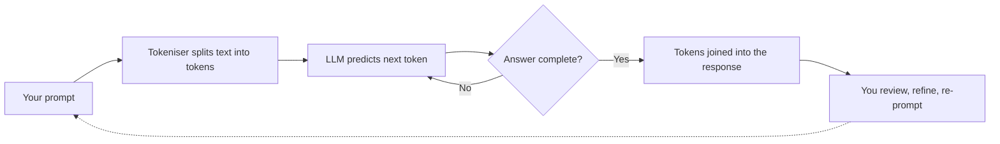
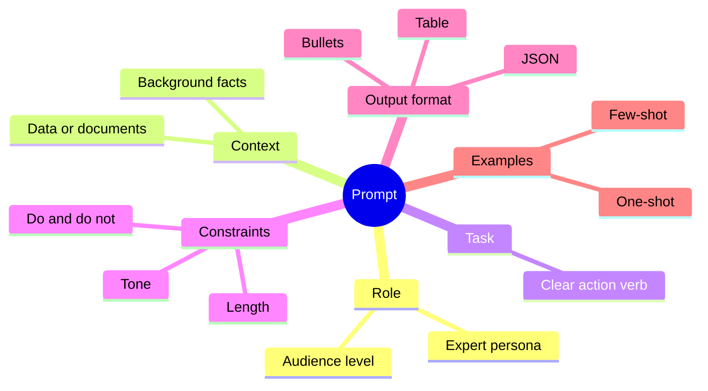
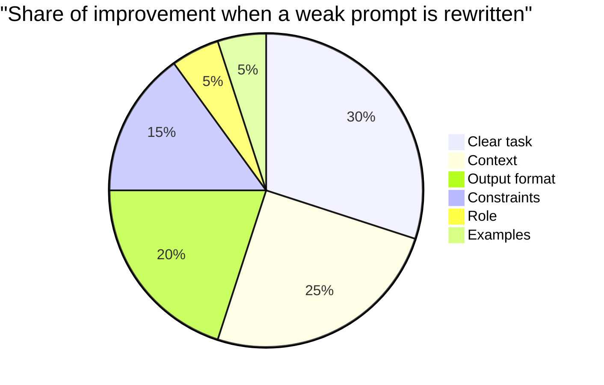

# Session 1 · Getting Started with Prompting

[](https://colab.research.google.com/github/Hamnakhan123/Generative-AI/blob/main/01-prompt-engineering/code/session-01-getting-started-with-prompting.ipynb)

> 🧭 [Generative AI](../README.md) › [Track 1 · Prompt Engineering](README.md) › **Session 1**
>
> ⏱️ **Estimated time:** 2 hours · 📋 **Prerequisites:** None — this is the starting point

⬅ Previous (start) · [🏠 Track home](README.md) · [Next ➡](session-02-types-of-prompts-and-priming.md)

---

## 🎯 Learning objectives

By the end of this session you will be able to:

- Define the core vocabulary of generative AI: **model, LLM, token, context window, temperature, hallucination**.
- Describe how a large language model turns your words into an answer.
- Compare the popular AI assistants at a high level and pick one for a task.
- Explain what a **prompt** is and why **prompt engineering** is a real, valuable skill.
- Break any prompt into its **six building blocks** and rewrite a weak prompt into a strong one.

## 📖 Concepts

### 1. Basic terms you will hear every day

| Term | Plain-English meaning | Classroom analogy |
|---|---|---|
| **Artificial Intelligence (AI)** | Software that performs tasks we usually associate with human thinking. | The whole school of "smart" programs. |
| **Machine Learning (ML)** | AI that learns patterns from data instead of following hand-written rules. | A student who learns from past papers. |
| **Generative AI** | ML models that *create* new content: text, images, audio, video, code. | A student who can write a brand-new essay. |
| **Large Language Model (LLM)** | A generative model trained on huge amounts of text to predict the next piece of text. | Autocomplete that read a whole library. |
| **Token** | The small chunk of text a model reads and writes (a word, part of a word, or a symbol). | Syllables the model "speaks" in. |
| **Context window** | The maximum number of tokens the model can consider at once (prompt + answer). | The size of the whiteboard. |
| **Temperature** | A setting that controls randomness. Low = focused and repeatable, high = creative and varied. | Strict teacher vs. brainstorming session. |
| **Hallucination** | A confident answer that is false or made up. | A student bluffing in a viva. |

### 2. How an LLM answers you

An LLM does not "look up" an answer. It reads your prompt as tokens, then repeatedly predicts **the most suitable next token** based on patterns learned in training, until the answer is complete. That is why the *wording* of your prompt matters so much: every word shifts the probabilities of what comes next.

> 💡 **Key insight:** The model only knows what is in its training data plus what you put in the prompt. If you want it to use your syllabus, your tone, or your data, **you must give it that context.**

### 3. A quick tour of the AI world

Generative AI tools fall into a few families:

- **Chat assistants** — ChatGPT, Microsoft Copilot, Google Gemini, Claude. General-purpose writing, reasoning and coding.
- **Image generators** — Midjourney, DALL·E, Ideogram, Stable Diffusion, Adobe Firefly.
- **Audio and video** — text-to-speech voices, music generators, video generators and AI editors.
- **Embedded AI** — AI features inside apps you already use: documents, spreadsheets, email, design tools.

### 4. Comparing the big three chat assistants

| Feature | ChatGPT | Microsoft Copilot | Google Gemini |
|---|---|---|---|
| Strength | Strong all-round writing, reasoning, custom GPTs | Web-grounded answers with citations, tight Microsoft 365 integration | Google Search grounding, Google Workspace integration |
| Live web access | Yes (in supported plans/modes) | Yes, by default | Yes |
| Image creation | Built-in | Built-in | Built-in |
| Best for | Drafting, tutoring, coding, analysis | Research with sources, Word/Excel/Outlook work | Gmail/Docs/Sheets users, quick research |

> ⚠️ Features and plans change frequently. Always check the current version before relying on a specific capability.

### 5. What is a prompt? What is prompt engineering?

A **prompt** is the input you give a generative model: a question, an instruction, some data, examples, or a combination.

**Prompt engineering** is the practice of designing prompts so the model produces output that is **accurate, relevant, and in the shape you need**, on the first or second try. It is part writing skill, part logical thinking, and part testing.

Why it matters:

- The same model can give a vague paragraph or a perfect lesson plan, depending only on the prompt.
- Good prompts **save time and money** (fewer retries, fewer tokens).
- Companies now hire for this skill in content, marketing, data, education and software roles.

### 6. Anatomy of a prompt — the six building blocks

| Block | Question it answers | Example |
|---|---|---|
| **Role** | Who should the AI act as? | "You are an experienced HR manager." |
| **Context** | What background does it need? | "Our company is a 50-person software house in Lahore." |
| **Task** | What exactly should it do? | "Write a job advert for a junior Python developer." |
| **Constraints** | What limits apply? | "Under 150 words, no gendered language." |
| **Output format** | What should the answer look like? | "A title, 4 bullet responsibilities, and a closing line." |
| **Examples** | What does a good answer look like? | A short sample advert you liked before. |

Not every prompt needs all six, but **Task** is mandatory and **Context + Format** usually give the biggest jump in quality.

## 🧭 Diagrams

How a prompt becomes an answer:



The anatomy of a prompt as a mind map:



## 💻 Worked examples

### Example 1 — From weak to strong prompt (template)

**Weak prompt**

```text
Write about climate change.
```

**Strong prompt**

```text
You are a friendly science teacher for grade 8 students in Karachi.
Students have just studied the water cycle and have 10 minutes left in class.
Explain how climate change affects rainfall in Pakistan.
Constraints: maximum 120 words, one local example, no jargon.
Format: 3 short bullet points, then one quiz question.
```

**Sample output (illustrative — your model's wording will differ):**

```text
• Warmer air holds more water vapour, so when it rains, it can rain much harder.
• Monsoon patterns are shifting: some years bring floods, like 2022 in Sindh, others bring long dry spells.
• Melting glaciers in the north first add water to rivers, then leave less over time.

Quiz: Why can a warmer atmosphere lead to heavier rainfall?
```

Notice how the role fixed the **tone**, the context fixed the **level**, and the format made the answer **ready to use in class**.

### Example 2 — Building prompts in Python

Prompts are just text, so we can assemble them programmatically. This is exactly how apps send prompts to AI models behind the scenes.

```python
# file: session-01_prompt_anatomy.py
"""Build a well-structured prompt from its six building blocks."""
from dataclasses import dataclass, field

@dataclass
class Prompt:
    role: str = ""
    context: str = ""
    task: str = ""
    constraints: list = field(default_factory=list)
    output_format: str = ""
    examples: list = field(default_factory=list)

    def render(self) -> str:
        parts = []
        if self.role:        parts.append(f"ROLE: You are {self.role}.")
        if self.context:     parts.append(f"CONTEXT: {self.context}")
        if self.task:        parts.append(f"TASK: {self.task}")
        if self.constraints: parts.append("CONSTRAINTS:\n" + "\n".join(f"- {c}" for c in self.constraints))
        if self.output_format: parts.append(f"OUTPUT FORMAT: {self.output_format}")
        for i, (inp, out) in enumerate(self.examples, 1):
            parts.append(f"EXAMPLE {i}:\nInput: {inp}\nOutput: {out}")
        return "\n\n".join(parts)

def score(p: Prompt) -> int:
    """Very rough 'completeness' score: one point per filled block (max 6)."""
    return sum(bool(x) for x in [p.role, p.context, p.task, p.constraints, p.output_format, p.examples])

weak = Prompt(task="Write about climate change.")
strong = Prompt(
    role="a friendly science teacher for grade 8 students in Karachi",
    context="Students have just studied the water cycle and have 10 minutes left in class.",
    task="Explain how climate change affects rainfall in Pakistan.",
    constraints=["Maximum 120 words", "Use one local example", "Avoid jargon"],
    output_format="3 short bullet points followed by one quiz question",
)
for name, p in [("WEAK", weak), ("STRONG", strong)]:
    print(f"===== {name} PROMPT (completeness {score(p)}/6) =====")
    print(p.render())
    print()
```

**Output**

```text
===== WEAK PROMPT (completeness 1/6) =====
TASK: Write about climate change.

===== STRONG PROMPT (completeness 5/6) =====
ROLE: You are a friendly science teacher for grade 8 students in Karachi.

CONTEXT: Students have just studied the water cycle and have 10 minutes left in class.

TASK: Explain how climate change affects rainfall in Pakistan.

CONSTRAINTS:
- Maximum 120 words
- Use one local example
- Avoid jargon

OUTPUT FORMAT: 3 short bullet points followed by one quiz question
```

### Example 3 — Estimating tokens and cost

Every model has a context window and is usually billed per token. This helper gives a rough estimate (real tokenisers differ slightly).

```python
# file: session-01_tokens.py
"""Rough token estimation: most English text averages ~4 characters per token."""
import re

def estimate_tokens(text: str) -> int:
    words = re.findall(r"\w+|[^\w\s]", text)
    by_chars = len(text) / 4
    by_words = len(words) * 0.75 + sum(1 for w in words if not w.isalnum())
    return round((by_chars + by_words) / 2)

samples = {
    "short question": "What is a prompt?",
    "instruction": "Summarise the attached article in five bullet points for a busy manager.",
    "paragraph": ("Generative AI models predict the next token in a sequence. The quality of the "
                  "answer depends heavily on the clarity, context and constraints in the prompt."),
}
context_window = 8000
for name, text in samples.items():
    t = estimate_tokens(text)
    print(f"{name:15} | chars={len(text):3} | ~tokens={t:3} | % of 8k window={t/context_window:.2%}")

cost_per_1k = 0.0005  # illustrative price in USD per 1,000 input tokens
monthly = 200 * 30 * 1500   # 200 requests/day, 30 days, ~1,500 tokens each
print(f"\nMonthly tokens: {monthly:,}  ->  estimated cost ${monthly/1000*cost_per_1k:.2f}")
```

**Output**

```text
short question  | chars= 17 | ~tokens=  4 | % of 8k window=0.05%
instruction     | chars= 72 | ~tokens= 14 | % of 8k window=0.18%
paragraph       | chars=155 | ~tokens= 32 | % of 8k window=0.40%

Monthly tokens: 9,000,000  ->  estimated cost $4.50
```

**Worked calculation:** 200 requests/day × 30 days × 1,500 tokens = **9,000,000 tokens**. At an illustrative \$0.0005 per 1,000 tokens: 9,000 × 0.0005 = **\$4.50 per month**.

## 📊 Where prompt quality comes from

Based on typical classroom experiments where students rewrite weak prompts, the improvement usually comes from these blocks (illustrative split):



## 🧪 Lab / practice tasks

**Task 1 · 🟢 Easy** — Ask any chat assistant "What is a token?" then ask "Explain tokens to a 10-year-old using a cricket analogy." Compare the two answers.

<details><summary>💡 Hint</summary>

The second prompt adds an audience (role/context) and a style constraint. Note how the length and vocabulary change.

</details>

**Task 2 · 🟢 Easy** — Label the six blocks in this prompt: "You are a travel agent. My family of four wants a 3-day trip to Hunza in July on a mid budget. Suggest an itinerary as a day-by-day table, under 200 words."

<details><summary>💡 Hint</summary>

Role = travel agent; Context = family of four, July, mid budget; Task = suggest itinerary; Constraints = 3 days, under 200 words; Format = day-by-day table; Examples = none.

</details>

**Task 3 · 🟡 Medium** — Rewrite "Make a quiz" into a strong prompt with at least 5 blocks, run it in two different assistants, and note two differences.

<details><summary>💡 Hint</summary>

Specify subject, level, number of questions, question type (MCQ), answer key placement and difficulty.

</details>

**Task 4 · 🟡 Medium** — Edit `session-01_prompt_anatomy.py` so it also prints a warning when the task does not start with an action verb (write, explain, list, compare...).

<details><summary>💡 Hint</summary>

Keep a small set of verbs and check `p.task.split()[0].lower()`.

</details>

**Task 5 · 🔴 Challenge** — Set temperature (where your tool allows, e.g. in an API playground) to 0.2 and then 1.0 for the same creative prompt. Run each three times and describe the difference in variety.

<details><summary>💡 Hint</summary>

Low temperature gives near-identical answers; high temperature varies wording and ideas. Record results in a small table.

</details>


## ✅ Quick quiz

**Q1. What is a token?**

- A) A full sentence
- B) A small chunk of text the model processes
- C) A password for the AI
- D) A type of image

<details><summary>Show answer</summary>

✅ **B) A small chunk of text the model processes** — Models read and write in tokens: words, sub-words or symbols.

</details>

**Q2. Which setting mainly controls randomness of output?**

- A) Context window
- B) Max tokens
- C) Temperature
- D) Top-k only

<details><summary>Show answer</summary>

✅ **C) Temperature** — Lower temperature = more predictable output.

</details>

**Q3. Which prompt block is mandatory?**

- A) Role
- B) Examples
- C) Task
- D) Constraints

<details><summary>Show answer</summary>

✅ **C) Task** — Without a task the model does not know what to do.

</details>

**Q4. A confident but false answer is called a...**

- A) Bias
- B) Hallucination
- C) Overfit
- D) Token leak

<details><summary>Show answer</summary>

✅ **B) Hallucination** — Always verify important facts.

</details>

**Q5. Which tool is especially known for web-grounded answers with citations inside Microsoft 365?**

- A) Copilot
- B) Midjourney
- C) Stable Diffusion
- D) Ideogram

<details><summary>Show answer</summary>

✅ **A) Copilot** — Copilot grounds answers in Bing results and integrates with Microsoft apps.

</details>


## 📝 Summary / cheat-sheet

- An LLM predicts the **next token** repeatedly; your prompt steers those predictions.
- Context window = prompt + answer budget. Temperature = creativity dial.
- **Prompt = Role + Context + Task + Constraints + Format + Examples.**
- Strong prompts are specific about **audience, length, tone and format**.
- Always **verify** facts: models can hallucinate.

**Viva / interview questions**

1. Explain the difference between AI, ML and generative AI with one example each.
2. Why does adding context to a prompt improve the answer?
3. What happens when a conversation exceeds the model's context window?
4. When would you choose a low temperature over a high one?
5. Name the six building blocks of a prompt and give an example of each.

---

⬅ Previous (start) · [🏠 Track home](README.md) · [Next ➡](session-02-types-of-prompts-and-priming.md)

<sub>Prepared by **Hamna Zahid Khan**, Junior Lecturer</sub>
