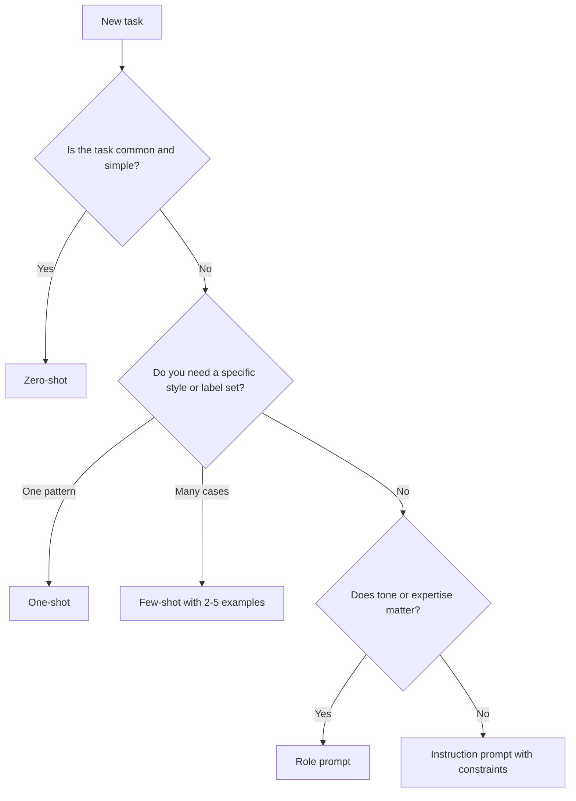
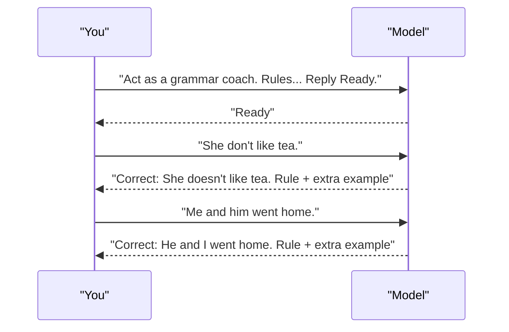
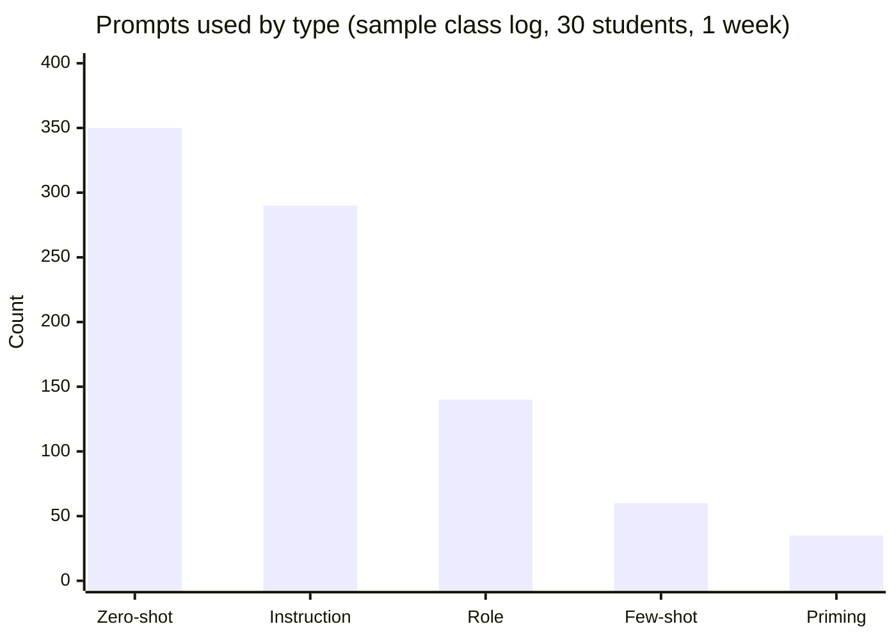

# Session 2 · Types of Prompts and Prompt Priming

[](https://colab.research.google.com/github/Hamnakhan123/Generative-AI/blob/main/01-prompt-engineering/code/session-02-types-of-prompts-and-priming.ipynb)

> 🧭 [Generative AI](../README.md) › [Track 1 · Prompt Engineering](README.md) › **Session 2**
>
> ⏱️ **Estimated time:** 2 hours · 📋 **Prerequisites:** Previous session

[⬅ Previous](session-01-getting-started-with-prompting.md) · [🏠 Track home](README.md) · [Next ➡](session-03-unleashing-the-power-of-prompts.md)

---

## 🎯 Learning objectives

- Name and recognise the main **types of prompts**: zero-shot, one-shot, few-shot, role, instruction, open vs. closed, and conversational.
- Use **prompt priming** to set up a model's behaviour for a whole conversation.
- Write simple starter prompts and practical everyday prompts.
- Apply a checklist for **effective prompting**.
- Use a **prompting IDE / playground** and reusable templates to test prompts systematically.

## 📖 Concepts

### 1. Types of prompts

| Type | What you give the model | When to use | Mini example |
|---|---|---|---|
| **Zero-shot** | Only the instruction | Simple, well-known tasks | "Translate 'good morning' into Urdu." |
| **One-shot** | Instruction + one example | You need a specific style | "Rewrite like this: *Input → Output*. Now do: …" |
| **Few-shot** | Instruction + 2–5 examples | Classification, consistent formatting | Labelled reviews, then a new review |
| **Role / persona** | "Act as …" | Tone, expertise level | "You are a career counsellor." |
| **Instruction** | Direct command with constraints | Most daily work | "List 5 tips, each under 12 words." |
| **Open-ended** | Broad question | Brainstorming | "What could a café do to attract students?" |
| **Closed** | Question with a fixed answer space | Facts, yes/no, choices | "Is 97 prime? Answer Yes or No." |
| **Conversational / iterative** | A chain of follow-ups | Refining a draft | "Shorter." → "More formal." → "Add a CTA." |

### 2. Prompt priming

**Priming** means preparing the model *before* the real request: you set the persona, rules and output style once, and every later answer follows them. It is like briefing a new intern at the start of the day instead of repeating instructions for every task.

A good priming prompt contains:

1. **Persona** — who the AI should be.
2. **Rules** — what to always / never do.
3. **Format** — how replies should look.
4. **Handshake** — "Reply 'Ready' and wait for my first request." This stops the model from rushing ahead.

### 3. Starter prompts vs. everyday practical prompts

- **Starter (simple) prompts** are one line: definitions, translations, quick facts. Great for learning how a tool responds.
- **Everyday practical prompts** solve real tasks: an email to a landlord, a weekly meal plan, a study timetable, a polite complaint, a WhatsApp announcement.

### 4. Effective prompting checklist (the **C.L.E.A.R.** rule)

| Letter | Meaning | Ask yourself |
|---|---|---|
| **C** | Concise but complete | Did I remove fluff but keep needed detail? |
| **L** | Logical order | Context first, then task, then format? |
| **E** | Explicit | Did I state length, tone, audience, format? |
| **A** | Adaptive | Am I ready to refine with follow-ups? |
| **R** | Reflective | Did I check the output for errors or bias? |

**Common mistakes:** asking two unrelated things at once, vague words ("good", "nice"), no audience, no length, and accepting the first answer without review.

### 5. Prompting IDEs and playgrounds

A **prompting IDE** (or playground) is a workspace for testing prompts like code: you can save versions, change model settings (temperature, max tokens), compare outputs side by side and keep a library. Examples include the developer playgrounds offered by model providers and prompt-management tools. Even a simple spreadsheet with columns *Prompt version · Settings · Output · Score* works as a lightweight IDE.

## 🧭 Diagrams

Choosing a prompt type:



Priming a conversation:



## 💻 Worked examples

### Example 1 — Prompt priming template

```text
For the rest of this chat, act as an English grammar coach for university students.
Rules:
1. Correct my sentence.
2. Explain the mistake in ONE line.
3. Give one more example using the same rule.
Format: Correct: ... | Why: ... | Another example: ...
Reply only with "Ready" now and wait for my first sentence.
```

**Sample output** (after sending "Ready" and then *"Each of the students have a laptop."*):

```text
Correct: Each of the students has a laptop. | Why: "Each" is singular, so the verb is singular. | Another example: Each of the players wears a cap.
```

### Example 2 — Everyday practical prompt

```text
Write a polite WhatsApp message to my building's residents group.
Context: water supply will be off on Sunday 9am–1pm for tank cleaning.
Tone: friendly, clear. Length: under 60 words. Add one emoji at most.
```

**Sample output:**

```text
Assalam o Alaikum everyone! 🙏 Please note the water supply will be off this Sunday from 9 am to 1 pm for tank cleaning. Kindly store some water in advance. Thank you for your cooperation!
```

### Example 3 — A reusable template library in Python

Templates turn your best prompts into fill-in-the-blank tools, and `string.Template` even catches missing fields.

```python
# file: session-02_templates.py
"""A tiny reusable prompt-template library using string.Template."""
from string import Template

TEMPLATES = {
    "zero_shot": Template("$task\n\nText: \"$text\""),
    "role": Template("You are $role. $task\nAudience: $audience. Keep it under $words words."),
    "priming": Template(
        "For the rest of this chat, act as $role.\n"
        "Rules: $rules\n"
        "Reply only with 'Ready' now. Wait for my first request."),
}

def few_shot(task, examples, query):
    """Build a few-shot prompt: instruction + labelled examples + new input."""
    lines = [task, ""]
    for text, label in examples:
        lines += [f"Review: {text}", f"Sentiment: {label}", ""]
    lines += [f"Review: {query}", "Sentiment:"]
    return "\n".join(lines)

print("--- ZERO-SHOT ---")
print(TEMPLATES["zero_shot"].substitute(task="Classify the sentiment as Positive, Negative or Neutral.",
                                         text="The delivery was late but the biryani was amazing."))
print("\n--- ROLE PROMPT ---")
print(TEMPLATES["role"].substitute(role="a patient maths tutor", task="Explain percentages.",
                                    audience="grade 6 students", words=100))
print("\n--- PRIMING PROMPT ---")
print(TEMPLATES["priming"].substitute(role="an English grammar coach",
      rules="correct my sentence, explain the mistake in one line, give one more example"))
print("\n--- FEW-SHOT PROMPT ---")
print(few_shot("Classify each review as Positive or Negative.",
               [("Battery lasts all day, love it!", "Positive"),
                ("Screen cracked after one week.", "Negative")],
               "Fast charging and a bright display."))
try:
    TEMPLATES["role"].substitute(role="a chef")
except KeyError as e:
    print(f"\nMissing placeholder detected: {e}  -> templates protect you from half-filled prompts")
```

**Output**

```text
--- ZERO-SHOT ---
Classify the sentiment as Positive, Negative or Neutral.

Text: "The delivery was late but the biryani was amazing."

--- ROLE PROMPT ---
You are a patient maths tutor. Explain percentages.
Audience: grade 6 students. Keep it under 100 words.

--- PRIMING PROMPT ---
For the rest of this chat, act as an English grammar coach.
Rules: correct my sentence, explain the mistake in one line, give one more example
Reply only with 'Ready' now. Wait for my first request.

--- FEW-SHOT PROMPT ---
Classify each review as Positive or Negative.

Review: Battery lasts all day, love it!
Sentiment: Positive

Review: Screen cracked after one week.
Sentiment: Negative

Review: Fast charging and a bright display.
Sentiment:

Missing placeholder detected: 'task'  -> templates protect you from half-filled prompts
```

### Example 4 — Same task, three prompt types

| Prompt type | Prompt | What changes |
|---|---|---|
| Zero-shot | "Summarise this article." | Length and style unpredictable |
| Instruction | "Summarise in 3 bullets, ≤15 words each." | Predictable shape |
| Few-shot | Two article→summary pairs, then the new article | Copies your exact style |

## 📊 Prompt-type usage in a typical week of student work



The log shows students lean on zero-shot prompts; most quality gains come when they move to instruction, role and few-shot prompts.

## 🧪 Lab / practice tasks

**Task 1 · 🟢 Easy** — Write one zero-shot, one one-shot and one few-shot prompt for "convert a sentence into passive voice". Test all three.

<details><summary>💡 Hint</summary>

For few-shot give 2–3 active→passive pairs, then your sentence ending with "Passive:".

</details>

**Task 2 · 🟢 Easy** — Write a priming prompt that turns the assistant into a quiz master who asks one MCQ at a time on Python basics and waits for your answer.

<details><summary>💡 Hint</summary>

Include persona, rules (one question at a time, wait, then give feedback), and a handshake ("Reply Ready").

</details>

**Task 3 · 🟡 Medium** — Take three everyday tasks from your own week and write C.L.E.A.R. prompts for each. Score the outputs from 1–5.

<details><summary>💡 Hint</summary>

Typical tasks: email to a teacher, grocery list from a recipe, timetable for exam week.

</details>

**Task 4 · 🟡 Medium** — Add a new template `"compare"` to `session-02_templates.py` that compares two items on given criteria and outputs a Markdown table.

<details><summary>💡 Hint</summary>

Template placeholders like `$a`, `$b`, `$criteria`; then call `.substitute(...)`.

</details>

**Task 5 · 🔴 Challenge** — Build a 5-row "prompt IDE" sheet: same task, 5 prompt versions, same settings. Record outputs and pick the winner with a short justification.

<details><summary>💡 Hint</summary>

Change only one thing per version (add role, add format, add example...) so you can see the effect of each change.

</details>


## ✅ Quick quiz

**Q1. Giving 3 labelled examples before your request is called...**

- A) Zero-shot
- B) Few-shot
- C) Priming
- D) Jailbreaking

<details><summary>Show answer</summary>

✅ **B) Few-shot** — Few-shot = several examples in the prompt.

</details>

**Q2. Why add "Reply Ready and wait" to a priming prompt?**

- A) To save tokens forever
- B) To stop the model answering before your real request
- C) To make it more creative
- D) It is required by all tools

<details><summary>Show answer</summary>

✅ **B) To stop the model answering before your real request** — The handshake confirms the setup without rushing ahead.

</details>

**Q3. Which is a closed prompt?**

- A) "Ideas for a birthday party?"
- B) "Is 51 a prime number? Answer Yes or No."
- C) "Write a poem"
- D) "Tell me about Lahore"

<details><summary>Show answer</summary>

✅ **B) "Is 51 a prime number? Answer Yes or No."** — The answer space is fixed.

</details>

**Q4. What does the "E" in C.L.E.A.R. stand for?**

- A) Emotional
- B) Explicit
- C) Endless
- D) Encrypted

<details><summary>Show answer</summary>

✅ **B) Explicit** — State length, tone, audience and format explicitly.

</details>

**Q5. A prompting IDE mainly helps you...**

- A) Train a new model
- B) Test and compare prompt versions and settings
- C) Hack a model
- D) Avoid using prompts

<details><summary>Show answer</summary>

✅ **B) Test and compare prompt versions and settings** — It is a workspace for systematic prompt testing.

</details>


## 📝 Summary / cheat-sheet

- **Zero → one → few-shot**: add examples when style or labels must be consistent.
- **Role** sets tone and expertise; **instruction** sets shape and limits.
- **Priming** = persona + rules + format + handshake, once per conversation.
- Use **C.L.E.A.R.**: Concise, Logical, Explicit, Adaptive, Reflective.
- Save winning prompts as **templates**; test variations in a playground or sheet.

**Viva / interview questions**

1. When does few-shot prompting beat zero-shot? Give an example.
2. What is prompt priming and what are its four parts?
3. How would you structure a prompt to get a consistent JSON output?
4. Why change only one variable at a time when testing prompts?
5. What are the risks of very long few-shot prompts? (Hint: context window, cost.)

---

[⬅ Previous](session-01-getting-started-with-prompting.md) · [🏠 Track home](README.md) · [Next ➡](session-03-unleashing-the-power-of-prompts.md)

<sub>Prepared by **Hamna Zahid Khan**, Junior Lecturer</sub>
