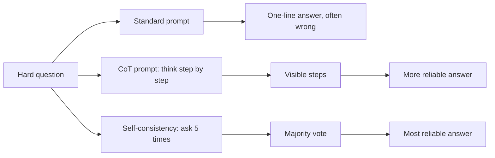
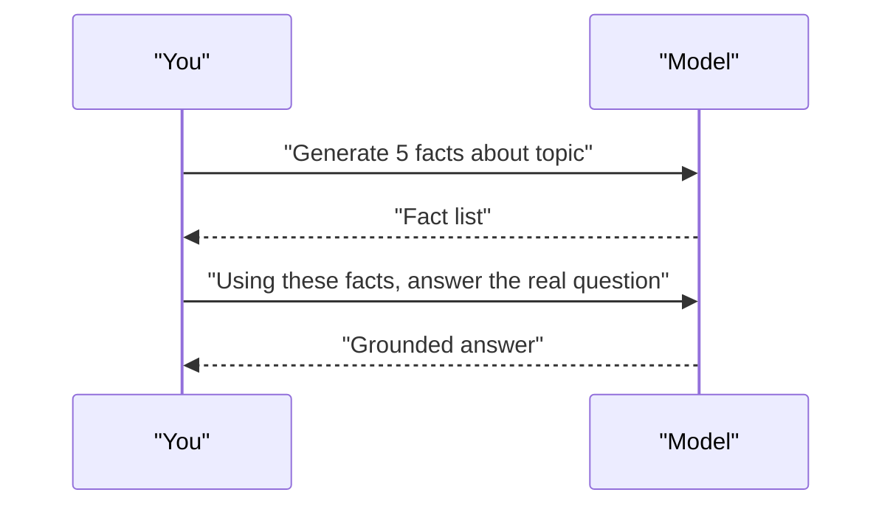
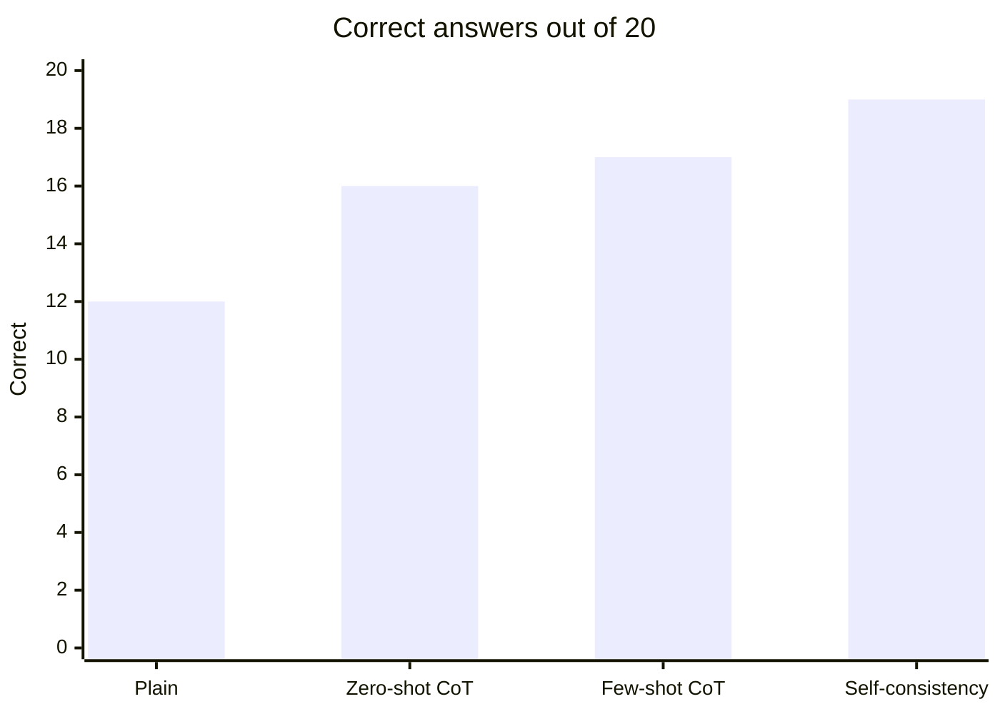

# Session 3 · Unleashing the Power of Prompts: CoT, Self-Consistency, Generated Knowledge

[](https://colab.research.google.com/github/Hamnakhan123/Generative-AI/blob/main/01-prompt-engineering/code/session-03-unleashing-the-power-of-prompts.ipynb)

> 🧭 [Generative AI](../README.md) › [Track 1 · Prompt Engineering](README.md) › **Session 3**
>
> ⏱️ **Estimated time:** 2 hours · 📋 **Prerequisites:** Previous session

[⬅ Previous](session-02-types-of-prompts-and-priming.md) · [🏠 Track home](README.md) · [Next ➡](session-04-case-studies-content-and-social-media.md)

---

## 🎯 Learning objectives

- Apply basic prompting to everyday writing: **emails, blogs, study help, code, emojis, contracts and writing styles**.
- Use an intermediate **focused prompt framework** to structure complex requests.
- Apply **Chain-of-Thought (CoT)** and **zero-shot CoT** to reasoning problems.
- Improve reliability with **self-consistency** and **generated knowledge** prompting.
- Turn data into a **chart** with the help of an AI assistant.

## 📖 Concepts

### 1. Basic prompting applications

| Use | Prompt pattern | Key detail to include |
|---|---|---|
| **Email** | "Write a [tone] email to [who] about [what]. Ask for [action]." | Recipient, purpose, call to action |
| **Blog** | "Write a [length] blog post for [audience] on [topic] with H2 headings." | Audience, length, structure, keywords |
| **Study buddy** | "Quiz me on [topic], one question at a time, harder each time." | Level, question type, feedback style |
| **Coding** | "Write a [language] function that [does X]. Include comments and a test." | Language, inputs/outputs, edge cases |
| **Emojis** | "Summarise this story in 5 emojis, then explain each." | Count, explanation |
| **Contracts** | "Draft a simple agreement between [A] and [B] for [service]. Mark it as a draft for legal review." | Parties, scope, payment, dates, disclaimer |
| **Writing styles** | "Rewrite this paragraph in [formal / Shakespearean / news / Gen-Z] style." | Target style, keep meaning |

> ⚖️ AI-drafted contracts or legal text are **starting drafts only**. A qualified person must review them.

### 2. The focused prompt framework (R-T-C-F)

For intermediate tasks use a four-line skeleton:

- **R — Role:** who the model is.
- **T — Task:** one precise objective.
- **C — Context & constraints:** facts, data, limits.
- **F — Format:** exact output shape.

### 3. Chain-of-Thought (CoT) prompting

LLMs answer more accurately on multi-step problems when they **write out intermediate steps**. CoT prompting shows the model a worked example *with reasoning*, so it imitates the step-by-step style.

**Zero-shot CoT** skips the example and just adds a trigger such as *"Let's think step by step."* or *"Work through this step by step, then give the final answer on the last line."*

### 4. Self-consistency

A single reasoning chain can go wrong. **Self-consistency** asks the same question several times (often with a higher temperature), collects the final answers and takes the **majority vote**. Wrong chains rarely agree with each other; correct ones usually do.

### 5. Generated knowledge prompting

Two-step technique: first ask the model to **generate relevant facts**, then ask it to **answer using those facts**. This pulls useful background into the context before the real question, improving answers on general-knowledge reasoning.

```text
Step 1: List 5 facts about how solar panels perform in hot, dusty climates.
Step 2: Using only those facts, advise a Karachi homeowner whether to install panels.
```

### 6. Use case: building charts with an assistant

Assistants with code execution can turn a table into a chart. Even without that, you can ask for **plotting code** (Python/matplotlib, Excel steps, or Google Sheets steps) and run it yourself.

## 🧭 Diagrams





## 💻 Worked examples

### Example 1 — CoT vs. no CoT

**Prompt without CoT**

```text
A shop sells pens at Rs 25 each. Ali buys 4 pens, pays with Rs 500, and gets a 10% discount on the total. How much change?
```

**Prompt with zero-shot CoT**

```text
A shop sells pens at Rs 25 each. Ali buys 4 pens, pays with Rs 500, and gets a 10% discount on the total.
How much change does he get? Let's think step by step and give the final answer on the last line as "Answer: <number>".
```

**Sample output (CoT):**

```text
1. Cost of 4 pens = 4 × 25 = Rs 100
2. Discount = 10% of 100 = Rs 10 → total Rs 90
3. Change = 500 − 90 = Rs 410
Answer: 410
```

### Example 2 — Self-consistency in code

The reasoning chains below are **sample outputs** of five runs (one of them flawed). The code extracts each final answer and votes.

```python
# file: session-03_self_consistency.py
"""Self-consistency: ask the same CoT question several times, take the majority answer.
The 'model runs' below are SAMPLE reasoning chains (hard-coded) so the demo is reproducible."""
from collections import Counter
import re

question = ("A shop sells pens at Rs 25 each. Ali buys 4 pens and pays with a Rs 500 note. "
            "The shopkeeper gives a 10% discount on the total. How much change does Ali get?")

sample_runs = [
    "4 x 25 = 100. 10% of 100 = 10, so total = 90. Change = 500 - 90 = 410. Answer: 410",
    "Total 100. Discount 10 -> 90. 500 - 90 = 410. Answer: 410",
    "4 pens cost 100. Change before discount = 400. 10% of 400 = 40. Answer: 440",   # flawed chain
    "Cost = 4*25 = 100; after 10% off = 90; change = 410. Answer: 410",
    "100 - 10% = 90. 500 - 90 = 410. Answer: 410",
]

def final_answer(chain):
    return re.search(r"Answer:\s*(\d+)", chain).group(1)

answers = [final_answer(r) for r in sample_runs]
votes = Counter(answers)
print("Question:", question)
for i, (r, a) in enumerate(zip(sample_runs, answers), 1):
    print(f"Run {i}: answer={a}")
best, count = votes.most_common(1)[0]
print("\nVotes:", dict(votes))
print(f"Self-consistent answer: Rs {best}  (confidence {count}/{len(answers)} = {count/len(answers):.0%})")
```

**Output**

```text
Question: A shop sells pens at Rs 25 each. Ali buys 4 pens and pays with a Rs 500 note. The shopkeeper gives a 10% discount on the total. How much change does Ali get?
Run 1: answer=410
Run 2: answer=410
Run 3: answer=440
Run 4: answer=410
Run 5: answer=410

Votes: {'410': 4, '440': 1}
Self-consistent answer: Rs 410  (confidence 4/5 = 80%)
```

### Example 3 — Focused framework for a coding task

```text
R: You are a senior Python instructor.
T: Write a function is_palindrome(s) that ignores spaces, punctuation and case.
C: Python 3, standard library only, include 3 assert tests, explain in 2 lines.
F: One code block, then the explanation.
```

**Sample output:**

```python
import re
def is_palindrome(s: str) -> bool:
    cleaned = re.sub(r"[^a-z0-9]", "", s.lower())
    return cleaned == cleaned[::-1]

assert is_palindrome("Never odd or even")
assert not is_palindrome("Karachi")
assert is_palindrome("A man, a plan, a canal: Panama")
```

### Example 4 — Chart from data (code an assistant would give you)

```python
# file: session-03_chart_from_ai.py
"""Use case: an assistant was asked 'Turn this sales data into a chart'.
This is the kind of code it returns. We draw a text bar chart so it runs anywhere,
and also save a PNG with matplotlib."""
import matplotlib
matplotlib.use("Agg")
import matplotlib.pyplot as plt

sales = {"Jan": 120, "Feb": 95, "Mar": 160, "Apr": 140, "May": 210, "Jun": 185}
peak = max(sales, key=sales.get)
for month, v in sales.items():
    print(f"{month} | {'#' * (v // 10):<21} {v}{'  <- peak' if month == peak else ''}")
growth = (sales["Jun"] - sales["Jan"]) / sales["Jan"] * 100
print(f"\nGrowth Jan->Jun: {growth:.1f}%   Average: {sum(sales.values())/len(sales):.1f}")

plt.bar(sales.keys(), sales.values(), color="#FF6B1A")
plt.title("Monthly sales (units)")
plt.savefig("session-03_sales_chart.png", dpi=80)
print("Saved chart -> session-03_sales_chart.png")
```

**Output**

```text
Jan | ############          120
Feb | #########             95
Mar | ################      160
Apr | ##############        140
May | ##################### 210  <- peak
Jun | ##################    185

Growth Jan->Jun: 54.2%   Average: 151.7
Saved chart -> session-03_sales_chart.png
```

## 📊 Accuracy by technique (illustrative classroom test, 20 word problems)

| Technique | Correct /20 | Avg. tokens per answer |
|---|---|---|
| Plain prompt | 12 | 15 |
| Zero-shot CoT | 16 | 80 |
| Few-shot CoT | 17 | 95 |
| Self-consistency (5 runs) | 19 | 450 |

Trade-off: more reliability costs more tokens and time.



## 🧪 Lab / practice tasks

**Task 1 · 🟢 Easy** — Ask an assistant to write a leave-application email to your HOD, then rewrite it in three styles (formal, friendly, very brief).

<details><summary>💡 Hint</summary>

Keep the facts fixed (dates, reason) and change only the style instruction.

</details>

**Task 2 · 🟢 Easy** — Summarise a famous movie plot in exactly 6 emojis and ask the model to explain each emoji.

<details><summary>💡 Hint</summary>

Add "exactly 6" and "explain each on its own line".

</details>

**Task 3 · 🟡 Medium** — Pick 3 tricky word problems. Solve each with a plain prompt and with zero-shot CoT. Record which got correct.

<details><summary>💡 Hint</summary>

Ask for the final answer on a fixed last line so comparison is easy.

</details>

**Task 4 · 🟡 Medium** — Use generated knowledge prompting to decide "Should a small bakery start home delivery?" Compare with a direct answer.

<details><summary>💡 Hint</summary>

Step 1: list facts (costs, demand, logistics). Step 2: answer using only those facts.

</details>

**Task 5 · 🔴 Challenge** — Extend `session-03_self_consistency.py` so it accepts answers typed by you from 5 real model runs and reports the vote and confidence.

<details><summary>💡 Hint</summary>

Use `input()` in a loop or read lines from a text file.

</details>


## ✅ Quick quiz

**Q1. "Let's think step by step" is a trigger for...**

- A) Few-shot learning
- B) Zero-shot Chain-of-Thought
- C) Prompt injection
- D) Fine-tuning

<details><summary>Show answer</summary>

✅ **B) Zero-shot Chain-of-Thought** — It invites step-by-step reasoning without examples.

</details>

**Q2. Self-consistency picks the final answer by...**

- A) The longest chain
- B) The first answer
- C) Majority vote across several runs
- D) The lowest temperature run

<details><summary>Show answer</summary>

✅ **C) Majority vote across several runs** — Agreement among independent chains signals correctness.

</details>

**Q3. Generated knowledge prompting first asks the model to...**

- A) Write code
- B) Produce relevant facts
- C) Translate the question
- D) Refuse

<details><summary>Show answer</summary>

✅ **B) Produce relevant facts** — Facts are generated, then used to answer.

</details>

**Q4. In R-T-C-F, the "F" stands for...**

- A) Facts
- B) Format
- C) Feedback
- D) Filter

<details><summary>Show answer</summary>

✅ **B) Format** — Exact output shape.

</details>

**Q5. Why must AI-drafted contracts be reviewed?**

- A) They are always illegal
- B) Models can miss legal requirements or hallucinate clauses
- C) Tokens expire
- D) They are too short

<details><summary>Show answer</summary>

✅ **B) Models can miss legal requirements or hallucinate clauses** — Treat them as drafts for professional review.

</details>


## 📝 Summary / cheat-sheet

- Basic apps: email, blog, study buddy, code, emojis, contracts, styles — always add **audience, length, format**.
- **R-T-C-F** framework for intermediate prompts.
- **CoT** = show steps; **zero-shot CoT** = "think step by step".
- **Self-consistency** = many runs + majority vote. **Generated knowledge** = facts first, answer second.
- Charts: ask for data → chart code, then run and check it.

**Viva / interview questions**

1. Why does Chain-of-Thought improve arithmetic and logic answers?
2. What is the cost of self-consistency and when is it worth it?
3. Describe generated knowledge prompting with your own example.
4. How would you prompt an assistant to produce plotting code for a dataset?
5. What safeguards do you apply when using AI for legal or official documents?

---

[⬅ Previous](session-02-types-of-prompts-and-priming.md) · [🏠 Track home](README.md) · [Next ➡](session-04-case-studies-content-and-social-media.md)

<sub>Prepared by **Hamna Zahid Khan**, Junior Lecturer</sub>
