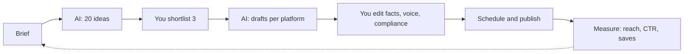
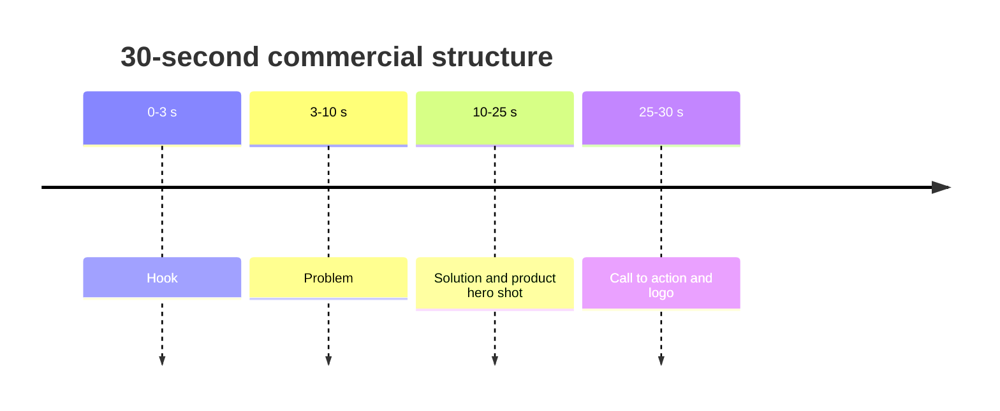
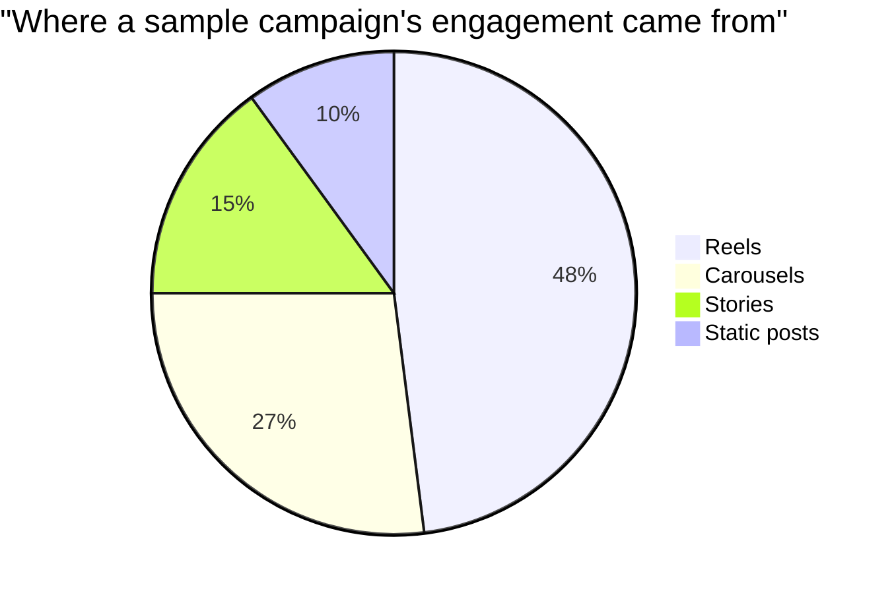

# Session 4 · Case Studies: Content, Commercials, Social Media and Icons

[](https://colab.research.google.com/github/Hamnakhan123/Generative-AI/blob/main/01-prompt-engineering/code/session-04-case-studies-content-and-social-media.ipynb)

> 🧭 [Generative AI](../README.md) › [Track 1 · Prompt Engineering](README.md) › **Session 4**
>
> ⏱️ **Estimated time:** 2 hours · 📋 **Prerequisites:** Previous session

[⬅ Previous](session-03-unleashing-the-power-of-prompts.md) · [🏠 Track home](README.md) · [Next ➡](session-05-prompting-in-apps-sheets-and-style.md)

---

## 🎯 Learning objectives

- Use AI assistants to plan and draft **content for social media**.
- Write prompts for **commercials and ad scripts** with a clear hook, message and call to action.
- Produce platform-specific content: **posts, short-video scripts, thumbnails and captions**.
- Generate a **consistent icon set** with style-locked prompts.
- Apply ethical rules for AI-generated marketing content.

## 📖 Concepts

### 1. AI for content creation — the workflow

Good AI-assisted content follows the same pipeline a human team uses: **brief → ideas → draft → edit → adapt per platform → schedule → measure**. The assistant speeds up ideas, drafts and adaptations; **you** own the brief, the facts, the brand voice and the final approval.

### 2. The content brief (feed this to every prompt)

| Field | Example |
|---|---|
| Brand / product | ChaiCorner · new cardamom iced tea |
| Audience | University students in Karachi |
| Goal | Awareness + first purchase |
| Tone | Fun, witty, respectful |
| Key message | Refreshing, local flavour, student-friendly price |
| Call to action (CTA) | "Show your student card for 15% off" |
| Must avoid | Health claims, competitor names |

### 3. Commercials: the **H-P-S-C** script formula

- **Hook (0–3 s):** surprise, question or relatable moment.
- **Problem:** the pain point ("Hot afternoon, long lecture…").
- **Solution:** the product as the hero.
- **CTA:** what to do now, with urgency or a reason.

### 4. Platform cheat-sheet

| Platform | Format that works | Prompt detail to add |
|---|---|---|
| Instagram | Carousel, reels, short captions | Word limit, hashtags count, emoji policy |
| TikTok / Reels / Shorts | 15–30 s vertical scripts | Scene list, on-screen text, sound idea |
| LinkedIn | Story-driven professional post | Lesson learned, no slang, line breaks |
| X | Single punchy line or thread | Character limit, thread length |
| YouTube | Title, description, thumbnail text | Keyword, curiosity gap, ≤5 thumbnail words |

### 5. Icons with AI — consistency is everything

An icon set looks professional only if every icon shares the **same style**. Lock a **style string** (flat/line/3D, stroke width, palette, background, aspect ratio, "no text") and only change the subject. Generate, pick the best, and vectorise or redraw if you need crisp SVGs.

### 6. Ethics for AI marketing

- Do not invent reviews, statistics or testimonials.
- Disclose AI-generated people or voices where required by platform or law.
- Check images for copyrighted characters, logos and trademarks.
- Respect cultural and religious sensitivities in your audience.

## 🧭 Diagrams





## 💻 Worked examples

### Example 1 — Commercial script prompt

```text
You are an award-winning ad copywriter.
Write a 30-second video commercial script for ChaiCorner's new cardamom iced tea.
Audience: university students in Karachi. Tone: fun, witty.
Use the structure Hook / Problem / Solution / CTA with timestamps.
Include on-screen text and one sound-effect idea per scene. CTA: "Show your student card for 15% off".
```

**Sample output (shortened):**

```text
[0-3s] HOOK — Student melting into chair like an ice cube in reverse. SFX: sizzle. On-screen: "3 PM lecture be like…"
[3-10s] PROBLEM — Fan spinning slowly, notes blowing away. On-screen: "Too hot to think?"
[10-25s] SOLUTION — Friend slides a frosty cardamom iced tea; everyone revives. SFX: ice clink. On-screen: "Desi flavour. Ice-cold."
[25-30s] CTA — Logo. VO: "ChaiCorner Cardamom Iced Tea. Show your student card for 15% off!"
```

### Example 2 — One brief, many platforms (Python)

```python
# file: session-04_content_calendar.py
"""Generate a week of social-media prompts from one campaign brief."""
brief = {"brand": "ChaiCorner", "product": "new cardamom iced tea",
         "audience": "university students in Karachi", "tone": "fun, witty", "cta": "Show your student card for 15% off"}
platforms = {"Instagram": "caption under 40 words + 5 hashtags",
             "LinkedIn": "professional post under 80 words about launching a local brand",
             "X": "tweet under 240 characters with 1 emoji",
             "TikTok": "15-second video script with 3 scenes"}
days = ["Mon", "Wed", "Fri", "Sun"]

def make_prompt(platform, spec):
    return (f"You are a social media manager for {brief['brand']}. Write a post for {platform} ({spec}) "
            f"promoting our {brief['product']} for {brief['audience']}. Tone: {brief['tone']}. "
            f"End with: '{brief['cta']}'.")

print(f"{'Day':4} | {'Platform':9} | Prompt")
print("-" * 100)
for day, (platform, spec) in zip(days, platforms.items()):
    p = make_prompt(platform, spec)
    print(f"{day:4} | {platform:9} | {p[:80]}...")
print("\nFull prompt for Instagram:\n" + make_prompt("Instagram", platforms["Instagram"]))
```

**Output**

```text
Day  | Platform  | Prompt
----------------------------------------------------------------------------------------------------
Mon  | Instagram | You are a social media manager for ChaiCorner. Write a post for Instagram (capti...
Wed  | LinkedIn  | You are a social media manager for ChaiCorner. Write a post for LinkedIn (profes...
Fri  | X         | You are a social media manager for ChaiCorner. Write a post for X (tweet under 2...
Sun  | TikTok    | You are a social media manager for ChaiCorner. Write a post for TikTok (15-secon...

Full prompt for Instagram:
You are a social media manager for ChaiCorner. Write a post for Instagram (caption under 40 words + 5 hashtags) promoting our new cardamom iced tea for university students in Karachi. Tone: fun, witty. End with: 'Show your student card for 15% off'.
```

### Example 3 — Thumbnail + title prompt

```text
Give me 5 YouTube title options (max 60 characters) and matching thumbnail text (max 4 words) for a video
"How I study 6 hours a day without burning out". Audience: university students. Make each pair create curiosity
without clickbait lies. Output as a table.
```

**Sample output:**

| Title | Thumbnail text |
|---|---|
| 6 Hours of Study, Zero Burnout: My System | "No Burnout?!" |
| The Study Routine That Saved My GPA | "GPA Saved" |
| Study Smarter: My 6-Hour Daily Plan | "6 Hrs, Easy?" |
| I Tried Studying 6 Hours a Day for 30 Days | "30-Day Test" |
| How Top Students Avoid Burnout | "Steal This" |

### Example 4 — Bulk icon prompts with a locked style

```python
# file: session-04_icon_prompts.py
"""Bulk-create consistent icon prompts for an app (style stays fixed, subject changes)."""
STYLE = ("flat vector icon, single subject centred, rounded corners, 2px outline, "
         "palette: deep violet #A78BFA and orange #FF6B1A, white background, no text, 1:1")
subjects = ["calendar", "chat bubble", "graduation cap", "bar chart", "settings gear"]
for i, s in enumerate(subjects, 1):
    print(f"{i}. {s.title():15} -> \"{s} icon, {STYLE}\"")
print(f"\nStyle string length: {len(STYLE)} chars, reused {len(subjects)} times for visual consistency")
```

**Output**

```text
1. Calendar        -> "calendar icon, flat vector icon, single subject centred, rounded corners, 2px outline, palette: deep violet #A78BFA and orange #FF6B1A, white background, no text, 1:1"
2. Chat Bubble     -> "chat bubble icon, flat vector icon, single subject centred, rounded corners, 2px outline, palette: deep violet #A78BFA and orange #FF6B1A, white background, no text, 1:1"
3. Graduation Cap  -> "graduation cap icon, flat vector icon, single subject centred, rounded corners, 2px outline, palette: deep violet #A78BFA and orange #FF6B1A, white background, no text, 1:1"
4. Bar Chart       -> "bar chart icon, flat vector icon, single subject centred, rounded corners, 2px outline, palette: deep violet #A78BFA and orange #FF6B1A, white background, no text, 1:1"
5. Settings Gear   -> "settings gear icon, flat vector icon, single subject centred, rounded corners, 2px outline, palette: deep violet #A78BFA and orange #FF6B1A, white background, no text, 1:1"

Style string length: 151 chars, reused 5 times for visual consistency
```

## 📊 Measuring content

| Metric | Formula | Worked example |
|---|---|---|
| Engagement rate | (likes + comments + shares + saves) ÷ reach × 100 | (420+35+60+85) ÷ 12,000 × 100 = **5.0%** |
| Click-through rate (CTR) | clicks ÷ impressions × 100 | 240 ÷ 16,000 × 100 = **1.5%** |
| Cost per click (CPC) | ad spend ÷ clicks | Rs 6,000 ÷ 240 = **Rs 25** |



## 🧪 Lab / practice tasks

**Task 1 · 🟢 Easy** — Write a content brief for a real or imaginary local business and generate 10 post ideas with an assistant.

<details><summary>💡 Hint</summary>

Use the brief table above; ask for ideas as a numbered list with a one-line angle each.

</details>

**Task 2 · 🟢 Easy** — Produce a 15-second Reels script using H-P-S-C for a campus event.

<details><summary>💡 Hint</summary>

Ask for timestamps, on-screen text and a sound idea per scene.

</details>

**Task 3 · 🟡 Medium** — Adapt one announcement into Instagram, LinkedIn and X versions with correct limits. Check each limit yourself.

<details><summary>💡 Hint</summary>

Count characters for X; LinkedIn should read like a short story with a takeaway.

</details>

**Task 4 · 🟡 Medium** — Generate a 6-icon set for a student app with a locked style string in any image tool. Judge consistency 1–5.

<details><summary>💡 Hint</summary>

Keep stroke, palette, background and aspect ratio fixed; change only the subject word.

</details>

**Task 5 · 🔴 Challenge** — Calculate engagement rate and CTR for 3 of your (or a sample) posts and ask the assistant for 3 data-driven improvements.

<details><summary>💡 Hint</summary>

Provide the numbers in a table; ask it to justify each suggestion with the data.

</details>


## ✅ Quick quiz

**Q1. In H-P-S-C, what comes first?**

- A) Price
- B) Hook
- C) CTA
- D) Logo

<details><summary>Show answer</summary>

✅ **B) Hook** — The hook grabs attention in the first seconds.

</details>

**Q2. Why lock a style string when generating icons?**

- A) To reduce cost
- B) To keep the set visually consistent
- C) To add text automatically
- D) It is required by law

<details><summary>Show answer</summary>

✅ **B) To keep the set visually consistent** — Only the subject should change.

</details>

**Q3. Engagement rate = (interactions ÷ reach) × 100. 300 interactions, 10,000 reach gives...**

- A) 0.3%
- B) 3%
- C) 30%
- D) 33%

<details><summary>Show answer</summary>

✅ **B) 3%** — 300 ÷ 10,000 × 100 = 3%.

</details>

**Q4. Which is an ethical problem in AI marketing?**

- A) Using a brief
- B) Inventing customer testimonials
- C) Writing hashtags
- D) Scheduling posts

<details><summary>Show answer</summary>

✅ **B) Inventing customer testimonials** — Fake reviews mislead customers.

</details>

**Q5. Which detail matters most in an X (Twitter) prompt?**

- A) Video length
- B) Character limit
- C) Slide count
- D) Thumbnail size

<details><summary>Show answer</summary>

✅ **B) Character limit** — X posts have a strict character limit.

</details>


## 📝 Summary / cheat-sheet

- Pipeline: **Brief → Ideas → Draft → Edit → Adapt → Publish → Measure.**
- Ads: **Hook, Problem, Solution, CTA** with timestamps.
- One brief → per-platform prompts with exact limits.
- Icons: lock style, vary subject only.
- Never fake reviews or stats; check copyright and cultural sensitivity.

**Viva / interview questions**

1. Walk through how you would plan a one-week social campaign with an AI assistant.
2. What belongs in a content brief and why?
3. How do you keep AI-generated visuals on-brand?
4. Define engagement rate and CTR and compute an example.
5. What ethical checks do you do before publishing AI-assisted marketing?

---

[⬅ Previous](session-03-unleashing-the-power-of-prompts.md) · [🏠 Track home](README.md) · [Next ➡](session-05-prompting-in-apps-sheets-and-style.md)

<sub>Prepared by **Hamna Zahid Khan**, Junior Lecturer</sub>
