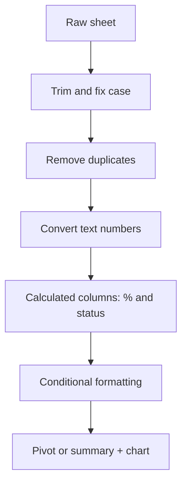
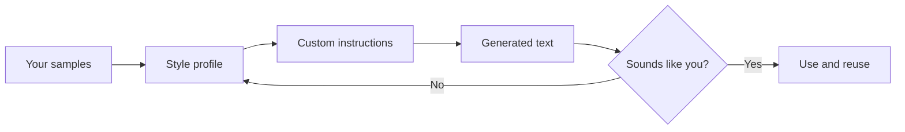
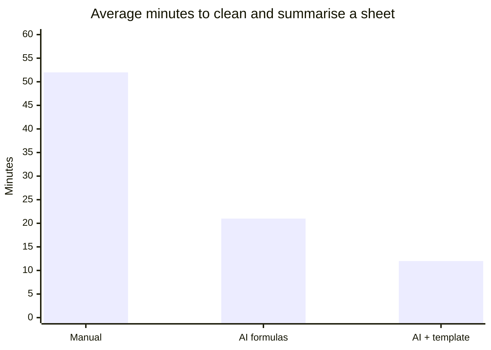

# Session 5 · Prompting in Apps: Spreadsheets, Personal Style and Comparisons

[](https://colab.research.google.com/github/Hamnakhan123/Generative-AI/blob/main/01-prompt-engineering/code/session-05-prompting-in-apps-sheets-and-style.ipynb)

> 🧭 [Generative AI](../README.md) › [Track 1 · Prompt Engineering](README.md) › **Session 5**
>
> ⏱️ **Estimated time:** 2 hours · 📋 **Prerequisites:** Previous session

[⬅ Previous](session-04-case-studies-content-and-social-media.md) · [🏠 Track home](README.md) · [Next ➡](session-06-comparing-ai-assistants.md)

---

## 🎯 Learning objectives

- Use AI prompts to **organise, clean and improve spreadsheets** (Google Sheets / Excel).
- Ask for and apply **formulas, formatting and charts** with AI help.
- "Train" an assistant on **your own writing style** with custom instructions and samples.
- Run structured **item comparisons** with clear criteria and tables.

## 📖 Concepts

### 1. What AI can do inside spreadsheets

| Task | Prompt example | Typical result |
|---|---|---|
| Clean text | "Give me a formula to trim spaces and fix capitalisation in column A." | `=PROPER(TRIM(A2))` |
| Remove duplicates | "How do I remove duplicate students by name and class?" | Menu steps / `UNIQUE()` |
| Categorise | "Formula: 'At risk' if attendance % < 75 else 'OK'." | `=IF(E2<75,"At risk","OK")` |
| Lookups | "Fetch each student's email from the Roster sheet by ID." | `=XLOOKUP(A2,Roster!A:A,Roster!C:C)` |
| Summaries | "Average attendance per class." | `=AVERAGEIF(B:B,"BSCS-1",E:E)` or a pivot table |
| Formatting | "Highlight rows below 75% in red." | Conditional formatting rule |
| Charts | "Which chart shows monthly trend best?" | Line chart with steps |

> 💡 Always **describe your columns** in the prompt: "Column A = Name, B = Class, C = Attended, D = Total". Formulas fail when the model guesses the layout.

### 2. The spreadsheet prompt formula

**Layout + goal + constraint + tool.** Example: *"My sheet has A=Name, B=Class, C=Attended, D=Total (rows 2–200). Give a Google Sheets formula for E2 that shows attendance % rounded to 1 decimal, and explain it in one line."*

### 3. Training an assistant on your style

Models do not permanently learn from one chat, but you can make them **write like you**:

1. **Collect** 3–5 samples of your real writing.
2. **Extract** a style profile: sentence length, formality, favourite phrases, sign-off, emoji use.
3. **Save** it as *custom instructions* (or a reusable priming prompt, or a custom GPT/gem).
4. **Test & refine**: compare a generated message with your own and adjust.

### 4. Structured comparisons

Comparisons go wrong when criteria are vague. Always give: the **items**, the **criteria**, the **user's situation**, and the **output format** (table + recommendation). Ask the model to say "unknown" instead of guessing specs, and verify prices/specs from official sources.

## 🧭 Diagrams





## 💻 Worked examples

### Example 1 — Prompt for a messy attendance sheet

```text
I have a Google Sheet: A=Name, B=Class, C=Attended, D=Total, rows 2-200.
Problems: extra spaces, mixed capitals, duplicates, some "n/a" in Attended.
Give me step-by-step fixes using formulas or menus, then a formula for attendance %, and a rule
to highlight students below 75%. Keep each step to one line.
```

**Sample output (shortened):**

```text
1. Helper column F: =PROPER(TRIM(A2))  → copy down, paste values over A.
2. Data ▸ Data cleanup ▸ Remove duplicates (columns A and B).
3. Attended as number: =IFERROR(VALUE(C2),0)
4. Attendance %: =ROUND(C2/D2*100,1)
5. Format ▸ Conditional formatting ▸ Custom formula =$E2<75 ▸ red fill.
```

### Example 2 — The same cleaning in Python (pandas)

Each pandas line is commented with its spreadsheet equivalent. Note "n/a" becomes 0, which we would flag for follow-up rather than assume.

```python
# file: session-05_clean_sheet.py
"""An assistant was asked: 'Clean this messy attendance sheet and summarise it.'
Below is the kind of pandas code it suggests (the same steps map to Google Sheets functions)."""
import pandas as pd

raw = pd.DataFrame({
    "Name": [" ali khan", "SARA AHMED", "Bilal  Raza", "sara ahmed", "Hina Shah", None],
    "Class": ["BSCS-1", "bscs-1", "BSCS-2", "BSCS-1", "BSCS-2", "BSCS-1"],
    "Attended": ["14", "16", "9", "16", "n/a", "12"],
    "Total": [16, 16, 16, 16, 16, 16],
})
df = raw.dropna(subset=["Name"]).copy()                       # = FILTER out blanks
df["Name"] = df["Name"].str.split().str.join(" ").str.title()  # = PROPER(TRIM())
df["Class"] = df["Class"].str.upper()                         # = UPPER()
df = df.drop_duplicates(subset=["Name", "Class"])              # = Data > Remove duplicates
df["Attended"] = pd.to_numeric(df["Attended"], errors="coerce").fillna(0).astype(int)
df["Attendance %"] = (df["Attended"] / df["Total"] * 100).round(1)
df["Status"] = df["Attendance %"].apply(lambda p: "OK" if p >= 75 else "At risk")  # = IF()
print(df.to_string(index=False))
print("\nClass averages:")
print(df.groupby("Class")["Attendance %"].mean().round(1).to_string())
```

**Output**

```text
      Name  Class  Attended  Total  Attendance %  Status
  Ali Khan BSCS-1        14     16          87.5      OK
Sara Ahmed BSCS-1        16     16         100.0      OK
Bilal Raza BSCS-2         9     16          56.2 At risk
 Hina Shah BSCS-2         0     16           0.0 At risk

Class averages:
Class
BSCS-1    93.8
BSCS-2    28.1
```

### Example 3 — Extracting your style profile

```python
# file: session-05_style_profile.py
"""'Train' an assistant on your style: extract a style profile from your own writing samples
and paste it into custom instructions."""
import re, statistics
samples = [
    "Quick update: the lab is moved to Room 4. Bring your laptops. Thanks!",
    "Reminder - quiz on Friday. Chapters 3 and 4 only. Good luck, you've got this!",
    "Assignment deadline extended to Monday. Please submit on the portal. Thanks!",
]
sentences = [s for t in samples for s in re.split(r"(?<=[.!?])\s+", t) if s]
words = [w for t in samples for w in re.findall(r"[A-Za-z']+", t)]
profile = {
    "avg_sentence_words": round(statistics.mean(len(s.split()) for s in sentences), 1),
    "exclamations_per_msg": round(sum(t.count("!") for t in samples) / len(samples), 2),
    "uses_contractions": any("'" in w for w in words),
    "common_signoff": max(set(t.split()[-1] for t in samples), key=lambda x: sum(t.endswith(x) for t in samples)),
}
print("Style profile:", profile)
print("\nCustom-instruction prompt:\n"
      f"Write like me: short sentences (~{profile['avg_sentence_words']} words), friendly and direct, "
      f"about {profile['exclamations_per_msg']} exclamation per message, "
      f"{'use' if profile['uses_contractions'] else 'avoid'} contractions, end with '{profile['common_signoff']}'.")
```

**Output**

```text
Style profile: {'avg_sentence_words': 4.3, 'exclamations_per_msg': 1.0, 'uses_contractions': True, 'common_signoff': 'Thanks!'}

Custom-instruction prompt:
Write like me: short sentences (~4.3 words), friendly and direct, about 1.0 exclamation per message, use contractions, end with 'Thanks!'.
```

**Sample output** when this instruction is given and you ask for "Tell students the class is cancelled tomorrow":

```text
Heads up: no class tomorrow. Use the time to revise Chapter 5. Thanks!
```

### Example 4 — Item comparison prompt

```text
Compare these laptops for a CS student on a Rs 250,000 budget who codes and runs small ML models:
Laptop A, Laptop B, Laptop C.
Criteria: CPU, RAM (upgradeable?), GPU, battery, weight, price, warranty in Pakistan.
Output: Markdown table, then a 3-line recommendation. Write "unknown" for any spec you are not sure of.
```

**Sample output structure:**

| Criteria | Laptop A | Laptop B | Laptop C |
|---|---|---|---|
| RAM | 16 GB, upgradeable | 16 GB, soldered | 8 GB, upgradeable |
| GPU | Integrated | Entry dedicated | Integrated |
| Battery | ~9 h | ~6 h | unknown |

*Recommendation: B for ML work; A if portability and upgrades matter more.* (Verify all specs on the official sites.)

## 📊 Time saved with AI help (sample of 12 students, cleaning a 200-row sheet)



## 🧪 Lab / practice tasks

**Task 1 · 🟢 Easy** — Create a 10-row messy marks sheet and ask an assistant for formulas to compute total, percentage and grade (A/B/C/F).

<details><summary>💡 Hint</summary>

Describe columns explicitly. For grades ask for nested IF or IFS.

</details>

**Task 2 · 🟢 Easy** — Ask for a conditional-formatting rule that colours grades: A green, F red.

<details><summary>💡 Hint</summary>

Use "Custom formula is" with `=$G2="A"`.

</details>

**Task 3 · 🟡 Medium** — Write a style profile from 3 of your own messages and save it as custom instructions. Generate two new messages and rate the match 1–5.

<details><summary>💡 Hint</summary>

Look at sentence length, greetings, sign-off and emoji habits.

</details>

**Task 4 · 🟡 Medium** — Run a comparison of 3 mobile data packages for a student who mainly streams lectures. Verify prices yourself.

<details><summary>💡 Hint</summary>

Criteria: data volume, validity, price per GB, night bundles.

</details>

**Task 5 · 🔴 Challenge** — Extend `session-05_clean_sheet.py` to export the cleaned table to CSV and add a column flagging rows where "n/a" was replaced.

<details><summary>💡 Hint</summary>

Keep a boolean column created before `to_numeric`; use `df.to_csv('clean.csv', index=False)`.

</details>


## ✅ Quick quiz

**Q1. Which formula removes extra spaces and capitalises names?**

- A) =UPPER(A2)
- B) =PROPER(TRIM(A2))
- C) =LEN(A2)
- D) =SUM(A2)

<details><summary>Show answer</summary>

✅ **B) =PROPER(TRIM(A2))** — TRIM removes spaces; PROPER capitalises each word.

</details>

**Q2. Why describe column layout in a spreadsheet prompt?**

- A) It is polite
- B) The model otherwise guesses cell references and formulas break
- C) It reduces file size
- D) Sheets requires it

<details><summary>Show answer</summary>

✅ **B) The model otherwise guesses cell references and formulas break** — Clear layout = correct references.

</details>

**Q3. Making an assistant "write like you" is best done with...**

- A) One random prompt
- B) Samples + style profile + custom instructions
- C) Increasing temperature
- D) Deleting chat history

<details><summary>Show answer</summary>

✅ **B) Samples + style profile + custom instructions** — Give concrete evidence of your style.

</details>

**Q4. In a comparison prompt, what should the model do for specs it is unsure of?**

- A) Guess
- B) Write "unknown"
- C) Skip the table
- D) Use the highest value

<details><summary>Show answer</summary>

✅ **B) Write "unknown"** — Prevents hallucinated specs.

</details>

**Q5. =IF(E2<75,"At risk","OK") returns what for 80?**

- A) At risk
- B) OK
- C) 80
- D) Error

<details><summary>Show answer</summary>

✅ **B) OK** — 80 is not below 75.

</details>


## 📝 Summary / cheat-sheet

- Spreadsheet prompt = **layout + goal + constraint + tool**.
- Key formulas: `TRIM`, `PROPER`, `IF/IFS`, `XLOOKUP`, `AVERAGEIF`, `UNIQUE`, conditional formatting.
- Style training = samples → profile → custom instructions → test.
- Comparisons: items + criteria + situation + format; "unknown" beats guessing.

**Viva / interview questions**

1. How would you prompt an AI to build a grade calculator in Google Sheets?
2. What is the difference between a formula and a pivot table summary?
3. Explain how custom instructions personalise an assistant.
4. Why should AI-provided product specs be verified?
5. Give two risks of pasting real student data into public AI tools, and how to reduce them.

---

[⬅ Previous](session-04-case-studies-content-and-social-media.md) · [🏠 Track home](README.md) · [Next ➡](session-06-comparing-ai-assistants.md)

<sub>Prepared by **Hamna Zahid Khan**, Junior Lecturer</sub>
