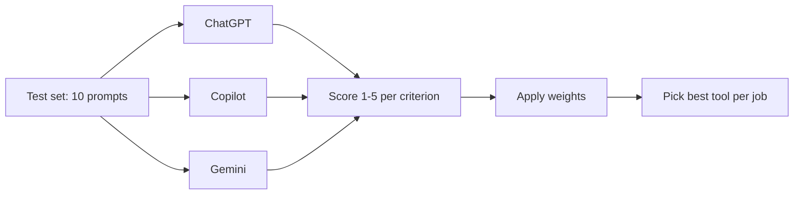
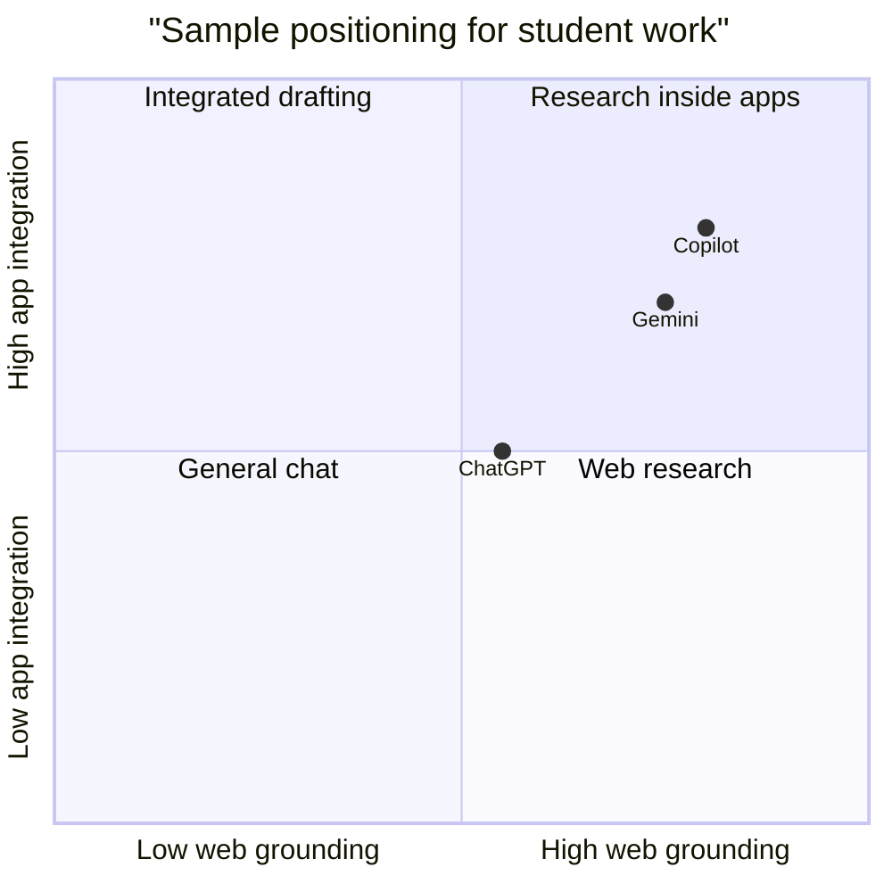
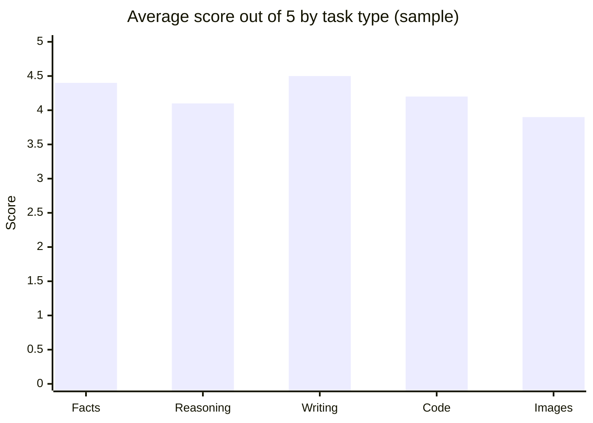

# Session 6 · Comparing AI Assistants: ChatGPT, Copilot and Gemini

[](https://colab.research.google.com/github/Hamnakhan123/Generative-AI/blob/main/01-prompt-engineering/code/session-06-comparing-ai-assistants.ipynb)

> 🧭 [Generative AI](../README.md) › [Track 1 · Prompt Engineering](README.md) › **Session 6**
>
> ⏱️ **Estimated time:** 2 hours · 📋 **Prerequisites:** Previous session

[⬅ Previous](session-05-prompting-in-apps-sheets-and-style.md) · [🏠 Track home](README.md) · [Next ➡](session-07-text-to-visual-art.md)

---

## 🎯 Learning objectives

- Set up and navigate **Microsoft Copilot** and use its conversation styles / modes.
- Use **Google Gemini** fundamentals, including Workspace integration.
- Create images from text inside chat assistants.
- Compare assistants fairly using a **test set and a weighted decision matrix**.

## 📖 Concepts

### 1. Copilot: setup and layout

**Microsoft Copilot** is available on the web, in the Edge sidebar, in Windows and inside Microsoft 365 apps. Its layout typically has: a chat box, suggested prompts, **source citations** under answers, an image-creation feature and a history panel. Because it searches the web, it is strong for **current information with references**.

**Modes / tones.** Copilot has offered different response styles over time (e.g. more creative, more balanced, more precise, or a quick vs. deep "think" option). The idea is the same as temperature: precise for facts, creative for ideation. Check what your current version offers.

### 2. Gemini fundamentals

**Google Gemini** works on the web and mobile and connects to Google services. Useful features: grounding with Google Search, a "double-check" option to verify statements, extensions/apps for Gmail, Drive, Docs and Maps, image understanding (upload a photo and ask about it), and image generation.

### 3. Comparing items with an assistant

Use the same comparison prompt in each tool and look at **accuracy, recency, citations and formatting**. Web-grounded tools usually do better on prices and news; all tools need verification.

### 4. Image and photo creation in chat assistants

Modern chat assistants include image generators. Prompt structure: **subject + setting + style + lighting + composition + aspect ratio**. Most assistants then allow conversational edits ("make it night time", "add rain").

### 5. A fair comparison method

1. Write a **test set** of 8–10 prompts covering your real needs (facts, reasoning, writing, code, image).
2. Run each prompt **once in each tool** on the same day.
3. Score each answer 1–5 on agreed **criteria**.
4. Weight criteria by importance and compute a **weighted score**.
5. Choose per **job**, not one winner for everything.

| Criterion | What to check |
|---|---|
| Accuracy | Facts correct? Reasoning valid? |
| Citations | Sources provided and real? |
| Speed | Time to useful answer |
| Integration | Works inside the apps you use? |
| Cost | Free tier limits, subscription price |
| Privacy | Data retention and training settings |

## 🧭 Diagrams





*(Positions are a sample class judgement, not official data.)*

## 💻 Worked examples

### Example 1 — Comparison prompt used in all three tools

```text
I am a university student in Karachi choosing between three note-taking apps: Notion, OneNote and Google Keep.
Compare them on: price (free tier), offline use, handwriting support, collaboration, export options.
Output: Markdown table with a source link for each price claim, then a 2-line recommendation.
```

**Sample observation sheet (what students typically record):**

| Tool | Table correct? | Gave sources? | Notes |
|---|---|---|---|
| ChatGPT | Mostly | Only when browsing was on | Clear recommendation |
| Copilot | Mostly | Yes, inline citations | Slightly longer |
| Gemini | Mostly | Yes, plus "double-check" | Linked Google docs |

### Example 2 — Image creation prompt

```text
Create an image: a cosy university library at sunset, students studying at wooden tables,
warm golden light through tall windows, soft watercolour style, wide 16:9 composition, no text.
```

Follow-up edits: *"Same scene at night with desk lamps."* → *"Add a cat sleeping on a bookshelf."*

### Example 3 — A weighted decision matrix in Python

```python
# file: session-06_assistant_matrix.py
"""Weighted decision matrix for choosing an AI assistant for a specific job.
Scores (1-5) are a SAMPLE class evaluation; re-score them with your own tests."""
criteria = {"accuracy": 0.30, "citations": 0.25, "speed": 0.15, "integration": 0.20, "cost": 0.10}
scores = {
    "ChatGPT": {"accuracy": 5, "citations": 3, "speed": 4, "integration": 3, "cost": 3},
    "Copilot": {"accuracy": 4, "citations": 5, "speed": 4, "integration": 5, "cost": 4},
    "Gemini":  {"accuracy": 4, "citations": 4, "speed": 5, "integration": 4, "cost": 4},
}
print(f"{'Tool':8} " + " ".join(f"{c[:5]:>6}" for c in criteria) + "   weighted")
results = {}
for tool, s in scores.items():
    total = sum(s[c] * w for c, w in criteria.items())
    results[tool] = total
    print(f"{tool:8} " + " ".join(f"{s[c]:>6}" for c in criteria) + f"   {total:.2f}")
best = max(results, key=results.get)
print(f"\nBest fit for a 'research report with sources' job: {best} ({results[best]:.2f}/5)")
```

**Output**

```text
Tool      accur  citat  speed  integ   cost   weighted
ChatGPT       5      3      4      3      3   3.75
Copilot       4      5      4      5      4   4.45
Gemini        4      4      5      4      4   4.15

Best fit for a 'research report with sources' job: Copilot (4.45/5)
```

**How the weighted score is computed for Copilot:** 4×0.30 + 5×0.25 + 4×0.15 + 5×0.20 + 4×0.10 = 1.20 + 1.25 + 0.60 + 1.00 + 0.40 = **4.45**.

### Example 4 — Gemini with Workspace (walkthrough)

1. Open Gemini and enable the Google Workspace extension/app.
2. Prompt: *"Find the email from the exam office about the date sheet and summarise the dates in a table."*
3. Prompt: *"Create a study plan in a Google Doc for these dates."*
4. Review the doc; correct any misread dates.

## 📊 Sample class results (10-prompt test set)



## 🧪 Lab / practice tasks

**Task 1 · 🟢 Easy** — Ask Copilot and Gemini the same current-events question. Check whether the cited sources actually support the answer.

<details><summary>💡 Hint</summary>

Open at least two cited links and look for the exact claim.

</details>

**Task 2 · 🟢 Easy** — Generate the same image prompt in two assistants and compare composition, style accuracy and text artefacts.

<details><summary>💡 Hint</summary>

Use the subject + setting + style + lighting + composition + ratio structure.

</details>

**Task 3 · 🟡 Medium** — Build a 6-prompt test set for your own studies and score three assistants with the matrix.

<details><summary>💡 Hint</summary>

Include one fact, one reasoning, one writing, one code, one summary and one image prompt.

</details>

**Task 4 · 🟡 Medium** — Change the weights in `session-06_assistant_matrix.py` for a "creative writing" job and see if the winner changes.

<details><summary>💡 Hint</summary>

Increase accuracy/creativity weight, lower citations.

</details>

**Task 5 · 🔴 Challenge** — Write a one-page recommendation memo for your department: which assistant to use for which job, with your evidence table.

<details><summary>💡 Hint</summary>

Structure: purpose, method, results table, recommendation, risks (privacy, cost).

</details>


## ✅ Quick quiz

**Q1. A key strength of web-grounded assistants is...**

- A) Offline use
- B) Current information with citations
- C) No need to verify
- D) Unlimited tokens

<details><summary>Show answer</summary>

✅ **B) Current information with citations** — They search the web and cite sources.

</details>

**Q2. In a fair comparison you should...**

- A) Use different prompts for each tool
- B) Use the same test prompts and criteria
- C) Only test one prompt
- D) Ask friends for opinions

<details><summary>Show answer</summary>

✅ **B) Use the same test prompts and criteria** — Same inputs, same rubric.

</details>

**Q3. Weighted score of scores [5,3] with weights [0.6,0.4] is...**

- A) 4.2
- B) 4.0
- C) 3.8
- D) 8

<details><summary>Show answer</summary>

✅ **A) 4.2** — 5×0.6 + 3×0.4 = 3.0 + 1.2 = 4.2.

</details>

**Q4. Gemini's Workspace integration lets you...**

- A) Edit Windows settings
- B) Work with Gmail, Docs and Drive content
- C) Train your own model
- D) Remove ads

<details><summary>Show answer</summary>

✅ **B) Work with Gmail, Docs and Drive content** — Extensions connect Google apps.

</details>

**Q5. Which element is NOT part of the image prompt structure taught here?**

- A) Subject
- B) Lighting
- C) Aspect ratio
- D) Password

<details><summary>Show answer</summary>

✅ **D) Password** — Subject, setting, style, lighting, composition, ratio.

</details>


## 📝 Summary / cheat-sheet

- **Copilot:** web-grounded, citations, Microsoft 365, modes for precise vs. creative.
- **Gemini:** Google Search grounding, double-check, Workspace apps, image understanding.
- **Images:** subject + setting + style + lighting + composition + ratio, then iterate in chat.
- **Fair comparison:** same test set, rubric, weights → best tool *per job*.

**Viva / interview questions**

1. How would you decide which assistant your team should use for research reports?
2. What is the value of citations and how do you verify them?
3. Explain a weighted decision matrix with an example.
4. What privacy settings would you check before using an assistant with university data?
5. Why might the "best" assistant differ between tasks?

---

[⬅ Previous](session-05-prompting-in-apps-sheets-and-style.md) · [🏠 Track home](README.md) · [Next ➡](session-07-text-to-visual-art.md)

<sub>Prepared by **Hamna Zahid Khan**, Junior Lecturer</sub>
