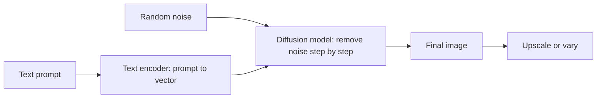
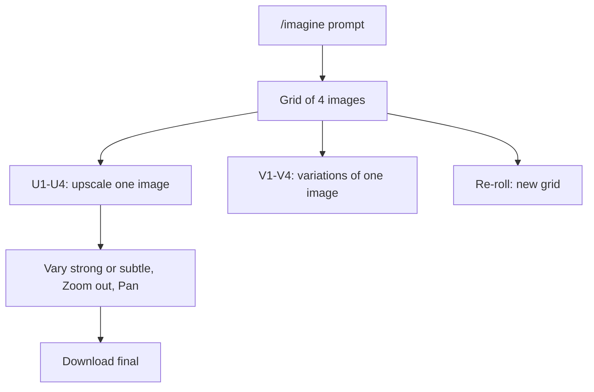
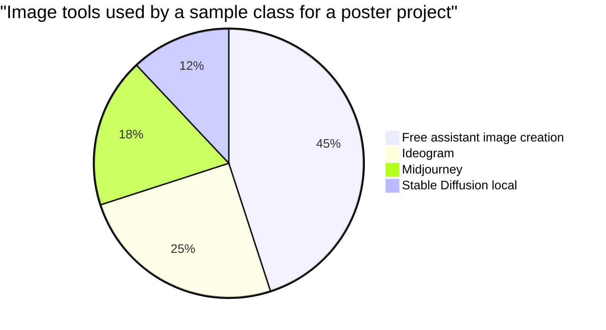

# Session 7 · Transforming Text into Visual Art

[](https://colab.research.google.com/github/Hamnakhan123/Generative-AI/blob/main/01-prompt-engineering/code/session-07-text-to-visual-art.ipynb)

> 🧭 [Generative AI](../README.md) › [Track 1 · Prompt Engineering](README.md) › **Session 7**
>
> ⏱️ **Estimated time:** 2 hours · 📋 **Prerequisites:** Previous session

[⬅ Previous](session-06-comparing-ai-assistants.md) · [🏠 Track home](README.md) · [Next ➡](session-08-image-generation-settings.md)

---

## 🎯 Learning objectives

- Explain how **text-to-image models** turn words into pictures (diffusion in plain language).
- Describe **Midjourney**: what it is, how accounts and the web/Discord interfaces work.
- Name **free alternatives** and choose one for a project.
- Use the core **command list and prompt parameters** (`/imagine`, `--ar`, `--stylize`, `--no`, `--seed`, `--v`).
- Write structured image prompts using a repeatable formula.

## 📖 Concepts

### 1. How text-to-image works (no maths)

Most image generators are **diffusion models**. During training, the model learns to remove noise from millions of captioned images. At generation time it starts with **pure random noise** and, guided by your text, removes noise step by step until an image appears. Your prompt is converted into a numerical "meaning" vector that steers each de-noising step.

> 🎨 Analogy: a sculptor sees a vague block of marble (noise) and, guided by the brief (prompt), chips away until a statue (image) appears.

### 2. Midjourney in a nutshell

**Midjourney** is a paid image-generation service known for artistic, high-quality results. You can use it through its **web app** or through **Discord** (a chat platform), where you type `/imagine` followed by your prompt. Each job returns a **grid of four variations**; you can then upscale (U), create variations (V), remix, pan or zoom.

**Account setup (walkthrough):**

1. Create/sign in to an account on the official website (and Discord if using that interface).
2. Choose a subscription plan (Midjourney has no permanent free tier; check current plans).
3. Use the web "Imagine" bar or join a newbie channel / DM the bot on Discord.
4. Type `/imagine prompt: …` and wait for the 4-image grid.
5. Check **privacy**: on most plans, generations are public in the gallery unless you use a stealth/private mode.

### 3. Free and freemium alternatives

| Tool | Access | Strength |
|---|---|---|
| Microsoft Designer / Copilot image creation | Free with account (daily boosts) | Easy, good quality |
| Google Gemini / ImageFX | Free with account | Photorealism, quick edits |
| Ideogram | Freemium | Excellent **text inside images** (posters, logos) |
| Leonardo AI | Freemium daily credits | Game assets, fine control |
| Stable Diffusion (local, e.g. via ComfyUI / Automatic1111) | Free, needs a GPU | Full control, open models |
| Canva Magic Media / Adobe Firefly | Freemium | Commercially safer training data (Firefly), design integration |

### 4. Core commands and parameters

| Command / parameter | Purpose | Example |
|---|---|---|
| `/imagine` | Generate images from a prompt | `/imagine prompt: a lighthouse at dawn` |
| `/describe` | Upload an image, get suggested prompts | Reverse-engineer a style |
| `/blend` | Merge 2–5 images | Combine a pet photo with a painting style |
| `/settings` | Default version, style, speed | Set raw mode, stylize level |
| `--ar W:H` | Aspect ratio | `--ar 16:9` |
| `--stylize N` / `--s` | How strongly the house style applies (low = literal, high = artistic) | `--s 50` vs `--s 750` |
| `--chaos N` | Variety between the 4 results | `--chaos 40` |
| `--no X` | Negative prompt: exclude things | `--no text, watermark` |
| `--seed N` | Reuse the starting noise for similar results | `--seed 4821` |
| `--v N` | Model version | `--v 6` |
| `--q`, `--tile`, `--weird` | Quality, seamless tiles, unusual looks | Pattern design with `--tile` |

> Parameter names and ranges vary between versions; check the official docs for your version.

### 5. The image prompt formula

**Subject → Setting → Style/medium → Lighting/colour → Camera/composition → Parameters**

Weak: `cat`
Strong: `a ginger cat sleeping on a stack of old books, cosy study room, oil painting, warm lamplight, close-up, shallow depth of field --ar 4:5 --s 250`

## 🧭 Diagrams





## 💻 Worked examples

### Example 1 — Building prompts from parts (Python)

```python
# file: session-07_image_prompt_builder.py
"""Compose image-generation prompts from parts, Midjourney-style parameters included."""
def image_prompt(subject, setting="", style="", lighting="", camera="", ar="1:1", stylize=None, no=None, version=None):
    core = ", ".join(x for x in [subject, setting, style, lighting, camera] if x)
    params = [f"--ar {ar}"]
    if stylize is not None: params.append(f"--stylize {stylize}")
    if no: params.append(f"--no {no}")
    if version: params.append(f"--v {version}")
    return f"{core} {' '.join(params)}"

prompts = [
    image_prompt("a red vintage rickshaw", "busy Karachi street at dusk", "cinematic photo",
                 "neon reflections on wet road", "35mm lens, shallow depth of field", ar="16:9", stylize=250),
    image_prompt("minimal logo of a steaming chai cup", style="flat vector, two colours",
                 ar="1:1", no="text, gradients"),
    image_prompt("portrait of an elderly fisherman", "Gwadar harbour", "oil painting",
                 "golden hour", ar="4:5", stylize=600),
]
for i, p in enumerate(prompts, 1):
    print(f"{i}. /imagine prompt: {p}\n")
```

**Output**

```text
1. /imagine prompt: a red vintage rickshaw, busy Karachi street at dusk, cinematic photo, neon reflections on wet road, 35mm lens, shallow depth of field --ar 16:9 --stylize 250

2. /imagine prompt: minimal logo of a steaming chai cup, flat vector, two colours --ar 1:1 --no text, gradients

3. /imagine prompt: portrait of an elderly fisherman, Gwadar harbour, oil painting, golden hour --ar 4:5 --stylize 600
```

### Example 2 — Stylize comparison (template)

```text
/imagine prompt: a teacup on a wooden table, morning light --ar 1:1 --s 50
/imagine prompt: a teacup on a wooden table, morning light --ar 1:1 --s 750
```

**Sample observation:** `--s 50` gives a plain, product-photo look that follows the prompt literally; `--s 750` adds dramatic composition, extra props and painterly colour that you did not ask for.

### Example 3 — Poster with text in a free alternative

```text
A minimalist event poster, large bold headline text "TECH WEEK 2026", subtitle "Talks · Workshops · Hackathon",
dark violet background with orange geometric shapes, clean sans-serif typography, centred layout, 2:3 portrait
```

**Tip:** tools such as Ideogram render short text far more reliably. Keep text short and put it in quotes.

### Example 4 — Reverse-engineering a style with /describe (walkthrough)

1. Upload a reference image you have rights to use.
2. Run `/describe` → you receive four suggested prompts.
3. Combine the useful style words with **your own subject**.
4. Generate and compare. Never claim a living artist's style as your own work; describe the style in neutral terms (e.g. "bold ink linework, flat pastel colours").

## 📊 Choosing a tool

| Need | Suggested tool type |
|---|---|
| Artistic concept art | Midjourney, Leonardo |
| Text on posters/logos | Ideogram |
| Free, quick, decent | Copilot/Designer, Gemini |
| Full control / offline | Stable Diffusion locally |
| Commercial-safety focus | Adobe Firefly |



## 🧪 Lab / practice tasks

**Task 1 · 🟢 Easy** — Turn the weak prompt "a house" into a strong prompt using all six parts of the formula, then generate it in any free tool.

<details><summary>💡 Hint</summary>

Example: "a mud-brick house in a Thar desert village, ... watercolour, sunset, wide shot, 16:9".

</details>

**Task 2 · 🟢 Easy** — Create the same image at 1:1, 16:9 and 9:16. Note what the model adds or crops.

<details><summary>💡 Hint</summary>

Wide ratios add scenery to the sides; tall ratios stack sky/foreground.

</details>

**Task 3 · 🟡 Medium** — Run one prompt with low and high stylize (or "creativity") settings and write 3 differences.

<details><summary>💡 Hint</summary>

If your tool lacks stylize, compare "photorealistic, simple" vs "highly artistic, dramatic".

</details>

**Task 4 · 🟡 Medium** — Use a negative prompt to remove a recurring unwanted element (text, extra hands, watermark).

<details><summary>💡 Hint</summary>

Midjourney uses `--no`; other tools have a "negative prompt" field.

</details>

**Task 5 · 🔴 Challenge** — Design a 4-image mood board for a café brand with a consistent palette and style. Present the prompts and a one-paragraph rationale.

<details><summary>💡 Hint</summary>

Lock palette, medium and lighting words; vary subject (cup, interior, pastry, sign).

</details>


## ✅ Quick quiz

**Q1. Diffusion models generate images by...**

- A) Copying a stored image
- B) Gradually removing noise guided by the prompt
- C) Drawing vectors only
- D) Searching Google Images

<details><summary>Show answer</summary>

✅ **B) Gradually removing noise guided by the prompt** — They de-noise random noise step by step.

</details>

**Q2. Which parameter sets aspect ratio in Midjourney?**

- A) --seed
- B) --ar
- C) --no
- D) --chaos

<details><summary>Show answer</summary>

✅ **B) --ar** — e.g. --ar 16:9.

</details>

**Q3. What does --no do?**

- A) Disables the model
- B) Excludes elements from the image
- C) Removes the watermark from all images
- D) Turns off upscaling

<details><summary>Show answer</summary>

✅ **B) Excludes elements from the image** — It acts as a negative prompt.

</details>

**Q4. Which tool is especially good at readable text inside images?**

- A) Ideogram
- B) Excel
- C) Discord
- D) Zapier

<details><summary>Show answer</summary>

✅ **A) Ideogram** — It is known for typography.

</details>

**Q5. Reusing the same seed mainly helps...**

- A) Increase resolution
- B) Get more similar, reproducible results
- C) Lower cost
- D) Add text

<details><summary>Show answer</summary>

✅ **B) Get more similar, reproducible results** — Same starting noise → similar outputs.

</details>


## 📝 Summary / cheat-sheet

- Diffusion = noise → image, steered by your prompt.
- Midjourney: `/imagine`, grid of 4, **U** = upscale, **V** = variations.
- Key params: `--ar`, `--s`, `--chaos`, `--no`, `--seed`, `--v`.
- Formula: **Subject, Setting, Style, Lighting, Camera, Parameters**.
- Free alternatives exist; pick by need (text, control, commercial safety).

**Viva / interview questions**

1. Explain diffusion models to a non-technical client.
2. What is the difference between upscale and variation?
3. When would you raise or lower stylize?
4. How do you get readable text in an AI-generated poster?
5. What are the copyright and privacy considerations when using public image generators?

---

[⬅ Previous](session-06-comparing-ai-assistants.md) · [🏠 Track home](README.md) · [Next ➡](session-08-image-generation-settings.md)

<sub>Prepared by **Hamna Zahid Khan**, Junior Lecturer</sub>
