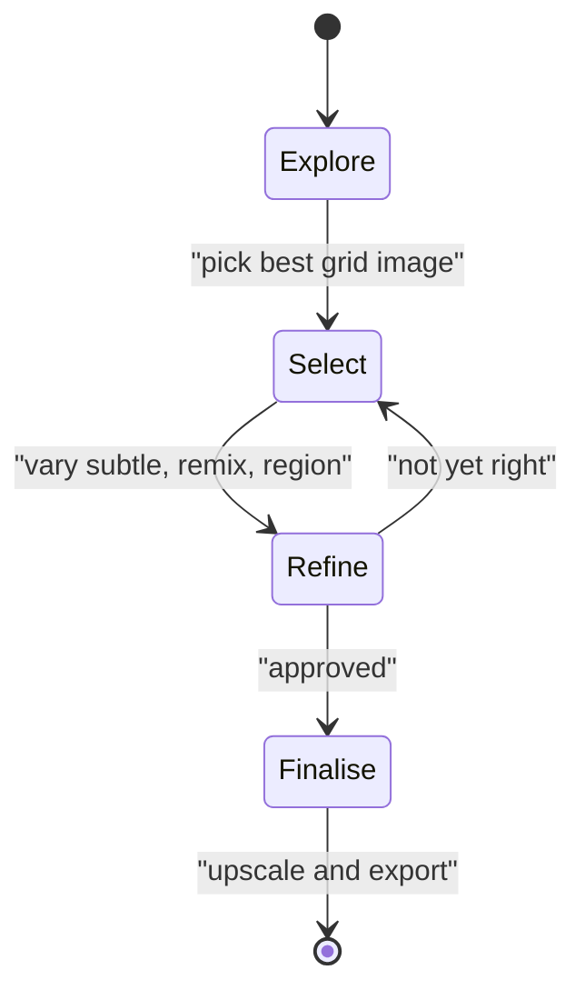
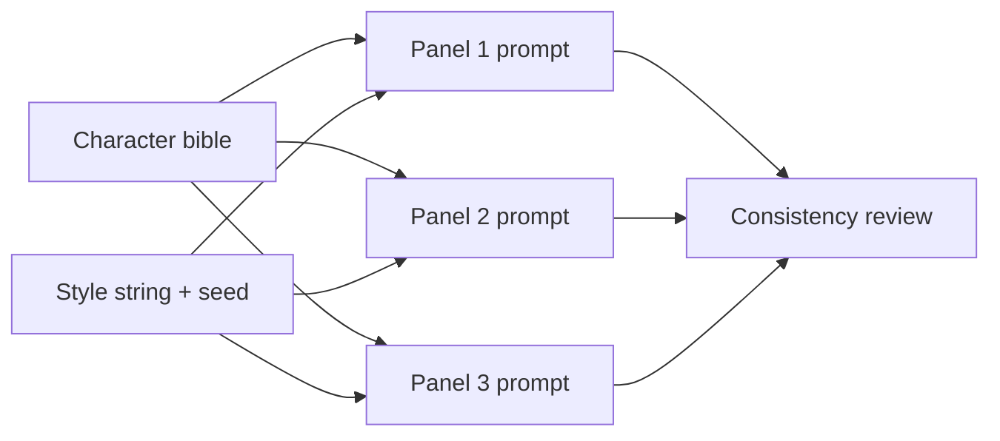
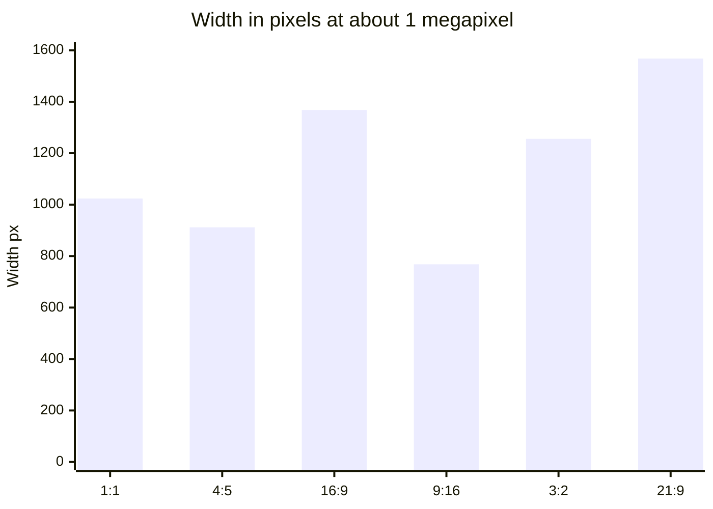

# Session 8 · Image Generation Settings: Iterate, Upscale, Remix, Aspect Ratio

[](https://colab.research.google.com/github/Hamnakhan123/Generative-AI/blob/main/01-prompt-engineering/code/session-08-image-generation-settings.ipynb)

> 🧭 [Generative AI](../README.md) › [Track 1 · Prompt Engineering](README.md) › **Session 8**
>
> ⏱️ **Estimated time:** 2 hours · 📋 **Prerequisites:** Previous session

[⬅ Previous](session-07-text-to-visual-art.md) · [🏠 Track home](README.md) · [Next ➡](session-09-advanced-prompting-strategies.md)

---

## 🎯 Learning objectives

- **Iterate** on a base image to strengthen visual storytelling.
- Use **upscaling, variations (strong/subtle), remix, zoom and pan** deliberately.
- Choose the right **aspect ratio** for each platform and compute output sizes.
- Create **consistent characters in bulk** for comics, story books or brand mascots.

## 📖 Concepts

### 1. Reiterating your base image

Your first grid is a **draft**, not the final. A professional workflow:

1. **Explore** — generate 2–3 grids with variations of the prompt.
2. **Select** — pick the image whose composition is closest to your goal.
3. **Refine** — vary subtly, remix the prompt, fix details with inpainting ("vary region").
4. **Finalise** — upscale and export at the right ratio.

### 2. The editing toolkit

| Tool | What it does | Use it when |
|---|---|---|
| **Upscale (Subtle / Creative)** | Increases resolution; creative upscale may add detail | Final export, print |
| **Vary (Subtle)** | Small changes, same composition | You love the layout but want polish |
| **Vary (Strong)** | Bigger changes, same idea | You need fresh options |
| **Vary (Region) / inpaint** | Regenerates a selected area | Fix hands, change an object |
| **Remix** | Edit the prompt while varying | Change "day" to "night", swap clothes |
| **Zoom out** | Expands the canvas outward | Reveal more scene |
| **Pan** | Extends in one direction | Make a banner wider |

### 3. Aspect ratio strategy

Aspect ratio changes **composition**, not just size. A 9:16 portrait invites full-body shots and vertical stacking; 21:9 invites panoramas. Decide the ratio **before** generating rather than cropping later.

### 4. Bulk character creation

To keep a character the same across many images:

- Write a **character bible**: name, age, hair, clothes, colours, distinctive item, expression.
- Keep a fixed **style string** (medium, line quality, palette).
- Reuse the **seed** and/or a **character reference image** feature where available.
- Change **only the scene/pose** each time.
- Do a **consistency review**: hair, colours, accessories, proportions.

## 🧭 Diagrams





## 💻 Worked examples

### Example 1 — Iteration log (template)

| Step | Prompt / action | Result | Decision |
|---|---|---|---|
| 1 | `/imagine` "old bookshop in Saddar, rainy evening, cinematic --ar 16:9" | Grid; #3 best composition | Select #3 |
| 2 | Vary (Subtle) on #3 | Better lighting | Keep |
| 3 | Remix: add "a girl in yellow raincoat at the door" | Character added | Keep |
| 4 | Vary (Region) on her face | Fixed distorted face | Keep |
| 5 | Upscale (Subtle) | 2× resolution | Export |

### Example 2 — Aspect ratios and pixel sizes (Python)

```python
# file: session-08_aspect_ratio.py
"""Aspect ratio -> pixel sizes, and what an upscale does to resolution."""
from math import gcd, sqrt
BASE_PIXELS = 1024 * 1024        # typical base image area (~1 megapixel)
uses = {"1:1": "profile pics, icons", "4:5": "Instagram portrait", "16:9": "YouTube thumbnail, slides",
        "9:16": "Reels/Shorts/Stories", "3:2": "classic photo print", "21:9": "cinematic banner"}
print(f"{'Ratio':6} {'Width':>6} x {'Height':<6} {'Upscaled 2x':>14}   Best for")
for ratio, use in uses.items():
    w, h = map(int, ratio.split(":"))
    scale = sqrt(BASE_PIXELS / (w * h))
    W, H = round(w * scale / 8) * 8, round(h * scale / 8) * 8   # snap to multiples of 8
    print(f"{ratio:6} {W:>6} x {H:<6} {W*2:>6} x {H*2:<6}   {use}")
w, h = 1920, 1080
g = gcd(w, h)
print(f"\n1920x1080 simplifies to {w//g}:{h//g}")
```

**Output**

```text
Ratio   Width x Height    Upscaled 2x   Best for
1:1      1024 x 1024     2048 x 2048     profile pics, icons
4:5       912 x 1144     1824 x 2288     Instagram portrait
16:9     1368 x 768      2736 x 1536     YouTube thumbnail, slides
9:16      768 x 1368     1536 x 2736     Reels/Shorts/Stories
3:2      1256 x 840      2512 x 1680     classic photo print
21:9     1568 x 672      3136 x 1344     cinematic banner

1920x1080 simplifies to 16:9
```

**Calculation check for 16:9:** area ≈ 1,048,576 px; width/height = 16/9 → height = √(1,048,576 × 9/16) ≈ 768, width ≈ 1365 → snapped to 1368.

### Example 3 — Remix prompt pair

```text
Original : a street food stall selling gol gappay, night market, neon lights, photoreal --ar 3:2
Remix to : a street food stall selling gol gappay, early morning, soft mist, photoreal --ar 3:2
```

**Sample observation:** layout and stall stay the same; lighting, colour temperature and crowd density change.

### Example 4 — Bulk character prompts (Python)

```python
# file: session-08_character_sheet.py
"""Bulk character creation: keep a fixed 'character bible' and vary only pose/scene.
Re-using the same seed (where the tool supports it) also helps consistency."""
character = ("Zara, 10-year-old girl, curly black hair in two puffs, round glasses, yellow raincoat, "
             "red sneakers, cheerful expression")
style = "children's book illustration, soft watercolour, white background"
seed = 4821
scenes = ["waving hello", "reading a book under a tree", "jumping in a puddle",
          "looking through a telescope at night", "sharing lunch with a friend"]
for n, scene in enumerate(scenes, 1):
    print(f"Panel {n}: {character}, {scene}, {style} --ar 3:2 --seed {seed}")
print(f"\nCharacter bible: {len(character.split(', '))} fixed traits reused across {len(scenes)} panels")
```

**Output**

```text
Panel 1: Zara, 10-year-old girl, curly black hair in two puffs, round glasses, yellow raincoat, red sneakers, cheerful expression, waving hello, children's book illustration, soft watercolour, white background --ar 3:2 --seed 4821
Panel 2: Zara, 10-year-old girl, curly black hair in two puffs, round glasses, yellow raincoat, red sneakers, cheerful expression, reading a book under a tree, children's book illustration, soft watercolour, white background --ar 3:2 --seed 4821
Panel 3: Zara, 10-year-old girl, curly black hair in two puffs, round glasses, yellow raincoat, red sneakers, cheerful expression, jumping in a puddle, children's book illustration, soft watercolour, white background --ar 3:2 --seed 4821
Panel 4: Zara, 10-year-old girl, curly black hair in two puffs, round glasses, yellow raincoat, red sneakers, cheerful expression, looking through a telescope at night, children's book illustration, soft watercolour, white background --ar 3:2 --seed 4821
Panel 5: Zara, 10-year-old girl, curly black hair in two puffs, round glasses, yellow raincoat, red sneakers, cheerful expression, sharing lunch with a friend, children's book illustration, soft watercolour, white background --ar 3:2 --seed 4821

Character bible: 7 fixed traits reused across 5 panels
```

**Consistency checklist** for the generated panels: ☐ two hair puffs ☐ round glasses ☐ yellow raincoat ☐ red sneakers ☐ same face shape ☐ same watercolour style.

## 📊 Platform ratio guide

| Platform / use | Ratio |
|---|---|
| Instagram feed portrait | 4:5 |
| Reels, Shorts, Stories, TikTok | 9:16 |
| YouTube thumbnail, slides | 16:9 |
| Profile picture, icon | 1:1 |
| Website hero banner | 21:9 or 3:1 |
| Printed photo | 3:2 |



## 🧪 Lab / practice tasks

**Task 1 · 🟢 Easy** — Generate one image and perform at least three iteration steps (vary, remix, upscale). Fill in an iteration log table.

<details><summary>💡 Hint</summary>

Change only one thing per step so you can see its effect.

</details>

**Task 2 · 🟢 Easy** — Compute pixel sizes for 2:3 and 5:4 at ~1 megapixel by editing `session-08_aspect_ratio.py`.

<details><summary>💡 Hint</summary>

Add the ratios to the `uses` dictionary.

</details>

**Task 3 · 🟡 Medium** — Fix a flaw (hands, eyes, text) using region variation or inpainting in any tool. Show before/after.

<details><summary>💡 Hint</summary>

Select a slightly larger area than the flaw and describe what should be there.

</details>

**Task 4 · 🟡 Medium** — Extend a square image into a 21:9 banner using pan/zoom-out or "generative expand".

<details><summary>💡 Hint</summary>

Describe what should appear in the new areas in the prompt.

</details>

**Task 5 · 🔴 Challenge** — Create a 6-panel mini story with one consistent character. Score consistency per panel (0–6 traits) and report the average.

<details><summary>💡 Hint</summary>

Use a character bible, fixed style and seed or character reference.

</details>


## ✅ Quick quiz

**Q1. Which tool keeps the composition but makes small changes?**

- A) Vary (Strong)
- B) Vary (Subtle)
- C) Zoom out
- D) New prompt

<details><summary>Show answer</summary>

✅ **B) Vary (Subtle)** — Subtle variation preserves layout.

</details>

**Q2. Remix allows you to...**

- A) Change the prompt while varying an image
- B) Delete the account
- C) Train a model
- D) Change file format

<details><summary>Show answer</summary>

✅ **A) Change the prompt while varying an image** — Edit prompt + vary.

</details>

**Q3. Best ratio for TikTok and Reels?**

- A) 16:9
- B) 1:1
- C) 9:16
- D) 21:9

<details><summary>Show answer</summary>

✅ **C) 9:16** — Vertical full-screen.

</details>

**Q4. What is a character bible?**

- A) A list of fixed traits used in every prompt
- B) A religious text
- C) A seed number only
- D) A Discord channel

<details><summary>Show answer</summary>

✅ **A) A list of fixed traits used in every prompt** — It keeps characters consistent.

</details>

**Q5. To fix a distorted hand only, use...**

- A) Upscale
- B) Vary (Region) / inpainting
- C) --chaos 100
- D) A new account

<details><summary>Show answer</summary>

✅ **B) Vary (Region) / inpainting** — Regenerate just that area.

</details>


## 📝 Summary / cheat-sheet

- Workflow: **Explore → Select → Refine → Finalise**.
- Subtle vs Strong variation; Region for fixes; Remix for prompt edits; Zoom/Pan to expand.
- Decide ratio first: 1:1, 4:5, 9:16, 16:9, 3:2, 21:9.
- Consistent characters: **bible + style string + seed/reference + vary scene only**.

**Viva / interview questions**

1. Describe your iteration workflow for a client's hero image.
2. When would you use Vary (Strong) instead of Subtle?
3. Why does aspect ratio affect composition?
4. How do you keep a mascot consistent across 20 images?
5. What is the difference between subtle and creative upscaling?

---

[⬅ Previous](session-07-text-to-visual-art.md) · [🏠 Track home](README.md) · [Next ➡](session-09-advanced-prompting-strategies.md)

<sub>Prepared by **Hamna Zahid Khan**, Junior Lecturer</sub>
