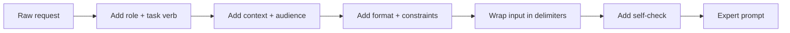
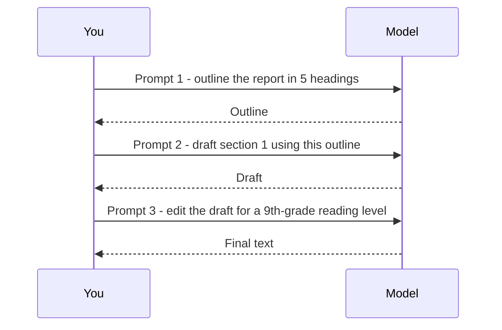

# Session 9 · Advanced Prompting Strategies and AI in Spreadsheets

[](https://colab.research.google.com/github/Hamnakhan123/Generative-AI/blob/main/01-prompt-engineering/code/session-09-advanced-prompting-strategies.ipynb)

> 🧭 [Generative AI](../README.md) › [Track 1 · Prompt Engineering](README.md) › **Session 9**
>
> ⏱️ **Estimated time:** 2 hours · 📋 **Prerequisites:** Previous session

[⬅ Previous](session-08-image-generation-settings.md) · [🏠 Track home](README.md) · [Next ➡](session-10-applied-prompting-and-prompt-tuning.md)

---

## 🎯 Learning objectives

- Apply **expert prompting strategies**: role, context, constraints, delimiters, step-by-step and self-check.
- Use **prompt chaining** to split a big job into reliable smaller prompts.
- **Lint** a prompt against a checklist and fix its weak spots.
- Use AI **inside spreadsheets** (an `=AI()`-style column) to classify, summarise and clean rows at scale.

## 📖 Concepts

### 1. The expert prompt checklist

Strong prompts are rarely clever; they are **complete**. Before you press Enter, check:

| Element | Question to ask | Example phrase |
|---|---|---|
| **Role** | Who should the model be? | "You are a university admissions officer." |
| **Task verb** | What exactly should it do? | "Summarise", "Compare", "Classify" |
| **Context** | What background does it need? | "Our students are first-year BBA, mostly from Karachi." |
| **Audience** | Who reads the output? | "for parents with no tech background" |
| **Format** | What shape should the answer have? | "a 3-column table", "JSON with keys …" |
| **Constraints** | Limits on length, tone, sources | "under 120 words, formal, no jargon" |
| **Delimiters** | Where does pasted input start and end? | `### TEXT ###` or `"""…"""` |
| **Self-check** | Should it verify before finishing? | "Before answering, check every figure against the table." |

### 2. Advanced strategies

- **Decomposition** — ask the model to list sub-questions first, then answer each.
- **Prompt chaining** — the output of prompt 1 becomes the input of prompt 2 (outline → draft → edit). Each step is small, testable and easy to fix.
- **Ask for questions first** — "Before you start, ask me up to 3 questions that would change your answer."
- **Reflection / self-critique** — "Review your draft against these criteria and rewrite the weakest part."
- **Negative instructions sparingly** — say what to do ("use simple words") more than what not to do.
- **Temperature awareness** — low temperature for facts and formulas, higher for brainstorming.

### 3. AI in spreadsheets

Google Sheets (Gemini / `=AI()` in supported workspaces), Excel (Copilot) and add-ons let one prompt run **once per row**. The pattern:

1. Put the **instruction** in a fixed cell (e.g. `$B$1`) so every row uses the same wording.
2. Reference the row's data: `=AI($B$1, A2)`.
3. Constrain the output to a **closed set** ("Positive, Negative or Mixed") so you can filter and chart it.
4. **Spot-check** 10–20 rows by hand before trusting the whole column.

> ⚠️ AI formulas can recalculate and change. Once you are happy, **copy → paste values** to freeze results.

## 🧭 Diagrams





## 💻 Worked examples

### Example 1 — Before and after

```text
BEFORE: Write about our new attendance app.

AFTER : You are a product marketer for a university IT team.
        Write 3 bullet points (under 15 words each) for busy department heads,
        explaining why the new QR attendance app saves time.
        Format: Markdown list. Tone: confident, no jargon.
        Before finishing, check each bullet names a concrete benefit.
```

### Example 2 — A prompt linter (Python)

The script scores a prompt against six checks from the checklist and suggests fixes.

```python
# file: session-09_prompt_linter.py
"""A prompt 'linter': checks a prompt against expert strategies and suggests fixes."""
import re
CHECKS = [
    ("Has an action verb", lambda p: re.match(r"^(write|explain|list|compare|summari[sz]e|create|draft|classify|translate|generate|analy[sz]e|rewrite|act)\b", p.strip(), re.I) or re.search(r"\byou are\b", p, re.I),
     "Start with a clear verb (Write, Explain, Compare...) or a role line."),
    ("States audience", lambda p: re.search(r"\b(for|audience|students|beginners|manager|customers|kids)\b", p, re.I),
     "Say who the output is for."),
    ("Limits length", lambda p: re.search(r"\b(\d+\s*(words|bullets|sentences|lines|characters)|short|brief)\b", p, re.I),
     "Add a length limit (e.g. 'under 120 words')."),
    ("Specifies format", lambda p: re.search(r"\b(table|bullet|json|list|steps|headings|markdown|csv)\b", p, re.I),
     "Ask for a format: table, bullets, JSON..."),
    ("Uses delimiters for input", lambda p: ('"""' in p) or ("###" in p) or ("<text>" in p) or ("Text:" not in p),
     "Wrap pasted input in delimiters like ### or triple quotes."),
    ("Avoids vague words", lambda p: not re.search(r"\b(good|nice|stuff|things|etc)\b", p, re.I),
     "Replace vague words with measurable criteria."),
]

def lint(prompt):
    passed, tips = 0, []
    for name, test, tip in CHECKS:
        if test(prompt): passed += 1
        else: tips.append(f"  - {name}: {tip}")
    return passed, tips

for p in ["Write something good about our product etc.",
          "You are a product marketer. Write 3 bullet points (under 15 words each) for busy managers "
          "explaining why our attendance app saves time. Format: Markdown list."]:
    score, tips = lint(p)
    print(f"PROMPT: {p[:70]}...\nScore: {score}/{len(CHECKS)}")
    print("\n".join(tips) if tips else "  All checks passed")
    print()
```

**Output**

```text
PROMPT: Write something good about our product etc....
Score: 2/6
  - States audience: Say who the output is for.
  - Limits length: Add a length limit (e.g. 'under 120 words').
  - Specifies format: Ask for a format: table, bullets, JSON...
  - Avoids vague words: Replace vague words with measurable criteria.

PROMPT: You are a product marketer. Write 3 bullet points (under 15 words each...
Score: 6/6
  All checks passed
```

### Example 3 — Prompt chain for a lab report

| Step | Prompt | Output used by |
|---|---|---|
| 1 | "List 5 headings for a lab report on bubble sort timing." | Step 2 |
| 2 | "Using these headings, draft the Method section in 150 words." | Step 3 |
| 3 | "Rewrite the Method in passive voice and check units are consistent." | Final |

### Example 4 — An `=AI()` column, simulated (Python)

The model call is replaced with a simple rule so the demo runs offline, but the structure is the same as a real sheet: one fixed template, applied to each row, returning a closed label.

```python
# file: session-09_sheet_ai_formula.py
"""Simulates an '=AI(prompt, cell)' column in a spreadsheet: one prompt template applied per row.
The model call is replaced by a deterministic rule so the demo runs offline (SAMPLE behaviour)."""
rows = [("Order #101", "The parcel arrived broken and support never replied."),
        ("Order #102", "Fast delivery, great packaging, will buy again!"),
        ("Order #103", "Item is okay, but delivery took 9 days.")]
TEMPLATE = "Classify the customer feedback as Positive, Negative or Mixed and give a 5-word reason: {text}"

def fake_model(prompt):
    t = prompt.lower()
    neg = sum(w in t for w in ["broken", "never", "took 9 days", "late"])
    pos = sum(w in t for w in ["fast", "great", "again", "okay"])
    label = "Mixed" if neg and pos else ("Negative" if neg else "Positive")
    reason = {"Negative": "damaged item, no support reply", "Positive": "fast delivery and good packaging",
              "Mixed": "fine product, slow delivery time"}[label]
    return label, reason

print(f"{'Row':11} | {'Label':8} | Reason")
for order, text in rows:
    label, reason = fake_model(TEMPLATE.format(text=text))
    print(f"{order:11} | {label:8} | {reason}")
print("\nPrompt sent per row:\n" + TEMPLATE.format(text=rows[0][1]))
```

**Output**

```text
Row         | Label    | Reason
Order #101  | Negative | damaged item, no support reply
Order #102  | Positive | fast delivery and good packaging
Order #103  | Mixed    | fine product, slow delivery time

Prompt sent per row:
Classify the customer feedback as Positive, Negative or Mixed and give a 5-word reason: The parcel arrived broken and support never replied.
```

**In Google Sheets** the same idea looks like:

```text
B1: Classify the customer feedback as Positive, Negative or Mixed. Reply with one word.
C2: =AI($B$1, B2)        ← drag down for every row
D2: =COUNTIF(C:C, "Negative")
```

## 📊 Which strategy for which job?

| Job | Best strategy |
|---|---|
| Long document (report, proposal) | Prompt chaining |
| Unclear brief | Ask questions first |
| Maths or logic | Step-by-step + self-check, low temperature |
| Hundreds of rows | Spreadsheet AI column with a closed label set |
| Marketing ideas | Higher temperature + several variations |

## 🧪 Lab / practice tasks

**Task 1 · 🟢 Easy** — Take three of your own old prompts and run them through `session-09_prompt_linter.py`. Rewrite each until it scores 6/6.

<details><summary>💡 Hint</summary>

Edit the `for p in [...]` list at the bottom of the script.

</details>

**Task 2 · 🟢 Easy** — Add a seventh check to the linter: "Asks for a self-check".

<details><summary>💡 Hint</summary>

Search for words like "check", "verify" or "review".

</details>

**Task 3 · 🟡 Medium** — Build a 3-step prompt chain that turns a messy meeting transcript into an action list with owners and dates. Save each step's output.

<details><summary>💡 Hint</summary>

Step 1 extract decisions, step 2 extract tasks, step 3 format as a table.

</details>

**Task 4 · 🟡 Medium** — In Google Sheets or Excel, classify 20 product reviews with an AI column. Hand-check 10 rows and record the accuracy.

<details><summary>💡 Hint</summary>

Use a closed label set and freeze the results with paste-values.

</details>

**Task 5 · 🔴 Challenge** — Extend `session-09_sheet_ai_formula.py` to output a second column, "Urgency: High/Low", and print a count of each label.

<details><summary>💡 Hint</summary>

Add another template and a second fake rule; use a dictionary for counts.

</details>


## ✅ Quick quiz

**Q1. Which element tells the model where pasted input starts and ends?**

- A) Role
- B) Delimiters
- C) Temperature
- D) Audience

<details><summary>Show answer</summary>

✅ **B) Delimiters** — Delimiters such as ### or triple quotes separate data from instructions.

</details>

**Q2. Prompt chaining means...**

- A) Using one very long prompt
- B) Feeding one prompt's output into the next prompt
- C) Asking the same prompt many times
- D) Chaining two accounts

<details><summary>Show answer</summary>

✅ **B) Feeding one prompt's output into the next prompt** — Small steps are easier to test and fix.

</details>

**Q3. Why fix the instruction in one cell like $B$1?**

- A) It is required by Excel
- B) Every row gets the same wording, so results are consistent
- C) It makes the model faster
- D) It hides the prompt

<details><summary>Show answer</summary>

✅ **B) Every row gets the same wording, so results are consistent** — Consistent instructions give comparable outputs.

</details>

**Q4. Best temperature for calculating marks?**

- A) High
- B) Low
- C) Random
- D) It does not matter

<details><summary>Show answer</summary>

✅ **B) Low** — Low temperature gives more deterministic answers.

</details>

**Q5. After you are happy with an AI column, you should...**

- A) Delete the prompt
- B) Copy and paste values to freeze results
- C) Turn off the computer
- D) Change the labels

<details><summary>Show answer</summary>

✅ **B) Copy and paste values to freeze results** — AI formulas may recalculate and change.

</details>


## 📝 Summary / cheat-sheet

- Checklist: **Role · Verb · Context · Audience · Format · Constraints · Delimiters · Self-check**.
- Big jobs → **chain** prompts; unclear jobs → **ask questions first**.
- Spreadsheet AI: fixed instruction cell, closed labels, spot-check, paste values.

**Viva / interview questions**

1. Walk through how you would improve a one-line prompt into an expert prompt.
2. What are the advantages of prompt chaining over one large prompt?
3. Why should spreadsheet AI outputs use a closed set of labels?
4. When would you ask the model to ask you questions first?
5. What risks come with AI formulas that recalculate?

---

[⬅ Previous](session-08-image-generation-settings.md) · [🏠 Track home](README.md) · [Next ➡](session-10-applied-prompting-and-prompt-tuning.md)

<sub>Prepared by **Hamna Zahid Khan**, Junior Lecturer</sub>
