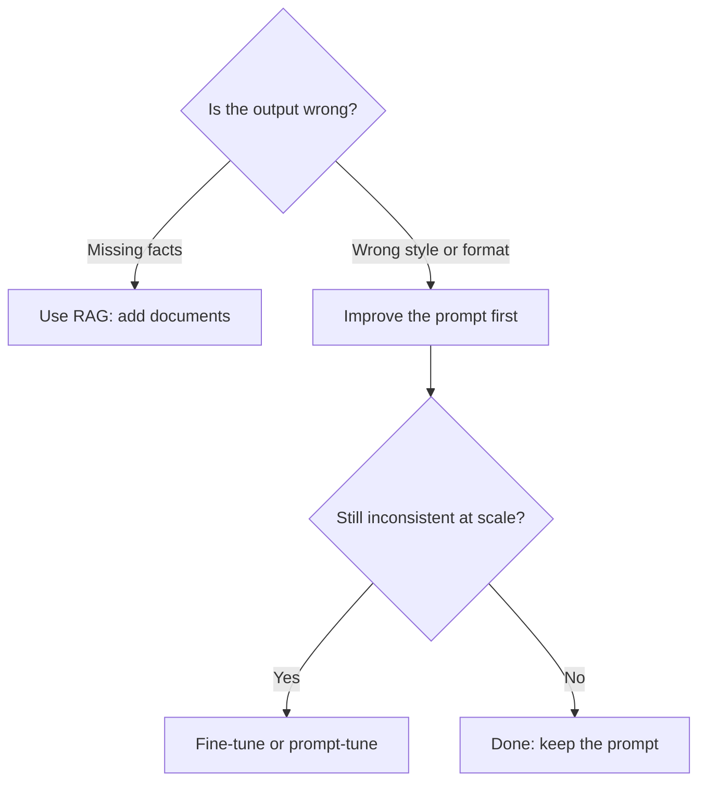
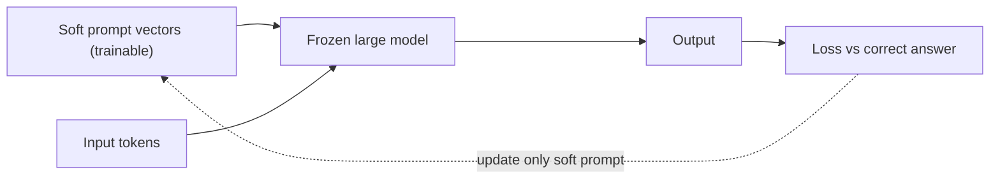

# Session 10 · Applied Prompting, Fine-Tuning Basics and Soft Prompts

[](https://colab.research.google.com/github/Hamnakhan123/Generative-AI/blob/main/01-prompt-engineering/code/session-10-applied-prompting-and-prompt-tuning.ipynb)

> 🧭 [Generative AI](../README.md) › [Track 1 · Prompt Engineering](README.md) › **Session 10**
>
> ⏱️ **Estimated time:** 2 hours · 📋 **Prerequisites:** Previous session

[⬅ Previous](session-09-advanced-prompting-strategies.md) · [🏠 Track home](README.md) · [Next ➡](session-11-prompt-hacking-and-defences.md)

---

## 🎯 Learning objectives

- Apply prompting to real tasks: **summarising, extracting, rewriting, tutoring and coding help**.
- Explain the difference between **prompt engineering, RAG and fine-tuning**, and when to use each.
- Prepare a clean **fine-tuning dataset** in chat-JSONL format.
- Understand **soft prompts / prompt tuning**: learning a prompt as numbers instead of words.

## 📖 Concepts

### 1. Applied prompting patterns

| Pattern | Template | Typical use |
|---|---|---|
| **Summarise** | "Summarise ### TEXT ### in 5 bullets for {audience}." | Notes, articles, emails |
| **Extract** | "From the text, return JSON with keys name, date, amount." | Invoices, forms, CVs |
| **Transform** | "Rewrite in {tone} for {audience}, keep all facts." | Emails, notices |
| **Tutor** | "Explain {topic} step by step, then ask me 2 check questions." | Self-study |
| **Code helper** | "Explain this error, then show the fixed code with comments." | Programming labs |

### 2. Three ways to customise a model

```text
Prompt engineering  →  change the INPUT text          (minutes, free, no training)
RAG                 →  add retrieved DOCUMENTS to it  (hours, needs a search index)
Fine-tuning         →  change the MODEL WEIGHTS       (days, needs data + compute)
```

Start with prompting. Move to **RAG** when the model lacks your facts (policies, course outline). Move to **fine-tuning** when you need a consistent **style or format** across thousands of calls and prompts alone are not enough.

### 3. Fine-tuning basics

- **Training data** = many examples of input → ideal output, usually 50–1,000+ for style tasks.
- Common format: **chat JSONL**, one JSON object per line with `system`, `user`, `assistant` messages.
- **Quality beats quantity**: every example should follow the rules you want the model to learn. One bad example teaches bad habits.
- Keep a **validation set** (10–20%) that the model never trains on, to measure improvement honestly.
- Never put **private data** (student IDs, phone numbers) in training files.

### 4. Soft prompts and prompt tuning

A normal ("hard") prompt is made of real words. A **soft prompt** is a small set of **learned vectors** placed in front of the input. The large model stays **frozen**; only those few vectors are trained.

| | Hard prompt | Soft prompt (prompt tuning) | Full fine-tuning |
|---|---|---|---|
| What changes | Words you type | A few learned vectors | All or many weights |
| Readable by humans? | Yes | No | No |
| Cost | Free | Low | High |
| Storage per task | A text file | Kilobytes | A full model copy (or adapter) |

Related methods: **prefix tuning** (vectors at every layer) and **LoRA adapters** (small trainable matrices).

## 🧭 Diagrams





## 💻 Worked examples

### Example 1 — Extraction prompt

```text
Extract the following from the email between ### marks.
Return JSON only with keys: student_name, course_code, request, deadline (YYYY-MM-DD or null).
### Dear Sir, I am Ayesha Siddiqui from CS-201. I missed Lab 4 due to illness and request a
makeup by 30 October. Regards. ###
```

**Sample output:** `{"student_name": "Ayesha Siddiqui", "course_code": "CS-201", "request": "makeup for Lab 4", "deadline": "2026-10-30"}`

### Example 2 — Building and validating a fine-tuning dataset (Python)

```python
# file: session-10_finetune_dataset.py
"""Builds and validates a small fine-tuning dataset in chat-JSONL format.
Each line = one example: system + user + assistant messages. Bad rows are reported, not silently kept."""
import json

SYSTEM = "You are IoBM Helpdesk. Answer in at most 2 sentences, politely, in simple English."
raw = [
    ("How do I reset my LMS password?", "Click 'Forgot password' on the LMS login page and follow the email link. If no email arrives in 10 minutes, contact IT at the helpdesk counter."),
    ("When is the add/drop deadline?", "The add/drop deadline is published in the academic calendar on the student portal. Please check it there, as dates change each semester."),
    ("Can I bring my own laptop to the lab?", "Yes, you can use your own laptop in the lab. Connect to the campus Wi-Fi with your student ID."),
    ("", "This row has no question."),
    ("Where is the library?", "The library is on the ground floor of the main block, next to the cafeteria, and it is open from 8 am to 8 pm on weekdays. Bring your student card to borrow books. Laptops are allowed in the reading area. Group rooms can be booked online."),
]

def valid(q, a):
    if not q.strip(): return "empty question"
    if a.count(".") > 2: return "answer longer than 2 sentences (breaks the style rule)"
    return None

good, report = [], []
for i, (q, a) in enumerate(raw, 1):
    problem = valid(q, a)
    if problem:
        report.append(f"row {i}: REJECTED ({problem})")
        continue
    good.append({"messages": [{"role": "system", "content": SYSTEM},
                              {"role": "user", "content": q},
                              {"role": "assistant", "content": a}]})
    report.append(f"row {i}: ok")

with open("session-10_helpdesk_train.jsonl", "w") as f:
    for ex in good:
        f.write(json.dumps(ex) + "\n")

print("\n".join(report))
print(f"\nKept {len(good)} of {len(raw)} examples -> session-10_helpdesk_train.jsonl")
print("First line:\n" + json.dumps(good[0])[:160] + "...")
```

**Output**

```text
row 1: ok
row 2: ok
row 3: ok
row 4: REJECTED (empty question)
row 5: REJECTED (answer longer than 2 sentences (breaks the style rule))

Kept 3 of 5 examples -> session-10_helpdesk_train.jsonl
First line:
{"messages": [{"role": "system", "content": "You are IoBM Helpdesk. Answer in at most 2 sentences, politely, in simple English."}, {"role": "user", "content": "...
```

Two rows were rejected: one had no question, and one broke the "at most 2 sentences" rule we want the model to learn.

### Example 3 — A soft prompt, learned (toy, Python)

The "model" below is frozen. Only a 2-number soft prompt is trained, and accuracy improves because the prompt changes how the model weighs each word.

```python
# file: session-10_soft_prompt_toy.py
"""Toy 'soft prompt' (prompt tuning) demo in pure Python.
A frozen 'model' adds up each word's sentiment (x), weighting each word by how much it 'attends'
to the prompt vector: weight = 1 + soft . v. The word vectors and the scoring rule never change.
We learn ONLY the 2-number soft prompt so the frozen model stops being fooled by
complaints that start with a polite word ("great, we waited hours again")."""
VEC = {"great": (1.0, -0.5), "love": (0.9, -0.5), "fast": (0.6, 0.0), "service": (0.1, 0.0),
       "waited": (-0.2, 0.9), "hours": (-0.1, 0.8), "broken": (-0.9, 0.3), "again": (0.0, 0.4)}
data = [("great fast service", 1), ("love the service", 1),
        ("great waited hours again", 0), ("love waited hours", 0), ("broken again", 0)]

def model(sentence, soft):
    score = 0.0
    for w in sentence.split():
        x, y = VEC.get(w, (0.0, 0.0))
        score += x * (1 + soft[0] * x + soft[1] * y)
    return score

def accuracy(soft):
    return sum((model(s, soft) > 0) == bool(l) for s, l in data) / len(data)

def loss(soft):  # hinge loss with margin 0.1
    return sum(max(0.0, 0.1 - (1 if l else -1) * model(s, soft)) for s, l in data)

soft = [0.0, 0.0]
print(f"Before tuning: soft prompt = ({soft[0]:+.2f}, {soft[1]:+.2f}), accuracy = {accuracy(soft):.0%}")
lr, eps = 0.1, 1e-4
for step in range(300):  # numeric gradient descent; only the soft prompt moves, the model stays frozen
    grad = []
    for k in range(2):
        up = soft.copy(); up[k] += eps
        grad.append((loss(up) - loss(soft)) / eps)
    soft = [soft[k] - lr * grad[k] for k in range(2)]
print(f"After tuning : soft prompt = ({soft[0]:+.2f}, {soft[1]:+.2f}), accuracy = {accuracy(soft):.0%}, loss = {loss(soft):.2f}")
for s, l in data:
    print(f"  {s:26} label={'pos' if l else 'neg'}  score={model(s, soft):+.2f}")
```

**Output**

```text
Before tuning: soft prompt = (+0.00, +0.00), accuracy = 60%
After tuning : soft prompt = (-0.57, +0.44), accuracy = 100%, loss = 0.00
  great fast service         label=pos  score=+0.69
  love the service           label=pos  score=+0.33
  great waited hours again   label=neg  score=-0.24
  love waited hours          label=neg  score=-0.21
  broken again               label=neg  score=-1.48
```

In a real model the soft prompt is, for example, 20 vectors of 4,096 numbers each, trained with the same idea.

## 📊 Choosing an approach

| Need | Prompting | RAG | Fine-tune |
|---|---|---|---|
| Answer from our latest policy PDF | ⚪ | ✅ | ⚪ |
| Always reply in our helpdesk tone | ✅ (try first) | ⚪ | ✅ at scale |
| Fixed JSON format for 10,000 calls | ✅ | ⚪ | ✅ |
| Quick one-off task | ✅ | ⚪ | ⚪ |

## 🧪 Lab / practice tasks

**Task 1 · 🟢 Easy** — Write one prompt for each of the five applied patterns using a real task from your week.

<details><summary>💡 Hint</summary>

Reuse the templates in the first table.

</details>

**Task 2 · 🟢 Easy** — Add two new valid examples to `session-10_finetune_dataset.py` and one invalid one. Check the report.

<details><summary>💡 Hint</summary>

Keep answers to 2 sentences or fewer.

</details>

**Task 3 · 🟡 Medium** — Add a validation split: put every 5th valid example into `session-10_helpdesk_valid.jsonl`.

<details><summary>💡 Hint</summary>

Use `enumerate` and `i % 5 == 0`.

</details>

**Task 4 · 🟡 Medium** — Decide prompting vs RAG vs fine-tuning for five scenarios your teacher gives you, and justify each in one line.

<details><summary>💡 Hint</summary>

Ask: missing facts, or wrong style?

</details>

**Task 5 · 🔴 Challenge** — In `session-10_soft_prompt_toy.py`, add a new negative sentence "service broken again" and retrain. Does the soft prompt still reach 100%?

<details><summary>💡 Hint</summary>

Print the loss every 50 steps to watch training.

</details>


## ✅ Quick quiz

**Q1. Which approach changes the model's weights?**

- A) Prompt engineering
- B) RAG
- C) Fine-tuning
- D) Delimiters

<details><summary>Show answer</summary>

✅ **C) Fine-tuning** — Fine-tuning trains the model itself.

</details>

**Q2. The model gives wrong answers about your university's new policy. Best first fix?**

- A) Fine-tune
- B) RAG with the policy document
- C) Higher temperature
- D) Shorter prompt

<details><summary>Show answer</summary>

✅ **B) RAG with the policy document** — The model lacks facts; retrieval provides them.

</details>

**Q3. A soft prompt is...**

- A) A polite prompt
- B) A set of learned vectors in front of the input
- C) A prompt in lowercase
- D) A deleted prompt

<details><summary>Show answer</summary>

✅ **B) A set of learned vectors in front of the input** — Learned, not human-readable.

</details>

**Q4. In prompt tuning, which part is trained?**

- A) The whole model
- B) Only the soft prompt vectors
- C) The tokenizer
- D) Nothing

<details><summary>Show answer</summary>

✅ **B) Only the soft prompt vectors** — The base model stays frozen.

</details>

**Q5. Why keep a validation set?**

- A) To make files bigger
- B) To measure improvement on unseen examples
- C) It is required by JSON
- D) To store passwords

<details><summary>Show answer</summary>

✅ **B) To measure improvement on unseen examples** — Honest measurement needs unseen data.

</details>


## 📝 Summary / cheat-sheet

- Applied patterns: **Summarise · Extract · Transform · Tutor · Code helper**.
- Order of escalation: **Prompt → RAG (facts) → Fine-tune (style at scale)**.
- Fine-tuning data: chat JSONL, clean, consistent, validation split, no private data.
- Soft prompt = trainable vectors + frozen model; cheap and tiny per task.

**Viva / interview questions**

1. When is fine-tuning worth the cost compared to better prompting?
2. What makes a good fine-tuning example?
3. Explain prompt tuning to a non-technical manager.
4. How do RAG and fine-tuning solve different problems?
5. Why should training data avoid personal information?

---

[⬅ Previous](session-09-advanced-prompting-strategies.md) · [🏠 Track home](README.md) · [Next ➡](session-11-prompt-hacking-and-defences.md)

<sub>Prepared by **Hamna Zahid Khan**, Junior Lecturer</sub>
