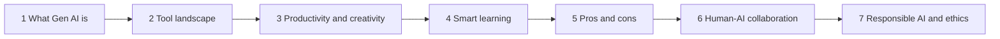

# Track 2 · Gen AI Accelerator

> 🧭 [⬆ Up](../README.md) · Generative AI › **Track 2 · Gen AI Accelerator**

Prepared by **Hamna Zahid Khan**, Junior Lecturer

## 📌 About this track

The Gen AI Accelerator is a practical tour of generative AI for everyday work and study. It explains what generative AI is and how large language models produce text, surveys the main tools, shows how to boost productivity and creativity, uses AI as a study partner, weighs benefits against risks, sets out how humans and AI should work together, and finishes with responsible and ethical AI use.

**By the end you will be able to:**

- Explain tokens, next-token prediction, temperature and hallucination in plain words.
- Pick the right Gen AI tool for a task using evidence, not habit.
- Use a Draft → Review → Refine loop and reusable templates to save real time.
- Study with AI in tutor mode using active recall and spaced repetition.
- Verify AI output, score risks, design human-in-the-loop workflows and apply responsible-AI principles.

## 🧭 Learning path

## 🛠️ Setup

- A free account on at least one AI assistant (ChatGPT, Microsoft Copilot, Google Gemini or Claude); a research tool (Perplexity or NotebookLM) and an image tool help in Sessions 2 and 5.
- Python 3.10+ for the `code/` folder. Every script runs offline with the standard library only.
- Notebooks open in Jupyter or Google Colab with the badge at the top of each session.

## 🗂️ Sessions

| # | Session | Time |
|---|---|---|
| 1 | [Getting Started with Generative AI](session-01-getting-started-with-generative-ai.md) | 2 hours |
| 2 | [Exploring Generative AI Tools](session-02-exploring-gen-ai-tools.md) | 2 hours |
| 3 | [Boosting Productivity and Creativity with AI](session-03-boosting-productivity-and-creativity.md) | 2 hours |
| 4 | [Collaborating with AI for Smart Learning](session-04-collaborating-with-ai-for-smart-learning.md) | 2 hours |
| 5 | [Weighing the Pros and Cons of Generative AI](session-05-weighing-pros-and-cons.md) | 2 hours |
| 6 | [Human–AI Collaboration Essentials](session-06-human-ai-collaboration.md) | 2 hours |
| 7 | [Responsible AI and Ethical Considerations](session-07-responsible-ai-and-ethics.md) | 2 hours |

📝 **Module practice test:** [practice-test.md](practice-test.md) — 20 MCQs + 3 scenario questions with solutions.

## 📋 Track cheat-sheet

| Topic | Remember |
|---|---|
| What Gen AI is | AI ⊃ ML ⊃ deep learning ⊃ Gen AI; it **creates** text, images, audio, video, code |
| How LLMs work | Tokens → probabilities → sample next token → repeat; pre-training + fine-tuning/human feedback |
| Temperature | Low = consistent and factual · High = varied and creative |
| Limits | Hallucination · knowledge cut-off · bias · context window |
| Tool categories | Chat · research · image · audio · video · code · slides · built-in suites |
| Choosing tools | **C-FIPS**: Capability, Free tier, Integration, Privacy, Sources |
| Productivity | **Draft → Review → Refine**; templates with [placeholders]; count review time |
| Creativity | SCAMPER · role-storming · worst idea · constraints · mash-ups |
| Smart learning | Tutor mode (hints, not answers) · active recall · spaced repetition · Feynman · interleaving |
| Integrity | 🟢 study aids · 🟡 permitted + disclosed · 🔴 passing off AI work, fake references |
| Verification | **V-3**: source check → lateral reading → cross-check |
| Risk | Score = likelihood × impact; act on HIGH first |
| Collaboration | Tool → assistant → collaborator → agent; centaur vs cyborg; jagged frontier |
| Human oversight | In / on / out of the loop; route by **stakes** and confidence; own the result |
| Responsible AI | Fairness · transparency · accountability · privacy & security · safety · human oversight |
| Bias & privacy | Four-fifths rule (ratio < 0.8 → investigate) · minimise and redact personal data |
| Regulation | EU AI Act tiers: unacceptable · high · limited · minimal; follow institutional AI policy |

## ✅ Track checklist

- [ ] Finished all 7 sessions and their lab tasks
- [ ] Scored at least 4/5 on every session quiz
- [ ] Attempted the [practice test](practice-test.md) in 60 minutes
- [ ] Wrote an AI-use disclosure statement and a personal checklist for verifying AI output

---
Prepared by **Hamna Zahid Khan**, Junior Lecturer
