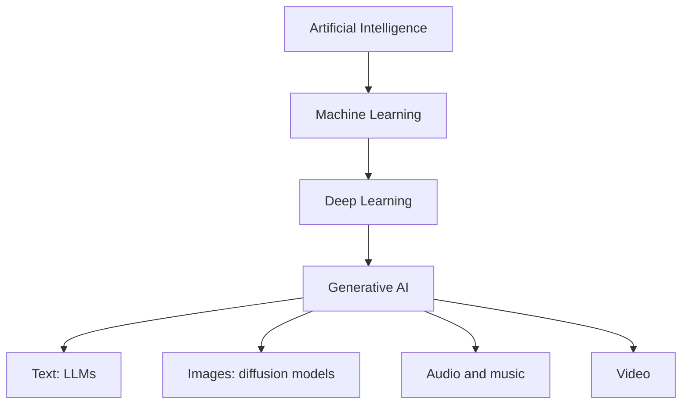
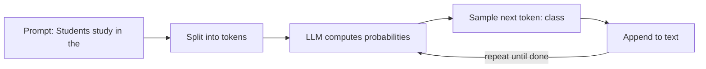

# Session 1 · Getting Started with Generative AI

[](https://colab.research.google.com/github/Hamnakhan123/Generative-AI/blob/main/02-gen-ai-accelerator/code/session-01-getting-started-with-generative-ai.ipynb)

> 🧭 [Generative AI](../README.md) › [Track 2 · Gen AI Accelerator](README.md) › **Session 1**
>
> ⏱️ **Estimated time:** 2 hours · 📋 **Prerequisites:** Track 1 recommended

[⬅ Previous](../01-prompt-engineering/session-12-final-project-mastering-prompts.md) · [🏠 Track home](README.md) · [Next ➡](session-02-exploring-gen-ai-tools.md)

---

## 🎯 Learning objectives

- Define **generative AI** and place it inside the AI → ML → deep learning family.
- Explain in plain words how a **large language model (LLM)** produces text: tokens, next-token prediction, training.
- Name the main **modalities** (text, image, audio, video, code) and an example tool for each.
- Describe what **temperature** does to a model's output.
- List the core **limitations**: hallucination, knowledge cut-off, bias and context limits.

## 📖 Concepts

### 1. What is generative AI?

**Generative AI** is AI that **creates new content** — text, images, audio, video or code — that resembles the data it learned from. Traditional (discriminative) AI mostly **classifies or predicts** ("Is this email spam?"); generative AI **produces** ("Write a polite reply to this email").

| Layer | What it means | Example |
|---|---|---|
| **Artificial Intelligence** | Machines doing tasks that need human-like intelligence | Chess engine, route planner |
| **Machine Learning** | Systems that learn patterns from data instead of fixed rules | Spam filter |
| **Deep Learning** | ML with many-layered neural networks | Face recognition |
| **Generative AI** | Deep learning models that generate new content | ChatGPT, Gemini, DALL·E, Suno |

### 2. A very short history

| Year | Milestone |
|---|---|
| 1966 | ELIZA — a rule-based chatbot that matched patterns |
| 2014 | GANs (Generative Adversarial Networks) generate realistic images |
| 2017 | The **Transformer** architecture ("Attention Is All You Need") |
| 2018–2020 | GPT, BERT, GPT-3 show the power of large pre-trained models |
| 2022 | ChatGPT launches; text-to-image tools (DALL·E 2, Midjourney, Stable Diffusion) go mainstream |
| 2023 onward | Multimodal assistants (text + image + voice), AI built into office apps, AI agents |

### 3. How an LLM works — the 4 ideas you need

1. **Tokens.** Text is split into small pieces (words or word-parts). "Unbelievable" may become `un` + `believ` + `able`. Models read and write tokens, and pricing and limits are counted in tokens.
2. **Next-token prediction.** Given the tokens so far, the model outputs a **probability for every possible next token**, picks one, appends it and repeats. Whole essays are built one token at a time.
3. **Pre-training.** The model learns those probabilities by reading huge amounts of text and adjusting billions of **parameters** (weights) to get better at predicting the next token.
4. **Fine-tuning and alignment.** It is then tuned on example conversations and human feedback (RLHF and similar methods) so it follows instructions and behaves helpfully and safely.

> 💡 An LLM does not "look up" answers in a database. It generates the most plausible continuation. That is why it can be fluent and still wrong.

### 4. Modalities

| Modality | Input → Output | Example tools |
|---|---|---|
| Text | text → text | ChatGPT, Gemini, Copilot, Claude |
| Image | text → image | DALL·E, Midjourney, Adobe Firefly, Canva |
| Audio | text → speech / music | ElevenLabs, Suno |
| Video | text/image → video | Runway, Sora, Veo |
| Code | text → code | GitHub Copilot, Gemini Code Assist |
| Multimodal | mix of the above | GPT-4o, Gemini (photo + question → answer) |

### 5. Temperature and randomness

Most tools let the model **sample** from the probabilities. **Temperature** controls how adventurous that sampling is:

- **Low (0–0.3):** picks the most likely token almost every time — consistent, factual, repetitive.
- **Medium (~0.7):** a balance — the usual default for chat.
- **High (1.0+):** gives unlikely tokens a real chance — creative, varied, more errors.

### 6. Key limitations

- **Hallucination** — confident, fluent, false statements or made-up references.
- **Knowledge cut-off** — the model only knows what was in its training data unless it can search the web or read your files.
- **Bias** — patterns in training data (including stereotypes) can appear in outputs.
- **Context window** — the model can only "see" a limited number of tokens at once.
- **No real understanding or intent** — it predicts text; it does not know whether it is true.

## 🧭 Diagrams





## 💻 Worked examples

### Example 1 — A tiny next-word predictor

A bigram model counts which word follows which. An LLM does the same job with a neural network trained on billions of words.

```python
# file: session-01_next_word.py
"""A tiny 'language model': count which word follows which (a bigram model),
then predict the next word. Real LLMs do the same job - predict the next token -
but with billions of learned parameters instead of a word-count table."""
from collections import Counter, defaultdict

corpus = """students learn python in the lab . students learn ai in the class .
teachers explain ai in the class . students ask questions in the lab .
ai helps students learn faster . teachers use ai to plan the class ."""
words = corpus.split()

follows = defaultdict(Counter)
for a, b in zip(words, words[1:]):
    follows[a][b] += 1

def next_word_probs(word):
    c = follows[word]
    total = sum(c.values())
    return {w: n / total for w, n in c.most_common()}

for w in ["students", "in", "ai"]:
    probs = next_word_probs(w)
    print(f"after '{w}':", ", ".join(f"{k} {v:.2f}" for k, v in probs.items()))

# Greedy generation: always pick the most likely next word
word, out = "teachers", ["teachers"]
for _ in range(6):
    word = follows[word].most_common(1)[0][0]
    out.append(word)
print("\ngreedy text:", " ".join(out))
```

**Output**

```text
after 'students': learn 0.75, ask 0.25
after 'in': the 1.00
after 'ai': in 0.50, helps 0.25, to 0.25

greedy text: teachers explain ai in the class .
```

### Example 2 — Temperature in numbers

The model's raw scores (logits) are turned into probabilities with the softmax function. Dividing by the temperature first changes how peaked the distribution is.

```python
# file: session-01_temperature.py
"""How 'temperature' reshapes a model's next-token probabilities.
Low temperature -> safe, repetitive; high temperature -> varied, riskier."""
import math

logits = {"class": 2.0, "lab": 1.5, "library": 0.5, "moon": -1.0}  # raw model scores

def softmax(scores, t):
    exps = {k: math.exp(v / t) for k, v in scores.items()}
    z = sum(exps.values())
    return {k: e / z for k, e in exps.items()}

print("Next word after 'Students study in the ...'\n")
print(f"{'temp':>5} " + " ".join(f"{k:>8}" for k in logits))
for t in [0.2, 0.7, 1.0, 1.5]:
    p = softmax(logits, t)
    print(f"{t:>5} " + " ".join(f"{p[k]:>8.2f}" for k in logits))
```

**Output**

```text
Next word after 'Students study in the ...'

 temp    class      lab  library     moon
  0.2     0.92     0.08     0.00     0.00
  0.7     0.62     0.30     0.07     0.01
  1.0     0.53     0.32     0.12     0.03
  1.5     0.45     0.32     0.17     0.06
```

At **0.2** the model almost always says "class"; at **1.5** even "moon" gets a 6% chance — that is where creative (and silly) outputs come from.

### Example 3 — Seeing hallucination for yourself

**Prompt**

```text
Give me 3 journal articles (author, year, title, DOI) about the use of ChatGPT in Pakistani universities.
```

**What to do with the answer:** search each DOI and title on Google Scholar. Very often at least one reference does not exist or has the wrong authors. Lesson: **always verify citations**, or use a tool that searches and links real sources.

## 🧪 Lab / practice tasks

**Task 1 · 🟢 Easy** — Ask two different assistants "Explain generative AI to a 12-year-old in 5 sentences". Compare their analogies.

<details><summary>💡 Hint</summary>

Keep the prompt identical so the comparison is fair.

</details>

**Task 2 · 🟢 Easy** — Use an online tokenizer (for example OpenAI's Tokenizer page) to count tokens for one English and one Roman Urdu sentence of the same meaning.

<details><summary>💡 Hint</summary>

Roman Urdu usually needs more tokens because it is rarer in training data.

</details>

**Task 3 · 🟡 Medium** — Run `session-01_next_word.py` with your own 10-sentence corpus about your department and generate text from three starting words.

<details><summary>💡 Hint</summary>

Replace the `corpus` string; keep spaces around full stops so they become tokens.

</details>

**Task 4 · 🟡 Medium** — Ask an assistant the same creative prompt three times (e.g. "a slogan for our CS society"). Note how much the answers vary and explain why.

<details><summary>💡 Hint</summary>

Sampling with temperature above 0 gives different outputs each time.

</details>

**Task 5 · 🔴 Challenge** — Change the logits in `session-01_temperature.py` so "library" becomes most likely at temperature 1.0, and print a table for five temperatures.

<details><summary>💡 Hint</summary>

Raise the library score above class; add 0.5 to the temperature list.

</details>


## ✅ Quick quiz

**Q1. Generative AI is best described as AI that...**

- A) Only sorts data into categories
- B) Creates new content like text, images or audio
- C) Stores data in a database
- D) Replaces the internet

<details><summary>Show answer</summary>

✅ **B) Creates new content like text, images or audio** — It generates rather than only classifies.

</details>

**Q2. An LLM writes text by...**

- A) Copying whole web pages
- B) Predicting the next token repeatedly
- C) Searching a dictionary
- D) Running fixed if-else rules

<details><summary>Show answer</summary>

✅ **B) Predicting the next token repeatedly** — Next-token prediction, one token at a time.

</details>

**Q3. Which architecture (2017) underpins modern LLMs?**

- A) Decision tree
- B) Transformer
- C) Perceptron
- D) Expert system

<details><summary>Show answer</summary>

✅ **B) Transformer** — "Attention Is All You Need" introduced it.

</details>

**Q4. A low temperature makes output...**

- A) More random
- B) More consistent and predictable
- C) Longer
- D) Multilingual

<details><summary>Show answer</summary>

✅ **B) More consistent and predictable** — The most likely tokens dominate.

</details>

**Q5. A confident but false answer is called...**

- A) Overfitting
- B) Hallucination
- C) Tokenisation
- D) Alignment

<details><summary>Show answer</summary>

✅ **B) Hallucination** — Always verify facts and references.

</details>


## 📝 Summary / cheat-sheet

- **Gen AI = creates**, traditional AI = classifies/predicts. Family: AI ⊃ ML ⊃ DL ⊃ Gen AI.
- LLM pipeline: **tokens → probabilities → sample → repeat**; learned in pre-training, shaped by fine-tuning and human feedback.
- Modalities: text, image, audio, video, code, multimodal.
- **Temperature:** low = factual/consistent, high = creative/varied.
- Limits: **hallucination, cut-off, bias, context window** — verify before you trust.

**Viva / interview questions**

1. How is generative AI different from a spam classifier?
2. What is a token and why do tokens matter for cost and limits?
3. Explain next-token prediction with an example sentence.
4. When would you choose a low temperature, and when a high one?
5. Why do LLMs hallucinate, and how do you protect yourself from it?

---

[⬅ Previous](../01-prompt-engineering/session-12-final-project-mastering-prompts.md) · [🏠 Track home](README.md) · [Next ➡](session-02-exploring-gen-ai-tools.md)

<sub>Prepared by **Hamna Zahid Khan**, Junior Lecturer</sub>
