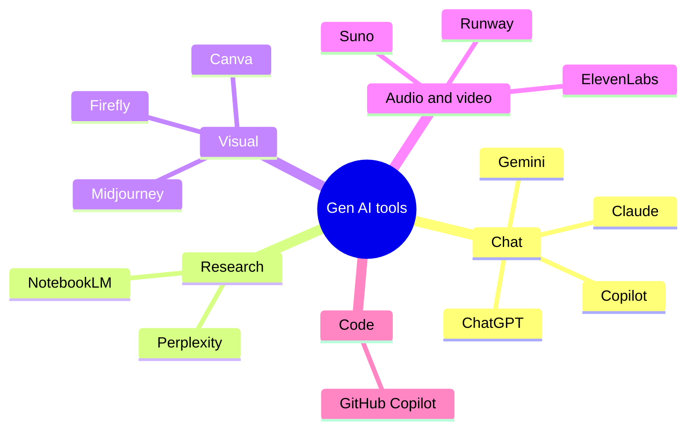
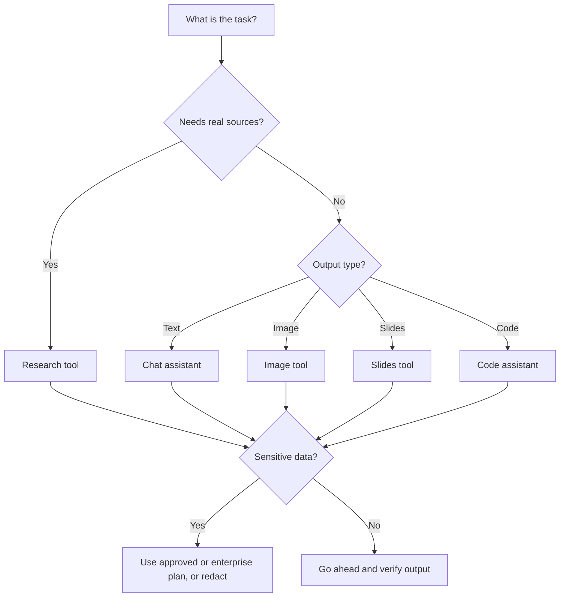

# Session 2 · Exploring Generative AI Tools

[](https://colab.research.google.com/github/Hamnakhan123/Generative-AI/blob/main/02-gen-ai-accelerator/code/session-02-exploring-gen-ai-tools.ipynb)

> 🧭 [Generative AI](../README.md) › [Track 2 · Gen AI Accelerator](README.md) › **Session 2**
>
> ⏱️ **Estimated time:** 2 hours · 📋 **Prerequisites:** Previous session

[⬅ Previous](session-01-getting-started-with-generative-ai.md) · [🏠 Track home](README.md) · [Next ➡](session-03-boosting-productivity-and-creativity.md)

---

## 🎯 Learning objectives

- Map the **Gen AI tool landscape** by category: chat assistants, research, image, audio, video, code, slides and productivity suites.
- Compare tools on **capability, free tier, data privacy, sources and integration**.
- Choose the right tool for a given task using a simple **selection checklist**.
- Use **multimodal** features: uploading images, PDFs and voice.
- Follow safe-use rules: account settings, what not to paste, checking terms.

## 📖 Concepts

### 1. The landscape at a glance

| Category | What it does | Popular tools (2024–26) |
|---|---|---|
| **Chat assistants** | General Q&A, writing, analysis, coding help | ChatGPT, Google Gemini, Microsoft Copilot, Claude |
| **Research & sources** | Answers with citations; chat with your own documents | Perplexity, NotebookLM, Consensus |
| **Image generation** | Text → image, editing, background removal | DALL·E (in ChatGPT), Midjourney, Adobe Firefly, Canva Magic Studio, Ideogram |
| **Audio & music** | Text-to-speech, voice cloning, songs | ElevenLabs, Suno, Murf |
| **Video** | Text/image → clips, avatars, editing | Runway, Sora, Veo, Synthesia, CapCut |
| **Code** | Autocomplete, explain, debug | GitHub Copilot, Cursor, Gemini Code Assist |
| **Slides & docs** | Presentations and documents from a prompt | Gamma, Copilot in PowerPoint, Gemini in Google Docs |
| **Built-in suites** | AI inside tools you already use | Microsoft 365 Copilot, Google Workspace Gemini, Notion AI |

> ⚠️ Names, features and prices change every few months. Treat any list (including this one) as a snapshot and check the tool's site.

### 2. How to compare tools — the C-FIPS checklist

- **C — Capability:** Can it do the job well (quality, languages, file types, length)?
- **F — Free tier & cost:** What is free, what is limited, what does paid add?
- **I — Integration:** Does it work inside your apps (Docs, Sheets, Teams, VS Code)?
- **P — Privacy:** Can you turn off training on your chats? Is there an education or enterprise plan?
- **S — Sources:** Does it cite or link sources you can check?

### 3. Multimodal features worth knowing

| Feature | Try this |
|---|---|
| **Image input** | Photo of a whiteboard → "Turn this into tidy notes with headings." |
| **File upload** | A 20-page PDF → "Summarise in 10 bullets and list 5 exam questions." |
| **Voice mode** | Practise a viva by speaking answers aloud. |
| **Web search** | "Search for this year's admission deadlines and cite the pages." |
| **Data analysis** | Upload a CSV → "Plot monthly attendance and describe the trend." |
| **Custom assistants** | Custom GPTs, Gemini Gems or Copilot agents with saved instructions. |

### 4. Safe-use rules for any tool

1. **Never paste** passwords, CNIC numbers, student records, unpublished exam papers or confidential data into a public tool.
2. Check **data controls** (e.g. "Improve the model for everyone" toggle, temporary chats).
3. Read the **usage policy** — some tools restrict commercial use of free-tier outputs or require disclosure.
4. Keep a **human check** on anything published, graded or sent to others.

### 5. Matching task to tool

| Task | Best fit category | Why |
|---|---|---|
| Literature summary with references | Research tool | Real, clickable citations |
| Event poster | Image / design tool | Templates, text layout, brand kit |
| Lesson plan draft | Chat assistant | Flexible structure and tone |
| 10-slide pitch | Slides tool | Generates layout, not just text |
| Explaining a bug | Code assistant | Reads your code in context |

## 🧭 Diagrams





## 💻 Worked examples

### Example 1 — A tool shortlister

The script filters a small catalogue by category, free tier and whether you can switch off training on your chats.

```python
# file: session-02_tool_finder.py
"""Shortlist Gen AI tools for a task by category, free tier and data-safety needs.
The catalogue is a teaching snapshot - tool features and prices change, so check each site."""
TOOLS = [
    # name, category, free tier?, can disable training on chats?
    ("ChatGPT", "text", True, True),
    ("Google Gemini", "text", True, True),
    ("Microsoft Copilot", "text", True, True),
    ("Claude", "text", True, True),
    ("Perplexity", "research", True, True),
    ("NotebookLM", "research", True, True),
    ("Canva Magic Studio", "image", True, False),
    ("Adobe Firefly", "image", True, True),
    ("Midjourney", "image", False, False),
    ("ElevenLabs", "audio", True, False),
    ("Runway", "video", True, False),
    ("GitHub Copilot", "code", True, True),
    ("Gamma", "slides", True, False),
]

def shortlist(category, need_free=True, need_privacy=False):
    return [n for n, c, free, priv in TOOLS
            if c == category and (free or not need_free) and (priv or not need_privacy)]

jobs = [("Summarise 5 research papers with sources", "research", True, True),
        ("Poster for a college event", "image", True, False),
        ("Draft a lesson plan on recursion", "text", True, True),
        ("Pitch deck in 10 minutes", "slides", True, False)]
for job, cat, free, priv in jobs:
    print(f"{job}\n  -> {', '.join(shortlist(cat, free, priv)) or 'no match: relax a filter'}")
```

**Output**

```text
Summarise 5 research papers with sources
  -> Perplexity, NotebookLM
Poster for a college event
  -> Canva Magic Studio, Adobe Firefly
Draft a lesson plan on recursion
  -> ChatGPT, Google Gemini, Microsoft Copilot, Claude
Pitch deck in 10 minutes
  -> Gamma
```

### Example 2 — Same prompt, three assistants

**Prompt**

```text
Explain recursion to first-semester students in 120 words with one everyday analogy and one Python example of factorial.
```

**What to compare:** accuracy of the code, quality of the analogy, word count, formatting, and whether it adds anything unasked. Record results in a small table — this is how you pick a tool with evidence instead of habit.

### Example 3 — Multimodal: from a photo to notes

```text
[Attach photo of whiteboard]
This is a photo of my lecture board on sorting algorithms. Convert it into clean notes:
1) headings per algorithm, 2) time complexity table, 3) anything you cannot read, mark as [unclear].
```

The `[unclear]` instruction stops the model from inventing text it cannot read.

## 🧪 Lab / practice tasks

**Task 1 · 🟢 Easy** — Create free accounts on two chat assistants and one image tool. Find and screenshot each one's data/privacy setting.

<details><summary>💡 Hint</summary>

Look under Settings → Data controls or Privacy.

</details>

**Task 2 · 🟢 Easy** — Ask a research tool and a chat assistant the same factual question; compare whether each gives sources you can click.

<details><summary>💡 Hint</summary>

Pick a recent topic so the difference is visible.

</details>

**Task 3 · 🟡 Medium** — Score three assistants with C-FIPS (1–5 each) for the task "write a weekly quiz for my class". Present a table and a recommendation.

<details><summary>💡 Hint</summary>

Use the same prompt in each; note free-tier limits.

</details>

**Task 4 · 🟡 Medium** — Upload a short PDF (e.g. a course outline) and ask for 5 MCQs with answers. Check every answer against the PDF.

<details><summary>💡 Hint</summary>

Ask the tool to quote the line each answer comes from.

</details>

**Task 5 · 🔴 Challenge** — Extend `session-02_tool_finder.py` with a `max_cost` field and a `languages` list, then shortlist tools for "Urdu voice-over under $10/month".

<details><summary>💡 Hint</summary>

Add fields to each tuple or switch to dictionaries.

</details>


## ✅ Quick quiz

**Q1. Which tool category is best when you need real, clickable citations?**

- A) Image generator
- B) Research tool such as Perplexity or NotebookLM
- C) Video generator
- D) Slides tool

<details><summary>Show answer</summary>

✅ **B) Research tool such as Perplexity or NotebookLM** — Research tools ground answers in sources.

</details>

**Q2. In C-FIPS, "P" stands for...**

- A) Price
- B) Privacy
- C) Prompt
- D) Plugin

<details><summary>Show answer</summary>

✅ **B) Privacy** — Check data controls and training settings.

</details>

**Q3. Which of these should never be pasted into a public AI tool?**

- A) A public news article
- B) Your own lesson outline
- C) Student CNIC numbers and grades
- D) A famous poem

<details><summary>Show answer</summary>

✅ **C) Student CNIC numbers and grades** — Personal and confidential data must stay out.

</details>

**Q4. A "multimodal" assistant can...**

- A) Only read text
- B) Accept and produce more than one type of content (e.g. image + text)
- C) Run without internet
- D) Only translate

<details><summary>Show answer</summary>

✅ **B) Accept and produce more than one type of content (e.g. image + text)** — Multi = many modes.

</details>

**Q5. Why should a tool list be treated as a snapshot?**

- A) Tools never change
- B) Features, names and prices change frequently
- C) All tools are identical
- D) Lists are illegal

<details><summary>Show answer</summary>

✅ **B) Features, names and prices change frequently** — Re-check before choosing.

</details>


## 📝 Summary / cheat-sheet

- Categories: **chat, research, image, audio, video, code, slides, built-in suites**.
- Compare with **C-FIPS**: Capability, Free tier, Integration, Privacy, Sources.
- Multimodal: images, PDFs, voice, web search, data analysis, custom assistants.
- Safe use: no personal/confidential data, check data controls, read the policy, human check.
- Pick tools with **evidence** (same prompt, scored table), not habit.

**Viva / interview questions**

1. Name one tool per category and the job you would give it.
2. Why might a research tool be better than a chat assistant for an assignment?
3. What data should never go into a free AI tool, and why?
4. Explain how you would compare three assistants fairly.
5. What is a custom assistant (GPT/Gem) and when is it useful?

---

[⬅ Previous](session-01-getting-started-with-generative-ai.md) · [🏠 Track home](README.md) · [Next ➡](session-03-boosting-productivity-and-creativity.md)

<sub>Prepared by **Hamna Zahid Khan**, Junior Lecturer</sub>
