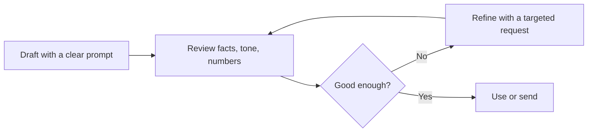
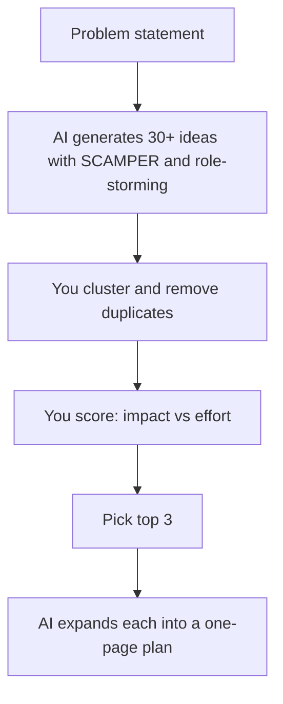

# Session 3 · Boosting Productivity and Creativity with AI

[](https://colab.research.google.com/github/Hamnakhan123/Generative-AI/blob/main/02-gen-ai-accelerator/code/session-03-boosting-productivity-and-creativity.ipynb)

> 🧭 [Generative AI](../README.md) › [Track 2 · Gen AI Accelerator](README.md) › **Session 3**
>
> ⏱️ **Estimated time:** 2 hours · 📋 **Prerequisites:** Previous session

[⬅ Previous](session-02-exploring-gen-ai-tools.md) · [🏠 Track home](README.md) · [Next ➡](session-04-collaborating-with-ai-for-smart-learning.md)

---

## 🎯 Learning objectives

- Use AI to speed up everyday **work tasks**: email, meeting notes, summaries, planning and documents.
- Apply a repeatable **Draft → Review → Refine** loop so AI output is fast *and* correct.
- Use structured creativity methods (**SCAMPER, role-storming, "worst idea"**) with AI to brainstorm.
- Build reusable **prompt templates** for tasks you repeat every week.
- Measure time saved honestly, including review time.

## 📖 Concepts

### 1. Where AI saves the most time

| Task | AI does | You still do |
|---|---|---|
| **Email** | First draft, tone change, shortening | Facts, names, final send |
| **Meeting notes** | Summary, decisions, action items table | Confirm owners and dates |
| **Reading** | Summaries of long documents, key points | Check the original for anything important |
| **Planning** | Weekly schedules, task breakdowns, checklists | Set priorities and real deadlines |
| **Documents** | Outlines, templates, rewriting for audience | Accuracy and policy compliance |
| **Spreadsheets** | Formulas, cleaning steps, charts | Verify a sample of rows |

### 2. The Draft → Review → Refine loop

1. **Draft:** give a clear prompt with role, task, context and format.
2. **Review:** check facts, tone, names, numbers and anything that would embarrass you if wrong.
3. **Refine:** ask for targeted changes ("make paragraph 2 shorter", "use a warmer tone") instead of starting over.

The loop is where real productivity comes from — a perfect first prompt is rare.

### 3. Reusable prompt templates

Save prompts you use weekly with **[placeholders]**:

```text
Summarise the meeting notes below for [audience].
Output: 1) 3-line summary, 2) decisions, 3) action items as a table (Owner | Task | Due).
If an owner or date is missing, write "TBD" — do not guess.
NOTES: """[paste]"""
```

Keep them in a document, a text expander, or a custom assistant (Custom GPT / Gem).

### 4. AI for creativity

AI is strong at **quantity and variety**; you are strong at **judgement and taste**.

| Method | How to prompt it |
|---|---|
| **SCAMPER** | Substitute, Combine, Adapt, Modify, Put to other use, Eliminate, Reverse — one prompt per letter |
| **Role-storming** | "Give ideas as a first-year student / a parent / a security guard would" |
| **Worst idea** | "List the 10 worst ways to run orientation week" → flip each into a good idea |
| **Constraints** | "Ideas that cost under Rs 5,000 and need no app" |
| **Mash-up** | "Combine a cricket match and a coding contest into an event format" |

### 5. Measuring productivity honestly

Time saved = (time without AI) − (prompting time + **review time** + fixing time). Studies of knowledge workers report large gains on tasks inside AI's strengths and **worse** results on tasks outside them, so track your own numbers before claiming a speed-up.

## 🧭 Diagrams





## 💻 Worked examples

### Example 1 — Email in three tones

**Prompt**

```text
Write a short email to my students announcing that Friday's lab is moved to Monday 10 am, Lab 2.
Give three versions: formal, friendly, and a 2-line WhatsApp-style message.
```

**Sample output (friendly version):**

```text
Subject: Lab moved to Monday 🙂
Hi everyone, quick update — this Friday's lab is shifting to Monday at 10 am in Lab 2.
Bring your laptops and last week's code. See you there!
```

### Example 2 — Action items from meeting notes

Ask the assistant for an Owner | Task | Due table. The script below extracts the same table with a pattern, which is also a quick way to **check** what the AI produced.

```python
# file: session-03_meeting_actions.py
"""Pull action items out of meeting notes - the same structure you should ask an AI
assistant for ("list owner, task, due date as a table"), and a way to check its work."""
import re

notes = """Dept meeting 14 Oct.
Discussed mid-term schedule. Sana will share the room plan by Friday.
Lab 3 PCs are slow - Bilal to raise IT ticket by Monday.
New AI policy draft: Hamna to circulate to faculty by 20 Oct.
Next meeting in two weeks."""

pattern = re.compile(r"(?P<owner>[A-Z][a-z]+) (?:will|to) (?P<task>.+?) by (?P<due>[\w ]+?)\.")
items = [m.groupdict() for m in pattern.finditer(notes)]

print(f"{'Owner':7} | {'Task':38} | Due")
print("-" * 60)
for it in items:
    print(f"{it['owner']:7} | {it['task']:38} | {it['due']}")
print(f"\n{len(items)} action items found")
```

**Output**

```text
Owner   | Task                                   | Due
------------------------------------------------------------
Sana    | share the room plan                    | Friday
Bilal   | raise IT ticket                        | Monday
Hamna   | circulate to faculty                   | 20 Oct

3 action items found
```

### Example 3 — SCAMPER prompt generator

```python
# file: session-03_scamper.py
"""Turn the SCAMPER creativity method into seven ready-to-paste brainstorming prompts."""
SCAMPER = {
    "Substitute": "What could we replace in {x} to make it better or cheaper?",
    "Combine": "What could {x} be combined with to create something new?",
    "Adapt": "What idea from another field could be adapted for {x}?",
    "Modify": "What could be made bigger, smaller or different in {x}?",
    "Put to other use": "Who else could use {x}, or for what other purpose?",
    "Eliminate": "What could be removed from {x} without losing its value?",
    "Reverse": "What if we did {x} in the opposite order or from the user's side?",
}
idea = "the university library's book-return process"
for i, (step, q) in enumerate(SCAMPER.items(), 1):
    print(f"{i}. [{step}] {q.format(x=idea)} Give 3 short ideas.")
```

**Output**

```text
1. [Substitute] What could we replace in the university library's book-return process to make it better or cheaper? Give 3 short ideas.
2. [Combine] What could the university library's book-return process be combined with to create something new? Give 3 short ideas.
3. [Adapt] What idea from another field could be adapted for the university library's book-return process? Give 3 short ideas.
4. [Modify] What could be made bigger, smaller or different in the university library's book-return process? Give 3 short ideas.
5. [Put to other use] Who else could use the university library's book-return process, or for what other purpose? Give 3 short ideas.
6. [Eliminate] What could be removed from the university library's book-return process without losing its value? Give 3 short ideas.
7. [Reverse] What if we did the university library's book-return process in the opposite order or from the user's side? Give 3 short ideas.
```

Paste each line into an assistant, collect ~21 ideas, then pick the best three yourself.

### Example 4 — Weekly plan

```text
I teach 3 lab sections (Mon/Wed 9–11, Tue 2–4), have 40 assignments to mark by Thursday,
and must prepare a quiz for Friday. Build a Monday–Friday plan in a table with 45-minute focus blocks,
breaks, and a buffer each day. Do not schedule anything after 6 pm.
```

## 📊 Time per task (illustrative, one lecturer's log)

| Task | Without AI (min) | With AI incl. review (min) |
|---|---|---|
| Weekly announcement email | 15 | 6 |
| Meeting summary | 25 | 10 |
| 10 quiz MCQs | 60 | 25 |
| Lesson outline | 45 | 20 |

```mermaid
xychart-beta
    title "Minutes per task"
    x-axis ["Email", "Summary", "10 MCQs", "Outline"]
    y-axis "Minutes" 0 --> 60
    bar [15, 25, 60, 45]
    bar [6, 10, 25, 20]
```



## 🧪 Lab / practice tasks

**Task 1 · 🟢 Easy** — Draft a real email you need to send this week with AI, then list every change you made during review.

<details><summary>💡 Hint</summary>

Note especially facts and names you corrected.

</details>

**Task 2 · 🟢 Easy** — Paste notes from a recent meeting or class and ask for summary + action items table with "TBD" for missing info.

<details><summary>💡 Hint</summary>

The "do not guess" instruction reduces invented owners.

</details>

**Task 3 · 🟡 Medium** — Run SCAMPER on a campus problem (e.g. canteen queues) with `session-03_scamper.py`, collect ideas from an assistant and rank the top 3 by impact vs effort.

<details><summary>💡 Hint</summary>

Change the `idea` variable to your problem.

</details>

**Task 4 · 🟡 Medium** — Build three reusable prompt templates for your weekly tasks and save them in one document.

<details><summary>💡 Hint</summary>

Use [placeholders] and a fixed output format.

</details>

**Task 5 · 🔴 Challenge** — Log five tasks this week with and without AI (including review time) and calculate your real time saved as a percentage.

<details><summary>💡 Hint</summary>

Saved % = (without − with) / without × 100.

</details>


## ✅ Quick quiz

**Q1. In the Draft → Review → Refine loop, "Refine" means...**

- A) Start a new chat
- B) Ask for targeted changes to the draft
- C) Send immediately
- D) Delete the draft

<details><summary>Show answer</summary>

✅ **B) Ask for targeted changes to the draft** — Small, specific corrections beat restarting.

</details>

**Q2. Why add "If missing, write TBD — do not guess" to a notes prompt?**

- A) To shorten output
- B) To stop the model inventing owners or dates
- C) To change the language
- D) To raise temperature

<details><summary>Show answer</summary>

✅ **B) To stop the model inventing owners or dates** — It prevents fabricated details.

</details>

**Q3. The "worst idea" technique asks AI to...**

- A) Give only safe ideas
- B) List bad ideas, which you then flip into good ones
- C) Delete ideas
- D) Grade students

<details><summary>Show answer</summary>

✅ **B) List bad ideas, which you then flip into good ones** — Reversal sparks creativity.

</details>

**Q4. Honest time saved must include...**

- A) Only typing time
- B) Prompting, review and fixing time
- C) Only AI processing time
- D) Nothing — AI is instant

<details><summary>Show answer</summary>

✅ **B) Prompting, review and fixing time** — Review time is real time.

</details>

**Q5. A good place to store reusable prompts is...**

- A) Nowhere — retype each time
- B) A template document or custom assistant
- C) A public forum
- D) The trash folder

<details><summary>Show answer</summary>

✅ **B) A template document or custom assistant** — Reuse makes gains repeatable.

</details>


## 📝 Summary / cheat-sheet

- Best time savers: **email, meeting notes, summaries, planning, documents, spreadsheets**.
- Always loop **Draft → Review → Refine**.
- Save **templates with placeholders** for repeated tasks.
- Creativity: **SCAMPER, role-storming, worst idea, constraints, mash-ups** — AI for quantity, you for judgement.
- Measure time saved **including review**.

**Viva / interview questions**

1. Which work tasks benefit most from AI, and which least?
2. Walk through the Draft → Review → Refine loop with an example.
3. How does SCAMPER work with an AI assistant?
4. Why can AI make some tasks slower?
5. Show a reusable prompt template you would use every week.

---

[⬅ Previous](session-02-exploring-gen-ai-tools.md) · [🏠 Track home](README.md) · [Next ➡](session-04-collaborating-with-ai-for-smart-learning.md)

<sub>Prepared by **Hamna Zahid Khan**, Junior Lecturer</sub>
