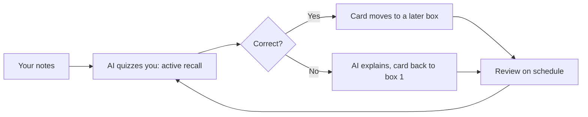
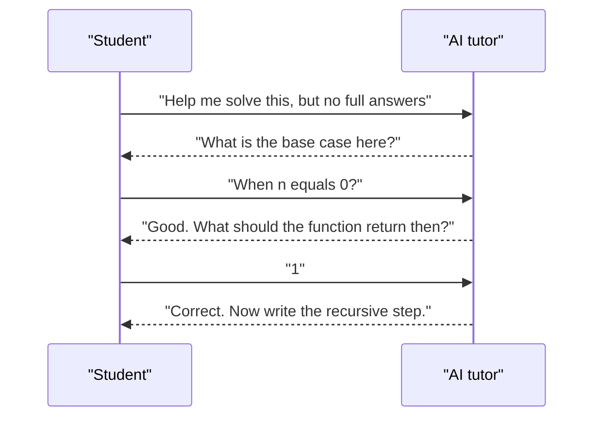

# Session 4 · Collaborating with AI for Smart Learning

[](https://colab.research.google.com/github/Hamnakhan123/Generative-AI/blob/main/02-gen-ai-accelerator/code/session-04-collaborating-with-ai-for-smart-learning.ipynb)

> 🧭 [Generative AI](../README.md) › [Track 2 · Gen AI Accelerator](README.md) › **Session 4**
>
> ⏱️ **Estimated time:** 2 hours · 📋 **Prerequisites:** Previous session

[⬅ Previous](session-03-boosting-productivity-and-creativity.md) · [🏠 Track home](README.md) · [Next ➡](session-05-weighing-pros-and-cons.md)

---

## 🎯 Learning objectives

- Use AI as a **tutor**, not an answer machine: explanations, Socratic questioning and feedback.
- Apply proven learning methods with AI: **active recall, spaced repetition, the Feynman technique, interleaving**.
- Generate **flashcards, quizzes and study plans** from your own notes.
- Get useful **feedback on writing and code** without outsourcing the thinking.
- Follow **academic integrity** rules: what is allowed, what must be disclosed, what is misconduct.

## 📖 Concepts

### 1. Tutor mode vs. answer mode

| Answer mode (weak learning) | Tutor mode (strong learning) |
|---|---|
| "Solve this question." | "Give me a hint for step 1 only." |
| "Write my essay." | "Ask me 5 questions that help me plan my essay." |
| "Explain recursion." (then read) | "Explain recursion, then quiz me until I get 3 right in a row." |
| Copy the output | Explain the output back in your own words |

### 2. Learning science + AI

| Method | Why it works | AI prompt |
|---|---|---|
| **Active recall** | Retrieving strengthens memory more than re-reading | "Quiz me on these notes, one question at a time." |
| **Spaced repetition** | Reviewing just before you forget | "Make 15 flashcards (Q/A) from these notes." + a Leitner schedule |
| **Feynman technique** | Explaining simply exposes gaps | "I'll explain normalisation; point out any gaps or errors." |
| **Interleaving** | Mixing topics improves transfer | "Give me 6 mixed problems: loops, lists, functions — don't say which is which." |
| **Elaboration** | Linking to what you know | "Relate stacks to something from daily life in Karachi." |
| **Worked examples → fading** | Step-by-step, then fewer hints | "Show one solved example, then a similar one with the last two steps blank." |

### 3. The Socratic tutor prompt

```text
You are a patient Socratic tutor for [subject] at [level].
Never give the full answer. Ask one guiding question at a time.
If I'm stuck twice, give a small hint. When I finish, summarise what I learned in 3 bullets.
Topic: [topic]
```

### 4. Feedback on your work

- **Writing:** "Using this rubric, give feedback on clarity, structure and evidence. Do not rewrite it; quote the weakest sentence and explain why."
- **Code:** "Find bugs and explain them as hints. Do not paste corrected code."
- **Presentations:** "Act as a tough examiner and ask 5 viva questions about these slides."

### 5. Academic integrity — the traffic light

| 🟢 Usually allowed | 🟡 Allowed only if your instructor permits + disclose | 🔴 Misconduct |
|---|---|---|
| Explaining concepts, quizzing yourself, flashcards, study plans | Grammar polishing, brainstorming, outline feedback, code hints | Submitting AI-written work as your own, fake references, using AI in closed exams |

Always follow **your course's AI policy**, keep your prompts and drafts as evidence of your process, and **verify every reference**.

## 🧭 Diagrams





## 💻 Worked examples

### Example 1 — Leitner spaced repetition

AI writes the flashcards; a schedule decides **when** you review them. Correct answers move a card to a box reviewed less often; a wrong answer sends it back to box 1.

```python
# file: session-04_flashcards.py
"""Leitner-box spaced repetition: cards you get right move to a box reviewed less often.
Pair it with AI-generated flashcards so you study, not just read."""
INTERVAL = {1: 1, 2: 3, 3: 7, 4: 14}   # box -> days until next review

cards = {"What is a token?": 1, "Define hallucination": 1, "What does temperature control?": 1}
# One week of simulated answers: True = recalled correctly
answers = {
    "What is a token?": [True, True, True],
    "Define hallucination": [False, True, True],
    "What does temperature control?": [True, False, True],
}
for card, results in answers.items():
    box, day, log = 1, 0, []
    for ok in results:
        box = min(box + 1, 4) if ok else 1
        day += INTERVAL[box]
        log.append(f"{'right' if ok else 'wrong'}->box{box}")
    print(f"{card:32} {' | '.join(log)}  next review: day {day}")
```

**Output**

```text
What is a token?                 right->box2 | right->box3 | right->box4  next review: day 24
Define hallucination             wrong->box1 | right->box2 | right->box3  next review: day 11
What does temperature control?   right->box2 | wrong->box1 | right->box2  next review: day 7
```

### Example 2 — Quiz prompt from your own notes

Restricting the tutor to **your** notes keeps questions on the syllabus and reduces hallucination.

```python
# file: session-04_quiz_maker.py
"""Build a self-quiz prompt from your own notes, then grade your answers.
Asking AI to quiz you (active recall) beats asking it to explain the topic again."""
notes = ["Generative AI creates new content such as text, images and audio.",
         "A large language model predicts the next token.",
         "Hallucination is a confident but false output."]
prompt = ("You are my study buddy. Using ONLY the notes below, ask me one question at a time, "
          "wait for my answer, then tell me if I am right and why.\nNOTES:\n" +
          "\n".join(f"- {n}" for n in notes))
print(prompt)

key = {"Q1": "next token", "Q2": "false"}
mine = {"Q1": "It predicts the next token", "Q2": "an output that is always true"}
score = sum(key[q] in mine[q].lower() for q in key)
print(f"\nSelf-check score: {score}/{len(key)}")
```

**Output**

```text
You are my study buddy. Using ONLY the notes below, ask me one question at a time, wait for my answer, then tell me if I am right and why.
NOTES:
- Generative AI creates new content such as text, images and audio.
- A large language model predicts the next token.
- Hallucination is a confident but false output.

Self-check score: 1/2
```

### Example 3 — Feynman check

**Prompt**

```text
I'm going to explain what a primary key is as if to a 10-year-old. Point out anything wrong or missing,
then ask me one follow-up question.
My explanation: "A primary key is like a roll number. Every student has one, no two are the same, and you use it to find them."
```

**Sample output:**

```text
Great analogy! Two gaps: (1) a primary key can never be empty (NULL), and (2) it can be made of more than one column.
Follow-up: In a table of course enrolments, why might a single column not be enough as the key?
```

### Example 4 — A 2-week study plan

```text
Make a 14-day study plan for my Data Structures final (topics: arrays, linked lists, stacks, queues, trees, sorting).
I have 90 minutes each weekday and 3 hours on weekends. Use spaced review and interleaving; put a mock test on day 12.
Output as a table: Day | Topic | Activity | Minutes.
```

## 🧪 Lab / practice tasks

**Task 1 · 🟢 Easy** — Use the Socratic tutor prompt on a topic you find hard and continue until you solve one problem without a full answer.

<details><summary>💡 Hint</summary>

If it gives the answer, remind it: "hints only".

</details>

**Task 2 · 🟢 Easy** — Generate 15 flashcards from one lecture's notes and check every answer against your notes.

<details><summary>💡 Hint</summary>

Ask for "Q: … / A: …" format so they paste into Anki or Quizlet.

</details>

**Task 3 · 🟡 Medium** — Do a Feynman check: explain a concept in 5 sentences and have AI find the gaps. Rewrite and repeat once.

<details><summary>💡 Hint</summary>

Ask it to score your explanation 1–10 each round.

</details>

**Task 4 · 🟡 Medium** — Build a 2-week study plan for a real upcoming exam and follow it for 3 days; note what you changed.

<details><summary>💡 Hint</summary>

Give real time limits and exam dates.

</details>

**Task 5 · 🔴 Challenge** — Extend `session-04_flashcards.py` to read cards from a CSV and print which cards are due today.

<details><summary>💡 Hint</summary>

Store each card's box and next-review day in the CSV.

</details>


## ✅ Quick quiz

**Q1. Which prompt best supports learning?**

- A) "Write my assignment."
- B) "Give me a hint for the first step only."
- C) "Paste the full solution."
- D) "Make it sound human."

<details><summary>Show answer</summary>

✅ **B) "Give me a hint for the first step only."** — Hints keep the thinking with the learner.

</details>

**Q2. Active recall means...**

- A) Re-reading notes
- B) Retrieving information from memory, e.g. via quizzes
- C) Highlighting text
- D) Watching videos at 2×

<details><summary>Show answer</summary>

✅ **B) Retrieving information from memory, e.g. via quizzes** — Retrieval strengthens memory.

</details>

**Q3. In the Leitner system a wrong answer sends a card...**

- A) To the last box
- B) Back to box 1
- C) Out of the deck
- D) Nowhere

<details><summary>Show answer</summary>

✅ **B) Back to box 1** — It is reviewed again soon.

</details>

**Q4. The Feynman technique asks you to...**

- A) Memorise definitions
- B) Explain simply to expose gaps
- C) Copy a textbook
- D) Skip examples

<details><summary>Show answer</summary>

✅ **B) Explain simply to expose gaps** — Simple explanations reveal weak spots.

</details>

**Q5. Submitting AI-written text as your own work without permission is...**

- A) Allowed everywhere
- B) Academic misconduct
- C) A study technique
- D) Required

<details><summary>Show answer</summary>

✅ **B) Academic misconduct** — Follow course policy and disclose.

</details>


## 📝 Summary / cheat-sheet

- Use **tutor mode**: hints, questions, feedback — not full answers.
- Methods: **active recall, spaced repetition (Leitner), Feynman, interleaving, elaboration, fading**.
- Generate flashcards/quizzes **from your own notes**; verify answers.
- Feedback prompts: **critique, don't rewrite**.
- Integrity: 🟢 study aids · 🟡 permitted + disclosed · 🔴 passing off AI work, fake references.

**Viva / interview questions**

1. What is the difference between using AI in tutor mode and answer mode?
2. Explain spaced repetition and how AI can support it.
3. Write a Socratic tutor prompt for a topic you teach or study.
4. How can AI give feedback without doing the work for the student?
5. Where is the line between acceptable AI help and misconduct?

---

[⬅ Previous](session-03-boosting-productivity-and-creativity.md) · [🏠 Track home](README.md) · [Next ➡](session-05-weighing-pros-and-cons.md)

<sub>Prepared by **Hamna Zahid Khan**, Junior Lecturer</sub>
