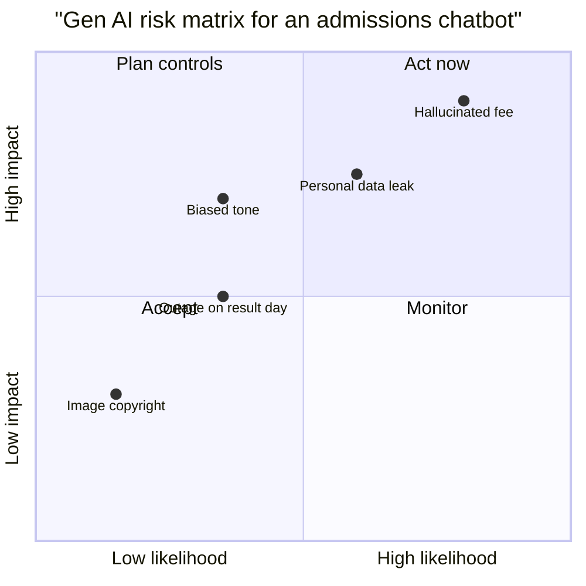
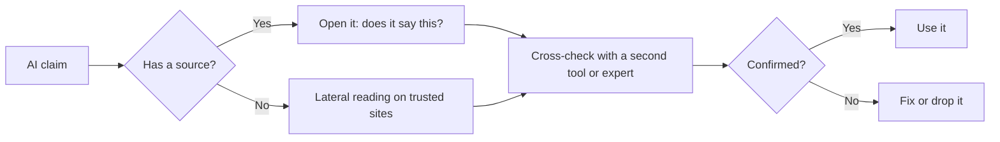

# Session 5 · Weighing the Pros and Cons of Generative AI

[](https://colab.research.google.com/github/Hamnakhan123/Generative-AI/blob/main/02-gen-ai-accelerator/code/session-05-weighing-pros-and-cons.ipynb)

> 🧭 [Generative AI](../README.md) › [Track 2 · Gen AI Accelerator](README.md) › **Session 5**
>
> ⏱️ **Estimated time:** 2 hours · 📋 **Prerequisites:** Previous session

[⬅ Previous](session-04-collaborating-with-ai-for-smart-learning.md) · [🏠 Track home](README.md) · [Next ➡](session-06-human-ai-collaboration.md)

---

## 🎯 Learning objectives

- List the main **benefits** of generative AI for individuals, education and business.
- Explain the main **risks**: hallucination, bias, privacy, intellectual property, security, over-reliance, environmental cost and jobs.
- Use a **likelihood × impact risk matrix** to judge an AI use case.
- Apply a **verification routine** (lateral reading, source check, cross-tool check) to AI output.
- Decide when to **use, limit or avoid** AI for a task.

## 📖 Concepts

### 1. Benefits

| Benefit | Example |
|---|---|
| **Speed** | First drafts of emails, reports, code in minutes |
| **Access** | Explanations in simpler language or another language; help for people with disabilities (speech-to-text, alt text) |
| **Personalisation** | Practice questions at the learner's level |
| **Creativity** | Many ideas and variations quickly |
| **Scale** | One support bot answering hundreds of routine questions |
| **Cost** | Small teams produce designs, videos and code they could not afford before |

### 2. Risks

| Risk | What it looks like | Mitigation |
|---|---|---|
| **Hallucination** | Wrong facts, fake citations, invented numbers | Verify; use tools with sources; ground in your documents |
| **Bias** | Stereotyped images or unequal treatment of groups | Test with varied inputs; human review; diverse data |
| **Privacy** | Personal or confidential data pasted into public tools | Redact; approved/enterprise plans; data controls |
| **Intellectual property** | Unclear copyright of outputs; outputs resembling protected work | Check tool licences; avoid "in the style of [living artist]" for commercial work; disclose |
| **Security** | Prompt injection, AI-written phishing, deepfakes | Least privilege; verify identities; awareness training |
| **Over-reliance** | Skills fade; errors accepted without thought ("automation bias") | Keep humans thinking; use AI as a second opinion |
| **Environmental cost** | Training and running large models uses significant electricity and water | Use AI where it adds value; smaller models when enough |
| **Jobs & skills** | Tasks change; some roles shrink, new ones appear | Reskill; focus on judgement, domain knowledge, communication |

### 3. Hallucination — why it happens

The model generates the **most plausible** text, not the **verified** text. It has no built-in truth check, so gaps in training data, rare topics, precise numbers and citations are where errors cluster. Asking it "Are you sure?" does not reliably fix this — **external verification** does.

### 4. The verification routine (V-3)

1. **Source check:** Does the claim have a source? Open it — does it actually say this?
2. **Lateral reading:** Search the claim independently on trusted sites (official, academic, reputable news).
3. **Cross-check:** Ask a second tool or a human expert; disagreements show you where to dig.

### 5. Use, limit or avoid?

| Use freely | Use with limits (human review) | Avoid / not allowed |
|---|---|---|
| Brainstorming, drafts, explanations, formatting | Grades, health or legal information, published content, code in production | Closed exams, decisions about people without oversight, confidential data in public tools |

## 🧭 Diagrams





## 💻 Worked examples

### Example 1 — Checking AI numbers against a trusted source

```python
# file: session-05_fact_check.py
"""Verify AI claims against a trusted source before you reuse them.
Here the 'trusted source' is a small dictionary; in real life it is an official site or textbook."""
trusted = {"boiling point of water at sea level (C)": 100,
           "speed of light (km/s)": 299792,
           "number of provinces in Pakistan": 4}
ai_claims = {"boiling point of water at sea level (C)": 100,
             "speed of light (km/s)": 300000,
             "number of provinces in Pakistan": 5}

for claim, value in ai_claims.items():
    truth = trusted[claim]
    err = abs(value - truth) / truth
    verdict = "OK" if err == 0 else ("ROUNDED" if err < 0.01 else "WRONG - fix before use")
    print(f"{claim:42} AI={value:<8} source={truth:<8} {verdict}")
```

**Output**

```text
boiling point of water at sea level (C)    AI=100      source=100      OK
speed of light (km/s)                      AI=300000   source=299792   ROUNDED
number of provinces in Pakistan            AI=5        source=4        WRONG - fix before use
```

A rounded value can be fine in a slide; a wrong count of provinces in an official document is not.

### Example 2 — Risk matrix for a use case

Score each risk 1–5 for likelihood and impact; multiply; act on the highest first.

```python
# file: session-05_risk_matrix.py
"""Score Gen AI risks by likelihood x impact (1-5 each) for one use case:
an AI chatbot that answers student admission questions."""
risks = {
    "Hallucinated fee or deadline": (4, 5),
    "Personal data pasted into chat": (3, 4),
    "Biased tone towards some applicants": (2, 4),
    "Copyright issue in generated images": (1, 2),
    "Service outage on result day": (2, 3),
}
ranked = sorted(risks.items(), key=lambda kv: kv[1][0] * kv[1][1], reverse=True)
print(f"{'Risk':38} L  I  Score  Level")
for name, (l, i) in ranked:
    s = l * i
    level = "HIGH" if s >= 15 else "MEDIUM" if s >= 8 else "LOW"
    print(f"{name:38} {l}  {i}  {s:>5}  {level}")
```

**Output**

```text
Risk                                   L  I  Score  Level
Hallucinated fee or deadline           4  5     20  HIGH
Personal data pasted into chat         3  4     12  MEDIUM
Biased tone towards some applicants    2  4      8  MEDIUM
Service outage on result day           2  3      6  LOW
Copyright issue in generated images    1  2      2  LOW
```

**Controls for the top risk:** answer fees and deadlines only from an approved document (retrieval), show the source link, and add "Confirm on the official admissions page" to every answer.

### Example 3 — Prompting for honesty

```text
Answer the question below. If you are not sure, say "I am not certain" and explain what I should check.
Separate facts you are confident about from estimates. Do not invent references.
Question: What percentage of Pakistan's electricity came from solar in 2024?
```

This does not guarantee accuracy, but it makes uncertainty visible so you know what to verify.

### Example 4 — Pros and cons debate

```text
Act as two debaters. Debater A argues that universities should allow generative AI in all coursework;
Debater B argues for strict limits. Give 3 arguments each with one real-world example, then a neutral 3-line verdict.
```

## 🧪 Lab / practice tasks

**Task 1 · 🟢 Easy** — Ask an assistant for 5 statistics on a topic you know well. Verify each with V-3 and mark it correct, rounded, outdated or wrong.

<details><summary>💡 Hint</summary>

Search each number on an official or academic site.

</details>

**Task 2 · 🟢 Easy** — Generate 4 images of "a doctor", "an engineer", "a nurse", "a CEO". Note any patterns in gender, age or ethnicity.

<details><summary>💡 Hint</summary>

Then try adding diversity explicitly and compare.

</details>

**Task 3 · 🟡 Medium** — Build a risk matrix for one AI use in your department (e.g. AI-graded quizzes) using `session-05_risk_matrix.py`. Propose controls for the top two risks.

<details><summary>💡 Hint</summary>

Replace the `risks` dictionary with your own scores.

</details>

**Task 4 · 🟡 Medium** — Run the pros-and-cons debate prompt on "AI in hiring" and write your own one-paragraph position.

<details><summary>💡 Hint</summary>

Disagree with the AI where you have evidence.

</details>

**Task 5 · 🔴 Challenge** — Extend `session-05_fact_check.py` to read claims from a CSV and output a verification report with a percentage of claims confirmed.

<details><summary>💡 Hint</summary>

Use the csv module; write results to a new CSV.

</details>


## ✅ Quick quiz

**Q1. Which is the most reliable way to deal with hallucination?**

- A) Ask "Are you sure?"
- B) External verification against trusted sources
- C) Use a higher temperature
- D) Use longer prompts only

<details><summary>Show answer</summary>

✅ **B) External verification against trusted sources** — Self-checks are not reliable; outside sources are.

</details>

**Q2. "Automation bias" means...**

- A) AI is biased against machines
- B) People accept automated output without enough scrutiny
- C) Robots replace jobs
- D) Models train faster

<details><summary>Show answer</summary>

✅ **B) People accept automated output without enough scrutiny** — Over-trust leads to missed errors.

</details>

**Q3. In a risk matrix, a risk with likelihood 4 and impact 5 scores...**

- A) 9
- B) 20
- C) 1
- D) 45

<details><summary>Show answer</summary>

✅ **B) 20** — Score = likelihood × impact.

</details>

**Q4. Lateral reading means...**

- A) Reading the AI answer twice
- B) Checking the claim independently on other trusted sources
- C) Reading sideways
- D) Skimming

<details><summary>Show answer</summary>

✅ **B) Checking the claim independently on other trusted sources** — Leave the page to verify it.

</details>

**Q5. Which use should have human review?**

- A) Brainstorming names
- B) Health or legal information given to the public
- C) Formatting a table
- D) Generating practice quiz ideas

<details><summary>Show answer</summary>

✅ **B) Health or legal information given to the public** — High-stakes outputs need oversight.

</details>


## 📝 Summary / cheat-sheet

- **Benefits:** speed, access, personalisation, creativity, scale, cost.
- **Risks:** hallucination, bias, privacy, IP, security, over-reliance, environment, jobs.
- Hallucination comes from **plausibility without a truth check**.
- **V-3:** source check → lateral reading → cross-check.
- Risk score = **likelihood × impact**; act on HIGH first.
- Decide: **use freely / use with review / avoid**.

**Viva / interview questions**

1. Give three benefits and three risks of generative AI in education.
2. Why do LLMs hallucinate citations in particular?
3. Explain the V-3 verification routine with an example.
4. Build a quick risk matrix for an AI chatbot on a university website.
5. How do you balance AI productivity gains against over-reliance?

---

[⬅ Previous](session-04-collaborating-with-ai-for-smart-learning.md) · [🏠 Track home](README.md) · [Next ➡](session-06-human-ai-collaboration.md)

<sub>Prepared by **Hamna Zahid Khan**, Junior Lecturer</sub>
