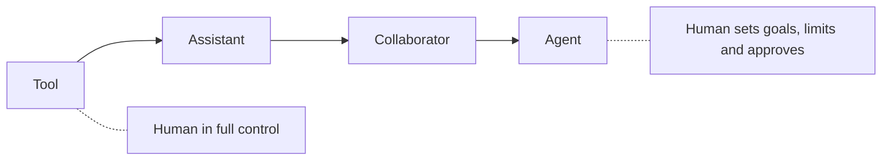
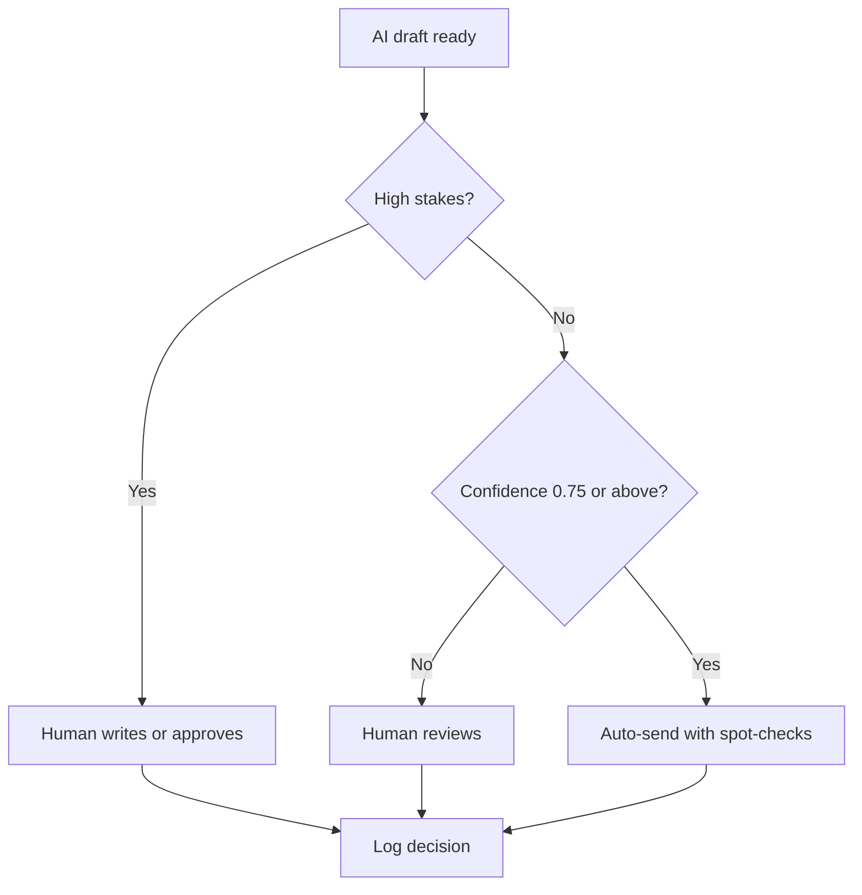

# Session 6 · Human–AI Collaboration Essentials

[](https://colab.research.google.com/github/Hamnakhan123/Generative-AI/blob/main/02-gen-ai-accelerator/code/session-06-human-ai-collaboration.ipynb)

> 🧭 [Generative AI](../README.md) › [Track 2 · Gen AI Accelerator](README.md) › **Session 6**
>
> ⏱️ **Estimated time:** 2 hours · 📋 **Prerequisites:** Previous session

[⬅ Previous](session-05-weighing-pros-and-cons.md) · [🏠 Track home](README.md) · [Next ➡](session-07-responsible-ai-and-ethics.md)

---

## 🎯 Learning objectives

- Describe models of **human–AI collaboration**: AI as tool, assistant, collaborator and agent.
- Compare the **centaur** and **cyborg** working styles and know when each fits.
- Decide **what to delegate** to AI using a task-by-task delegation matrix.
- Design a **human-in-the-loop (HITL)** workflow with clear review points.
- Communicate with AI as a **teammate**: context, feedback, iteration, and owning the result.

## 📖 Concepts

### 1. Four levels of collaboration

| Level | AI role | Human role | Example |
|---|---|---|---|
| **Tool** | Does one narrow action on request | Fully in control | Grammar check, background removal |
| **Assistant** | Drafts and suggests | Directs and edits | Email or lesson-plan drafts |
| **Collaborator** | Contributes ideas, critiques, alternatives | Co-creates and decides | Brainstorming a research question together |
| **Agent** | Plans and carries out multi-step tasks | Sets goals, limits and approves | Booking a meeting, filing tickets, running a workflow |

The higher the level, the more important **limits, permissions and review** become.

### 2. Centaurs and cyborgs

Researchers studying consultants using AI (Harvard–BCG field experiment, 2023) described two effective styles:

- **Centaur:** clear split — the human does some sub-tasks, AI does others (e.g. AI drafts, human analyses and decides).
- **Cyborg:** tight interweaving — human and AI work sentence-by-sentence, constantly switching.

The same study found a **"jagged frontier"**: AI boosted quality and speed on tasks inside its capabilities but made people *more* likely to be wrong on a task just outside them. Knowing where the frontier lies is a core skill.

### 3. The delegation matrix

Ask two questions per task: **How well does AI do this?** and **How costly is a mistake?**

| | Low cost of error | High cost of error |
|---|---|---|
| **AI does it well** | ✅ Delegate, spot-check | 🟡 Delegate the draft, human approves |
| **AI does it poorly** | 🧪 Experiment, keep human lead | ⛔ Human does it |

### 4. Human-in-the-loop design

- **Human-in-the-loop:** a person approves before any action (e.g. grades, refunds).
- **Human-on-the-loop:** AI acts, a person monitors and can step in (e.g. routine FAQ replies with spot-checks).
- **Human-out-of-the-loop:** fully automatic — only for low-stakes, well-tested tasks.

Good HITL design routes by **stakes** and **confidence**, logs decisions, and makes overriding the AI easy.

### 5. Working with AI as a teammate

1. **Brief it like a new colleague:** goal, audience, constraints, examples of good work.
2. **Give specific feedback:** "Too formal; cut to 100 words; keep point 3."
3. **Ask it to challenge you:** "What's weak about my plan? What am I missing?"
4. **Divide the work explicitly:** "You list options; I'll choose; then you draft."
5. **Own the outcome:** your name is on it — you are accountable, not the tool.

### 6. Skills that grow in value

Judgement, domain expertise, asking good questions, critical evaluation, ethics, communication and collaboration with people.

## 🧭 Diagrams





## 💻 Worked examples

### Example 1 — Routing drafts by stakes and confidence

A student-services inbox gets AI-drafted replies. High-stakes topics always go to a person, low-confidence ones get reviewed, the rest are sent with spot-checks.

```python
# file: session-06_hitl_review.py
"""Human-in-the-loop routing: let AI handle routine, high-confidence items and
send risky or uncertain ones to a person."""
drafts = [
    ("Reply: library timings", 0.95, "low"),
    ("Reply: fee refund request", 0.90, "high"),
    ("Reply: exam re-take policy", 0.62, "medium"),
    ("Reply: Wi-Fi password reset steps", 0.88, "low"),
    ("Reply: harassment complaint", 0.97, "high"),
]

def route(conf, stakes):
    if stakes == "high":
        return "HUMAN writes/approves"
    if conf < 0.75:
        return "HUMAN reviews"
    return "AUTO send + spot-check"

counts = {}
for item, conf, stakes in drafts:
    r = route(conf, stakes)
    counts[r] = counts.get(r, 0) + 1
    print(f"{item:36} conf={conf:.2f} stakes={stakes:6} -> {r}")
print("\n", counts)
```

**Output**

```text
Reply: library timings               conf=0.95 stakes=low    -> AUTO send + spot-check
Reply: fee refund request            conf=0.90 stakes=high   -> HUMAN writes/approves
Reply: exam re-take policy           conf=0.62 stakes=medium -> HUMAN reviews
Reply: Wi-Fi password reset steps    conf=0.88 stakes=low    -> AUTO send + spot-check
Reply: harassment complaint          conf=0.97 stakes=high   -> HUMAN writes/approves

 {'AUTO send + spot-check': 2, 'HUMAN writes/approves': 2, 'HUMAN reviews': 1}
```

Note: the harassment complaint has a **very high confidence** but still goes to a human — confidence is not the same as appropriateness.

### Example 2 — Centaur workflow for a research proposal

| Step | Who | Output |
|---|---|---|
| 1. Define problem and scope | Human | 3-line problem statement |
| 2. Generate 10 possible research questions | AI | List |
| 3. Choose and justify one | Human | Selected question |
| 4. Suggest methods and risks | AI | Draft table |
| 5. Check feasibility with supervisor | Human | Decision |
| 6. Polish language | AI | Clean draft |
| 7. Final review and sign-off | Human | Submitted proposal |

### Example 3 — Asking AI to push back

```text
Here is my plan to introduce weekly AI-assisted quizzes in my lab course.
Act as a sceptical head of department. List the 5 strongest objections, rank them by seriousness,
and for each suggest what evidence would convince you.
```

### Example 4 — Clear division of labour in one prompt

```text
We're writing a lab manual section on stacks together.
You: propose an outline and 3 exercises. Me: I'll pick and edit.
Wait for my choices before writing any full section.
```

## 🧪 Lab / practice tasks

**Task 1 · 🟢 Easy** — List 10 tasks from your week and place each in the delegation matrix.

<details><summary>💡 Hint</summary>

Two questions: how good is AI at it, how bad is a mistake?

</details>

**Task 2 · 🟢 Easy** — Use the "sceptical head of department" prompt on a plan of your own and rewrite the plan to answer the top 2 objections.

<details><summary>💡 Hint</summary>

Ask for objections ranked by seriousness.

</details>

**Task 3 · 🟡 Medium** — Run a centaur workflow on a small document (e.g. a lab handout) and record which steps were human vs AI and the time each took.

<details><summary>💡 Hint</summary>

Use the 7-step table as a template.

</details>

**Task 4 · 🟡 Medium** — Find one task where AI performed badly for you (outside the frontier). Describe what went wrong and how you would detect it next time.

<details><summary>💡 Hint</summary>

Precise numbers, niche local facts and long logic chains are common weak spots.

</details>

**Task 5 · 🔴 Challenge** — Extend `session-06_hitl_review.py` with a daily cap on auto-sends and a random 10% sample of auto items sent for human audit.

<details><summary>💡 Hint</summary>

Use `random.seed(0)` so results are repeatable.

</details>


## ✅ Quick quiz

**Q1. In the "centaur" style, human and AI...**

- A) Never interact
- B) Split the work into clear separate sub-tasks
- C) Work sentence by sentence
- D) Let AI decide everything

<details><summary>Show answer</summary>

✅ **B) Split the work into clear separate sub-tasks** — Centaurs divide the work.

</details>

**Q2. The "jagged frontier" idea says that...**

- A) AI is equally good at everything
- B) AI helps on some tasks and hurts on tasks just outside its abilities
- C) AI is always worse than humans
- D) Only coders benefit

<details><summary>Show answer</summary>

✅ **B) AI helps on some tasks and hurts on tasks just outside its abilities** — Know where the frontier lies.

</details>

**Q3. A task AI does well with high cost of error should be...**

- A) Fully automated
- B) Drafted by AI, approved by a human
- C) Banned
- D) Ignored

<details><summary>Show answer</summary>

✅ **B) Drafted by AI, approved by a human** — High stakes need approval.

</details>

**Q4. "Human-on-the-loop" means...**

- A) A human approves every action first
- B) AI acts while a human monitors and can intervene
- C) No human involvement
- D) The human does all the work

<details><summary>Show answer</summary>

✅ **B) AI acts while a human monitors and can intervene** — Monitoring with the power to step in.

</details>

**Q5. Who is accountable for work you submit with AI help?**

- A) The AI company
- B) You
- C) Nobody
- D) The internet

<details><summary>Show answer</summary>

✅ **B) You** — You own the outcome.

</details>


## 📝 Summary / cheat-sheet

- Levels: **tool → assistant → collaborator → agent**; more autonomy needs more limits.
- **Centaur** (divide tasks) vs **cyborg** (interweave); beware the **jagged frontier**.
- Delegation matrix: AI skill × cost of error.
- HITL: **in / on / out of the loop**; route by stakes and confidence; log decisions.
- Treat AI like a teammate: brief, feedback, challenge, divide work, **own the result**.

**Viva / interview questions**

1. Explain the four levels of human–AI collaboration with examples.
2. What is the difference between centaur and cyborg working styles?
3. What does the "jagged frontier" mean for everyday AI use?
4. Design a HITL workflow for AI-drafted student emails.
5. Which human skills become more valuable as AI improves, and why?

---

[⬅ Previous](session-05-weighing-pros-and-cons.md) · [🏠 Track home](README.md) · [Next ➡](session-07-responsible-ai-and-ethics.md)

<sub>Prepared by **Hamna Zahid Khan**, Junior Lecturer</sub>
