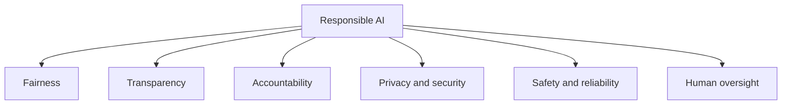
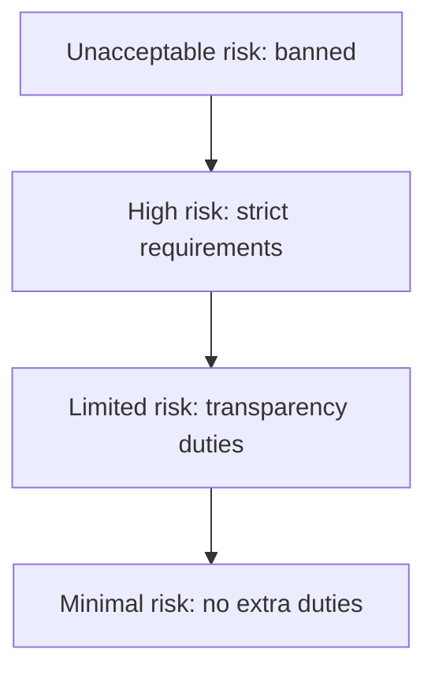

# Session 7 · Responsible AI and Ethical Considerations

[](https://colab.research.google.com/github/Hamnakhan123/Generative-AI/blob/main/02-gen-ai-accelerator/code/session-07-responsible-ai-and-ethics.ipynb)

> 🧭 [Generative AI](../README.md) › [Track 2 · Gen AI Accelerator](README.md) › **Session 7**
>
> ⏱️ **Estimated time:** 2 hours · 📋 **Prerequisites:** Previous session

[⬅ Previous](session-06-human-ai-collaboration.md) · [🏠 Track home](README.md) · [Next ➡](../03-innovate-with-generative-ai/session-01-generative-ai-for-creators.md)

---

## 🎯 Learning objectives

- State the core **principles of responsible AI**: fairness, transparency, accountability, privacy, safety and human oversight.
- Identify **ethical issues** in Gen AI: bias, deepfakes and misinformation, consent, copyright, labour and environment.
- Run a simple **bias audit** using selection rates and the four-fifths rule.
- **Protect personal data** with redaction before using public AI tools.
- Know the main **regulations and policies** (EU AI Act, data-protection laws, institutional AI policies) and write a short AI-use policy.

## 📖 Concepts

### 1. Six principles of responsible AI

| Principle | Question to ask |
|---|---|
| **Fairness** | Does it treat people and groups equitably? |
| **Transparency** | Do people know AI is involved and roughly how it works? |
| **Accountability** | Who is responsible when it goes wrong? |
| **Privacy & security** | Is personal data minimised, protected and used with consent? |
| **Safety & reliability** | Is it tested, monitored and robust against misuse? |
| **Human oversight** | Can a person review, override or switch it off? |

Major frameworks (OECD AI Principles, UNESCO Recommendation on the Ethics of AI, NIST AI Risk Management Framework, company principles from Microsoft and Google) all cover variations of these.

### 2. Ethical issues specific to generative AI

| Issue | Example | Response |
|---|---|---|
| **Bias & stereotypes** | Image tool shows only men as engineers | Test varied prompts; diverse review; report issues |
| **Deepfakes & misinformation** | Fake audio of a politician; fake exam-cancellation notice | Verify sources; watermarking/content credentials (C2PA); media literacy |
| **Consent** | Cloning a colleague's voice without permission | Explicit consent; never impersonate |
| **Copyright & attribution** | Using outputs that copy protected work | Check licences; credit sources; disclose AI use |
| **Labour** | Low-paid data-labelling work; jobs changing | Fair sourcing; reskilling |
| **Environment** | Energy and water used by data centres | Use AI proportionately; prefer efficient models |

### 3. Measuring bias — the four-fifths rule

When a system selects people (shortlisting, admissions, loans), compare **selection rates** per group. A common screening test from US employment guidelines: if a group's rate is **less than 80%** of the highest group's rate, there may be **adverse impact** that needs investigation. It is a red flag, not proof.

### 4. Privacy in practice

- **Data minimisation:** only share what the task needs.
- **Redact** names, ID numbers, phone numbers, emails and roll numbers before using a public tool.
- Prefer **approved / enterprise** tools whose terms say your data is not used for training.
- In Pakistan, the **Prevention of Electronic Crimes Act (PECA) 2016** covers misuse of personal information and identity, and a personal data protection bill has been under discussion; in the EU, the **GDPR** applies. Your institution's policy also binds you.

### 5. Regulation snapshot

- **EU AI Act** (in force 2024, applied in phases): a **risk-based** law — *unacceptable* (banned, e.g. social scoring), *high* (strict duties, e.g. AI in education admissions or hiring), *limited* (transparency duties, e.g. chatbots and deepfakes must be disclosed), *minimal* (no extra duties).
- **Institutional AI policies** set what students and staff may do, how to disclose AI use, and which tools are approved.

### 6. Disclosure

A simple disclosure line builds trust:

```text
AI use: I used ChatGPT to brainstorm the outline and check grammar. All analysis, data and conclusions are my own and were verified.
```

## 🧭 Diagrams





## 💻 Worked examples

### Example 1 — Bias audit of an AI shortlisting tool

```python
# file: session-07_bias_audit.py
"""Check an AI screening tool for disparate impact with the four-fifths (80%) rule:
each group's selection rate should be at least 80% of the highest group's rate."""
results = {  # group: (applicants, shortlisted by the AI tool)
    "Group A": (200, 60),
    "Group B": (150, 30),
    "Group C": (100, 27),
}
rates = {g: s / n for g, (n, s) in results.items()}
best = max(rates.values())
print(f"{'Group':8} {'rate':>6} {'ratio':>6}  check")
for g, r in rates.items():
    ratio = r / best
    print(f"{g:8} {r:>6.2f} {ratio:>6.2f}  {'OK' if ratio >= 0.8 else 'POSSIBLE BIAS - investigate'}")
```

**Output**

```text
Group      rate  ratio  check
Group A    0.30   1.00  OK
Group B    0.20   0.67  POSSIBLE BIAS - investigate
Group C    0.27   0.90  OK
```

Group B's rate is only 67% of Group A's, below the 80% threshold — investigate the features and training data before using the tool.

### Example 2 — Redact before you paste

```python
# file: session-07_pii_redactor.py
"""Redact personal data before pasting text into a public AI tool."""
import re

PATTERNS = [
    ("EMAIL", r"[\w.+-]+@[\w-]+\.[\w.]+"),
    ("CNIC", r"\b\d{5}-\d{7}-\d\b"),
    ("PHONE", r"\b03\d{2}-?\d{7}\b"),
    ("ROLLNO", r"\b[A-Z]{2}\d{2}-\d{4}\b"),
]

def redact(text):
    found = {}
    for label, pat in PATTERNS:
        text, n = re.subn(pat, f"[{label}]", text)
        if n: found[label] = n
    return text, found

msg = ("Student Ayesha Khan (roll CS23-0412, CNIC 42101-1234567-8) emailed "
       "ayesha.k@example.com from 0321-5551234 asking about her grade.")
clean, found = redact(msg)
print(clean)
print("redacted:", found)
```

**Output**

```text
Student Ayesha Khan (roll [ROLLNO], CNIC [CNIC]) emailed [EMAIL] from [PHONE] asking about her grade.
redacted: {'EMAIL': 1, 'CNIC': 1, 'PHONE': 1, 'ROLLNO': 1}
```

The name is **not** caught — pattern-based redaction misses free-text names. Review manually or use a dedicated PII tool, and replace names with placeholders like `[STUDENT]`.

### Example 3 — An ethics review prompt

```text
Act as an AI ethics reviewer. For the use case below, assess fairness, transparency, accountability,
privacy, safety and human oversight. For each give a risk (low/medium/high) and one concrete control.
Use case: An AI tool that drafts feedback comments on student essays, which teachers then edit.
```

### Example 4 — A one-page AI-use policy for a course

| Section | Content |
|---|---|
| Allowed | Brainstorming, explanations, grammar checks, self-quizzing |
| Allowed with disclosure | Outline feedback, code hints, translation |
| Not allowed | AI-written submissions, AI in quizzes/exams, fabricated references |
| Data | No personal or confidential data in public tools |
| Disclosure | One line stating tool and purpose on every submission |
| Consequence | Handled under the academic integrity policy |

## 🧪 Lab / practice tasks

**Task 1 · 🟢 Easy** — Write a disclosure statement for an assignment where you used AI for brainstorming and grammar.

<details><summary>💡 Hint</summary>

Name the tool, the purpose and what remained your own work.

</details>

**Task 2 · 🟢 Easy** — Find your institution's (or a well-known university's) AI policy and summarise its rules in a 🟢🟡🔴 table.

<details><summary>💡 Hint</summary>

Look for "generative AI policy" on the university site.

</details>

**Task 3 · 🟡 Medium** — Use `session-07_bias_audit.py` with your own made-up numbers for an admissions tool; adjust them until all groups pass and explain what that means in practice.

<details><summary>💡 Hint</summary>

Passing the four-fifths rule is a screen, not proof of fairness.

</details>

**Task 4 · 🟡 Medium** — Run the ethics review prompt on an AI use you would like to introduce in class and turn its controls into a checklist.

<details><summary>💡 Hint</summary>

Push back where you think the AI is too lenient or too strict.

</details>

**Task 5 · 🔴 Challenge** — Improve `session-07_pii_redactor.py` so it also replaces names from a given class list with `[STUDENT]` and reports how many were redacted.

<details><summary>💡 Hint</summary>

Loop over the list with `re.sub(re.escape(name), ...)`.

</details>


## ✅ Quick quiz

**Q1. Which principle asks "Who is responsible when it goes wrong?"**

- A) Fairness
- B) Accountability
- C) Transparency
- D) Safety

<details><summary>Show answer</summary>

✅ **B) Accountability** — Accountability assigns responsibility.

</details>

**Q2. Under the four-fifths rule, a group selected at 0.20 when the top group is at 0.30 has a ratio of...**

- A) 0.67 — investigate
- B) 1.5 — fine
- C) 0.90 — fine
- D) 0.20 — fine

<details><summary>Show answer</summary>

✅ **A) 0.67 — investigate** — 0.20 / 0.30 = 0.67, below 0.8.

</details>

**Q3. The EU AI Act classifies AI systems by...**

- A) Company size
- B) Level of risk
- C) Programming language
- D) Price

<details><summary>Show answer</summary>

✅ **B) Level of risk** — Unacceptable, high, limited, minimal.

</details>

**Q4. Before pasting student data into a public AI tool you should...**

- A) Do nothing
- B) Redact personal identifiers or use an approved tool
- C) Translate it
- D) Add emojis

<details><summary>Show answer</summary>

✅ **B) Redact personal identifiers or use an approved tool** — Data minimisation and redaction.

</details>

**Q5. A deepfake is...**

- A) A secure password
- B) Synthetic media that realistically imitates a real person
- C) A type of database
- D) A bias test

<details><summary>Show answer</summary>

✅ **B) Synthetic media that realistically imitates a real person** — Verify and disclose; never create without consent.

</details>


## 📝 Summary / cheat-sheet

- Principles: **fairness, transparency, accountability, privacy & security, safety & reliability, human oversight**.
- Gen AI issues: **bias, deepfakes, consent, copyright, labour, environment**.
- Bias screen: **four-fifths rule** (rate ÷ highest rate < 0.8 → investigate).
- Privacy: **minimise, redact, approved tools**; know local and institutional rules.
- **EU AI Act** risk tiers: unacceptable · high · limited · minimal.
- Always **disclose** AI use where required.

**Viva / interview questions**

1. Name the six principles of responsible AI and give an example of each.
2. How would you check an AI shortlisting tool for bias?
3. What are the four risk tiers of the EU AI Act?
4. Why is pattern-based PII redaction not enough on its own?
5. Draft the key rules of an AI-use policy for your course.

---

[⬅ Previous](session-06-human-ai-collaboration.md) · [🏠 Track home](README.md) · [Next ➡](../03-innovate-with-generative-ai/session-01-generative-ai-for-creators.md)

<sub>Prepared by **Hamna Zahid Khan**, Junior Lecturer</sub>
