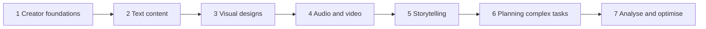

# Track 3 · Innovate with Generative AI

> 🧭 [⬆ Up](../README.md) · Generative AI › **Track 3 · Innovate with Generative AI**

Prepared by **Hamna Zahid Khan**, Junior Lecturer

## 📌 About this track

Innovate with Generative AI is the creator's track. You will use generative AI to make real content: written pieces (essays, reports, blogs, social posts), visual designs (images, posters, presentations), audio and video, and stories with well-built plots and characters. You will then plan complex work such as events, campaigns and content projects, and finish by measuring and improving how your content performs.

Every session pairs the creative workflow with **real, runnable Python tools** that check your work: readability scores, contrast checks, subtitle generators, story continuity checkers, critical-path schedulers and analytics audits.

**By the end you will be able to:**

- Choose the right Gen AI tool and modality for any creative task.
- Write effective prompts for text, images, audio and video, and refine results with targeted feedback.
- Produce posters and slide decks that are readable and on-brand, and promo videos with timed narration and captions.
- Plan stories with arcs, character bibles and branching paths, and keep long AI-written stories consistent.
- Plan events and campaigns with SMART goals, critical paths and budget forecasts.
- Measure content with ER, CTR, CVR and CPA, run A/B significance tests and optimise a strategy from data.

## 🧭 Learning path

## 🛠️ Setup

- A free account on at least one chat assistant (ChatGPT, Gemini, Copilot or Claude), one image tool (e.g. Firefly, Ideogram, Canva) and one video/audio editor with AI features (e.g. CapCut). Free tiers are enough.
- Python 3.10+ for the `code/` folder. Most scripts use only the standard library; charts need `matplotlib` and Session 7 needs `pandas` (`pip install matplotlib pandas`).
- Notebooks open in Jupyter or Google Colab with the badge at the top of each session. See [code/README.md](code/README.md) for every file and how to run it.

## 🗂️ Sessions

| # | Session | Time |
|---|---|---|
| 1 | [Generative AI for Creators: Foundations and Toolkit](session-01-generative-ai-for-creators.md) | 2 hours |
| 2 | [Creating Textual Content with Generative AI](session-02-creating-textual-content.md) | 2 hours |
| 3 | [Creating Visual Designs: Images, Posters and Presentations](session-03-creating-visual-designs.md) | 2 hours |
| 4 | [Creating Audio and Video with Generative AI](session-04-creating-audio-and-video.md) | 2 hours |
| 5 | [Storytelling with Generative AI](session-05-storytelling-with-generative-ai.md) | 2 hours |
| 6 | [Planning Complex Tasks: Events, Campaigns and Projects](session-06-planning-complex-tasks.md) | 2 hours |
| 7 | [Analysing and Optimising Content Strategies](session-07-analyzing-and-optimizing-content.md) | 2 hours |

📝 **Module practice test:** [practice-test.md](practice-test.md) — 20 MCQs + 3 scenario questions with solutions.

## 📋 One-page cheat sheet

| Topic | Remember |
|---|---|
| Gen AI vs traditional AI | Generative **creates** content; traditional **classifies/predicts** |
| How models generate | LLMs predict the **next token**; image/video models **denoise** toward the prompt |
| Creator workflow | **Brief → Generate → Review → Refine → Publish**; count review time |
| Modalities | Text · image · audio · video · slides/design |
| Writing prompts | **RTACFC**: Role, Task, Audience, Context, Format, Constraints + examples + `"""delimiters"""` |
| Long writing | Outline → draft **section by section** → check → targeted revision |
| Readability | Flesch: 60–70 plain English; short sentences and words raise it |
| Image prompts | Subject · setting · style · lighting · composition · palette · **aspect ratio** · **negative prompt** |
| Posters | Art without text → add text yourself → contrast **4.5:1** body, **3:1** headings |
| Slides | One idea per slide, point-stating headline, **6×6 rule**, detail in speaker notes |
| Audio basics | Sample rate · bit depth · amplitude; never exceed 1.0 (clipping) |
| Video planning | Script → time at **150 wpm** (30 s ≈ 75 words) → storyboard → generate → edit → captions |
| Captions | SRT: number, `HH:MM:SS,mmm --> …`, ≤ 2 lines × ~42 chars |
| Story elements | Character · want · conflict · stakes · setting · theme · resolution |
| Structures | Three-act · Freytag five-stage · hero's journey · story spine |
| Characters | **Want, need, flaw, voice**, fixed facts in a **story bible** |
| Planning pattern | **AI drafts → code calculates → human decides** |
| Planning tools | SMART · WBS · dependencies · **critical path** (zero slack) · Gantt · RACI · risk register |
| Paid media | Impressions = spend ÷ CPM × 1,000 · CTR = clicks ÷ impressions · CPA = spend ÷ results |
| Content metrics | ER = engagements ÷ reach · CVR = conversions ÷ clicks; compute rates **from totals** |
| A/B tests | Significant when \|z\| ≥ 1.96 (p < 0.05); small samples prove little |
| Optimisation loop | Measure → analyse → hypothesise → test → scale → repeat |
| Ethics | Consent for voices/faces · no deepfakes · disclose AI · respect copyright · no personal data in free tools |

## ✅ Track checklist

- [ ] Finished all 7 sessions, their lab tasks and mini projects
- [ ] Ran every script in `code/` and compared your output with the session page
- [ ] Scored at least 4/5 on every session quiz
- [ ] Attempted the [practice test](practice-test.md) in 60 minutes
- [ ] Built one complete content pack: blog post, poster, 30-second reel with captions, and a one-page performance report

---
Prepared by **Hamna Zahid Khan**, Junior Lecturer
