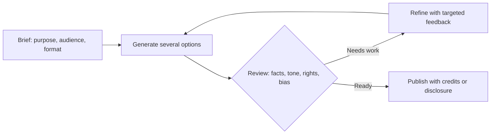
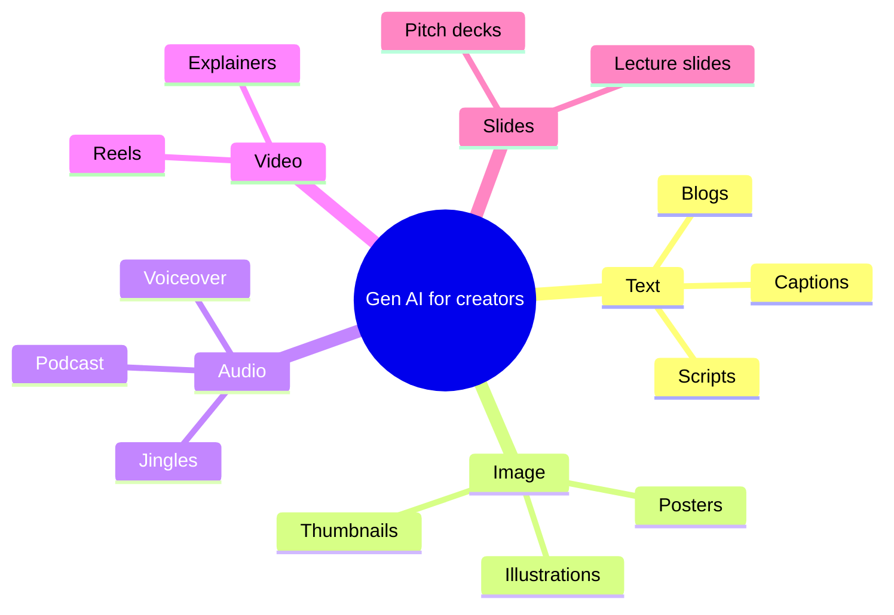
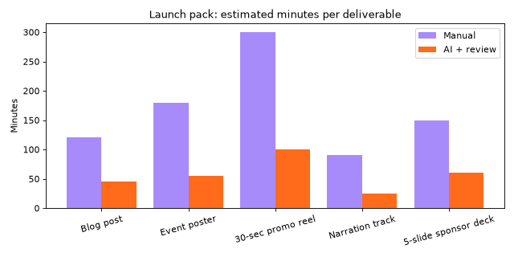
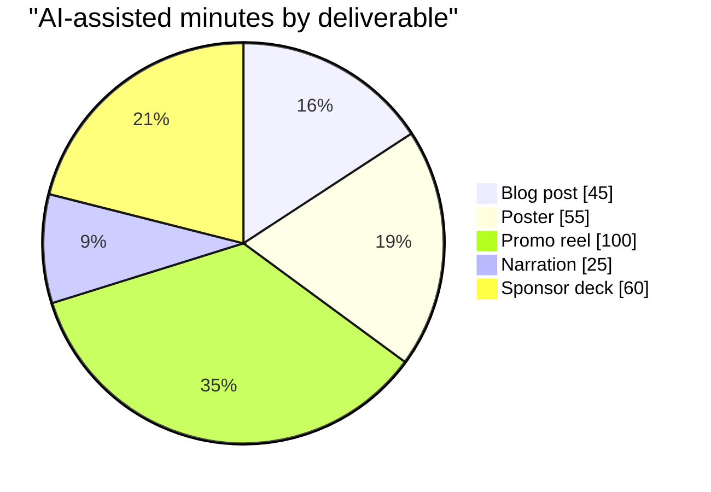

# Session 1 · Generative AI for Creators: Foundations and Toolkit

[](https://colab.research.google.com/github/Hamnakhan123/Generative-AI/blob/main/03-innovate-with-generative-ai/code/session-01-generative-ai-for-creators.ipynb)

> 🧭 [Generative AI](../README.md) › [Track 3 · Innovate with Generative AI](README.md) › **Session 1**
>
> ⏱️ **Estimated time:** 2 hours · 📋 **Prerequisites:** Tracks 1–2 recommended

[⬅ Previous](../02-gen-ai-accelerator/session-07-responsible-ai-and-ethics.md) · [🏠 Track home](README.md) · [Next ➡](session-02-creating-textual-content.md)

---

## 🎯 Learning objectives

By the end of this session you will be able to:

- Explain what **generative AI** is, how it differs from traditional AI, and why it matters for everyday creative work.
- Describe the five **output modalities** (text, image, audio, video, slides/design) and match a task to the right one.
- Name the key **beginner-friendly tools** in each category and say what each is good and bad at.
- Use the **Brief → Generate → Review → Refine → Publish** creator workflow on a real deliverable.
- Estimate honestly how much time AI saves, **including review time**.

## 📖 Concepts

### 1. What "generative" really means

Traditional AI mostly **recognises** or **predicts labels**: "Is this email spam?", "Is this a cat?". Generative AI **creates new content** that did not exist before: a paragraph, a poster, a voice, a video clip.

> 🧠 **Analogy — the music student.** A music student who has listened to thousands of songs does not memorise and replay them; she learns patterns (scales, rhythms, chord progressions) and can then compose a new tune *in the style of* what she heard. Generative models learn patterns from huge amounts of data in the same way, then produce new combinations of those patterns.

| | Traditional (discriminative) AI | Generative AI |
|---|---|---|
| Question it answers | "Which category is this?" | "What could this look/sound/read like?" |
| Output | A label or a number | New text, images, audio, video, code |
| Everyday example | Spam filter, face unlock | Chat assistant, image generator, AI voiceover |
| Typical risk | Wrong label | Confident but false or biased content |

### 2. How it works, in one paragraph

A **large language model (LLM)** splits text into **tokens** (word pieces), and during training it learns the probability of the next token given the previous ones. When you send a prompt, it **samples** one likely token after another. Image and video models (mostly **diffusion models**) start from random noise and remove noise step by step, steered by your text, until a picture appears. Audio models generate sound samples or speech from text in a similar step-by-step way. In every case the model **recombines learned patterns**; it does not look facts up unless the tool adds web search.

> 🧠 **Analogy — the sculptor and the fog.** A diffusion model is like a sculptor who starts with a block of fog and, following your description, keeps removing the fog that does not look like "a cat on a rooftop at sunset" until only the cat, the roof and the sunset remain.

### 3. Why it matters in daily tasks

| Daily task | What Gen AI adds | Human still owns |
|---|---|---|
| Writing a society announcement | First draft in seconds, three tones to choose from | Facts, dates, final approval |
| Making a poster | Many visual ideas fast, no drawing skills needed | Brand, spelling, contrast, licensing |
| Recording a voiceover | Natural text-to-speech in many voices and languages | Pronunciation of names, consent for cloned voices |
| Planning an event | Task lists, timelines, budget templates | Real deadlines, real prices, real people |
| Studying | Explanations, quizzes, summaries | Learning and doing the graded work yourself |

### 4. The five creator modalities and beginner tools

| Modality | What you make | Beginner tools (examples) | Watch out for |
|---|---|---|---|
| **Text** | Essays, blogs, captions, scripts, emails | ChatGPT, Gemini, Microsoft Copilot, Claude | Hallucinated facts and references |
| **Image** | Posters, illustrations, thumbnails, logos | DALL·E (in ChatGPT/Copilot), Adobe Firefly, Ideogram, Canva Magic Media | Misspelled text inside images, extra fingers, copyright style concerns |
| **Audio** | Voiceovers, podcasts, jingles, music | ElevenLabs, built-in text-to-speech, Suno | Voice cloning without consent, licence terms |
| **Video** | Reels, explainers, trailers | Runway, Pika, InVideo, CapCut AI tools | Short clip lengths, odd motion, credits cost |
| **Slides / design** | Decks, social templates, flyers | Gamma, Copilot in PowerPoint, Canva | Generic layouts, invented numbers on slides |

Tool names and free tiers change often. Choose by **capability, cost, privacy and output rights**, not by brand loyalty.

### 5. The creator workflow

1. **Brief** — write what you need: purpose, audience, format, length, deadline, brand rules.
2. **Generate** — prompt the right tool; ask for several options, not one.
3. **Review** — check facts, spelling, tone, bias, accessibility and rights.
4. **Refine** — give targeted feedback ("make the headline shorter", "warmer colours").
5. **Publish** — export in the right size/format, add credits or AI disclosure if required.

> 🧠 **Analogy — the head chef.** AI is a very fast kitchen assistant that can chop, stir and plate in seconds. You are the head chef: you choose the menu (brief), taste every dish (review) and decide what leaves the kitchen (publish).

### 6. Limits every creator must know

- **Hallucination:** fluent but false statements, fake quotes, invented statistics.
- **Bias:** stereotypes in images ("a doctor" drawn as one gender) or text.
- **Rights:** check each tool's terms on commercial use; never upload others' private photos or voices.
- **Privacy:** do not paste personal data (CNIC numbers, phone numbers, grades) into free tools.
- **Sameness:** unedited AI output looks generic; your taste and local knowledge make it stand out.

## 🪜 Step-by-step walkthrough: your first AI-made announcement pack

**Goal:** announce a "Coding Club Orientation" with a caption and a poster idea.

1. **Write the brief (2 min).** Event, date, time, place, audience (first-years), tone (friendly), call to action (register via the form).
2. **Generate the caption.** Prompt a chat assistant: *"Write three Instagram captions (max 60 words) for…"* — ask for three so you can compare.
3. **Generate the poster concept.** Ask the same assistant for an image prompt, then paste it into an image tool. Ask for **no text** in the image.
4. **Review.** Check date/time/venue against the official notice; check the image for odd hands or stereotypes.
5. **Refine.** "Shorter, add one emoji, end with 'Link in bio'." For the image: "more space at the top for a headline".
6. **Assemble.** Add the real text to the image yourself in Canva or a slide tool (AI images often misspell words).
7. **Publish and record.** Post, then note how long each step took; you will compare times in the mini project.

## 🧭 Diagrams





## 💻 Worked examples (basic → advanced)

### Example 1 (basic) — A first creative prompt

**Prompt**

```text
Write three short Instagram captions (max 40 words each) announcing the Coding Club
orientation on Wednesday 4 Nov, 3 pm, Lab 2. Audience: first-year students. Friendly tone,
one emoji each, end with "Register via the link in bio".
```

**Sample output (one of three):**

```text
New to coding? 👩‍💻 Meet the Coding Club this Wednesday, 4 Nov, 3 pm in Lab 2.
Games, mini-challenges and free chai. Register via the link in bio.
```

Review note: "free chai" was invented by the model. Remove it unless it is true.

### Example 2 (intermediate) — Route each task to the right modality

Before opening any tool, decide *what kind* of output you need. This script classifies tasks by trigger words and names the tool category. Notice the comment about whole-word matching: a naive substring test once sent a **poster** job to a text tool because "post" is inside "poster".

```python
# file: session-01_modality_map.py
"""
Session 1 · Example 1 — Map a creative task to the right Gen AI modality.

Idea: before opening any tool, decide WHAT kind of output you need
(text, image, audio, video, slides, code). This script does that with
simple keyword rules and prints a starter prompt for each task.

Run:  python session-01_modality_map.py
Only the Python standard library is used.
"""
import re

# Each modality has trigger words and a starter prompt skeleton.
MODALITIES = {
    "text":   {"words": ["essay", "blog", "caption", "email", "report", "script", "post"],
               "tools": "chat assistants (ChatGPT, Gemini, Copilot, Claude)",
               "skeleton": "Act as a {role}. Write a {item} about {topic} for {audience}. Format: {fmt}."},
    "image":  {"words": ["poster", "logo", "illustration", "thumbnail", "photo", "banner"],
               "tools": "image generators (DALL-E, Firefly, Midjourney, Ideogram)",
               "skeleton": "{item} of {topic}, style: {style}, lighting: {light}, aspect ratio {ar}."},
    "audio":  {"words": ["podcast", "voiceover", "jingle", "narration", "music"],
               "tools": "voice and music tools (ElevenLabs, Suno, text-to-speech)",
               "skeleton": "Generate a {item} about {topic}, voice: {voice}, length: {length}."},
    "video":  {"words": ["reel", "video", "short", "trailer", "animation"],
               "tools": "video tools (Runway, Pika, Sora, InVideo, CapCut)",
               "skeleton": "A {length} {item} showing {topic}, camera: {camera}, mood: {mood}."},
    "slides": {"words": ["presentation", "deck", "slides", "pitch"],
               "tools": "slide tools (Gamma, Copilot in PowerPoint, Canva)",
               "skeleton": "Create a {n}-slide deck on {topic} for {audience}; one idea per slide."},
}


def classify(task: str) -> str:
    """Return the modality whose trigger word appears in the task (first match wins).

    We compare WHOLE words. A plain substring test would wrongly find "post"
    inside "poster" and send a poster job to a text tool.
    """
    task_words = set(re.findall(r"[a-z]+", task.lower()))
    for name, info in MODALITIES.items():
        if task_words & set(info["words"]):
            return name
    return "text"  # sensible default: most creative work starts as words


tasks = [
    "Instagram caption for a campus bake sale",
    "Poster for the Spring coding contest",
    "30-second voiceover for the department intro",
    "Reel showing a day in the CS lab",
    "Pitch deck for a student startup",
    "Thank-you note to guest speaker",  # no trigger word -> default
]

print(f"{'Task':45} | {'Modality':8} | Tool category")
print("-" * 100)
for t in tasks:
    m = classify(t)
    print(f"{t:45} | {m:8} | {MODALITIES[m]['tools']}")

print("\nStarter skeleton for the poster task:")
print(MODALITIES["image"]["skeleton"])
```

**Output**

```text
Task                                          | Modality | Tool category
----------------------------------------------------------------------------------------------------
Instagram caption for a campus bake sale      | text     | chat assistants (ChatGPT, Gemini, Copilot, Claude)
Poster for the Spring coding contest          | image    | image generators (DALL-E, Firefly, Midjourney, Ideogram)
30-second voiceover for the department intro  | audio    | voice and music tools (ElevenLabs, Suno, text-to-speech)
Reel showing a day in the CS lab              | video    | video tools (Runway, Pika, Sora, InVideo, CapCut)
Pitch deck for a student startup              | slides   | slide tools (Gamma, Copilot in PowerPoint, Canva)
Thank-you note to guest speaker               | text     | chat assistants (ChatGPT, Gemini, Copilot, Claude)

Starter skeleton for the poster task:
{item} of {topic}, style: {style}, lighting: {light}, aspect ratio {ar}.
```

### Example 3 (advanced) — See generation happen inside a toy model

A real LLM is far too big to read, so here is a tiny one: it learns which word follows which in six sentences, then **samples** new sentences. Different seeds give different outputs, exactly like pressing "regenerate".

```python
# file: session-01_tiny_generator.py
"""
Session 1 · Example 2 — A tiny "generative model" you can read in one minute.

A real large language model learns probabilities for the next token from
billions of words. Here we do the same thing at toy scale: count which word
follows which in a small corpus (a bigram model), then SAMPLE new sentences.

Key lesson: the model only recombines patterns it has seen. Changing the
random seed changes the output, just like re-generating in a chat tool.

Run:  python session-01_tiny_generator.py
"""
import random
from collections import defaultdict

corpus = """
the poster shows a bright city at night .
the poster uses bold orange text .
the video shows a calm city at sunrise .
the video uses soft music and slow camera moves .
the story follows a young coder at night .
the story uses short scenes and bold choices .
"""

# 1) Learn: for every word, remember all words that came right after it.
follows = defaultdict(list)
words = corpus.split()
for current, nxt in zip(words, words[1:]):
    follows[current].append(nxt)

print("What the model learned after 'the':", sorted(set(follows["the"])))
print("What the model learned after 'uses':", sorted(set(follows["uses"])))


# 2) Generate: start with a word and keep sampling a likely next word.
def generate(start: str, seed: int, max_words: int = 12) -> str:
    rng = random.Random(seed)       # fixed seed => reproducible output
    out = [start]
    while len(out) < max_words:
        options = follows.get(out[-1])
        if not options:
            break
        nxt = rng.choice(options)   # frequent pairs appear more often in the list
        out.append(nxt)
        if nxt == ".":
            break
    return " ".join(out)


print()
for seed in (1, 2, 3, 4):
    print(f"seed {seed}: {generate('the', seed)}")
```

**Output**

```text
What the model learned after 'the': ['poster', 'story', 'video']
What the model learned after 'uses': ['bold', 'short', 'soft']

seed 1: the poster shows a bright city at sunrise .
seed 2: the poster shows a calm city at sunrise .
seed 3: the poster shows a young coder at night .
seed 4: the poster uses bold choices .
```

**What to notice:** "the poster shows a calm city at sunrise" never appeared in the training text. The model **recombined** patterns ("the poster shows", "a calm city", "at sunrise"). That is the source of both AI's creativity and its hallucinations: it produces what is *likely*, not what is *true*.

## 🏗️ Real-life problem: plan a launch pack with AI (full solution)

**Scenario.** Your student society must deliver a launch pack for the annual tech fest: a 600-word blog post, an event poster, a 30-second promo reel, a narration track and a 5-slide sponsor deck. Budget: zero. You need a plan that names the modality for each item, the human review step, and an honest time estimate with and without AI.

**Approach.** Model each deliverable as data (minutes by hand, minutes with AI, minutes of review), compute the saving, and chart it.

```python
# file: session-01_project_toolkit_planner.py
"""
Session 1 · Mini project (full solution) — Creator Toolkit Planner.

Problem: a student society must deliver a launch pack for its annual tech
fest: a blog post, a poster, a 30-second promo reel, a narration track and a
5-slide sponsor deck. Budget: Rs 0 (free tiers only). Plan which tool category
to use, the estimated effort with and without AI, and the review step for each
deliverable, then draw a bar chart of the time saved.

Run:  python session-01_project_toolkit_planner.py
Creates: session-01_time_saved.png  (needs matplotlib: pip install matplotlib)
"""
from dataclasses import dataclass

import matplotlib
matplotlib.use("Agg")               # draw to a file, no window needed
import matplotlib.pyplot as plt


@dataclass
class Deliverable:
    name: str
    modality: str
    manual_min: int      # minutes if done fully by hand
    ai_min: int          # minutes WITH AI, including prompting
    review_min: int      # minutes a human spends checking the AI output
    review_step: str

    @property
    def total_ai(self) -> int:
        return self.ai_min + self.review_min

    @property
    def saved_pct(self) -> float:
        return 100 * (self.manual_min - self.total_ai) / self.manual_min


pack = [
    Deliverable("Blog post (600 words)", "text",   120, 25, 20, "Fact-check dates, names, sponsor list"),
    Deliverable("Event poster",          "image",  180, 30, 25, "Check spelling in the image, contrast, logo use"),
    Deliverable("30-sec promo reel",     "video",  300, 60, 40, "Watch at full speed; check captions and music licence"),
    Deliverable("Narration track",       "audio",   90, 15, 10, "Listen for mispronounced names"),
    Deliverable("5-slide sponsor deck",  "slides", 150, 30, 30, "Verify every number and the contact details"),
]

print(f"{'Deliverable':24}{'Modality':9}{'Manual':>8}{'AI+Review':>11}{'Saved':>8}  Review step")
print("-" * 110)
for d in pack:
    print(f"{d.name:24}{d.modality:9}{d.manual_min:>8}{d.total_ai:>11}{d.saved_pct:>7.0f}%  {d.review_step}")

manual = sum(d.manual_min for d in pack)
with_ai = sum(d.total_ai for d in pack)
review = sum(d.review_min for d in pack)
print("-" * 110)
print(f"Total manual: {manual} min ({manual/60:.1f} h) | with AI incl. review: {with_ai} min ({with_ai/60:.1f} h)")
print(f"Review share of AI time: {100*review/with_ai:.0f}%  -> reviewing is a real part of the job")

# Chart: grouped bars, manual vs AI+review
labels = [d.name.split(" (")[0] for d in pack]
x = range(len(pack))
plt.figure(figsize=(8, 4))
plt.bar([i - 0.2 for i in x], [d.manual_min for d in pack], width=0.4, label="Manual", color="#A78BFA")
plt.bar([i + 0.2 for i in x], [d.total_ai for d in pack], width=0.4, label="AI + review", color="#FF6B1A")
plt.xticks(list(x), labels, rotation=15)
plt.ylabel("Minutes")
plt.title("Launch pack: estimated minutes per deliverable")
plt.legend()
plt.tight_layout()
plt.savefig("session-01_time_saved.png", dpi=80)
print("Saved chart -> session-01_time_saved.png")
```

**Output**

```text
Deliverable             Modality   Manual  AI+Review   Saved  Review step
--------------------------------------------------------------------------------------------------------------
Blog post (600 words)   text          120         45     62%  Fact-check dates, names, sponsor list
Event poster            image         180         55     69%  Check spelling in the image, contrast, logo use
30-sec promo reel       video         300        100     67%  Watch at full speed; check captions and music licence
Narration track         audio          90         25     72%  Listen for mispronounced names
5-slide sponsor deck    slides        150         60     60%  Verify every number and the contact details
--------------------------------------------------------------------------------------------------------------
Total manual: 840 min (14.0 h) | with AI incl. review: 285 min (4.8 h)
Review share of AI time: 44%  -> reviewing is a real part of the job
Saved chart -> session-01_time_saved.png
```



**Reading the result.** AI cuts the total from about 14 hours to under 5, but **44% of the AI time is human review**. If you skip review, you save more time and publish mistakes.

## 📊 Where creators spend AI time (from the plan above)



## ⚠️ Common mistakes

| Mistake | Why it hurts | Fix |
|---|---|---|
| One vague prompt ("make a poster") | Generic, off-brand output | Write a brief: audience, purpose, style, size |
| Publishing the first output | Errors and invented details go live | Always review and refine at least once |
| Trusting text inside AI images | Spelling is often wrong | Add text yourself in a design tool |
| Using a cloned voice without consent | Ethical and legal problem | Use stock AI voices or your own recorded voice |
| Pasting personal data into free tools | Privacy risk | Remove names/IDs or use an approved tool |
| Picking tools by hype | Wasted time and credits | Pick by capability, cost, privacy, rights |

## ✅ Best practices

- Ask for **3–5 options**, then choose and refine one.
- Keep a **prompt library** of briefs that worked.
- Keep a **review checklist**: facts, names, dates, spelling, contrast, bias, rights.
- **Disclose** AI use where your institution, client or platform requires it.
- Keep the **human signature**: your local context, voice and judgement.

## 🧪 Lab / practice tasks

**Task 1 · 🟢 Easy** — Pick one daily task (an announcement, a birthday wish, a lab instruction) and write a full brief for it before prompting.

<details><summary>💡 Hint</summary>

Include purpose, audience, format, length, tone and a call to action.

</details>

**Task 2 · 🟢 Easy** — Run `session-01_modality_map.py` and add three of your own tasks, including one that should be "audio".

<details><summary>💡 Hint</summary>

Add your strings to the `tasks` list; add a trigger word if a task is misclassified.

</details>

**Task 3 · 🟡 Medium** — Generate the same poster concept in two different image tools and compare them on five criteria in a table.

<details><summary>💡 Hint</summary>

Criteria idea: matches brief, text quality, style, odd artefacts, licence terms.

</details>

**Task 4 · 🟡 Medium** — Change the corpus in `session-01_tiny_generator.py` to six sentences about cricket and generate five sentences. Which outputs are "hallucinations"?

<details><summary>💡 Hint</summary>

Any sentence that combines facts in a way that never happened is a hallucination in miniature.

</details>

**Task 5 · 🔴 Challenge** — Adapt the toolkit planner to your own real project (e.g. a class presentation) and record actual minutes for one week.

<details><summary>💡 Hint</summary>

Replace the estimates with your logged times and compare saved % with the estimates.

</details>


<details><summary>✅ Lab solutions and model answers</summary>

**Task 1 (model brief):** *Purpose:* remind 2nd-year students of the lab-report deadline. *Audience:* 60 students on the class WhatsApp group. *Format:* 3-line message. *Tone:* firm but friendly. *Facts:* due Friday 6 Nov, 11:59 pm, upload to the LMS. *CTA:* "Reply with questions by Thursday."

**Task 2:** add `"jingle"`-style tasks such as `"Podcast intro for the alumni series"` → audio. If you add `"Voice note for parents"`, it falls back to *text* because "voice" is not a trigger word; fix by adding `"voice"` to the audio list.

**Task 3 (sample table):**

| Criterion | Tool A | Tool B |
|---|---|---|
| Matches brief | ✅ | ⚠️ too dark |
| Text in image | ❌ misspelt | ✅ readable |
| Style | Flat vector | Photo-real |
| Artefacts | None | Extra finger |
| Commercial use allowed | Check terms | Check terms |

**Task 4:** e.g. "babar hits a six off the last ball of the final" may be produced even if the corpus never said Babar played in a final: the model joined two true fragments into a false claim.

**Task 5:** change each `Deliverable(...)` line to your real minutes; the script's totals and chart update automatically.

</details>

## ✅ Quick quiz

**Q1. What makes generative AI different from a spam filter?**

- A) It runs offline
- B) It creates new content instead of only labelling
- C) It never makes mistakes
- D) It needs no data

<details><summary>Show answer</summary>

✅ **B) It creates new content instead of only labelling** — Generate vs classify.

</details>

**Q2. A diffusion image model creates a picture by...**

- A) Copying a stock photo
- B) Removing noise step by step guided by the prompt
- C) Drawing vectors by hand
- D) Searching Google Images

<details><summary>Show answer</summary>

✅ **B) Removing noise step by step guided by the prompt** — Noise → image.

</details>

**Q3. Which is the safest way to get correct text on an AI poster?**

- A) Trust the generator
- B) Add the text yourself in a design tool
- C) Use more emojis
- D) Lower the resolution

<details><summary>Show answer</summary>

✅ **B) Add the text yourself in a design tool** — Generators often misspell.

</details>

**Q4. In the creator workflow, what comes right after Generate?**

- A) Publish
- B) Review
- C) Delete
- D) Brief

<details><summary>Show answer</summary>

✅ **B) Review** — Brief → Generate → Review → Refine → Publish.

</details>

**Q5. In the launch-pack plan, about what share of AI time was human review?**

- A) 5%
- B) 44%
- C) 90%
- D) 0%

<details><summary>Show answer</summary>

✅ **B) 44%** — 125 of 285 minutes.

</details>


## 📝 Summary / cheat-sheet

- Generative AI **creates**; traditional AI **classifies or predicts**.
- LLMs predict the **next token**; diffusion models **denoise** toward the prompt.
- Five creator modalities: **text, image, audio, video, slides/design**.
- Workflow: **Brief → Generate → Review → Refine → Publish**.
- Ask for options, review everything, add text to images yourself, respect privacy and rights.
- Count **review time** when you claim time saved.

**Viva / interview questions**

1. Explain generative AI to a non-technical relative using an analogy.
2. How does an LLM produce a sentence? Why can that sentence be false?
3. Which tool category would you use for a podcast intro, and what is the main ethical risk?
4. Walk through the five-step creator workflow with a poster example.
5. Why should time-saved estimates include review time?
6. Give two reasons to add text to an AI image manually.

---

[⬅ Previous](../02-gen-ai-accelerator/session-07-responsible-ai-and-ethics.md) · [🏠 Track home](README.md) · [Next ➡](session-02-creating-textual-content.md)

<sub>Prepared by **Hamna Zahid Khan**, Junior Lecturer</sub>
