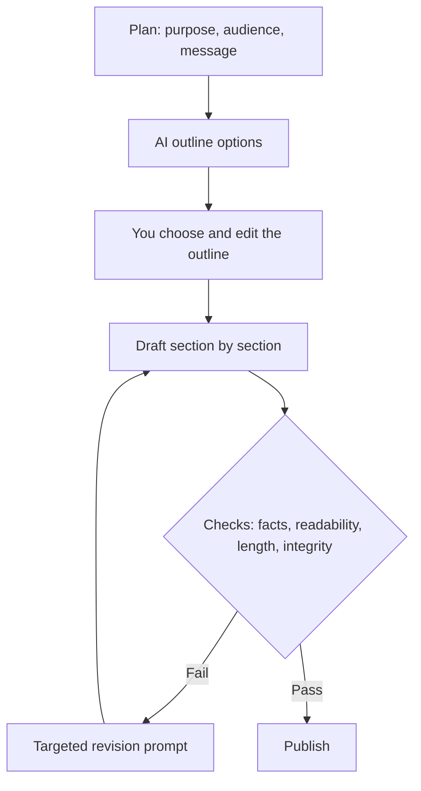
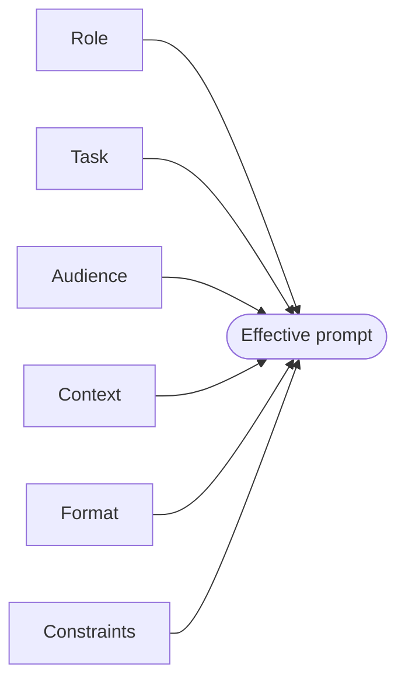
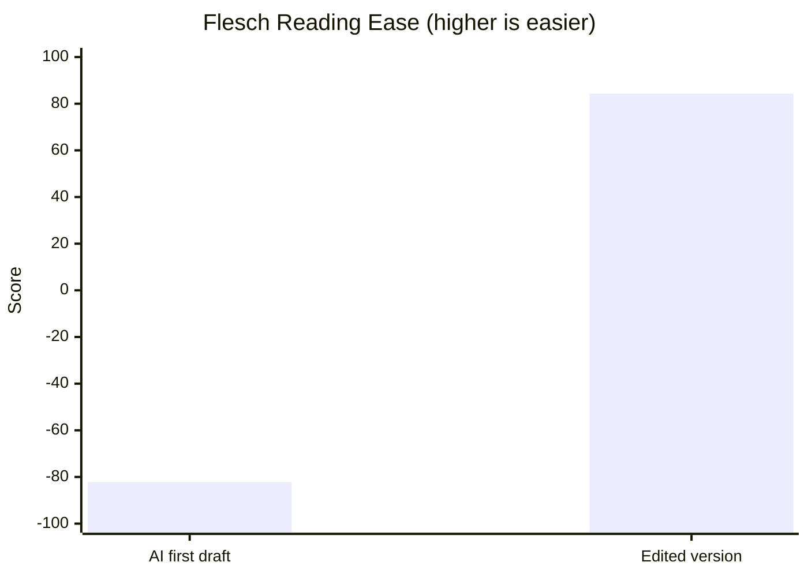

# Session 2 · Creating Textual Content with Generative AI

[](https://colab.research.google.com/github/Hamnakhan123/Generative-AI/blob/main/03-innovate-with-generative-ai/code/session-02-creating-textual-content.ipynb)

> 🧭 [Generative AI](../README.md) › [Track 3 · Innovate with Generative AI](README.md) › **Session 2**
>
> ⏱️ **Estimated time:** 2 hours · 📋 **Prerequisites:** Previous session

[⬅ Previous](session-01-generative-ai-for-creators.md) · [🏠 Track home](README.md) · [Next ➡](session-03-creating-visual-designs.md)

---

## 🎯 Learning objectives

- Identify the main **Gen AI text tools** and choose one for a writing task.
- Craft effective writing prompts using the **RTACFC** checklist (Role, Task, Audience, Context, Format, Constraints).
- Follow a step-by-step process to produce **essays, reports, social media posts and blogs** with AI.
- Measure and improve drafts with **readability**, **platform-fit** and **keyword** checks.
- Use AI for writing **without breaking academic integrity**.

## 📖 Concepts

### 1. Text tools at a glance

| Tool type | Examples | Best for | Note |
|---|---|---|---|
| General chat assistants | ChatGPT, Gemini, Microsoft Copilot, Claude | Drafting, rewriting, brainstorming, outlining | Can hallucinate facts and references |
| Research assistants | Perplexity, NotebookLM, Copilot with web | Answers with citations, summarising your sources | Still open and read every source |
| Writing improvers | Grammarly, QuillBot, Word/Google Docs AI | Grammar, tone, paraphrasing | Paraphrasing others' work is still plagiarism |
| Built-in app AI | Gmail/Outlook drafting, Notion AI, Canva Docs | Quick drafts inside your workflow | Check your organisation's privacy policy |

> 🧠 **Analogy — the brilliant new intern.** A text assistant is like a brilliant intern on their first day: fast, well-read and eager, but they know nothing about *your* audience, *your* facts or *your* rules unless you tell them. The prompt is your briefing.

### 2. Anatomy of an effective writing prompt: RTACFC

| Part | Question it answers | Example |
|---|---|---|
| **Role** | Who should the AI write as? | "a friendly science journalist" |
| **Task** | What exactly to produce? | "a 600-word blog post titled …" |
| **Audience** | Who reads it? | "first-year students new to AI" |
| **Context** | What facts or background must it use? | Paste notes, data, policy text |
| **Format** | What shape? | "H1, intro, five H2 sections, conclusion" |
| **Constraints** | What rules? | "sentences under 20 words, no invented statistics" |

Two extra techniques make a big difference:

- **Examples (few-shot):** paste one paragraph in the style you want: "Write like this: …".
- **Delimiters:** wrap pasted material in triple quotes `"""…"""` so the model knows what is data and what is instruction.

### 3. The content types and how they differ

| Type | Purpose | Structure | Typical length | AI's role |
|---|---|---|---|---|
| **Essay** | Argue or explain a position | Thesis → body paragraphs with evidence → conclusion | 800–2,000 words | Brainstorm, outline, feedback (if allowed) |
| **Report** | Inform a decision with evidence | Title, summary, introduction, findings, recommendations, references | 1–10 pages | Structure, summarising data you provide |
| **Social post** | Grab attention, drive one action | Hook → value → call to action → hashtags | 1–3 lines to 2,200 chars | Variants, tone, length fitting |
| **Blog** | Teach or entertain, attract search traffic | Catchy title, intro, scannable H2 sections, conclusion | 600–1,500 words | Outline, section drafts, titles, meta description |

### 4. The writing process with AI

1. **Plan:** decide purpose, audience and key message yourself.
2. **Outline:** ask AI for 2–3 outline options; pick and edit one.
3. **Draft by section:** one prompt per section beats one giant prompt.
4. **Edit:** read aloud, cut filler, fix facts, add your own examples.
5. **Check:** readability, length limits, keywords, references, integrity rules.
6. **Polish and publish.**

> 🧠 **Analogy — building a house.** You would not ask a builder to "make a house" in one instruction. You approve a plan (outline), then build room by room (sections), then inspect (edit and check). Long AI writing works the same way.

### 5. Readability and style

The **Flesch Reading Ease** score estimates how easy text is: higher is easier. Short sentences and short words raise it. AI drafts often score low because they use long, formal sentences ("utilised", "facilitate", "consequently"). A prompt such as *"Rewrite at a Grade 8 reading level, sentences under 18 words"* usually fixes this; measure to confirm.

### 6. Integrity: where the line is

| 🟢 Usually fine | 🟡 Only if your course allows, and disclose | 🔴 Not acceptable |
|---|---|---|
| Brainstorming topics, explaining concepts, grammar feedback on your own draft | Outlining, rewriting your own paragraphs, generating practice questions | Submitting AI-written graded work as your own, invented references, paraphrasing others to hide copying |

## 🪜 Step-by-step walkthrough: a 600-word blog post

1. **Brief:** title, audience, purpose, key message, call to action.
2. **Outline prompt:** *"Give me three different outlines for a 600-word blog titled … for first-year students. Each with 4–5 H2 headings."*
3. **Choose and edit** the outline yourself; assign a word budget to each section.
4. **Section prompts:** one per section, with its word budget and the same tone instructions.
5. **Assemble** the sections, add a real example from your own experience.
6. **Fact-check** every number and name; replace `[SOURCE NEEDED]` placeholders.
7. **Check readability** and keyword use (Example 4 below and the mini project automate this).
8. **Write a title and meta description** (under 155 characters) with AI, pick the best.

## 🧭 Diagrams





## 💻 Worked examples (basic → advanced)

### Example 1 (basic) — Weak vs strong prompt

| Weak | Strong |
|---|---|
| "Write about climate change." | "You are a science teacher. Write a 150-word paragraph for Grade 9 students explaining why Karachi's summers are getting hotter. Use one everyday example and no statistics unless I provide them." |

The strong prompt fixes the **role, audience, length, focus and rules**, so the output is usable on the first try.

### Example 2 (intermediate) — A prompt builder that refuses gaps

```python
# file: session-02_prompt_builder.py
"""
Session 2 · Example 1 — A reusable prompt builder for written content.

A good writing prompt has six parts: Role, Task, Audience, Context,
Format and Constraints (the "RTACFC" checklist used in this session).
This class assembles them and refuses to build a prompt with gaps,
the same way a careful writer checks a brief before starting.

Run:  python session-02_prompt_builder.py
"""
from dataclasses import dataclass, field


@dataclass
class WritingPrompt:
    role: str = ""
    task: str = ""
    audience: str = ""
    context: str = ""
    fmt: str = ""
    constraints: list = field(default_factory=list)

    REQUIRED = ("role", "task", "audience", "fmt")

    def missing(self) -> list:
        """Names of the required parts that are still empty."""
        return [name for name in self.REQUIRED if not getattr(self, name).strip()]

    def build(self) -> str:
        gaps = self.missing()
        if gaps:
            raise ValueError(f"Prompt is incomplete, please fill: {', '.join(gaps)}")
        lines = [
            f"You are {self.role}.",
            f"Task: {self.task}",
            f"Audience: {self.audience}",
        ]
        if self.context:
            lines.append(f'Context: """{self.context}"""')
        lines.append(f"Format: {self.fmt}")
        if self.constraints:
            lines.append("Rules:")
            lines += [f"- {c}" for c in self.constraints]
        return "\n".join(lines)


# 1) A vague prompt is caught before it wastes a generation.
vague = WritingPrompt(task="write a blog about AI")
try:
    vague.build()
except ValueError as err:
    print("Caught:", err)

# 2) A complete prompt for a real assignment.
blog = WritingPrompt(
    role="a friendly tech writer who explains ideas with everyday examples",
    task="Write a 600-word blog post titled 'Five ways AI helps first-year students study smarter'.",
    audience="first-year university students in Karachi, new to AI tools",
    context="The campus allows AI for brainstorming and feedback, not for writing graded work.",
    fmt="H1 title, 80-word intro, five H2 sections with one example each, 60-word conclusion with a call to action",
    constraints=["Plain English, sentences under 20 words", "Mention academic integrity once",
                 "No made-up statistics; write [SOURCE NEEDED] if a number is required"],
)
print("\n" + blog.build())
```

**Output**

```text
Caught: Prompt is incomplete, please fill: role, audience, fmt

You are a friendly tech writer who explains ideas with everyday examples.
Task: Write a 600-word blog post titled 'Five ways AI helps first-year students study smarter'.
Audience: first-year university students in Karachi, new to AI tools
Context: """The campus allows AI for brainstorming and feedback, not for writing graded work."""
Format: H1 title, 80-word intro, five H2 sections with one example each, 60-word conclusion with a call to action
Rules:
- Plain English, sentences under 20 words
- Mention academic integrity once
- No made-up statistics; write [SOURCE NEEDED] if a number is required
```

### Example 3 (intermediate) — An essay outline

```text
Act as a writing tutor. I am writing a 1,000-word argumentative essay: "Should universities
allow AI in assignments?" Do NOT write the essay. Give me: a thesis in one sentence, three
arguments for, two counter-arguments with rebuttals, and the type of evidence I should look
for for each point.
```

Notice "Do NOT write the essay": this keeps the AI in tutor mode, which most integrity policies allow.

### Example 4 (intermediate) — Is the AI draft readable?

```python
# file: session-02_readability.py
"""
Session 2 · Example 2 — Measure readability of an AI draft vs an edited draft.

The Flesch Reading Ease score (0-100, higher = easier) is a classic formula:
    206.835 - 1.015 * (words / sentences) - 84.6 * (syllables / words)
60-70 is "plain English"; under 30 reads like an academic paper.
AI drafts often come out long-winded, so measuring before and after editing
shows whether your "make it simpler" prompt actually worked.

Run:  python session-02_readability.py
"""
import re


def count_syllables(word: str) -> int:
    """Approximate syllables: count vowel groups, drop a silent final 'e'."""
    word = word.lower()
    groups = re.findall(r"[aeiouy]+", word)
    n = len(groups)
    if word.endswith("e") and n > 1 and not word.endswith("le"):
        n -= 1
    return max(n, 1)


def readability(text: str) -> dict:
    sentences = max(len(re.findall(r"[.!?]+", text)), 1)
    words = re.findall(r"[A-Za-z']+", text)
    syllables = sum(count_syllables(w) for w in words)
    wps = len(words) / sentences
    spw = syllables / len(words)
    score = 206.835 - 1.015 * wps - 84.6 * spw
    return {"words": len(words), "sentences": sentences,
            "words_per_sentence": round(wps, 1), "flesch": round(score, 1)}


ai_draft = ("Artificial intelligence technologies are increasingly being utilised by "
            "contemporary university students in order to facilitate the comprehension of "
            "complicated academic material, consequently improving educational outcomes "
            "significantly across numerous disciplines.")

edited = ("Many students now use AI to understand hard topics. "
          "It can explain an idea in simple words. "
          "It can quiz you before a test. "
          "Used well, it helps you learn faster.")

for label, text in (("AI first draft", ai_draft), ("Edited version", edited)):
    r = readability(text)
    print(f"{label:15} words={r['words']:3} sentences={r['sentences']} "
          f"words/sentence={r['words_per_sentence']:5} Flesch={r['flesch']}")

print("\nGuide: 90+ very easy | 60-70 plain English | 30-50 difficult | <30 very difficult")
print("Very dense text can even score below 0: one 29-word sentence full of long words does that.")
```

**Output**

```text
AI first draft  words= 29 sentences=1 words/sentence= 29.0 Flesch=-82.2
Edited version  words= 31 sentences=4 words/sentence=  7.8 Flesch=84.3

Guide: 90+ very easy | 60-70 plain English | 30-50 difficult | <30 very difficult
Very dense text can even score below 0: one 29-word sentence full of long words does that.
```

The edited version says the same thing in four short sentences and moves from "very difficult" to "easy".

### Example 5 (advanced) — Report from your own data

```text
You are a report writer. Using ONLY the data between the triple quotes, write a one-page
report for the Head of Department: Summary (3 sentences), Findings (bullets), Recommendations (3).
If something is not in the data, write "not available".
DATA: """Lab attendance: Sec A 92%, Sec B 71%, Sec C 88%. Sec B labs are on Friday 4-6 pm.
Survey: 64% of Sec B students cite transport after 5 pm as a problem."""
```

"Using ONLY the data" and "write 'not available'" stop the model from inventing figures.

### Example 6 (advanced) — Does the social post fit the platform?

```python
# file: session-02_platform_fit.py
"""
Session 2 · Example 3 — Check social posts against platform rules before posting.

AI happily writes a 400-character post for a platform that cuts off at 280,
or stuffs in 15 hashtags. This checker flags such problems automatically.
Limits below are the commonly published ones at the time of writing; check
each platform's help page because they change.

Run:  python session-02_platform_fit.py
"""
import re

RULES = {
    # platform: (max characters, recommended max hashtags)
    "X (Twitter)": (280, 2),
    "Instagram":   (2200, 5),
    "LinkedIn":    (3000, 3),
    "Facebook":    (63206, 3),
}


def check(platform: str, post: str) -> list:
    limit, max_tags = RULES[platform]
    problems = []
    if len(post) > limit:
        problems.append(f"too long: {len(post)}/{limit} characters")
    tags = re.findall(r"#\w+", post)
    if len(tags) > max_tags:
        problems.append(f"{len(tags)} hashtags (keep to {max_tags} or fewer)")
    if not re.search(r"(register|join|read|sign up|link|visit|comment)", post, re.I):
        problems.append("no call to action")
    return problems


posts = {
    "X (Twitter)": "Our AI Study Skills workshop is this Thursday 3 pm in Lab 4! Learn to quiz yourself "
                   "with AI, build flashcards, and stay within the integrity rules. Free for all "
                   "first-years, snacks included, bring your laptop and your questions, see you there "
                   "#AI #StudySmart #Karachi #Students",
    "LinkedIn":    "Proud to host our first AI Study Skills workshop for first-year students. "
                   "We covered tutor-mode prompting, flashcards and academic integrity. "
                   "Read the full recap at the link in comments. #AI #Education",
}

for platform, post in posts.items():
    issues = check(platform, post)
    status = "OK" if not issues else "FIX -> " + "; ".join(issues)
    print(f"{platform:12} {len(post):4} chars  {status}")
```

**Output**

```text
X (Twitter)   277 chars  FIX -> 4 hashtags (keep to 2 or fewer); no call to action
LinkedIn      201 chars  OK
```

The X post is under the limit but has four hashtags and no call to action. A follow-up prompt fixes both: *"Shorten to 230 characters, two hashtags, end with 'Register: link in bio'."*

## 🏗️ Real-life problem: a weekly blog pipeline (full solution)

**Scenario.** You publish a 700-word blog every week on the department website. One giant prompt produces generic text, and the editor keeps sending drafts back. Build a pipeline: outline with word budgets → one prompt per section → automatic quality gate → precise revision prompt.

```python
# file: session-02_project_blog_pipeline.py
"""
Session 2 · Mini project (full solution) — A blog-writing pipeline.

Real-life problem: you must publish a 700-word, search-friendly blog post
every week for the department website. Writing one giant prompt gives a
generic article. A better workflow splits the job into steps:

  1. Outline  -> a word budget for every section
  2. Section prompts -> one focused prompt per section (better quality)
  3. Quality gate -> check the assembled draft: length, keyword use,
     readability, unfinished placeholders

This script builds the prompts and runs the quality gate on a sample draft.
Run:  python session-02_project_blog_pipeline.py
"""
import re

TITLE = "How to Use AI as a Study Partner (Without Cheating)"
KEYWORD = "ai study partner"
TARGET_WORDS = 700
SECTIONS = [  # (heading, share of the word budget)
    ("Introduction", 0.12),
    ("What an AI study partner can and cannot do", 0.22),
    ("Three prompts that make you think", 0.30),
    ("Staying inside the integrity rules", 0.22),
    ("Conclusion and next step", 0.14),
]

# ---------- Step 1: outline with word budgets ----------
print(f"OUTLINE for '{TITLE}' ({TARGET_WORDS} words)")
budget = {h: round(TARGET_WORDS * share) for h, share in SECTIONS}
for h, w in budget.items():
    print(f"  {w:4} words  {h}")
print(f"  ----\n  {sum(budget.values()):4} words total")

# ---------- Step 2: one prompt per section ----------
print("\nSECTION PROMPTS")
for i, (h, w) in enumerate(budget.items(), 1):
    prompt = (f"[{i}/{len(budget)}] Write the section '{h}' of the blog '{TITLE}'. "
              f"About {w} words, audience: first-year students, friendly tone. "
              f"Use the phrase '{KEYWORD}' at most once. End without a summary line.")
    print("  " + prompt)

# ---------- Step 3: quality gate on an assembled draft ----------
draft = """
# How to Use AI as a Study Partner (Without Cheating)
An AI study partner can quiz you, explain hard ideas, and check your reasoning.
It cannot sit your exam. Studies show students who test themselves remember more [SOURCE NEEDED].
## Three prompts that make you think
Ask: give me one hint, not the answer. Ask: quiz me with five questions. Ask: find the gap in my explanation.
Your AI study partner works best when you do the thinking. Your AI study partner should never write graded work.
"""


def quality_gate(text: str) -> list:
    report = []
    words = re.findall(r"[A-Za-z']+", text)
    report.append(("length", len(words) >= 0.9 * TARGET_WORDS, f"{len(words)}/{TARGET_WORDS} words"))
    hits = text.lower().count(KEYWORD)
    density = 100 * hits * len(KEYWORD.split()) / max(len(words), 1)
    report.append(("keyword density", 0.5 <= density <= 2.5, f"{hits} uses = {density:.1f}% (aim 0.5-2.5%)"))
    placeholders = re.findall(r"\[[A-Z ]+\]", text)
    report.append(("placeholders", not placeholders, f"found {placeholders}" if placeholders else "none"))
    found = [h for h, _ in SECTIONS if h.lower() in text.lower()]
    report.append(("sections", len(found) == len(SECTIONS), f"{len(found)}/{len(SECTIONS)} headings present"))
    return report


print("\nQUALITY GATE")
results = quality_gate(draft)
for name, ok, detail in results:
    print(f"  [{'PASS' if ok else 'FAIL'}] {name:16} {detail}")
passed = sum(ok for _, ok, _ in results)
print(f"\n{passed}/{len(results)} checks passed -> {'publish' if passed == len(results) else 'send back for revision'}")

# ---------- Step 4: turn failures into a precise revision prompt ----------
failed = [f"- {name}: {detail}" for name, ok, detail in results if not ok]
if failed:
    print("\nREVISION PROMPT (paste back into the assistant)")
    print("Revise the draft below. Fix ONLY these problems and keep everything else:")
    print("\n".join(failed))
    print("Replace any [SOURCE NEEDED] with a real, named source or delete the claim.")
```

**Output**

```text
OUTLINE for 'How to Use AI as a Study Partner (Without Cheating)' (700 words)
    84 words  Introduction
   154 words  What an AI study partner can and cannot do
   210 words  Three prompts that make you think
   154 words  Staying inside the integrity rules
    98 words  Conclusion and next step
  ----
   700 words total

SECTION PROMPTS
  [1/5] Write the section 'Introduction' of the blog 'How to Use AI as a Study Partner (Without Cheating)'. About 84 words, audience: first-year students, friendly tone. Use the phrase 'ai study partner' at most once. End without a summary line.
  [2/5] Write the section 'What an AI study partner can and cannot do' of the blog 'How to Use AI as a Study Partner (Without Cheating)'. About 154 words, audience: first-year students, friendly tone. Use the phrase 'ai study partner' at most once. End without a summary line.
  [3/5] Write the section 'Three prompts that make you think' of the blog 'How to Use AI as a Study Partner (Without Cheating)'. About 210 words, audience: first-year students, friendly tone. Use the phrase 'ai study partner' at most once. End without a summary line.
  [4/5] Write the section 'Staying inside the integrity rules' of the blog 'How to Use AI as a Study Partner (Without Cheating)'. About 154 words, audience: first-year students, friendly tone. Use the phrase 'ai study partner' at most once. End without a summary line.
  [5/5] Write the section 'Conclusion and next step' of the blog 'How to Use AI as a Study Partner (Without Cheating)'. About 98 words, audience: first-year students, friendly tone. Use the phrase 'ai study partner' at most once. End without a summary line.

QUALITY GATE
  [FAIL] length           86/700 words
  [FAIL] keyword density  3 uses = 10.5% (aim 0.5-2.5%)
  [FAIL] placeholders     found ['[SOURCE NEEDED]']
  [FAIL] sections         1/5 headings present

0/4 checks passed -> send back for revision

REVISION PROMPT (paste back into the assistant)
Revise the draft below. Fix ONLY these problems and keep everything else:
- length: 86/700 words
- keyword density: 3 uses = 10.5% (aim 0.5-2.5%)
- placeholders: found ['[SOURCE NEEDED]']
- sections: 1/5 headings present
Replace any [SOURCE NEEDED] with a real, named source or delete the claim.
```

**Why this works.** Each section prompt has a clear job and size. The quality gate turns vague feedback ("it's not good") into exact instructions the AI can follow ("86/700 words, keyword density 10.5%, one placeholder, 4 headings missing").

## 📊 Readability before and after editing



| Content type | Target Flesch score | Target sentence length |
|---|---|---|
| Social post | 70+ | under 15 words |
| Blog for students | 60–70 | under 20 words |
| Report for managers | 40–60 | under 25 words |
| Academic essay | 30–50 | varies |

## ⚠️ Common mistakes

| Mistake | Fix |
|---|---|
| Asking for the whole 2,000-word piece in one prompt | Outline first, then draft section by section |
| No audience in the prompt | Always name who will read it |
| Accepting statistics and references without checking | Use `[SOURCE NEEDED]` and verify every number |
| Keyword stuffing for search engines | Keep density around 0.5–2.5%, write for humans |
| Same text pasted on every platform | Adapt length, tone and hashtags per platform |
| Using AI to write graded work | Use tutor-mode prompts; follow and disclose per policy |

## ✅ Best practices

- Paste **context** (notes, data, policy) inside delimiters; say "use only this".
- Give **one example** of the style you want.
- Ask for **variants** of titles and hooks; pick the best.
- **Read it aloud** before publishing; delete filler phrases.
- Keep your **own voice**: add a personal example, a local reference, an opinion.

## 🧪 Lab / practice tasks

**Task 1 · 🟢 Easy** — Rewrite three weak prompts from your own chat history using RTACFC.

<details><summary>💡 Hint</summary>

Check each of the six parts is present; the builder script can verify four of them.

</details>

**Task 2 · 🟢 Easy** — Paste a paragraph of your own writing into `session-02_readability.py` and record its score.

<details><summary>💡 Hint</summary>

Replace the `edited` string with your text.

</details>

**Task 3 · 🟡 Medium** — Produce an Instagram, LinkedIn and X version of the same announcement and pass all three through `session-02_platform_fit.py`.

<details><summary>💡 Hint</summary>

Add an "Instagram" entry to the `posts` dict.

</details>

**Task 4 · 🟡 Medium** — Ask an AI for an essay *outline only* on a topic of your choice, then write one body paragraph yourself and ask the AI for feedback.

<details><summary>💡 Hint</summary>

Use "Do NOT write the essay" and "give feedback on clarity and evidence only".

</details>

**Task 5 · 🔴 Challenge** — Run the full blog pipeline on a real topic: generate each section with an AI, paste the assembled draft into the script and iterate until all checks pass.

<details><summary>💡 Hint</summary>

Replace the `draft` string; you will need about 630+ words and all five headings.

</details>


<details><summary>✅ Lab solutions and model answers</summary>

**Task 1 example:** "make my CV better" → *Role:* career adviser for CS graduates. *Task:* rewrite my CV summary in 60 words. *Audience:* recruiters for junior developer roles in Karachi. *Context:* """[paste CV]""". *Format:* one paragraph + 5 bullet skills. *Constraints:* no invented experience, use action verbs.

**Task 3 model posts:**

- *Instagram:* "AI Study Skills workshop 💡 Thu 3 pm, Lab 4. Learn to quiz yourself with AI and stay inside the integrity rules. Free for first-years. Register via link in bio. #StudySmart #AI" → passes.
- *X:* "AI Study Skills workshop, Thu 3 pm, Lab 4. Learn to quiz yourself with AI the honest way. Register: link in bio #StudySmart #AI" → passes (2 hashtags, CTA present).

**Task 4:** the feedback prompt: *"Here is my paragraph. Do not rewrite it. Tell me (1) whether the claim is clear, (2) what evidence is missing, (3) one sentence that is hard to follow."*

**Task 5:** the gate passes when the draft has ≥ 630 words, uses "ai study partner" 2–5 times (each use adds about 0.43% at 700 words), has no `[ … ]` placeholders and all five headings appear verbatim.

</details>

## ✅ Quick quiz

**Q1. In RTACFC, "Context" means...**

- A) The AI model version
- B) Facts, notes or data the AI must use
- C) The font size
- D) The publishing date

<details><summary>Show answer</summary>

✅ **B) Facts, notes or data the AI must use** — Paste background material inside delimiters.

</details>

**Q2. Why draft a long blog section by section?**

- A) It uses fewer words
- B) Each prompt has a clear job, giving better quality and control
- C) AI cannot write long text
- D) It avoids plagiarism automatically

<details><summary>Show answer</summary>

✅ **B) Each prompt has a clear job, giving better quality and control** — Smaller tasks, better output.

</details>

**Q3. A Flesch Reading Ease score of 84 means the text is...**

- A) Very difficult
- B) Easy to read
- C) Academic
- D) Invalid

<details><summary>Show answer</summary>

✅ **B) Easy to read** — Higher scores are easier.

</details>

**Q4. Which instruction best prevents invented numbers in a report?**

- A) "Be creative"
- B) "Use ONLY the data provided; write 'not available' otherwise"
- C) "Write longer"
- D) "Use more adjectives"

<details><summary>Show answer</summary>

✅ **B) "Use ONLY the data provided; write 'not available' otherwise"** — Ground the model in your data.

</details>

**Q5. Which is a 🔴 integrity breach?**

- A) Asking AI to explain a concept
- B) Submitting an AI-written essay as your own work
- C) Getting grammar feedback on your draft
- D) Generating practice questions

<details><summary>Show answer</summary>

✅ **B) Submitting an AI-written essay as your own work** — Passing off AI work is misconduct.

</details>


## 📝 Summary / cheat-sheet

- Text tools: **chat assistants, research assistants, writing improvers, built-in app AI**.
- Prompt checklist **RTACFC** + examples + delimiters.
- Process: **plan → outline → draft by section → edit → check → publish**.
- Essays argue, reports inform decisions, posts drive one action, blogs teach and attract search.
- Measure: **readability, platform limits, keyword density, placeholders**.
- Integrity: AI as tutor and editor, never as ghost-writer of graded work.

**Viva / interview questions**

1. List the six parts of RTACFC and give an example for each.
2. How would you use AI to write a report without it inventing numbers?
3. Why does section-by-section drafting give better blogs?
4. What does a low Flesch score tell you, and how do you fix it with a prompt?
5. How should one announcement differ on X, Instagram and LinkedIn?
6. Where is the line between acceptable and unacceptable AI help in essays?

---

[⬅ Previous](session-01-generative-ai-for-creators.md) · [🏠 Track home](README.md) · [Next ➡](session-03-creating-visual-designs.md)

<sub>Prepared by **Hamna Zahid Khan**, Junior Lecturer</sub>
