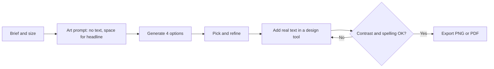
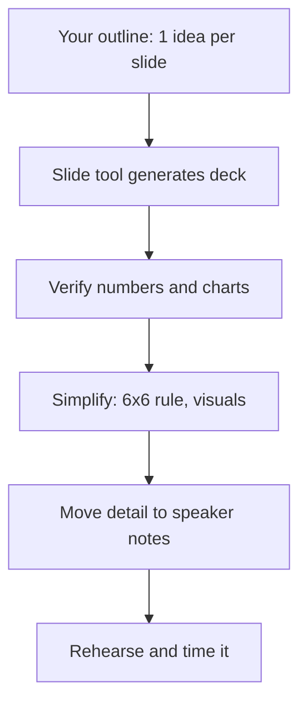
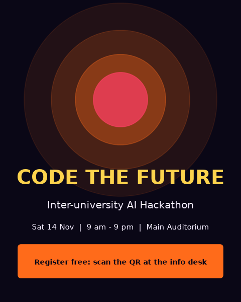
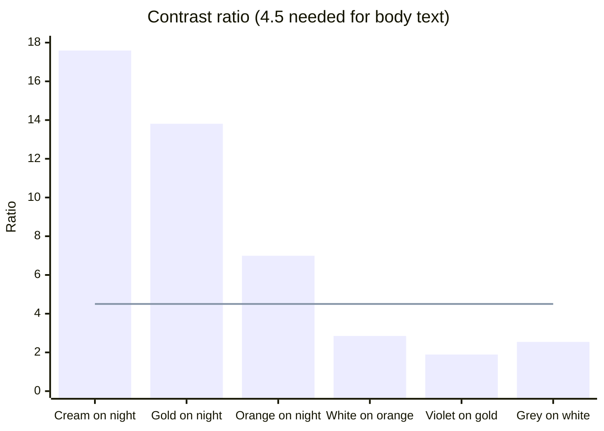

# Session 3 · Creating Visual Designs: Images, Posters and Presentations

[](https://colab.research.google.com/github/Hamnakhan123/Generative-AI/blob/main/03-innovate-with-generative-ai/code/session-03-creating-visual-designs.ipynb)

> 🧭 [Generative AI](../README.md) › [Track 3 · Innovate with Generative AI](README.md) › **Session 3**
>
> ⏱️ **Estimated time:** 2 hours · 📋 **Prerequisites:** Previous session

[⬅ Previous](session-02-creating-textual-content.md) · [🏠 Track home](README.md) · [Next ➡](session-04-creating-audio-and-video.md)

---

## 🎯 Learning objectives

- Identify Gen AI **multimedia tools** for images, posters and presentations.
- Write structured **image prompts** (subject, setting, style, lighting, composition, palette, aspect ratio, negative prompt).
- Follow a step-by-step process to create a **poster** and a **presentation** with AI.
- Check designs for **readability (contrast)**, **size** and **slide clarity** using simple, real formulas.
- Recognise the **ethical and legal** issues in AI imagery (bias, copyright, deepfakes, disclosure).

## 📖 Concepts

### 1. Visual Gen AI tools

| Category | Examples | Strengths | Limits |
|---|---|---|---|
| Text-to-image | DALL·E (in ChatGPT / Copilot), Adobe Firefly, Midjourney, Ideogram, Stable Diffusion | Concept art, illustrations, backgrounds, product mock-ups | Text inside images, hands, consistency across images |
| Design suites with AI | Canva (Magic Design, Magic Media), Adobe Express | Posters, social templates, brand kits | Templates can look generic |
| Image editing with AI | Photoshop Generative Fill, Canva Magic Eraser | Extend, remove or replace parts of real photos | Easy to mislead viewers; disclose edits |
| Presentation tools | Gamma, Copilot in PowerPoint, Canva Presentations, Google Slides with Gemini | Deck from an outline in minutes | Invented numbers, text-heavy slides |

> 🧠 **Analogy — the courtroom sketch artist.** An image generator is like a sketch artist working from a witness's description. The more precise the description ("short hair, round glasses, standing in a busy market at dusk"), the closer the sketch. Vague words ("a nice picture") give a guess.

### 2. Anatomy of an image prompt

| Element | Question | Example words |
|---|---|---|
| **Subject** | Who/what? | "a young woman coding on a laptop" |
| **Setting** | Where/when? | "rooftop in Karachi at dusk" |
| **Style / medium** | Looks like what? | flat vector, watercolour, 3D render, photo, isometric |
| **Lighting** | What light? | golden hour, soft studio, neon, high contrast |
| **Composition / camera** | How framed? | close-up, wide shot, rule of thirds, top-down, empty space for text |
| **Palette** | Which colours? | "navy, orange, gold"; brand hex codes |
| **Aspect ratio** | What shape? | 1:1 post, 4:5 portrait, 9:16 story, 16:9 slide |
| **Negative prompt** | What to avoid? | text, watermark, extra fingers, blur |

### 3. Design principles AI does not guarantee

- **Hierarchy:** one dominant element (headline), then details, then call to action.
- **Contrast:** text must stand out from its background. WCAG asks for at least **4.5:1** for body text and **3:1** for large headings.
- **Alignment and white space:** fewer elements, more breathing room.
- **Consistency:** same fonts, colours and style across a campaign (use a brand kit or a fixed "style sentence" in every prompt).

> 🧠 **Analogy — the stage play.** On a poster, the headline is the lead actor under the spotlight, the details are the supporting cast, and the background is the set. If the set is as bright as the lead actor, nobody knows where to look.

### 4. Presentations with AI

A good AI-assisted deck starts from **your outline**, not from a one-line topic.

- **One idea per slide**, with a headline that states the point ("Reels get 2× engagement", not "Results").
- **6×6 rule:** at most six bullets of at most six words each, or better, a visual.
- **Speaker notes** carry the detail; the slide carries the message.
- **Verify every number and chart** the tool adds.

### 5. Ethics and rights

| Issue | What to do |
|---|---|
| **Bias** ("a CEO" always drawn as one type of person) | Specify diversity deliberately; review sets of images |
| **Copyright and style** | Avoid prompting with living artists' names; check the tool's commercial-use terms |
| **Real people** | Never generate realistic images of real people without consent; never make deepfakes |
| **Disclosure** | Label AI-generated or AI-edited images where it could mislead (news, ads, academic work) |
| **Brand assets** | Use the official logo file, not an AI imitation |

## 🪜 Step-by-step walkthrough: an event poster

1. **Brief:** event name, date/time/venue, audience, mood, brand colours, size (e.g. 4:5 for Instagram, A3 for print).
2. **Art prompt:** use the anatomy table; ask for **no text** and **empty space** where the headline will go.
3. **Generate 4 options**, pick one, then refine ("warmer light", "move subject left").
4. **Upscale** or regenerate at the final size.
5. **Add text in a design tool** (Canva, PowerPoint, Figma): headline, details, call to action, logo.
6. **Check contrast** of each text colour (Example 3) and spelling.
7. **Export** in the right format: PNG for social, PDF for print (300 dpi).

## 🧭 Diagrams





## 💻 Worked examples (basic → advanced)

### Example 1 (basic) — Vague vs specific image prompt

| Vague | Specific |
|---|---|
| "a poster for a hackathon" | "Glowing laptop on a desk surrounded by floating code symbols, dark night background, neon orange and violet light, isometric 3D style, wide shot, empty space at the top third for a headline, no text --ar 4:5" |

### Example 2 (intermediate) — Build prompts and pixel sizes in code

```python
# file: session-03_image_prompt_builder.py
"""
Session 3 · Example 1 — Build image prompts from parts, plus pixel sizes.

Image generators respond best to a prompt that names, in order:
subject -> setting -> style -> lighting -> composition -> colour palette,
plus an aspect ratio and a "negative prompt" (things to avoid).
This script builds such prompts and converts aspect ratios into pixel sizes
for common uses (posters, slides, stories).

Run:  python session-03_image_prompt_builder.py
"""
from math import gcd


def image_prompt(subject, setting, style, lighting, composition, palette,
                 ratio="1:1", avoid=()):
    parts = [subject, setting, f"{style} style", f"{lighting} lighting",
             composition, f"colour palette: {palette}"]
    prompt = ", ".join(p for p in parts if p)
    prompt += f" --ar {ratio}"
    if avoid:
        prompt += "\nNegative prompt: " + ", ".join(avoid)
    return prompt


def pixels(ratio: str, long_side: int) -> tuple:
    """Width and height for a ratio like '16:9' when the longer side is long_side px."""
    w, h = map(int, ratio.split(":"))
    if w >= h:
        return long_side, round(long_side * h / w)
    return round(long_side * w / h), long_side


basic = image_prompt("a robot reading a book", "", "cartoon", "soft", "", "pastel")
advanced = image_prompt(
    subject="a young woman coding on a laptop, smiling, wearing a dupatta",
    setting="rooftop in Karachi at dusk, city lights behind",
    style="flat vector illustration",
    lighting="warm golden-hour",
    composition="subject on the left third, empty space on the right for a headline",
    palette="deep navy, fire orange, gold",
    ratio="4:5",
    avoid=("text", "watermark", "extra fingers", "distorted face"),
)
print("BASIC PROMPT\n" + basic)
print("\nADVANCED PROMPT\n" + advanced)

print("\nASPECT RATIO -> PIXELS (long side 1920 px)")
for use, ratio in [("Slide / YouTube thumbnail", "16:9"), ("Instagram portrait post", "4:5"),
                   ("Story / Reel", "9:16"), ("Square post", "1:1"), ("A-series poster", "1:1.414")]:
    if "." in ratio:  # A-series paper is 1 : square root of 2
        w, h = round(1920 / 1.414), 1920
    else:
        w, h = pixels(ratio, 1920)
    g = gcd(w, h)
    print(f"  {use:26} {ratio:8} -> {w} x {h} px  (simplest ratio {w//g}:{h//g})")
```

**Output**

```text
BASIC PROMPT
a robot reading a book, cartoon style, soft lighting, colour palette: pastel --ar 1:1

ADVANCED PROMPT
a young woman coding on a laptop, smiling, wearing a dupatta, rooftop in Karachi at dusk, city lights behind, flat vector illustration style, warm golden-hour lighting, subject on the left third, empty space on the right for a headline, colour palette: deep navy, fire orange, gold --ar 4:5
Negative prompt: text, watermark, extra fingers, distorted face

ASPECT RATIO -> PIXELS (long side 1920 px)
  Slide / YouTube thumbnail  16:9     -> 1920 x 1080 px  (simplest ratio 16:9)
  Instagram portrait post    4:5      -> 1536 x 1920 px  (simplest ratio 4:5)
  Story / Reel               9:16     -> 1080 x 1920 px  (simplest ratio 9:16)
  Square post                1:1      -> 1920 x 1920 px  (simplest ratio 1:1)
  A-series poster            1:1.414  -> 1358 x 1920 px  (simplest ratio 679:960)
```

The A-series row shows that print paper is not a "neat" ratio (it is 1 : √2), so ask the tool for the closest ratio and crop.

### Example 3 (intermediate) — Is the text readable? WCAG contrast in code

```python
# file: session-03_contrast_checker.py
"""
Session 3 · Example 2 — Is the text on your AI poster readable? (WCAG contrast)

AI tools pick attractive colours, not necessarily readable ones. The Web
Content Accessibility Guidelines (WCAG 2) define a contrast ratio:
    (L_lighter + 0.05) / (L_darker + 0.05)
where L is the "relative luminance" of each colour. Body text needs at least
4.5:1 (AA); large headings need 3:1; 7:1 is the stricter AAA level.

Run:  python session-03_contrast_checker.py
"""


def luminance(hex_colour: str) -> float:
    """Relative luminance of an sRGB colour such as '#FF6B1A'."""
    hex_colour = hex_colour.lstrip("#")
    channels = [int(hex_colour[i:i + 2], 16) / 255 for i in (0, 2, 4)]
    linear = [c / 12.92 if c <= 0.03928 else ((c + 0.055) / 1.055) ** 2.4 for c in channels]
    r, g, b = linear
    return 0.2126 * r + 0.7152 * g + 0.0722 * b


def contrast(fg: str, bg: str) -> float:
    l1, l2 = sorted((luminance(fg), luminance(bg)), reverse=True)
    return (l1 + 0.05) / (l2 + 0.05)


def verdict(ratio: float) -> str:
    if ratio >= 7:
        return "AAA (excellent)"
    if ratio >= 4.5:
        return "AA (good for body text)"
    if ratio >= 3:
        return "large headings only"
    return "FAIL - hard to read"


pairs = [
    ("Cream text on night background", "#F5EEFF", "#0A0716"),
    ("Gold text on night background",  "#FCD34D", "#0A0716"),
    ("Orange text on night background", "#FF6B1A", "#0A0716"),
    ("White text on orange button",    "#FFFFFF", "#FF6B1A"),
    ("Violet text on gold banner",     "#A78BFA", "#FCD34D"),
    ("Grey text on white page",        "#9CA3AF", "#FFFFFF"),
]
print(f"{'Pair':34} {'Ratio':>6}  Verdict")
for name, fg, bg in pairs:
    r = contrast(fg, bg)
    print(f"{name:34} {r:6.2f}  {verdict(r)}")
```

**Output**

```text
Pair                                Ratio  Verdict
Cream text on night background      17.59  AAA (excellent)
Gold text on night background       13.81  AAA (excellent)
Orange text on night background      6.99  AA (good for body text)
White text on orange button          2.85  FAIL - hard to read
Violet text on gold banner           1.89  FAIL - hard to read
Grey text on white page              2.54  FAIL - hard to read
```

**Lesson:** white text on bright orange *looks* bold but fails (2.85:1). Use dark text on orange buttons instead.

### Example 4 (intermediate) — A presentation prompt

```text
Create a 6-slide presentation for first-year students: "Using AI Safely in Your First Semester".
Slide titles must state the point. Max 4 bullets per slide, max 6 words per bullet.
Put examples in speaker notes. Do not add statistics. Visual style: dark background,
orange accents, simple line icons.
```

### Example 5 (advanced) — Check an AI deck against the 6×6 rule

```python
# file: session-03_slide_outline.py
"""
Session 3 · Example 3 — From a topic to a presentation outline that a slide
tool (Gamma, Copilot in PowerPoint, Canva) can turn into a deck.

Two rules keep AI decks readable:
  * one idea per slide, a headline that states the point;
  * at most 6 bullets of at most 6 words each ("6x6 rule").
The script writes a Markdown outline and checks each slide against the rules.

Run:  python session-03_slide_outline.py
"""

deck = {
    "title": "Using AI Safely in Your First Semester",
    "slides": [
        ("AI is a study partner, not a ghost-writer",
         ["Explains hard ideas", "Quizzes you before tests", "Gives feedback on drafts"]),
        ("Three prompts that make you think",
         ["Give me one hint only", "Quiz me with five questions", "Find gaps in my explanation"]),
        ("Know the integrity rules",
         ["Check each course's AI policy", "Disclose permitted AI help",
          "Never submit AI-written graded work", "Never invent references",
          "Keep your drafts as evidence", "Ask your teacher when unsure",
          "Remember that detectors are unreliable"]),
        ("Protect your data",
         ["Never paste CNIC numbers, passwords or grades into free AI tools because they may be stored"]),
    ],
}


def check_slide(bullets):
    issues = []
    if len(bullets) > 6:
        issues.append(f"{len(bullets)} bullets (max 6)")
    long = [b for b in bullets if len(b.split()) > 6]
    if long:
        issues.append(f"{len(long)} bullet(s) over 6 words")
    return issues


lines = [f"# {deck['title']}", ""]
for n, (headline, bullets) in enumerate(deck["slides"], 1):
    lines.append(f"## Slide {n}: {headline}")
    lines += [f"- {b}" for b in bullets]
    lines.append("")
    issues = check_slide(bullets)
    print(f"Slide {n}: {'OK' if not issues else 'FIX -> ' + '; '.join(issues)}")

print("\n--- Markdown outline (paste into a slide tool) ---")
print("\n".join(lines[:8]))
print("...")
```

**Output**

```text
Slide 1: OK
Slide 2: OK
Slide 3: FIX -> 7 bullets (max 6)
Slide 4: FIX -> 1 bullet(s) over 6 words

--- Markdown outline (paste into a slide tool) ---
# Using AI Safely in Your First Semester

## Slide 1: AI is a study partner, not a ghost-writer
- Explains hard ideas
- Quizzes you before tests
- Gives feedback on drafts

## Slide 2: Three prompts that make you think
...
```

Slides 3 and 4 fail: split slide 3 into "Rules" and "Good habits"; shorten slide 4 to "Never paste personal data" with the detail in speaker notes.

## 🏗️ Real-life problem: an event poster with guaranteed readable text (full solution)

**Scenario.** The hackathon poster made by an image generator had "HACKTHON" spelt wrong and pale text nobody could read on phones. Build a reliable workflow: AI for the artwork, code (standing in for a design tool) for the text layer, and an automatic contrast gate before anything is drawn.

```python
# file: session-03_project_poster.py
"""
Session 3 · Mini project (full solution) — Generate an event poster in code.

Real-life problem: image generators often misspell text inside images.
A reliable workflow is: let AI make the ARTWORK, then add the TEXT yourself
in a design tool. This script plays the "design tool" role: it lays out a
4:5 Instagram poster with a headline, details and a call to action, checks
every text colour for WCAG contrast first, and saves a PNG.

Run:  python session-03_project_poster.py
Creates: session-03_poster.png   (needs matplotlib)
"""
import matplotlib
matplotlib.use("Agg")
import matplotlib.pyplot as plt
from matplotlib.patches import Circle, FancyBboxPatch


def luminance(h):
    h = h.lstrip("#")
    c = [int(h[i:i + 2], 16) / 255 for i in (0, 2, 4)]
    c = [x / 12.92 if x <= 0.03928 else ((x + 0.055) / 1.055) ** 2.4 for x in c]
    return 0.2126 * c[0] + 0.7152 * c[1] + 0.0722 * c[2]


def contrast(a, b):
    l1, l2 = sorted((luminance(a), luminance(b)), reverse=True)
    return (l1 + 0.05) / (l2 + 0.05)


SPEC = {
    "bg": "#0A0716",
    "headline": ("CODE THE FUTURE", "#FCD34D", 30),
    "sub": ("Inter-university AI Hackathon", "#F5EEFF", 15),
    "details": ("Sat 14 Nov  |  9 am - 9 pm  |  Main Auditorium", "#F5EEFF", 11),
    "cta": ("Register free: scan the QR at the info desk", "#0A0716", 11),
    "cta_bg": "#FF6B1A",
}

# 1) Quality gate: every text/background pair must pass before we draw.
checks = [("headline", SPEC["headline"][1], SPEC["bg"], 3.0),
          ("sub", SPEC["sub"][1], SPEC["bg"], 4.5),
          ("details", SPEC["details"][1], SPEC["bg"], 4.5),
          ("cta", SPEC["cta"][1], SPEC["cta_bg"], 4.5)]
for name, fg, bg, need in checks:
    r = contrast(fg, bg)
    print(f"{name:9} contrast {r:5.2f} (needs {need}) -> {'PASS' if r >= need else 'FAIL'}")
    assert r >= need, f"{name} is not readable; pick another colour"

# 2) Draw the poster: 4:5 portrait, 4 x 5 inches at 120 dpi = 480 x 600 px.
fig = plt.figure(figsize=(4, 5), dpi=120)
ax = fig.add_axes([0, 0, 1, 1])
ax.set_xlim(0, 4); ax.set_ylim(0, 5); ax.axis("off")
fig.patch.set_facecolor(SPEC["bg"])
# "artwork" placeholder: glowing circles where AI-generated art would sit
for r, a in [(1.6, 0.10), (1.15, 0.18), (0.75, 0.35)]:
    ax.add_patch(Circle((2, 3.35), r, color="#FF6B1A", alpha=a))
ax.add_patch(Circle((2, 3.35), 0.45, color="#F43F5E", alpha=0.8))
text, colour, size = SPEC["headline"]
ax.text(2, 1.95, text, ha="center", color=colour, fontsize=size * 0.8, weight="bold")
for key, y in (("sub", 1.55), ("details", 1.2)):
    t, c, s = SPEC[key]
    ax.text(2, y, t, ha="center", color=c, fontsize=s * 0.8)
ax.add_patch(FancyBboxPatch((0.35, 0.45), 3.3, 0.45, boxstyle="round,pad=0.05", color=SPEC["cta_bg"]))
t, c, s = SPEC["cta"]
ax.text(2, 0.62, t, ha="center", color=c, fontsize=s * 0.75, weight="bold")
fig.savefig("session-03_poster.png", facecolor=SPEC["bg"])
w, h = fig.get_size_inches() * fig.dpi
print(f"Saved poster -> session-03_poster.png ({int(w)} x {int(h)} px, ratio 4:5)")
```

**Output**

```text
headline  contrast 13.81 (needs 3.0) -> PASS
sub       contrast 17.59 (needs 4.5) -> PASS
details   contrast 17.59 (needs 4.5) -> PASS
cta       contrast  6.99 (needs 4.5) -> PASS
Saved poster -> session-03_poster.png (480 x 600 px, ratio 4:5)
```



**How to adapt it:** replace the glowing circles with your AI artwork (`ax.imshow(plt.imread("art.png"), extent=[0, 4, 2.3, 5])`), change the text in `SPEC`, and the contrast gate will stop you if a colour is unreadable.

## 📊 Contrast ratios of the palette pairs



| Use | Aspect ratio | Pixels (long side 1920) |
|---|---|---|
| Slide / thumbnail | 16:9 | 1920 × 1080 |
| Instagram portrait | 4:5 | 1536 × 1920 |
| Story / Reel | 9:16 | 1080 × 1920 |
| Square post | 1:1 | 1920 × 1920 |

## ⚠️ Common mistakes

| Mistake | Fix |
|---|---|
| Letting the generator write the headline | Generate artwork only, add text yourself |
| Wrong aspect ratio, then cropping off heads | Set `--ar` / size before generating |
| Pretty but unreadable colours | Run a contrast check (4.5:1 body, 3:1 headings) |
| Text-heavy AI slides | 6×6 rule, detail in speaker notes |
| Prompting "in the style of [living artist]" | Describe the style in your own words |
| Realistic images of real people | Never without consent; label edits |

## ✅ Best practices

- Keep a **style sentence** (palette, medium, lighting) and reuse it for a consistent campaign.
- Generate **several options**, then iterate on one with small changes.
- Leave **empty space** for text in the prompt itself.
- Export at the **final size**; 300 dpi for print.
- Keep a record of **which tool and prompt** made each asset (helps with disclosure and reuse).

## 🧪 Lab / practice tasks

**Task 1 · 🟢 Easy** — Write a structured image prompt for a club logo concept using all eight elements of the anatomy table.

<details><summary>💡 Hint</summary>

Remember the negative prompt: "text, watermark".

</details>

**Task 2 · 🟢 Easy** — Add your own brand colours to `session-03_contrast_checker.py` and find one pair that fails.

<details><summary>💡 Hint</summary>

Add a tuple to `pairs`; try light grey on white.

</details>

**Task 3 · 🟡 Medium** — Make the same poster concept in two aspect ratios (4:5 and 9:16) and note what had to change in the composition.

<details><summary>💡 Hint</summary>

Vertical formats need the subject higher and the text lower.

</details>

**Task 4 · 🟡 Medium** — Generate a 5-slide deck with a slide tool from your own outline, then fix every slide that breaks the 6×6 rule.

<details><summary>💡 Hint</summary>

Put your outline in the `deck` dict of `session-03_slide_outline.py` to check it.

</details>

**Task 5 · 🔴 Challenge** — Edit `session-03_project_poster.py` to make a poster for a real event with an AI-generated background image.

<details><summary>💡 Hint</summary>

Use `ax.imshow(plt.imread("art.png"), extent=[...])` before drawing text; keep the contrast gate.

</details>


<details><summary>✅ Lab solutions and model answers</summary>

**Task 1:** "Minimal geometric fox head made of triangles (subject), centred on a plain background (setting), flat vector logo style, even soft lighting, front view with generous margin (composition), fire orange and deep navy only (palette) --ar 1:1. Negative prompt: text, letters, watermark, gradients, photo-realism."

**Task 2:** e.g. `("Light grey on white", "#D1D5DB", "#FFFFFF")` gives about 1.5:1 → FAIL. Darken to `#4B5563` (about 7.6:1, AAA).

**Task 3:** in 9:16 the subject moves to the upper half, the headline sits in the lower third, and side elements are cropped; you may need to regenerate rather than crop.

**Task 4:** typical fixes: split long slides, turn a list of numbers into one chart, rewrite bullets as 3–6-word phrases.

**Task 5:**

```python
art = plt.imread("art.png")           # your AI image, ideally 4:5
ax.imshow(art, extent=[0, 4, 2.3, 5])  # place it in the top part of the poster
```

If the artwork sits behind the text, check contrast against the **darkest and lightest** parts of that area, or add a semi-transparent dark box behind the text.

</details>

## ✅ Quick quiz

**Q1. What is a negative prompt?**

- A) A rude prompt
- B) A list of things the image should NOT contain
- C) A prompt in reverse order
- D) A low-resolution setting

<details><summary>Show answer</summary>

✅ **B) A list of things the image should NOT contain** — E.g. "text, watermark, extra fingers".

</details>

**Q2. Minimum WCAG contrast for normal body text (AA) is...**

- A) 1.5:1
- B) 4.5:1
- C) 10:1
- D) 21:1

<details><summary>Show answer</summary>

✅ **B) 4.5:1** — 3:1 is enough only for large headings.

</details>

**Q3. Best aspect ratio for an Instagram story or reel?**

- A) 16:9
- B) 9:16
- C) 1:1
- D) 4:3

<details><summary>Show answer</summary>

✅ **B) 9:16** — Tall, full-screen vertical.

</details>

**Q4. The 6×6 rule for slides means...**

- A) Six slides of six minutes
- B) At most six bullets of at most six words
- C) Six fonts and six colours
- D) Six images per slide

<details><summary>Show answer</summary>

✅ **B) At most six bullets of at most six words** — Keeps slides readable.

</details>

**Q5. Why add text to an AI poster manually?**

- A) It is faster to skip
- B) Generators often misspell and you need exact facts and brand fonts
- C) Text is illegal in AI images
- D) Contrast does not matter

<details><summary>Show answer</summary>

✅ **B) Generators often misspell and you need exact facts and brand fonts** — Reliability and brand control.

</details>


## 📝 Summary / cheat-sheet

- Tools: **text-to-image, design suites, AI photo editing, presentation generators**.
- Image prompt: **subject · setting · style · lighting · composition · palette · ratio · negative prompt**.
- Poster workflow: **brief → art (no text) → refine → add text yourself → contrast check → export**.
- Contrast: **4.5:1** body text, **3:1** large headings, **7:1** AAA.
- Slides: **one idea per slide, point-stating headlines, 6×6, notes for detail, verify numbers**.
- Ethics: **bias, copyright, consent, deepfakes, disclosure**.

**Viva / interview questions**

1. Name the eight elements of a strong image prompt.
2. Why do AI-generated posters often need manual text?
3. Explain the WCAG contrast ratio and the 4.5:1 threshold.
4. How would you keep a set of AI images visually consistent?
5. What makes an AI-generated slide deck bad, and how do you fix it?
6. Give two ethical rules for AI images of people.

---

[⬅ Previous](session-02-creating-textual-content.md) · [🏠 Track home](README.md) · [Next ➡](session-04-creating-audio-and-video.md)

<sub>Prepared by **Hamna Zahid Khan**, Junior Lecturer</sub>
