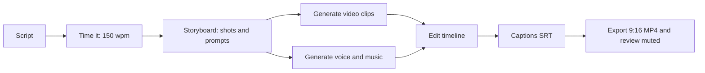
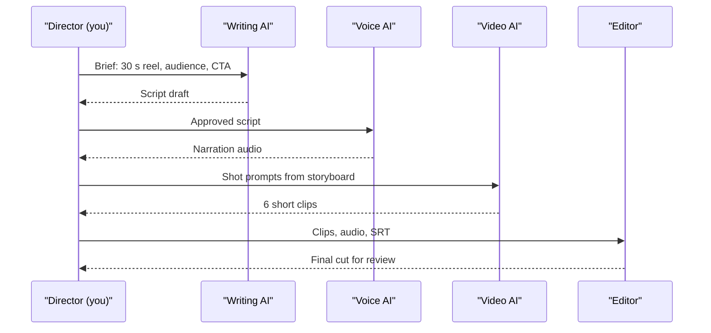
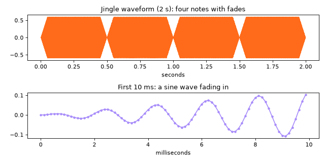

# Session 4 · Creating Audio and Video with Generative AI

[](https://colab.research.google.com/github/Hamnakhan123/Generative-AI/blob/main/03-innovate-with-generative-ai/code/session-04-creating-audio-and-video.ipynb)

> 🧭 [Generative AI](../README.md) › [Track 3 · Innovate with Generative AI](README.md) › **Session 4**
>
> ⏱️ **Estimated time:** 2 hours · 📋 **Prerequisites:** Previous session

[⬅ Previous](session-03-creating-visual-designs.md) · [🏠 Track home](README.md) · [Next ➡](session-05-storytelling-with-generative-ai.md)

---

## 🎯 Learning objectives

- Identify Gen AI tools for **audio** (voice, music, sound clean-up) and **video** (text-to-video, avatars, AI editing).
- Explain the end-to-end process of creating audio and video with Gen AI: **script → voice → visuals → edit → captions → export**.
- **Time a narration script**, generate **subtitles (SRT)** and plan a **storyboard** before spending generation credits.
- Understand how digital audio works (**samples, sample rate, amplitude**) by synthesising sound in code.
- Combine and edit **audio, text and visuals** responsibly (consent, licensing, disclosure).

## 📖 Concepts

### 1. The audio and video toolbox

| Need | Tool type | Examples | Watch out for |
|---|---|---|---|
| Narration from text | Text-to-speech (TTS) | ElevenLabs, Microsoft/Google TTS, CapCut voices | Mispronounced names; licence for commercial use |
| Your own voice, cleaned | Speech enhancement | Adobe Podcast Enhance, Descript Studio Sound | Over-processing sounds robotic |
| Music and jingles | Music generation | Suno, Udio, stock AI music in editors | Ownership and platform rules for AI music |
| Video from text or image | Text/image-to-video | Runway, Pika, Sora, Kling, Luma | Short clips (seconds), odd physics, credit cost |
| Talking-head videos | AI avatars | Synthesia, HeyGen | Consent; never imitate a real person without permission |
| Editing | AI-assisted editors | CapCut, Descript (edit by editing the transcript), Premiere, DaVinci Resolve | Always watch the final cut yourself |
| Captions | Speech-to-text | Built into CapCut, YouTube, Descript | Check names and technical terms |

> 🧠 **Analogy — a film crew in your laptop.** Gen AI gives you a voice actor (TTS), a composer (music AI), a camera crew (text-to-video), and an editor's assistant (auto-captions, cut suggestions). You are still the **director**: you write the script, approve every take and decide the final cut.

### 2. How digital audio works (the 3 numbers you need)

| Term | Meaning | Typical values |
|---|---|---|
| **Sample rate** | Measurements of the sound wave per second | 8,000 Hz (phone), 44,100 Hz (CD), 48,000 Hz (video) |
| **Bit depth** | Precision of each measurement | 16-bit (CD), 24-bit (studio) |
| **Amplitude** | How loud each sample is, from −1.0 to +1.0 | Peaks above 1.0 **clip** (distort) |

Every audio generator, AI or not, ultimately outputs a long list of numbers (samples). Example 4 builds one by hand.

### 3. How video generation works (briefly)

Text-to-video models extend image diffusion through **time**: they denoise a stack of frames together so motion stays consistent. Today's clips are short (a few seconds to about a minute), so real projects are **assembled from many shots** in an editor.

> 🧠 **Analogy — a flip-book.** A video is a flip-book of images shown 24–30 times per second. A video model must draw every page so that, when flipped, the character does not change face or shirt colour. That is why consistency is the hardest part.

### 4. Words per minute: the planning number

Narration runs at roughly **130–160 words per minute**; 150 wpm = **2.5 words per second**. A 30-second reel holds about **75 words**. Time the script *before* generating voice or video.

### 5. Captions and the SRT format

Most social video is watched **muted**, and captions make content accessible. An `.srt` file is plain text:

```text
1
00:00:00,000 --> 00:00:03,600
Ever wished your notes could talk back?
Meet StudyBuddy.
```

Guidelines: at most **2 lines**, about **42 characters per line**, at least **1 second** on screen.

### 6. Ethics: voice and face are personal data

- **Consent:** clone or imitate a voice or face only with written permission.
- **Deepfakes:** never create realistic fake statements by real people.
- **Disclosure:** label synthetic voices and avatars; many platforms require it.
- **Licensing:** check that music and voices may be used commercially.

## 🪜 Step-by-step walkthrough: a 30-second promo reel

1. **Goal and audience:** "Get first-years to try StudyBuddy, a flashcard app."
2. **Script with AI:** *"Write a 70-word, 30-second reel script: hook, problem, solution, proof, call to action."*
3. **Time it** at 150 wpm (Example 1); cut until it fits.
4. **Storyboard:** one shot per line of script, each with a visual prompt (mini project).
5. **Generate visuals:** text-to-video clips or screen recordings; 4–8 s each.
6. **Generate voice:** TTS in a clear voice; fix pronunciation with phonetic spelling ("Stu-dee-Buddy").
7. **Music:** a royalty-free or generated track; duck (lower) it under the voice.
8. **Edit:** place clips on the timeline, sync to voice, trim dead air.
9. **Captions:** import the SRT (Example 2) or auto-generate and correct.
10. **Export:** 1080 × 1920 (9:16), MP4, H.264; watch it once on a phone, muted.

## 🧭 Diagrams





## 💻 Worked examples (basic → advanced)

### Example 1 (basic) — Will the narration fit?

```python
# file: session-04_script_timer.py
"""
Session 4 · Example 1 — How long will my narration be?

Text-to-speech and human narrators speak at roughly 130-160 words per minute
(wpm). Before generating any audio, time the script so each scene fits its
video clip. 150 wpm = 2.5 words per second.

Run:  python session-04_script_timer.py
"""
WPM = 150
script = [
    ("Hook",     "Ever wished your notes could talk back? Meet StudyBuddy."),
    ("Problem",  "Exams pile up, notes are messy, and nobody has time to make flashcards."),
    ("Solution", "StudyBuddy turns your own notes into quizzes and flashcards in seconds, "
                 "then reminds you to review just before you forget."),
    ("Proof",    "In our pilot, forty students used it for two weeks."),
    ("CTA",      "Try it free this week. Link in bio."),
]

total = 0.0
print(f"{'Scene':9} {'Words':>5} {'Seconds':>8}  Start-End")
for name, text in script:
    words = len(text.split())
    secs = words / WPM * 60
    print(f"{name:9} {words:5} {secs:8.1f}  {total:5.1f}-{total + secs:5.1f}s")
    total += secs
print(f"Total: {total:.1f} s at {WPM} wpm")
limit = 30
print("Fits a 30-second reel" if total <= limit else f"Too long by {total - limit:.1f} s: cut words")
```

**Output**

```text
Scene     Words  Seconds  Start-End
Hook          9      3.6    0.0-  3.6s
Problem      13      5.2    3.6-  8.8s
Solution     20      8.0    8.8- 16.8s
Proof        10      4.0   16.8- 20.8s
CTA           8      3.2   20.8- 24.0s
Total: 24.0 s at 150 wpm
Fits a 30-second reel
```

### Example 2 (intermediate) — Make captions automatically

```python
# file: session-04_srt_maker.py
"""
Session 4 · Example 2 — Generate a subtitle (.srt) file from a timed script.

Captions matter: most social video is watched with the sound off, and
captions make content accessible to deaf and hard-of-hearing viewers.
An SRT file is plain text: a number, a time range "HH:MM:SS,mmm --> ...",
the caption text, then a blank line. Video editors (CapCut, Premiere,
DaVinci Resolve) and YouTube all import it.

Long lines are split so that no caption exceeds 42 characters per line,
which is a common broadcast guideline.

Run:  python session-04_srt_maker.py
Creates: session-04_promo.srt
"""
import textwrap

WPM = 150
MAX_CHARS = 42


def stamp(seconds: float) -> str:
    ms = round(seconds * 1000)
    h, ms = divmod(ms, 3_600_000)
    m, ms = divmod(ms, 60_000)
    s, ms = divmod(ms, 1000)
    return f"{h:02}:{m:02}:{s:02},{ms:03}"


def to_srt(lines):
    blocks, t, n = [], 0.0, 1
    for text in lines:
        # wrap into lines of at most MAX_CHARS, then show 2 lines per caption
        rows = textwrap.wrap(text, MAX_CHARS)
        for k in range(0, len(rows), 2):
            pair = rows[k:k + 2]
            words = sum(len(r.split()) for r in pair)
            dur = max(words / WPM * 60, 1.0)  # at least 1 second on screen
            blocks.append(f"{n}\n{stamp(t)} --> {stamp(t + dur)}\n" + "\n".join(pair) + "\n")
            t += dur
            n += 1
    return "\n".join(blocks)


script = [
    "Ever wished your notes could talk back? Meet StudyBuddy.",
    "Exams pile up, notes are messy, and nobody has time to make flashcards.",
    "StudyBuddy turns your own notes into quizzes and flashcards in seconds, "
    "then reminds you to review just before you forget.",
    "Try it free this week. Link in bio.",
]
srt = to_srt(script)
with open("session-04_promo.srt", "w", encoding="utf-8") as f:
    f.write(srt)
print(srt)
print("Saved -> session-04_promo.srt")
```

**Output**

```text
1
00:00:00,000 --> 00:00:03,600
Ever wished your notes could talk back?
Meet StudyBuddy.

2
00:00:03,600 --> 00:00:08,800
Exams pile up, notes are messy, and nobody
has time to make flashcards.

3
00:00:08,800 --> 00:00:13,600
StudyBuddy turns your own notes into
quizzes and flashcards in seconds, then

4
00:00:13,600 --> 00:00:16,800
reminds you to review just before you
forget.

5
00:00:16,800 --> 00:00:20,000
Try it free this week. Link in bio.

Saved -> session-04_promo.srt
```

Import `session-04_promo.srt` into CapCut, Premiere, DaVinci Resolve or YouTube Studio. Then fine-tune timings by ear.

### Example 3 (intermediate) — Prompts for each tool

| Tool | Prompt |
|---|---|
| Script | "Write a 70-word voiceover for a 30-second reel about a flashcard app for university students. Structure: hook, problem, solution, proof, call to action. Conversational." |
| TTS | Voice: warm, young adult, medium pace. Add pauses with commas or `<break time="0.5s"/>` where the tool supports SSML. |
| Text-to-video | "Close-up of a student's phone showing colourful flashcards flipping, bokeh library background, soft daylight, slow push-in, 5 seconds, 9:16." |
| Music | "Upbeat lo-fi hip hop, 90 BPM, no vocals, 30 seconds, ends on a clean hit." |

### Example 4 (advanced) — Generate real sound from numbers

```python
# file: session-04_jingle.py
"""
Session 4 · Example 3 — Make sound from numbers: a 2-second jingle.

Every audio tool, AI or not, ends up writing samples: numbers that describe
air pressure thousands of times per second. Here we synthesise a short
four-note jingle with pure maths (sine waves), add a fade in/out to avoid
clicks, save it as a WAV file with the standard library, and plot the
waveform. AI music tools do the same final step, only their numbers come
from a neural network instead of a sine formula.

Run:  python session-04_jingle.py
Creates: session-04_jingle.wav and session-04_waveform.png (matplotlib)
"""
import math
import struct
import wave

import matplotlib
matplotlib.use("Agg")
import matplotlib.pyplot as plt

RATE = 8000                     # samples per second (phone quality, keeps file small)
NOTES = [("C5", 523.25), ("E5", 659.25), ("G5", 783.99), ("C6", 1046.50)]
NOTE_LEN = 0.5                  # seconds per note
FADE = 0.05                     # 50 ms fade at each note edge

samples = []
for name, freq in NOTES:
    n = int(RATE * NOTE_LEN)
    for i in range(n):
        t = i / RATE
        env = min(1.0, t / FADE, (NOTE_LEN - t) / FADE)   # fade in and out
        samples.append(0.6 * env * math.sin(2 * math.pi * freq * t))

with wave.open("session-04_jingle.wav", "wb") as w:
    w.setnchannels(1)           # mono
    w.setsampwidth(2)           # 16-bit
    w.setframerate(RATE)
    w.writeframes(b"".join(struct.pack("<h", int(s * 32767)) for s in samples))

print(f"Notes: {' '.join(n for n, _ in NOTES)}")
print(f"Samples written: {len(samples)} ({len(samples)/RATE:.1f} s at {RATE} Hz)")
print(f"Peak amplitude: {max(abs(s) for s in samples):.2f} (1.0 = clipping)")
print("Saved -> session-04_jingle.wav")

# Plot the whole jingle plus a zoom on the first 10 ms to see the wave shape
fig, (a, b) = plt.subplots(2, 1, figsize=(8, 4))
a.plot([i / RATE for i in range(len(samples))], samples, color="#FF6B1A", linewidth=0.4)
a.set_title("Jingle waveform (2 s): four notes with fades")
a.set_xlabel("seconds")
zoom = int(RATE * 0.01)
b.plot([1000 * i / RATE for i in range(zoom)], samples[:zoom], color="#A78BFA", marker=".")
b.set_title("First 10 ms: a sine wave fading in")
b.set_xlabel("milliseconds")
fig.tight_layout()
fig.savefig("session-04_waveform.png", dpi=80)
print("Saved -> session-04_waveform.png")
```

**Output**

```text
Notes: C5 E5 G5 C6
Samples written: 16000 (2.0 s at 8000 Hz)
Peak amplitude: 0.60 (1.0 = clipping)
Saved -> session-04_jingle.wav
Saved -> session-04_waveform.png
```



**What to notice:** the fades remove clicks at note boundaries; peak amplitude 0.60 leaves **headroom** so the sound never clips. AI music tools hand you the same kind of sample list, only produced by a neural network.

## 🏗️ Real-life problem: storyboard → edit plan for a 45-second promo (full solution)

**Scenario.** The department wants a 45-second promo made from AI clips, an AI voiceover and captions. Every text-to-video generation costs credits, so you must plan first: one prompt per shot, narration timed per shot, a check that every line fits its shot, total runtime against the target, and a machine-readable edit plan.

```python
# file: session-04_project_storyboard.py
"""
Session 4 · Mini project (full solution) — Storyboard to edit plan.

Real-life problem: the department wants a 45-second promo video made with AI
clips (text-to-video), an AI voiceover and captions. Before generating
anything (each clip costs credits and time), plan it:

  * a shot list with a text-to-video prompt for every shot,
  * narration per shot, timed at 150 wpm,
  * a check that each shot is long enough for its narration,
  * total runtime vs the 45 s target,
  * a JSON edit plan an editor (or a script) can follow.

Run:  python session-04_project_storyboard.py
Creates: session-04_edit_plan.json
"""
import json

WPM, TARGET = 150, 45
shots = [
    # (shot length s, visual prompt for a text-to-video tool, narration, music cue)
    (6, "Slow drone shot over a university campus at sunrise, warm light, cinematic",
        "Every great career starts with one good decision.", "soft piano in"),
    (8, "Close-up of hands typing code on a laptop, screen glow, shallow depth of field",
        "In our computer science labs you build real projects from week one.", "beat starts"),
    (8, "Students laughing around a whiteboard covered in diagrams, handheld camera",
        "You learn with people who push you, help you and celebrate with you.", "beat"),
    (7, "A robot arm sorting coloured blocks, macro lens, studio lighting",
        "Robotics, AI and data science, taught by practising engineers.", "beat"),
    (8, "Graduates throwing caps in the air, slow motion, golden hour",
        "Our graduates work at startups and global companies.", "swell"),
    (6, "Logo reveal on dark background with orange glow particles",
        "Applications are open. Visit our website today.", "final hit"),
]

plan, t, problems = [], 0.0, []
print(f"{'#':>2} {'Len':>4} {'Talk':>5}  Visual prompt")
for i, (length, visual, narration, music) in enumerate(shots, 1):
    talk = len(narration.split()) / WPM * 60
    flag = "" if talk <= length - 0.5 else "  <-- narration too long for shot"
    if flag:
        problems.append(i)
    print(f"{i:2} {length:4} {talk:5.1f}  {visual[:58]}{flag}")
    plan.append({"shot": i, "start": t, "end": t + length, "visual_prompt": visual,
                 "narration": narration, "music": music, "caption": narration})
    t += length

print(f"\nRuntime {t:.0f} s vs target {TARGET} s -> {'OK' if abs(t - TARGET) <= 2 else 'adjust shots'}")
print("All narration fits its shot" if not problems else f"Rewrite narration for shots {problems}")
with open("session-04_edit_plan.json", "w") as f:
    json.dump({"title": "CS Department Promo", "fps": 30, "shots": plan}, f, indent=2)
print("Saved -> session-04_edit_plan.json")
print("\nFirst entry of the edit plan:")
print(json.dumps(plan[0], indent=2))
```

**Output**

```text
 #  Len  Talk  Visual prompt
 1    6   3.2  Slow drone shot over a university campus at sunrise, warm 
 2    8   4.8  Close-up of hands typing code on a laptop, screen glow, sh
 3    8   5.2  Students laughing around a whiteboard covered in diagrams,
 4    7   3.6  A robot arm sorting coloured blocks, macro lens, studio li
 5    8   3.2  Graduates throwing caps in the air, slow motion, golden ho
 6    6   2.8  Logo reveal on dark background with orange glow particles

Runtime 43 s vs target 45 s -> OK
All narration fits its shot
Saved -> session-04_edit_plan.json

First entry of the edit plan:
{
  "shot": 1,
  "start": 0.0,
  "end": 6.0,
  "visual_prompt": "Slow drone shot over a university campus at sunrise, warm light, cinematic",
  "narration": "Every great career starts with one good decision.",
  "music": "soft piano in",
  "caption": "Every great career starts with one good decision."
}
```

The JSON file is an **edit decision list** in simple form: an editor (or a script using a library like MoviePy) can place clips and captions exactly from it.

## 📊 Runtime of the planned shots

```mermaid
gantt
    title Promo timeline in seconds
    dateFormat s
    axisFormat %S
    section Shots
    Campus drone    :0, 6s
    Typing code     :6, 8s
    Whiteboard team :14, 8s
    Robot arm       :22, 7s
    Graduation      :29, 8s
    Logo reveal     :37, 6s
```



| Format | Ratio | Resolution | Typical length |
|---|---|---|---|
| Reel / Short / TikTok | 9:16 | 1080 × 1920 | 15–60 s |
| YouTube video | 16:9 | 1920 × 1080 | 2–15 min |
| Square feed video | 1:1 | 1080 × 1080 | 15–60 s |

## ⚠️ Common mistakes

| Mistake | Fix |
|---|---|
| Generating clips before the script is final | Script → time → storyboard → then generate |
| Script longer than the video | 150 wpm rule: 30 s ≈ 75 words |
| Music louder than the voice | Lower music 12–20 dB under speech ("ducking") |
| No captions | Add SRT; most viewers watch muted |
| Cloning a teacher's voice "for fun" | Written consent first, or use a stock voice |
| Mismatched style between AI clips | Reuse one style sentence in every shot prompt |

## ✅ Best practices

- **Plan on paper first;** generation credits and time are the expensive part.
- Keep shots **short (4–8 s)** and cut on movement.
- Generate **2–3 takes** per important shot; pick the best.
- **Listen and watch at full speed** on a phone before publishing.
- Label AI voices/avatars and keep licence records.

## 🧪 Lab / practice tasks

**Task 1 · 🟢 Easy** — Write a 60-word, 25-second script for a club promo and check it with `session-04_script_timer.py`.

<details><summary>💡 Hint</summary>

Replace the `script` list; aim for 60–65 words.

</details>

**Task 2 · 🟢 Easy** — Generate an SRT file for your script and open it in a text editor to inspect the format.

<details><summary>💡 Hint</summary>

Use `session-04_srt_maker.py`; each block has number, time range, text, blank line.

</details>

**Task 3 · 🟡 Medium** — Change `session-04_jingle.py` to play a 5-note melody and set the peak to 0.9. What happens at 1.2?

<details><summary>💡 Hint</summary>

Values above 1.0 overflow the 16-bit range: `struct.pack` raises an error, which is how clipping shows up here.

</details>

**Task 4 · 🟡 Medium** — Make a 15-second video in a free AI editor using three AI clips, a TTS voice and captions.

<details><summary>💡 Hint</summary>

Keep each clip 4–6 seconds; export 9:16.

</details>

**Task 5 · 🔴 Challenge** — Extend the storyboard script so it also writes an SRT file from the shot narration, using each shot's start time.

<details><summary>💡 Hint</summary>

Reuse the `stamp()` function from the SRT example; caption start = shot start.

</details>


<details><summary>✅ Lab solutions and model answers</summary>

**Task 1 sample (60 words):** "Bored of coding alone? Join the Coding Club! Every Wednesday we solve fun challenges, build real apps and help each other debug. No experience needed, just curiosity. Last term our members built a canteen-order app used by two hundred students. Your turn next. Wednesdays, 3 pm, Lab 2. Scan the code or tap the link in bio to join today." → exactly 24.0 s at 150 wpm.

**Task 3:** change `NOTES` to five tuples and `0.6` to `0.9`. At `1.2`, `int(s * 32767)` exceeds 32767 and `struct.pack("<h", ...)` raises `struct.error`: in a real editor the wave would be flattened (clipped) instead, which sounds harsh.

**Task 5 (add at the end of the storyboard script):**

```python
def stamp(sec):
    ms = round(sec * 1000); h, ms = divmod(ms, 3600000); m, ms = divmod(ms, 60000); s, ms = divmod(ms, 1000)
    return f"{h:02}:{m:02}:{s:02},{ms:03}"

with open("session-04_promo_shots.srt", "w") as f:
    for p in plan:
        talk = len(p["narration"].split()) / WPM * 60
        f.write(f"{p['shot']}\n{stamp(p['start'])} --> {stamp(p['start'] + talk)}\n{p['narration']}\n\n")
```

</details>

## ✅ Quick quiz

**Q1. At 150 words per minute, roughly how many words fit a 30-second reel?**

- A) 30
- B) 75
- C) 150
- D) 300

<details><summary>Show answer</summary>

✅ **B) 75** — 2.5 words per second × 30 s.

</details>

**Q2. What does a sample rate of 48,000 Hz mean?**

- A) 48,000 songs
- B) 48,000 measurements of the sound wave per second
- C) 48 kB file size
- D) 48 seconds long

<details><summary>Show answer</summary>

✅ **B) 48,000 measurements of the sound wave per second** — Samples per second.

</details>

**Q3. A good caption has at most...**

- A) 5 lines
- B) 2 lines of about 42 characters
- C) One word
- D) 200 characters on one line

<details><summary>Show answer</summary>

✅ **B) 2 lines of about 42 characters** — Readable at a glance.

</details>

**Q4. Why storyboard before generating AI video?**

- A) It is required by law
- B) Generation costs credits and time; planning avoids waste
- C) AI cannot make video without one
- D) To increase resolution

<details><summary>Show answer</summary>

✅ **B) Generation costs credits and time; planning avoids waste** — Plan first, generate once.

</details>

**Q5. Which needs explicit consent?**

- A) Using a stock TTS voice
- B) Cloning a classmate's voice
- C) Adding captions
- D) Lowering music volume

<details><summary>Show answer</summary>

✅ **B) Cloning a classmate's voice** — Voices are personal data.

</details>


## 📝 Summary / cheat-sheet

- Toolbox: **TTS, speech enhancement, music AI, text-to-video, avatars, AI editors, auto-captions**.
- Audio basics: **sample rate, bit depth, amplitude; never clip**.
- Process: **script → time (150 wpm) → storyboard → generate → edit → captions → export → review muted**.
- SRT: number, `HH:MM:SS,mmm --> HH:MM:SS,mmm`, ≤ 2 lines, blank line.
- Ethics: **consent, no deepfakes, disclosure, licensing**.

**Viva / interview questions**

1. Walk through the full pipeline for a 30-second AI promo reel.
2. Why are AI video projects assembled from many short shots?
3. Explain sample rate and clipping in simple words.
4. What is an SRT file and why do captions matter?
5. How do you keep a consistent style across AI-generated clips?
6. What are the ethical rules for AI voices and avatars?

---

[⬅ Previous](session-03-creating-visual-designs.md) · [🏠 Track home](README.md) · [Next ➡](session-05-storytelling-with-generative-ai.md)

<sub>Prepared by **Hamna Zahid Khan**, Junior Lecturer</sub>
