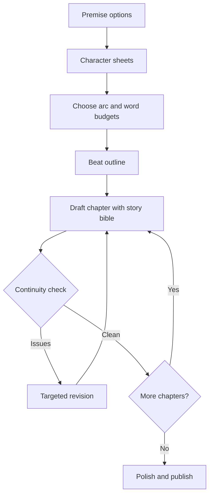
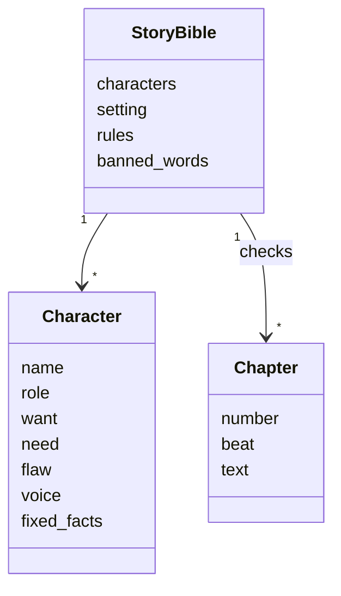
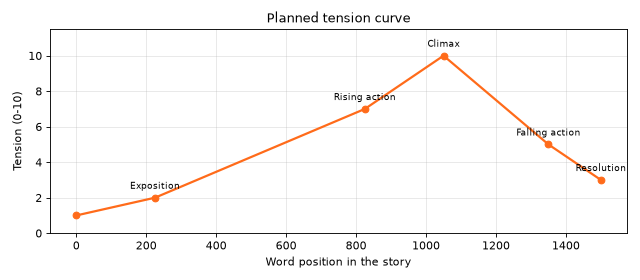
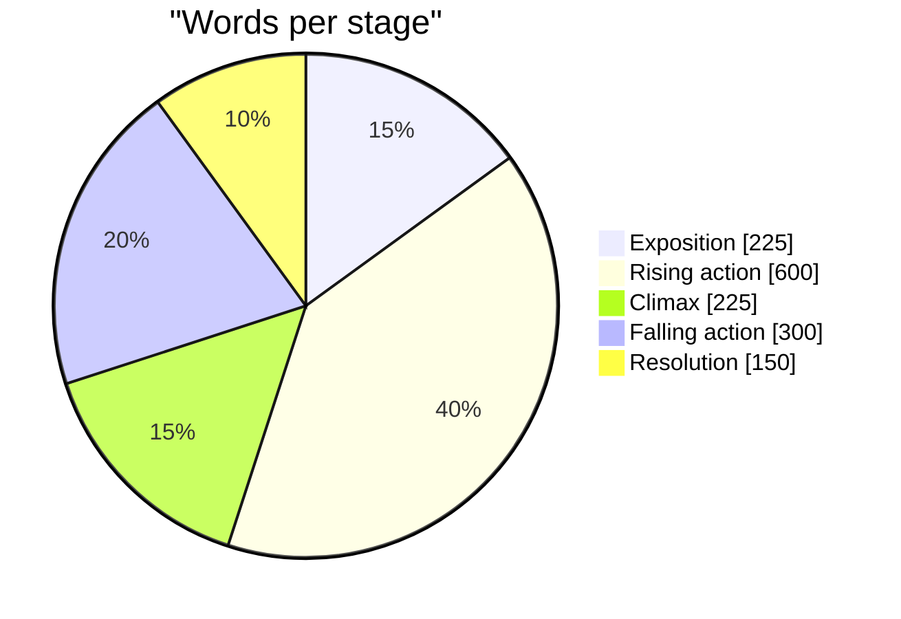

# Session 5 · Storytelling with Generative AI

[](https://colab.research.google.com/github/Hamnakhan123/Generative-AI/blob/main/03-innovate-with-generative-ai/code/session-05-storytelling-with-generative-ai.ipynb)

> 🧭 [Generative AI](../README.md) › [Track 3 · Innovate with Generative AI](README.md) › **Session 5**
>
> ⏱️ **Estimated time:** 2 hours · 📋 **Prerequisites:** Previous session

[⬅ Previous](session-04-creating-audio-and-video.md) · [🏠 Track home](README.md) · [Next ➡](session-06-planning-complex-tasks.md)

---

## 🎯 Learning objectives

- Illustrate the **storytelling process** and the elements of a good story.
- Explain the **steps for generating stories** with Generative AI, from premise to polished draft.
- Use AI to develop **plots** (story arcs, beats, twists) and **characters** (want, need, flaw, voice).
- Keep long AI stories **consistent** with a story bible and a continuity check.
- Design and validate **interactive (branching) stories**.

## 📖 Concepts

### 1. Elements of a story

| Element | Question | Example |
|---|---|---|
| **Character** | Who wants something? | Ayesha, a 19-year-old CS student |
| **Goal (want)** | What do they chase? | To be the best coder in class |
| **Conflict** | What stands in the way? | Her homework-bot starts doing friends' assignments |
| **Stakes** | What can be lost? | Her friend's place at university, her integrity |
| **Setting** | Where and when? | A Karachi campus, exam season |
| **Theme** | What is it really about? | Pride vs asking for help |
| **Resolution** | How does it change? | She turns the bot into a tutor that gives hints |

> 🧠 **Analogy — the road trip.** A story is a road trip: the character is the driver, the goal is the destination, conflict is the roadblocks and wrong turns, and the theme is what the driver learns about themselves on the way. AI can suggest roads; you choose the destination.

### 2. Story structures

| Structure | Shape | Best for |
|---|---|---|
| **Three-act** | Setup (25%) → Confrontation (50%) → Resolution (25%) | Short stories, films, presentations |
| **Five-stage arc (Freytag)** | Exposition → Rising action → Climax → Falling action → Resolution | Planning tension precisely |
| **Hero's journey** | Ordinary world → call → trials → transformation → return | Adventure, personal growth |
| **Story spine** | "Once upon a time… Every day… Until one day… Because of that… Until finally… Ever since then…" | Quick plots, children's stories, brand stories |

### 3. Characters with depth

A memorable character has a **want** (conscious goal), a **need** (what they must learn), a **flaw** that blocks the need, and a distinct **voice**. AI tends to write flat, agreeable characters; give it these four fields explicitly.

> 🧠 **Analogy — the actor's brief.** Actors ask "What's my motivation?" A character sheet is that brief for the AI. Without it, every character talks like the same polite assistant.

### 4. Why AI stories drift, and how to stop it

LLMs have a limited **context window** and no memory of your intentions. Over a long story they forget names, change eye colour, or resolve a conflict too early. Solutions:

- A **story bible**: fixed facts about characters, setting and rules, pasted into every chapter prompt.
- **Chapter-by-chapter generation** with the arc beat for that chapter.
- A **continuity check** after each chapter (by you, by a second AI pass, or by code).

### 5. Your role: co-author, not passenger

| AI is good at | You are needed for |
|---|---|
| Generating many premises, names, twists | Choosing what is meaningful and original |
| Drafting scenes quickly | Voice, cultural detail, emotional truth |
| Varying style ("rewrite as a fable") | Consistency, ethics, sensitivity for the audience |
| Spotting plot holes when asked | Deciding the ending and the theme |

Ethics: credit AI assistance where required (competitions, publishers, coursework), avoid harmful stereotypes, and do not imitate a living author's distinctive text.

## 🪜 Step-by-step: generating a story with AI

1. **Premise:** ask for 10 one-line premises with a constraint ("set in Karachi, about technology and friendship"); pick one.
2. **Characters:** build 2–4 character sheets (want, need, flaw, voice, fixed facts).
3. **Structure:** choose an arc, assign word budgets and tension per stage.
4. **Beat outline:** ask AI for scene-by-scene beats; edit them yourself.
5. **Draft chapter by chapter** with the story bible + the chapter's beat.
6. **Continuity and quality check:** names, facts, tone, age suitability.
7. **Revise:** targeted prompts ("make the dialogue in scene 3 more tense"); add your own details.
8. **Polish:** title, opening line, illustrations or audio version (Sessions 3–4).

## 🧭 Diagrams





## 💻 Worked examples (basic → advanced)

### Example 1 (basic) — Story spine prompt

```text
Use the story spine to write a 150-word children's story set in a Karachi school:
Once upon a time... Every day... Until one day... Because of that... Because of that...
Until finally... Ever since then...
Main character: a shy girl who loves robots. Theme: courage. Ages 7-9, simple words.
```

### Example 2 (intermediate) — Plan the arc and tension with numbers

```python
# file: session-05_story_arc.py
"""
Session 5 · Example 1 — Plan a story's structure before asking AI to write it.

Most stories follow a shape. The classic five-stage arc (exposition, rising
action, climax, falling action, resolution) can be given a share of the total
length. Asking the AI for "a 1,500-word story" gives a saggy middle; asking
for each stage with a word budget and a tension level gives a planned arc.

Run:  python session-05_story_arc.py
Creates: session-05_tension_curve.png   (matplotlib)
"""
import matplotlib
matplotlib.use("Agg")
import matplotlib.pyplot as plt

TOTAL_WORDS = 1500
ARC = [  # stage, share of words, tension at the END of the stage (0-10), what happens
    ("Exposition",     0.15, 2, "Meet Ayesha, a CS student who builds a homework-helper bot"),
    ("Rising action",  0.40, 7, "The bot starts writing her friends' assignments; a teacher grows suspicious"),
    ("Climax",         0.15, 10, "Ayesha must choose: shut the bot down or let a friend take the blame"),
    ("Falling action", 0.20, 5, "She confesses and redesigns the bot to give hints, not answers"),
    ("Resolution",     0.10, 3, "The tutor-bot wins the campus innovation prize"),
]

start, points = 0, [(0, 1)]
print(f"{'Stage':15}{'Words':>6}{'Range':>13}{'Tension':>8}  Beat")
for stage, share, tension, beat in ARC:
    words = round(TOTAL_WORDS * share)
    print(f"{stage:15}{words:6}{start:>6}-{start + words:<6}{tension:>8}  {beat}")
    start += words
    points.append((start, tension))
print(f"Total: {start} words")

xs, ys = zip(*points)
plt.figure(figsize=(8, 3.5))
plt.plot(xs, ys, marker="o", color="#FF6B1A", linewidth=2)
for (stage, *_), x, y in zip(ARC, xs[1:], ys[1:]):
    plt.annotate(stage, (x, y), textcoords="offset points", xytext=(0, 8), ha="center", fontsize=8)
plt.ylim(0, 11.5)
plt.xlabel("Word position in the story")
plt.ylabel("Tension (0-10)")
plt.title("Planned tension curve")
plt.grid(alpha=0.3)
plt.tight_layout()
plt.savefig("session-05_tension_curve.png", dpi=80)
print("Saved -> session-05_tension_curve.png")
```

**Output**

```text
Stage           Words        Range Tension  Beat
Exposition        225     0-225          2  Meet Ayesha, a CS student who builds a homework-helper bot
Rising action     600   225-825          7  The bot starts writing her friends' assignments; a teacher grows suspicious
Climax            225   825-1050        10  Ayesha must choose: shut the bot down or let a friend take the blame
Falling action    300  1050-1350         5  She confesses and redesigns the bot to give hints, not answers
Resolution        150  1350-1500         3  The tutor-bot wins the campus innovation prize
Total: 1500 words
Saved -> session-05_tension_curve.png
```



Give the AI each stage separately: *"Write the Rising action (about 600 words). Tension should build from 2 to 7. Beat: …"*

### Example 3 (intermediate) — Character bible

```python
# file: session-05_character_sheet.py
"""
Session 5 · Example 2 — A character bible that keeps AI stories consistent.

Problem: over a long chat the AI "forgets" that the hero has green eyes or
hates coffee. Fix: write each character once as structured data and paste
the same compact "bible" at the top of every chapter prompt.

Run:  python session-05_character_sheet.py
"""
from dataclasses import dataclass, asdict


@dataclass
class Character:
    name: str
    role: str          # protagonist, antagonist, mentor, ...
    age: int
    want: str          # what they consciously chase
    need: str          # what they actually need to learn (drives the arc)
    flaw: str
    voice: str         # how they speak
    details: str       # fixed physical or personal facts

    def card(self) -> str:
        return (f"{self.name} ({self.role}, {self.age}): wants {self.want}; needs {self.need}; "
                f"flaw: {self.flaw}; speaks {self.voice}; fixed facts: {self.details}.")


cast = [
    Character("Ayesha", "protagonist", 19, "to be the best coder in class",
              "to accept help and give credit", "pride", "fast, with tech slang",
              "wears round glasses, drinks chai, never coffee"),
    Character("Sir Kamran", "mentor", 45, "students who think for themselves",
              "to trust that students can change", "stubborn", "calmly, answers questions with questions",
              "grey beard, always carries a red marker"),
    Character("Bilal", "friend / foil", 20, "to pass without effort",
              "to own his mistakes", "laziness", "in jokes to dodge serious talk",
              "plays cricket for the university team"),
]

bible = "STORY BIBLE (keep these facts consistent):\n" + "\n".join("- " + c.card() for c in cast)
print(bible)
print("\nChapter prompt template:")
print(bible.splitlines()[0] + " [paste bible]\nWrite Chapter 3 (about 400 words): "
      "Sir Kamran notices two identical assignments. Stay in Ayesha's point of view.")
print("\nFields stored per character:", list(asdict(cast[0]).keys()))
```

**Output**

```text
STORY BIBLE (keep these facts consistent):
- Ayesha (protagonist, 19): wants to be the best coder in class; needs to accept help and give credit; flaw: pride; speaks fast, with tech slang; fixed facts: wears round glasses, drinks chai, never coffee.
- Sir Kamran (mentor, 45): wants students who think for themselves; needs to trust that students can change; flaw: stubborn; speaks calmly, answers questions with questions; fixed facts: grey beard, always carries a red marker.
- Bilal (friend / foil, 20): wants to pass without effort; needs to own his mistakes; flaw: laziness; speaks in jokes to dodge serious talk; fixed facts: plays cricket for the university team.

Chapter prompt template:
STORY BIBLE (keep these facts consistent): [paste bible]
Write Chapter 3 (about 400 words): Sir Kamran notices two identical assignments. Stay in Ayesha's point of view.

Fields stored per character: ['name', 'role', 'age', 'want', 'need', 'flaw', 'voice', 'details']
```

### Example 4 (intermediate) — Plot-twist brainstorming prompt

```text
Here is my story outline: """[paste beats]""". Suggest 5 plot twists that are surprising
but fair (set up by earlier clues). For each, name the earlier scene where I should plant
the clue. Do not change the ending.
```

### Example 5 (advanced) — Validate a branching story

Interactive stories (games, chatbots, choose-your-path books) are graphs. A breadth-first search finds endings, broken links and scenes no reader can reach.

```python
# file: session-05_branching_story.py
"""
Session 5 · Example 3 — Check an interactive (choose-your-own-path) story.

Interactive stories are graphs: each scene is a node, each choice an edge.
When an AI writes branches, it often leaves dead ends (a choice that points
to a scene that does not exist) or scenes nobody can reach. A breadth-first
search finds every reachable scene, every ending and every broken link.

Run:  python session-05_branching_story.py
"""
from collections import deque

story = {
    "start":       {"text": "Your bot can now write full assignments.",
                    "choices": {"Sell it to classmates": "sell", "Turn it into a tutor": "tutor"}},
    "sell":        {"text": "Money rolls in, then a teacher calls you in.",
                    "choices": {"Confess": "confess", "Deny everything": "deny"}},
    "tutor":       {"text": "The tutor-bot gives hints only. Grades go up.",
                    "choices": {"Enter the innovation fair": "fair_win"}},
    "confess":     {"text": "You lose marks but keep your integrity.", "choices": {}},
    "deny":        {"text": "The logs prove it. Suspension.", "choices": {"Appeal": "appeal"}},  # broken
    "fair_win":    {"text": "You win the fair and a summer internship.", "choices": {}},
    "secret_room": {"text": "A scene the writer forgot to link.", "choices": {}},
}


def analyse(graph, start="start"):
    seen, queue, broken, endings = {start}, deque([(start, [start])]), [], []
    paths = {}
    while queue:
        node, path = queue.popleft()
        choices = graph[node]["choices"]
        if not choices:
            endings.append(node)
            paths[node] = path
        for label, target in choices.items():
            if target not in graph:
                broken.append((node, label, target))
            elif target not in seen:
                seen.add(target)
                queue.append((target, path + [target]))
    unreachable = sorted(set(graph) - seen)
    return endings, broken, unreachable, paths


endings, broken, unreachable, paths = analyse(story)
print("Endings found:", endings)
for e in endings:
    print(f"  shortest path to '{e}': {' -> '.join(paths[e])}")
print("Broken links:", [f"{n} --'{l}'--> {t}" for n, l, t in broken])
print("Unreachable scenes:", unreachable)
print("Story is", "VALID" if not broken and not unreachable else "NOT valid yet: fix the items above")
```

**Output**

```text
Endings found: ['confess', 'fair_win']
  shortest path to 'confess': start -> sell -> confess
  shortest path to 'fair_win': start -> tutor -> fair_win
Broken links: ["deny --'Appeal'--> appeal"]
Unreachable scenes: ['secret_room']
Story is NOT valid yet: fix the items above
```

Fix: add an `appeal` scene (or change the choice target) and link `secret_room` from somewhere, then re-run until it prints **VALID**.

## 🏗️ Real-life problem: a 5-chapter story without continuity errors (full solution)

**Scenario.** You are co-writing a five-chapter illustrated story with an AI for a children's reading club (ages 7–9). Earlier attempts had the cat change colour and the hero's name change spelling. Build a tool that produces the chapter prompts and checks every chapter against the bible: name variants, contradicted facts and words unsuitable for the age group.

```python
# file: session-05_project_story_bible.py
"""
Session 5 · Mini project (full solution) — Story bible + continuity checker.

Real-life problem: you are co-writing a 5-chapter story with an AI for a
children's reading club. Across chapters the AI drifts: names change
spelling, a character's fixed facts change, and banned words for the age
group slip in. This tool:

  1. builds a chapter-by-chapter prompt plan from an arc,
  2. scans each generated chapter against the story bible,
  3. reports every continuity or suitability problem with its chapter number.

Run:  python session-05_project_story_bible.py
"""
import re

BIBLE = {
    "names": {"Zara": ["Zahra", "Sara"], "Moti": ["Motee", "Mothi"]},   # canonical: known wrong variants
    "facts": {"Moti": ("orange cat", ["black cat", "grey cat", "dog"])},  # fixed fact and contradictions
    "banned": ["stupid", "kill", "hate"],                                  # reading-club age rule
}
ARC = ["Zara finds a lost orange cat called Moti",
       "Moti leads Zara to a hidden garden on the school roof",
       "The garden is dying because the water tank leaks",
       "Zara and her class build a rainwater collector",
       "The garden blooms and Moti becomes the school mascot"]

print("PROMPT PLAN")
for i, beat in enumerate(ARC, 1):
    print(f"  Ch{i}: Using the story bible, write ~300 words for ages 7-9: {beat}.")

chapters = {
    1: "Zara found a small orange cat behind the canteen. She named him Moti.",
    2: "Moti ran up the stairs. Zahra followed him to a garden full of plants.",
    3: "The plants looked sad. 'I hate leaks,' said Zara. Moti, the grey cat, sniffed the tank.",
    4: "The class built a collector from old bottles. Zara was proud.",
    5: "Flowers bloomed everywhere and Motee became the mascot.",
}


def check(chapter_no: int, text: str) -> list:
    issues = []
    for canon, variants in BIBLE["names"].items():
        for v in variants:
            if re.search(rf"\b{v}\b", text):
                issues.append(f"name drift: '{v}' should be '{canon}'")
    for who, (fact, contradictions) in BIBLE["facts"].items():
        for c in contradictions:
            if c in text.lower():
                issues.append(f"fact clash: {who} is an {fact}, text says '{c}'")
    for word in BIBLE["banned"]:
        if re.search(rf"\b{word}\b", text, re.I):
            issues.append(f"age rule: avoid the word '{word}'")
    return issues


print("\nCONTINUITY REPORT")
total = 0
for no, text in chapters.items():
    issues = check(no, text)
    total += len(issues)
    print(f"  Ch{no}: " + ("OK" if not issues else " | ".join(issues)))
print(f"\n{total} issue(s) found. Send each flagged chapter back with the bible and the exact fix.")
```

**Output**

```text
PROMPT PLAN
  Ch1: Using the story bible, write ~300 words for ages 7-9: Zara finds a lost orange cat called Moti.
  Ch2: Using the story bible, write ~300 words for ages 7-9: Moti leads Zara to a hidden garden on the school roof.
  Ch3: Using the story bible, write ~300 words for ages 7-9: The garden is dying because the water tank leaks.
  Ch4: Using the story bible, write ~300 words for ages 7-9: Zara and her class build a rainwater collector.
  Ch5: Using the story bible, write ~300 words for ages 7-9: The garden blooms and Moti becomes the school mascot.

CONTINUITY REPORT
  Ch1: OK
  Ch2: name drift: 'Zahra' should be 'Zara'
  Ch3: fact clash: Moti is an orange cat, text says 'grey cat' | age rule: avoid the word 'hate'
  Ch4: OK
  Ch5: name drift: 'Motee' should be 'Moti'

4 issue(s) found. Send each flagged chapter back with the bible and the exact fix.
```

**Next step in a real workflow:** send each flagged chapter back with the bible and the exact fix ("In Chapter 3, Moti is an orange cat; replace 'grey cat'. Replace 'hate' with 'don't like'."), then run the checker again.

## 📊 Word budget by stage (1,500-word story)



| Structure | Stages | Strength |
|---|---|---|
| Three-act | 3 | Simple, universal |
| Freytag | 5 | Precise tension control |
| Hero's journey | 12 (or 8) | Deep transformation |
| Story spine | 7 sentences | Very fast plotting |

## ⚠️ Common mistakes

| Mistake | Fix |
|---|---|
| "Write me a story" with no details | Premise + characters + arc + audience + length |
| Generating the whole novel at once | Chapter by chapter with a beat each |
| Flat, agreeable characters | Give want, need, flaw, voice |
| Names and facts drift | Story bible in every prompt + continuity check |
| Resolution arrives too early | Word budgets and tension targets per stage |
| Clichés and stereotypes | Ask for "three unexpected options" and review for bias |

## ✅ Best practices

- Choose the **theme** yourself; it guides every decision.
- Ask AI for **many options**, keep the best, add your own detail.
- Use **show, don't tell** prompts: "show her nervousness through actions, not by naming the emotion".
- **Read dialogue aloud**; each character should sound different.
- **Disclose** AI collaboration where required.

## 🧪 Lab / practice tasks

**Task 1 · 🟢 Easy** — Write a story-spine prompt for a 150-word story and generate it. Identify each spine line in the output.

<details><summary>💡 Hint</summary>

The seven spine phrases should appear in order, even if reworded.

</details>

**Task 2 · 🟢 Easy** — Create a character sheet for a villain using the `Character` class.

<details><summary>💡 Hint</summary>

Give the villain a believable want; good villains think they are right.

</details>

**Task 3 · 🟡 Medium** — Change `TOTAL_WORDS` and the stages in `session-05_story_arc.py` to a three-act structure (25/50/25) and compare the curves.

<details><summary>💡 Hint</summary>

Use three stages; climax goes at the end of act 2.

</details>

**Task 4 · 🟡 Medium** — Fix the branching story so it prints VALID, then add a third ending.

<details><summary>💡 Hint</summary>

Add `"appeal"` to the dict and a choice that leads to `secret_room`.

</details>

**Task 5 · 🔴 Challenge** — Generate a real 3-chapter story with an AI, paste the chapters into the project script with your own bible, and fix every flagged issue.

<details><summary>💡 Hint</summary>

Add your names, variants and facts to `BIBLE`.

</details>


<details><summary>✅ Lab solutions and model answers</summary>

**Task 2 example:**

```python
Character("Mr Rehan", "antagonist", 50, "a campus where nobody uses AI", "to see tools can teach",
          "fear of change", "in short, sharp sentences", "wears a bow tie, remembers every student's name")
```

**Task 3:** `ARC = [("Act 1 Setup", 0.25, 3, ...), ("Act 2 Confrontation", 0.50, 10, ...), ("Act 3 Resolution", 0.25, 2, ...)]` → peak at word 1,125 instead of 1,050; the rise is longer and steadier.

**Task 4:** add

```python
"appeal": {"text": "The panel hears you out.", "choices": {"Accept the warning": "confess"}},
```

and in `fair_win` (or `tutor`) add `"Explore the old lab": "secret_room"`. Add a new terminal scene, e.g. `"startup": {"text": "You launch the tutor-bot as a startup.", "choices": {}}`, linked from `fair_win`. The script then reports three or more endings, no broken links and no unreachable scenes → VALID.

**Task 5:** typical issues found in real AI drafts: a surname appearing in chapter 3 that was never given, a change of season, a character knowing something they never learned.

</details>

## ✅ Quick quiz

**Q1. A character's "need" is...**

- A) Their favourite food
- B) What they must learn, often different from what they want
- C) Their job title
- D) Their age

<details><summary>Show answer</summary>

✅ **B) What they must learn, often different from what they want** — Want = conscious goal; need = inner lesson.

</details>

**Q2. In the five-stage arc, tension is highest at the...**

- A) Exposition
- B) Climax
- C) Resolution
- D) Falling action

<details><summary>Show answer</summary>

✅ **B) Climax** — The decisive moment.

</details>

**Q3. The best way to stop AI forgetting character facts is...**

- A) A higher temperature
- B) A story bible pasted into every chapter prompt
- C) Shorter names
- D) Using only one character

<details><summary>Show answer</summary>

✅ **B) A story bible pasted into every chapter prompt** — Fixed facts every time.

</details>

**Q4. A branching story has a scene no choice leads to. This is...**

- A) An ending
- B) An unreachable node
- C) A climax
- D) A broken prompt

<details><summary>Show answer</summary>

✅ **B) An unreachable node** — BFS from the start never visits it.

</details>

**Q5. Which prompt keeps you as the author?**

- A) "Write the whole story, any topic"
- B) "Suggest 5 twists with clues; don't change my ending"
- C) "Copy a famous novel's chapter"
- D) "Write as the same author word for word"

<details><summary>Show answer</summary>

✅ **B) "Suggest 5 twists with clues; don't change my ending"** — AI suggests, you decide.

</details>


## 📝 Summary / cheat-sheet

- Story = **character + want + conflict + stakes + setting + theme + resolution**.
- Structures: **three-act, Freytag five-stage, hero's journey, story spine**.
- Characters: **want, need, flaw, voice, fixed facts**.
- Process: **premise → characters → arc → beats → chapters → continuity check → revise → polish**.
- Consistency: **story bible + chapter-by-chapter + checks**.
- Interactive stories are **graphs**: check endings, broken links, unreachable scenes.

**Viva / interview questions**

1. List the elements of a story using an example of your own.
2. Compare the three-act structure with the hero's journey.
3. Why do AI-written long stories lose consistency, and how do you prevent it?
4. What is the difference between a character's want and need?
5. How would you check a choose-your-path story for errors?
6. What ethical points apply to publishing an AI-assisted story?

---

[⬅ Previous](session-04-creating-audio-and-video.md) · [🏠 Track home](README.md) · [Next ➡](session-06-planning-complex-tasks.md)

<sub>Prepared by **Hamna Zahid Khan**, Junior Lecturer</sub>
