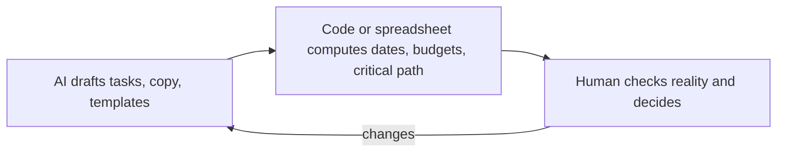
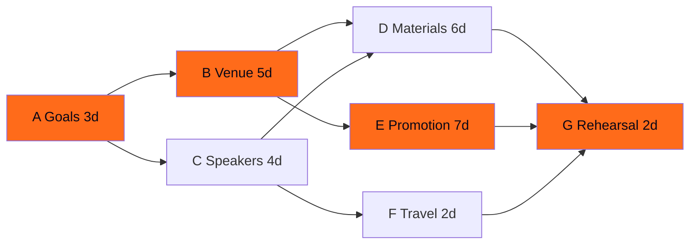
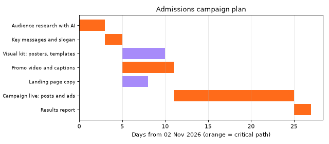
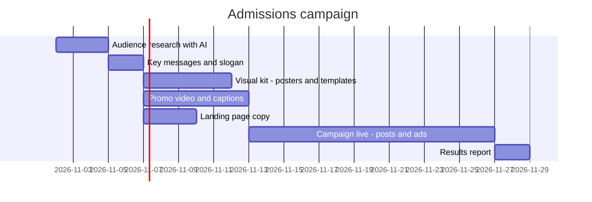
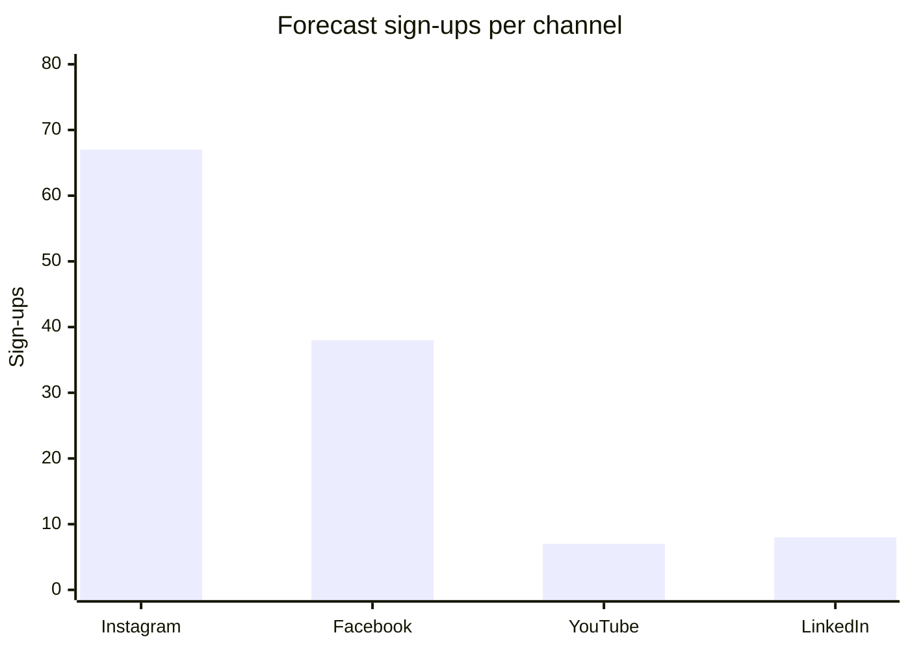

# Session 6 · Planning Complex Tasks: Events, Campaigns and Projects

[](https://colab.research.google.com/github/Hamnakhan123/Generative-AI/blob/main/03-innovate-with-generative-ai/code/session-06-planning-complex-tasks.ipynb)

> 🧭 [Generative AI](../README.md) › [Track 3 · Innovate with Generative AI](README.md) › **Session 6**
>
> ⏱️ **Estimated time:** 2 hours · 📋 **Prerequisites:** Previous session

[⬅ Previous](session-05-storytelling-with-generative-ai.md) · [🏠 Track home](README.md) · [Next ➡](session-07-analyzing-and-optimizing-content.md)

---

## 🎯 Learning objectives

- Explain how to create **event-related content and plans** with Gen AI.
- Describe the process of creating **marketing campaign** content with Gen AI, from audience research to a content calendar.
- Illustrate **project planning for content creation**: work breakdown, dependencies, schedule, budget.
- Use the **Critical Path Method**, **back-scheduling** and **CPM/CTR budget forecasts**, computed by code rather than guessed by AI.
- Combine AI drafts with human checks so plans are realistic.

## 📖 Concepts

### 1. Why complex tasks need structure

A complex task has **many parts, dependencies, deadlines and people**. AI is excellent at producing the *parts* (task lists, copy, templates) but weak at *arithmetic and real-world facts* (dates, prices, availability). The winning pattern is:

> **AI drafts → code/spreadsheet calculates → human decides.**

> 🧠 **Analogy — the wedding planner.** A wedding planner has a checklist for everything (AI can produce that list in seconds), but the planner also knows *the caterer must be booked before invitations go out*, and that the hall is closed on Sundays. Dependencies and real constraints are where planning skill lives.

### 2. Planning toolkit

| Tool | What it answers | Where AI helps |
|---|---|---|
| **SMART goals** | What exactly counts as success? (Specific, Measurable, Achievable, Relevant, Time-bound) | Turning a vague aim into SMART wording |
| **Work Breakdown Structure (WBS)** | What are all the pieces? | Brainstorming tasks and sub-tasks |
| **Dependencies** | What must finish before what? | Suggesting likely dependencies (you verify) |
| **Critical path (CPM)** | Which tasks cannot slip? | Explaining results; code computes them |
| **Gantt chart** | When does each task happen? | Generating Mermaid or spreadsheet formats |
| **RACI** | Who is Responsible, Accountable, Consulted, Informed? | Drafting the matrix from a team list |
| **Risk register** | What could go wrong and what is plan B? | Brainstorming risks and mitigations |

### 3. Events with AI

| Phase | AI-generated content |
|---|---|
| Before | Theme ideas, agenda, speaker invitations, registration form questions, promotion posts, FAQ |
| During | Run sheet (minute-by-minute), MC script, live posts, emergency announcements |
| After | Thank-you emails, feedback survey, recap blog, highlight reel script, report |

### 4. Marketing campaigns with AI

1. **Audience research:** personas, pain points, objections (AI drafts, real surveys confirm).
2. **Positioning and key message:** one sentence the campaign repeats.
3. **Channels and budget:** where the audience is; how money is split.
4. **Creative:** headlines, posts, visuals, video scripts (Sessions 2–4), with **A/B variants**.
5. **Content calendar:** which post on which day.
6. **Measure and optimise:** Session 7.

Key paid-media terms:

| Term | Formula | Meaning |
|---|---|---|
| **CPM** | cost per 1,000 impressions | Price of being seen |
| **Impressions** | spend ÷ CPM × 1,000 | Times the ad was shown |
| **CTR** | clicks ÷ impressions | Share who clicked |
| **Conversion rate** | sign-ups ÷ clicks | Share who acted |
| **CPA** | spend ÷ sign-ups | Cost of one result |

> 🧠 **Analogy — fishing.** CPM is the price of casting your net over 1,000 fish, CTR is how many bite, conversion is how many you land, and CPA is what each landed fish cost you.

### 5. Project planning for content creation

A content project (e.g. a month of social media, a course launch) is a pipeline: **research → messages → assets (visuals, video, copy) → review → publishing → reporting**. Assets can be made in parallel, but publishing waits for the slowest one. That slowest chain is the **critical path**.

## 🪜 Step-by-step: planning an event with AI

1. **Goal:** "200 students attend the AI hackathon on 12 Dec; 80% rate it 4/5 or higher." (SMART)
2. **WBS prompt:** *"List every task to run a one-day student hackathon for 200 people, grouped by Venue, Speakers, Marketing, Logistics, Judging. For each give an estimated duration in days and prerequisites."*
3. **Verify** durations with the people who do the work.
4. **Compute** the critical path (Example 2) and back-schedule dates from the event day (Example 3).
5. **Draft content** for each phase (invitations, posts, run sheet) with AI.
6. **RACI and risks:** ask AI for a draft; edit names and plan Bs.
7. **Track weekly;** re-run the schedule when something slips.

## 🧭 Diagrams





*Orange = critical path computed in Example 2.*

## 💻 Worked examples (basic → advanced)

### Example 1 (basic) — From vague goal to SMART goal

**Prompt:** *"Turn this goal into a SMART goal and list 3 measures: 'We want a good orientation week.'"*

**Sample output:** "By 15 Jan, run a 3-day orientation for all 350 first-years with at least 85% attendance on day 1 and an average feedback score of 4/5, within a Rs 150,000 budget."

### Example 2 (intermediate) — Critical path computed, not guessed

```python
# file: session-06_critical_path.py
"""
Session 6 · Example 1 — Critical path of an event plan (CPM).

AI assistants are good at listing tasks for a big job, but they rarely
compute the schedule correctly. The Critical Path Method does:
  * earliest start (ES) of a task = latest earliest-finish of its prerequisites
  * the project length = largest earliest finish
  * latest start (LS) found by walking backwards; slack = LS - ES
  * tasks with zero slack form the CRITICAL PATH: any delay there delays everything.

Run:  python session-06_critical_path.py
"""
tasks = {  # id: (days, prerequisites, description)
    "A": (3, [],          "Define goals, budget, audience"),
    "B": (5, ["A"],       "Book venue and date"),
    "C": (4, ["A"],       "Invite speakers"),
    "D": (6, ["B", "C"],  "Design and print materials"),
    "E": (7, ["B"],       "Run promotion campaign"),
    "F": (2, ["C"],       "Confirm speaker travel"),
    "G": (2, ["D", "E", "F"], "Rehearsal and final checks"),
}

# Forward pass (dict order is already a valid topological order here)
ES, EF = {}, {}
for t, (d, pre, _) in tasks.items():
    ES[t] = max((EF[p] for p in pre), default=0)
    EF[t] = ES[t] + d
length = max(EF.values())

# Backward pass
LF, LS = {}, {}
for t in reversed(list(tasks)):
    succ = [s for s, (_, pre, _) in tasks.items() if t in pre]
    LF[t] = min((LS[s] for s in succ), default=length)
    LS[t] = LF[t] - tasks[t][0]

print(f"{'Task':4} {'Days':>4} {'ES':>3} {'EF':>3} {'LS':>3} {'Slack':>5}  Description")
for t, (d, _, desc) in tasks.items():
    slack = LS[t] - ES[t]
    mark = "  <- critical" if slack == 0 else ""
    print(f"{t:4} {d:4} {ES[t]:3} {EF[t]:3} {LS[t]:3} {slack:5}  {desc}{mark}")
critical = [t for t in tasks if LS[t] == ES[t]]
print(f"\nProject length: {length} days | Critical path: {' -> '.join(critical)}")
```

**Output**

```text
Task Days  ES  EF  LS Slack  Description
A       3   0   3   0     0  Define goals, budget, audience  <- critical
B       5   3   8   3     0  Book venue and date  <- critical
C       4   3   7   5     2  Invite speakers
D       6   8  14   9     1  Design and print materials
E       7   8  15   8     0  Run promotion campaign  <- critical
F       2   7   9  13     6  Confirm speaker travel
G       2  15  17  15     0  Rehearsal and final checks  <- critical

Project length: 17 days | Critical path: A -> B -> E -> G
```

**Reading it:** promotion (E) is critical, so a 2-day delay in booking the venue (B) delays the whole event; inviting speakers (C) has 2 days of slack.

### Example 3 (intermediate) — Back-schedule a checklist from the event date

```python
# file: session-06_event_checklist.py
"""
Session 6 · Example 3 — Back-schedule an event checklist from its date.

Planners work BACKWARDS from the event day: "posters must be printed 10 days
before", "venue booked 30 days before". Give an AI the list of tasks and
lead times, but let code compute the dates (AIs often miscount weekdays).
Tasks that fall on a Sunday are moved to the Saturday before.

Run:  python session-06_event_checklist.py
"""
from datetime import date, timedelta

EVENT = date(2026, 12, 12)   # Saturday 12 December 2026
tasks = [  # (days before event, task, owner)
    (42, "Agree goals, budget and theme", "Lead"),
    (35, "Book auditorium and AV equipment", "Logistics"),
    (28, "Confirm speakers and judges", "Lead"),
    (21, "Launch registration form and social campaign", "Marketing"),
    (14, "Print posters and badges", "Design"),
    (6,  "Send reminder email and agenda", "Marketing"),
    (2,  "Rehearsal and tech check", "Logistics"),
    (0,  "EVENT DAY", "Everyone"),
    (-3, "Send thank-you notes and feedback survey", "Lead"),
]

print(f"Event: {EVENT:%A %d %B %Y}\n")
print(f"{'Due':16}{'D-':>5}  {'Owner':10} Task")
for days, task, owner in sorted(tasks, reverse=True):
    due = EVENT - timedelta(days=days)
    moved = ""
    if due.weekday() == 6:              # Sunday -> Saturday before
        due -= timedelta(days=1)
        moved = "  (moved from Sunday)"
    print(f"{due:%a %d %b %Y}{days:>5}  {owner:10} {task}{moved}")
```

**Output**

```text
Event: Saturday 12 December 2026

Due                D-  Owner      Task
Sat 31 Oct 2026   42  Lead       Agree goals, budget and theme
Sat 07 Nov 2026   35  Logistics  Book auditorium and AV equipment
Sat 14 Nov 2026   28  Lead       Confirm speakers and judges
Sat 21 Nov 2026   21  Marketing  Launch registration form and social campaign
Sat 28 Nov 2026   14  Design     Print posters and badges
Sat 05 Dec 2026    6  Marketing  Send reminder email and agenda  (moved from Sunday)
Thu 10 Dec 2026    2  Logistics  Rehearsal and tech check
Sat 12 Dec 2026    0  Everyone   EVENT DAY
Tue 15 Dec 2026   -3  Lead       Send thank-you notes and feedback survey
```

### Example 4 (intermediate) — Campaign content prompt pack

```text
You are a campaign strategist. Audience: Grade 12 students in Karachi and their parents.
Goal: 300 applications to the BS Computer Science programme by 15 Jan.
Produce: (1) two personas with pain points, (2) one key message under 12 words,
(3) five post ideas per persona with format (reel/carousel/image), (4) three headline A/B pairs.
Do not invent statistics about the university.
```

### Example 5 (advanced) — Budget split and results forecast

```python
# file: session-06_campaign_budget.py
"""
Session 6 · Example 2 — Split a campaign budget and forecast results.

Paid social is priced per 1,000 impressions (CPM). From the budget and CPM
we can forecast impressions; a click-through rate (CTR) gives clicks; a
conversion rate gives sign-ups; and cost per acquisition (CPA) = spend / sign-ups.
The CPMs and rates below are ASSUMED planning numbers for a student campaign,
not real market data: replace them with figures from your own ad dashboard.

Run:  python session-06_campaign_budget.py
"""
BUDGET = 50_000  # rupees
channels = {  # share of budget, CPM (Rs), CTR, conversion rate
    "Instagram": (0.40, 180, 0.012, 0.05),
    "Facebook":  (0.25, 120, 0.009, 0.04),
    "YouTube":   (0.20, 250, 0.006, 0.03),
    "LinkedIn":  (0.15, 600, 0.008, 0.08),
}

assert abs(sum(c[0] for c in channels.values()) - 1) < 1e-9, "shares must add up to 100%"
rows, tot = [], {"spend": 0, "imp": 0, "clicks": 0, "signups": 0}
print(f"{'Channel':10}{'Spend':>8}{'Impr.':>10}{'Clicks':>8}{'Sign-ups':>9}{'CPA':>8}")
for name, (share, cpm, ctr, cvr) in channels.items():
    spend = BUDGET * share
    imp = spend / cpm * 1000
    clicks = imp * ctr
    signups = clicks * cvr
    cpa = spend / signups
    print(f"{name:10}{spend:8,.0f}{imp:10,.0f}{clicks:8,.0f}{signups:9,.0f}{cpa:8,.0f}")
    for k, v in zip(tot, (spend, imp, clicks, signups)):
        tot[k] += v
print(f"{'TOTAL':10}{tot['spend']:8,.0f}{tot['imp']:10,.0f}{tot['clicks']:8,.0f}"
      f"{tot['signups']:9,.0f}{tot['spend']/tot['signups']:8,.0f}")
```

**Output**

```text
Channel      Spend     Impr.  Clicks Sign-ups     CPA
Instagram   20,000   111,111   1,333       67     300
Facebook    12,500   104,167     938       38     333
YouTube     10,000    40,000     240        7   1,389
LinkedIn     7,500    12,500     100        8     938
TOTAL       50,000   267,778   2,611      119     419
```

**Insight:** LinkedIn's high CPM is partly offset by its conversion rate, but YouTube gives the highest CPA in this plan, so test it with a small budget before scaling. All rates here are planning assumptions; replace them with your own dashboard data.

## 🏗️ Real-life problem: plan a 4-week admissions campaign (full solution)

**Scenario.** The admissions office wants a 4-week campaign starting Monday 2 November: research, messages, a visual kit, a promo video, landing-page copy, two weeks live, and a results report. They need a dated schedule, the critical path, a content calendar for the live weeks, a Gantt chart for the slide deck, and a Mermaid block for the project wiki.

```python
# file: session-06_project_campaign_planner.py
"""
Session 6 · Mini project (full solution) — Campaign planner with a Gantt chart.

Real-life problem: plan a 4-week admissions campaign. Inputs: a launch date,
a list of workstreams with durations and dependencies. Outputs:
  * a dated schedule (computed by the critical path method),
  * a weekly content calendar (which post goes out on which day),
  * a Mermaid gantt block you can paste into any Markdown page,
  * a Gantt chart PNG made with matplotlib.

Run:  python session-06_project_campaign_planner.py
Creates: session-06_gantt.png
"""
from datetime import date, timedelta

import matplotlib
matplotlib.use("Agg")
import matplotlib.pyplot as plt

START = date(2026, 11, 2)   # Monday
work = {  # id: (name, days, prerequisites)
    "res": ("Audience research with AI", 3, []),
    "msg": ("Key messages and slogan", 2, ["res"]),
    "vis": ("Visual kit: posters, templates", 5, ["msg"]),
    "vid": ("Promo video and captions", 6, ["msg"]),
    "web": ("Landing page copy", 3, ["msg"]),
    "run": ("Campaign live: posts and ads", 14, ["vis", "vid", "web"]),
    "rep": ("Results report", 2, ["run"]),
}

es, ef = {}, {}
for k, (_, d, pre) in work.items():
    es[k] = max((ef[p] for p in pre), default=0)
    ef[k] = es[k] + d
end = max(ef.values())

# backward pass: latest start; zero slack = critical
ls = {}
for k in reversed(list(work)):
    succ = [s for s, (_, _, pre) in work.items() if k in pre]
    lf = min((ls[s] for s in succ), default=end)
    ls[k] = lf - work[k][1]
critical = [k for k in work if ls[k] == es[k]]

print("SCHEDULE")
for k, (name, d, _) in work.items():
    s, e = START + timedelta(es[k]), START + timedelta(ef[k] - 1)
    print(f"  {name:32} {s:%d %b} -> {e:%d %b}  ({d} d)")
print(f"  Finish: {START + timedelta(end - 1):%a %d %b %Y} ({end} days)")
print(f"  Critical path: {' -> '.join(work[k][0] for k in critical)}")

print("\nCONTENT CALENDAR (campaign-live window)")
themes = ["Why study CS here", "Student story", "Lab tour reel", "Scholarship facts", "Q&A live"]
days = {0: "Mon", 2: "Wed", 4: "Fri"}
live = START + timedelta(es["run"])
n = 0
for offset in range(work["run"][1]):
    d = live + timedelta(offset)
    if d.weekday() in days:
        print(f"  {d:%a %d %b}: {themes[n % len(themes)]}")
        n += 1

print("\nMERMAID GANTT")
print("gantt\n    dateFormat YYYY-MM-DD\n    title Admissions campaign")
for k, (name, d, _) in work.items():
    print(f"    {name} :{k}, {START + timedelta(es[k])}, {d}d")

fig, ax = plt.subplots(figsize=(8, 3.5))
for i, (k, (name, d, _)) in enumerate(work.items()):
    ax.barh(i, d, left=es[k], color="#FF6B1A" if k in critical else "#A78BFA")
ax.set_yticks(range(len(work)))
ax.set_yticklabels([v[0] for v in work.values()], fontsize=8)
ax.invert_yaxis()
ax.set_xlabel(f"Days from {START:%d %b %Y} (orange = critical path)")
ax.set_title("Admissions campaign plan")
ax.grid(axis="x", alpha=0.3)
fig.tight_layout()
fig.savefig("session-06_gantt.png", dpi=80)
print("\nSaved -> session-06_gantt.png")
```

**Output**

```text
SCHEDULE
  Audience research with AI        02 Nov -> 04 Nov  (3 d)
  Key messages and slogan          05 Nov -> 06 Nov  (2 d)
  Visual kit: posters, templates   07 Nov -> 11 Nov  (5 d)
  Promo video and captions         07 Nov -> 12 Nov  (6 d)
  Landing page copy                07 Nov -> 09 Nov  (3 d)
  Campaign live: posts and ads     13 Nov -> 26 Nov  (14 d)
  Results report                   27 Nov -> 28 Nov  (2 d)
  Finish: Sat 28 Nov 2026 (27 days)
  Critical path: Audience research with AI -> Key messages and slogan -> Promo video and captions -> Campaign live: posts and ads -> Results report

CONTENT CALENDAR (campaign-live window)
  Fri 13 Nov: Why study CS here
  Mon 16 Nov: Student story
  Wed 18 Nov: Lab tour reel
  Fri 20 Nov: Scholarship facts
  Mon 23 Nov: Q&A live
  Wed 25 Nov: Why study CS here

MERMAID GANTT
gantt
    dateFormat YYYY-MM-DD
    title Admissions campaign
    Audience research with AI :res, 2026-11-02, 3d
    Key messages and slogan :msg, 2026-11-05, 2d
    Visual kit: posters, templates :vis, 2026-11-07, 5d
    Promo video and captions :vid, 2026-11-07, 6d
    Landing page copy :web, 2026-11-07, 3d
    Campaign live: posts and ads :run, 2026-11-13, 14d
    Results report :rep, 2026-11-27, 2d

Saved -> session-06_gantt.png
```



The Mermaid block printed above renders as a Gantt chart when pasted into GitHub Markdown:



## 📊 Forecast sign-ups by channel (from Example 5)



| Planning artefact | Made by AI | Checked/computed by |
|---|---|---|
| Task list (WBS) | ✅ draft | Team leads |
| Durations | ⚠️ guesses | People doing the work |
| Dates and critical path | ❌ unreliable | Code / spreadsheet |
| Budget forecast | ❌ invents rates | Code with your real rates |
| Copy and creative | ✅ draft | Editor and brand owner |

## ⚠️ Common mistakes

| Mistake | Fix |
|---|---|
| Trusting AI-computed dates and weekdays | Compute dates in code or a spreadsheet |
| Ignoring dependencies | List prerequisites for every task; find the critical path |
| Using AI-invented CPMs or prices | Use real quotes and dashboard numbers |
| Planning with no buffer | Add 10–20% buffer to critical tasks |
| One message for every audience | Personas → tailored messages |
| No owner per task | RACI: exactly one Accountable person |

## ✅ Best practices

- Write a **SMART goal** first; every task must serve it.
- Use AI for **breadth** (tasks, risks, ideas) and code for **numbers**.
- Keep the plan in **one shared place** (sheet, board, wiki) and re-run the schedule weekly.
- Prepare **plan Bs** for the top risks (rain, speaker cancels, venue AV fails).
- After the event or campaign, write a **lessons-learned** note for next time.

## 🧪 Lab / practice tasks

**Task 1 · 🟢 Easy** — Use AI to turn "we want more people at club meetings" into a SMART goal.

<details><summary>💡 Hint</summary>

Check each letter: Specific, Measurable, Achievable, Relevant, Time-bound.

</details>

**Task 2 · 🟢 Easy** — Change the event date in `session-06_event_checklist.py` to a real event of yours and print the checklist.

<details><summary>💡 Hint</summary>

Edit `EVENT = date(...)`; check any "moved from Sunday" lines.

</details>

**Task 3 · 🟡 Medium** — Ask an AI for a WBS with durations and prerequisites for a seminar, put it into `session-06_critical_path.py`, and find the critical path.

<details><summary>💡 Hint</summary>

Keep the dict in an order where prerequisites come first.

</details>

**Task 4 · 🟡 Medium** — Re-split the campaign budget so total CPA drops below Rs 400 and explain your choice.

<details><summary>💡 Hint</summary>

Move budget toward channels with the lowest CPA, but keep at least some reach on each audience's main platform.

</details>

**Task 5 · 🔴 Challenge** — Extend the campaign planner with a RACI table: for each workstream print Responsible and Accountable people from a team dict.

<details><summary>💡 Hint</summary>

Add `raci = {"res": ("Sana", "Hamna"), ...}` and print it with the schedule.

</details>


<details><summary>✅ Lab solutions and model answers</summary>

**Task 1:** "Raise average attendance at weekly Coding Club meetings from 15 to 30 members by 31 March, by running a themed challenge each week and posting reminders 24 hours before."

**Task 3 example input:**

```python
tasks = {
    "A": (2, [], "Choose topic and speaker"),
    "B": (3, ["A"], "Book seminar room"),
    "C": (4, ["A"], "Design poster"),
    "D": (5, ["C"], "Promote on social media"),
    "E": (1, ["B", "D"], "Final check"),
}
```

Critical path: **A → C → D → E** (12 days); B has 6 days of slack.

**Task 4:** moving 10% from YouTube to Instagram (Instagram 0.50, YouTube 0.10) gives total sign-ups ≈ 132 and CPA ≈ Rs 378 (down from 119 and Rs 419). Justification: Instagram has the lowest CPA in the plan; YouTube is kept at 10% to keep testing video.

**Task 5:**

```python
raci = {"res": ("Sana", "Hamna"), "msg": ("Ali", "Hamna"), "vis": ("Zoya", "Ali"),
        "vid": ("Omar", "Ali"), "web": ("Sana", "Ali"), "run": ("Zoya", "Hamna"), "rep": ("Sana", "Hamna")}
print("\nRACI (Responsible / Accountable)")
for k, (r, a) in raci.items():
    print(f"  {work[k][0]:32} R: {r:6} A: {a}")
```

</details>

## ✅ Quick quiz

**Q1. Which part of planning should NOT be trusted to an AI chat answer alone?**

- A) Brainstorming tasks
- B) Calculating dates and the critical path
- C) Drafting invitation emails
- D) Suggesting risks

<details><summary>Show answer</summary>

✅ **B) Calculating dates and the critical path** — Compute dates in code or a spreadsheet.

</details>

**Q2. A task with zero slack is...**

- A) Optional
- B) On the critical path
- C) Already finished
- D) Over budget

<details><summary>Show answer</summary>

✅ **B) On the critical path** — Any delay delays the whole project.

</details>

**Q3. With Rs 10,000 spent at a CPM of Rs 200, impressions are...**

- A) 2,000
- B) 50,000
- C) 200,000
- D) 500

<details><summary>Show answer</summary>

✅ **B) 50,000** — 10,000 ÷ 200 × 1,000.

</details>

**Q4. CPA means...**

- A) Clicks per ad
- B) Cost per acquisition (spend ÷ results)
- C) Campaign planning agent
- D) Content per audience

<details><summary>Show answer</summary>

✅ **B) Cost per acquisition (spend ÷ results)** — What one result costs.

</details>

**Q5. In RACI, how many people should be Accountable for a task?**

- A) None
- B) Exactly one
- C) Everyone
- D) Two at least

<details><summary>Show answer</summary>

✅ **B) Exactly one** — One final owner.

</details>


## 📝 Summary / cheat-sheet

- Pattern: **AI drafts → code calculates → human decides**.
- Toolkit: **SMART, WBS, dependencies, critical path, Gantt, RACI, risk register**.
- Events: content **before, during, after**; back-schedule from the event date.
- Campaigns: **audience → message → channels and budget → creative → calendar → measure**.
- Formulas: impressions = spend ÷ CPM × 1,000; CTR = clicks ÷ impressions; CPA = spend ÷ results.
- Critical path = zero-slack chain; protect it with buffer.

**Viva / interview questions**

1. Why should you not trust AI-generated schedules without checking?
2. Explain the critical path method with an example.
3. Walk through planning a marketing campaign with Gen AI.
4. Calculate impressions, clicks and CPA for a given budget, CPM, CTR and conversion rate.
5. What content would you prepare before, during and after an event?
6. What is RACI and why have exactly one Accountable person?

---

[⬅ Previous](session-05-storytelling-with-generative-ai.md) · [🏠 Track home](README.md) · [Next ➡](session-07-analyzing-and-optimizing-content.md)

<sub>Prepared by **Hamna Zahid Khan**, Junior Lecturer</sub>
