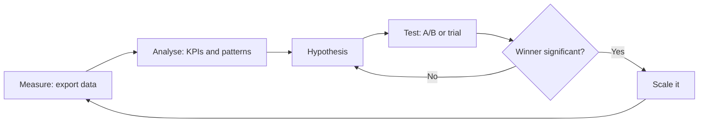
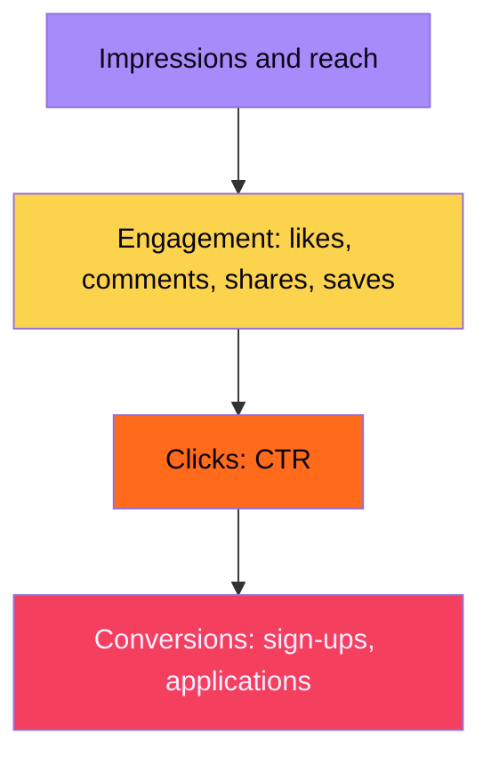
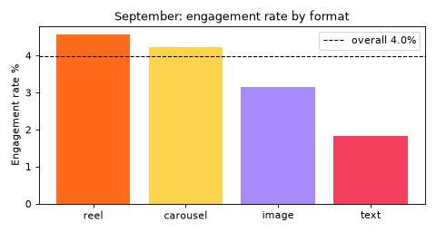
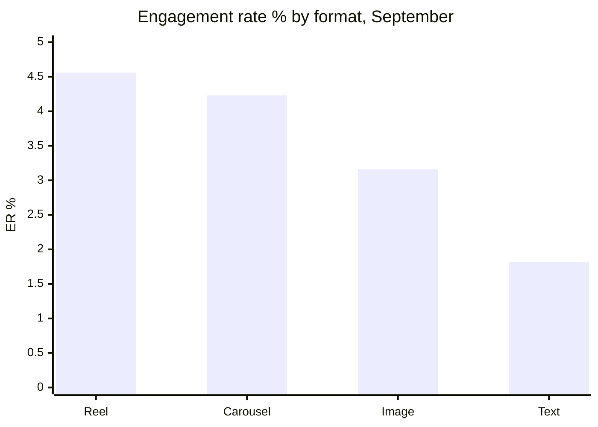

# Session 7 · Analysing and Optimising Content Strategies

[](https://colab.research.google.com/github/Hamnakhan123/Generative-AI/blob/main/03-innovate-with-generative-ai/code/session-07-analyzing-and-optimizing-content.ipynb)

> 🧭 [Generative AI](../README.md) › [Track 3 · Innovate with Generative AI](README.md) › **Session 7**
>
> ⏱️ **Estimated time:** 2 hours · 📋 **Prerequisites:** Previous session

[⬅ Previous](session-06-planning-complex-tasks.md) · [🏠 Track home](README.md) · [Next ➡](../04-ai-architecture-and-agents/session-01-transformers-and-attention.md)

---

## 🎯 Learning objectives

- Describe how to **analyse content performance** using Gen AI and simple data tools.
- Identify the **key metrics** for tracking content effectiveness and calculate them correctly.
- Decide whether a difference is **real or luck** with an A/B significance test.
- Outline the **steps to optimise** a content strategy for better reach and results.
- Combine **numbers from code** with **explanations from AI**, and check both.

## 📖 Concepts

### 1. Why measure?

Publishing without measuring is like cooking without tasting. Analytics tell you **what your audience actually responds to**, so next month's effort goes where it works.

> 🧠 **Analogy — the cricket coach.** A coach does not just watch matches; they study strike rates, dot-ball percentages and where wickets fall. Content metrics are your strike rates: they show which "shots" (formats, topics, times) score and which get you out.

### 2. The metrics that matter

| Funnel stage | Metric | Formula | Tells you |
|---|---|---|---|
| **Awareness** | Impressions | times content was shown | Visibility |
| | Reach | unique accounts that saw it | Audience size |
| **Engagement** | Engagement rate (ER) | engagements ÷ reach × 100 | Did it resonate? |
| | Watch time / completion rate | avg seconds watched; % who finished | Did the video hold attention? |
| **Action** | Click-through rate (CTR) | clicks ÷ impressions × 100 | Did it make people act? |
| | Conversion rate (CVR) | conversions ÷ clicks × 100 | Did the landing page work? |
| **Value** | Cost per acquisition (CPA) | spend ÷ conversions | Efficiency of paid content |
| | Bounce rate (web) | single-page sessions ÷ sessions | Did the page meet expectations? |

**Vanity vs actionable:** likes and follower counts feel good but rarely change decisions. Rates (ER, CTR, CVR) and costs (CPA) do.

> ⚠️ **Rate pitfall:** the average of percentages is not the overall percentage. Ten posts with tiny reach and high ER can make the "average ER" look great. Compute rates **from totals** (sum of engagements ÷ sum of reach), as the examples below do.

### 3. Where Gen AI helps in analysis

| Task | How AI helps | Your check |
|---|---|---|
| Understanding a dashboard | "Explain these columns and what good looks like" | Platform's own help pages |
| Analysis | Code interpreters (ChatGPT data analysis, Copilot in Excel, Gemini in Sheets) can group, chart and summarise a CSV | Re-run key numbers yourself |
| Insight writing | Turn a table into a short report | "Use ONLY these numbers" |
| Idea generation | New hooks, headlines and formats based on top posts | A/B test before scaling |
| Sentiment of comments | Classify comments as positive/negative/questions | Read a sample yourself |

> 🧠 **Analogy — the translator.** Code turns raw data into reliable numbers; AI translates those numbers into plain-language stories for your manager. Never let the translator invent the numbers.

### 4. Is the difference real? A/B testing

When headline B gets more clicks than A, it might be chance. A **two-proportion z-test** compares the two CTRs: if |z| ≥ 1.96 (p < 0.05) the difference is unlikely to be luck. Small samples rarely prove anything, which is why the *same* lift can be "not significant" with 400 viewers and "significant" with 4,000.

### 5. The optimisation loop

1. **Measure** (collect the export).
2. **Analyse** (KPIs, best/worst, by format, topic, time).
3. **Hypothesise** ("reels at 5 pm drive more sign-ups").
4. **Test** (A/B or a two-week trial).
5. **Scale** what wins, **stop** what loses.
6. **Repeat** monthly.

Optimisation levers: **format** (reel, carousel, image, text), **topic**, **hook/headline**, **posting time**, **frequency**, **call to action**, **visual style**, **audience targeting**, **SEO** (titles, descriptions, keywords) for blogs and video.

## 🪜 Step-by-step: a monthly content review

1. **Export** last month's post data as CSV from the platform's analytics.
2. **Clean:** remove duplicates and impossible rows (reach = 0, impressions < reach).
3. **Compute KPIs** per post and overall (from totals).
4. **Rank** top 3 and bottom 3 posts; look for patterns (format, topic, hook, time).
5. **Compare groups:** by format, topic, weekday, hour; note sample sizes.
6. **Write insights** with AI using *only* your numbers; check every figure.
7. **Decide 3 actions** for next month and **one A/B test**.
8. **Record** decisions so next month you can see if they worked.

## 🧭 Diagrams





## 💻 Worked examples (basic → advanced)

All data here is **synthetic** (generated by a seeded script) so everyone gets identical numbers. Run the data maker first:

```python
# file: session-07_make_data.py
"""
Session 7 · Data helper — create a SYNTHETIC posts dataset for the examples.

The numbers are invented by a seeded random generator (so everyone gets the
same file); they mimic the columns a social-media dashboard exports.
Run this first:  python session-07_make_data.py
Creates: session-07_posts.csv
"""
import csv
import random
from datetime import date, timedelta

rng = random.Random(42)
FORMATS = {"reel": (1.6, 0.050), "carousel": (1.1, 0.045), "image": (0.8, 0.030), "text": (0.5, 0.020)}
TOPICS = ["admissions", "student life", "research", "events", "tips"]
start = date(2026, 9, 1)

rows = []
for i in range(60):
    fmt = rng.choice(list(FORMATS))
    reach_mult, base_eng = FORMATS[fmt]
    day = start + timedelta(days=i)
    hour = rng.choice([9, 13, 17, 20])
    boost = 1.3 if hour in (17, 20) else 1.0           # evenings do better in this fake audience
    reach = int(rng.gauss(2000, 400) * reach_mult * boost)
    engagements = int(reach * base_eng * rng.uniform(0.7, 1.3))
    clicks = int(reach * rng.uniform(0.004, 0.015))
    signups = int(clicks * rng.uniform(0.02, 0.10))
    rows.append({"post_id": f"P{i+1:02}", "date": day.isoformat(), "hour": hour, "format": fmt,
                 "topic": rng.choice(TOPICS), "impressions": int(reach * 1.4), "reach": reach,
                 "engagements": engagements, "clicks": clicks, "signups": signups})

with open("session-07_posts.csv", "w", newline="") as f:
    w = csv.DictWriter(f, fieldnames=rows[0].keys())
    w.writeheader()
    w.writerows(rows)
print(f"Wrote {len(rows)} synthetic posts -> session-07_posts.csv")
print("Columns:", ", ".join(rows[0].keys()))
print("First row:", rows[0])
```

**Output**

```text
Wrote 60 synthetic posts -> session-07_posts.csv
Columns: post_id, date, hour, format, topic, impressions, reach, engagements, clicks, signups
First row: {'post_id': 'P01', 'date': '2026-09-01', 'hour': 9, 'format': 'reel', 'topic': 'tips', 'impressions': 4443, 'reach': 3174, 'engagements': 124, 'clicks': 16, 'signups': 1}
```

### Example 1 (basic) — Calculate the metrics by hand

A carousel post: impressions 3,500, reach 2,500, engagements 110, clicks 21, sign-ups 2.

| Metric | Working | Result |
|---|---|---|
| ER | 110 ÷ 2,500 × 100 | **4.4%** |
| CTR | 21 ÷ 3,500 × 100 | **0.6%** |
| CVR | 2 ÷ 21 × 100 | **9.5%** |

### Example 2 (intermediate) — KPIs for a whole month with pandas

```python
# file: session-07_metrics.py
"""
Session 7 · Example 1 — Compute content KPIs from a dashboard export.

Definitions used (state them in every report, because platforms differ):
  engagement rate (ER) = engagements / reach x 100
  click-through rate (CTR) = clicks / impressions x 100
  conversion rate (CVR) = sign-ups / clicks x 100
Uses pandas because real exports are CSV tables.

Run:  python session-07_make_data.py   (once, creates the CSV)
      python session-07_metrics.py
"""
import pandas as pd

df = pd.read_csv("session-07_posts.csv")
df["ER %"] = 100 * df.engagements / df.reach
df["CTR %"] = 100 * df.clicks / df.impressions
df["CVR %"] = 100 * df.signups / df.clicks.where(df.clicks > 0)

print("Overall (totals, not averages of percentages):")
print(f"  posts={len(df)}  reach={df.reach.sum():,}  ER={100*df.engagements.sum()/df.reach.sum():.2f}%  "
      f"CTR={100*df.clicks.sum()/df.impressions.sum():.2f}%  CVR={100*df.signups.sum()/df.clicks.sum():.2f}%")

by_fmt = df.groupby("format").agg(posts=("post_id", "count"), reach=("reach", "mean"),
                                  eng=("engagements", "sum"), r=("reach", "sum"))
by_fmt["ER %"] = 100 * by_fmt.eng / by_fmt.r
print("\nBy format:")
print(by_fmt[["posts", "reach", "ER %"]].round(1).sort_values("ER %", ascending=False).to_string())
```

**Output**

```text
Overall (totals, not averages of percentages):
  posts=60  reach=141,418  ER=3.99%  CTR=0.60%  CVR=3.47%

By format:
          posts   reach  ER %
format                       
reel         21  3427.1   4.6
carousel     15  2426.3   4.2
image         9  1826.9   3.2
text         15  1107.5   1.8
```

### Example 3 (intermediate) — Best time to post

```python
# file: session-07_best_time.py
"""
Session 7 · Example 3 — When should we post? Engagement by hour and weekday.

Run:  python session-07_best_time.py   (needs session-07_posts.csv)
"""
import pandas as pd

df = pd.read_csv("session-07_posts.csv", parse_dates=["date"])
df["weekday"] = df.date.dt.day_name().str[:3]
df["ER %"] = 100 * df.engagements / df.reach

by_hour = df.groupby("hour")["ER %"].agg(["count", "mean"]).round(2)
print("Engagement rate by posting hour:")
print(by_hour.to_string())
best = by_hour["mean"].idxmax()
print(f"\nBest hour in this data: {best}:00 (n={by_hour.loc[best, 'count']} posts)")

order = ["Mon", "Tue", "Wed", "Thu", "Fri", "Sat", "Sun"]
by_day = df.groupby("weekday")["reach"].mean().reindex(order).round(0)
print("\nAverage reach by weekday:")
print(by_day.to_string())
print("\nCaution: under 10 posts per group is a hint, not proof. Re-check monthly.")
```

**Output**

```text
Engagement rate by posting hour:
      count  mean
hour             
9        14  3.49
13       19  3.53
17       13  3.91
20       14  3.46

Best hour in this data: 17:00 (n=13 posts)

Average reach by weekday:
weekday
Mon    2438.0
Tue    2614.0
Wed    2102.0
Thu    2068.0
Fri    2010.0
Sat    2976.0
Sun    2370.0

Caution: under 10 posts per group is a hint, not proof. Re-check monthly.
```

Note: the 17:00 *mean* ER here (3.91%) differs from the ER computed from totals in the mini project (4.3%), a live example of the rate pitfall above.

### Example 4 (advanced) — Is headline B really better?

```python
# file: session-07_ab_test.py
"""
Session 7 · Example 2 — Did headline B really win? A two-proportion z-test.

AI can write ten headline variants in seconds, but "B got more clicks" might
be luck. The z-test compares two click-through rates:
  p = pooled rate, SE = sqrt(p(1-p)(1/nA + 1/nB)),  z = (pB - pA) / SE
|z| >= 1.96 means the difference is significant at the 95% level.
Only the standard library is needed (math.erf gives the normal curve).

Run:  python session-07_ab_test.py
"""
from math import erf, sqrt


def ab_test(clicks_a, n_a, clicks_b, n_b):
    pa, pb = clicks_a / n_a, clicks_b / n_b
    pooled = (clicks_a + clicks_b) / (n_a + n_b)
    se = sqrt(pooled * (1 - pooled) * (1 / n_a + 1 / n_b))
    z = (pb - pa) / se
    p_value = 2 * (1 - 0.5 * (1 + erf(abs(z) / sqrt(2))))
    return pa, pb, z, p_value


tests = [
    ("Small test", 12, 400, 19, 400),
    ("Same rates, 10x traffic", 120, 4000, 190, 4000),
]
print("A: 'Admissions open for 2027'   B: 'Your CS career starts here: apply by 15 Jan'")
for name, ca, na, cb, nb in tests:
    pa, pb, z, p = ab_test(ca, na, cb, nb)
    verdict = "B wins (significant)" if p < 0.05 else "not significant: keep testing"
    print(f"{name:24} CTR A={pa:.2%} B={pb:.2%}  lift={(pb/pa-1):+.0%}  z={z:.2f}  p={p:.4f}  -> {verdict}")
```

**Output**

```text
A: 'Admissions open for 2027'   B: 'Your CS career starts here: apply by 15 Jan'
Small test               CTR A=3.00% B=4.75%  lift=+58%  z=1.28  p=0.1997  -> not significant: keep testing
Same rates, 10x traffic  CTR A=3.00% B=4.75%  lift=+58%  z=4.06  p=0.0001  -> B wins (significant)
```

Same +58% lift, opposite conclusions: with 400 viewers per version the result could be luck; with 4,000 it almost certainly is not.

### Example 5 (advanced) — Asking AI to analyse safely

```text
You are a social media analyst. Below is a table of September results (format, posts, ER %,
CTR %, sign-ups). Using ONLY these numbers:
1) Name the best and worst format and by how much they differ.
2) Give two hypotheses for why.
3) Propose one A/B test for October with a success metric.
Flag any group with fewer than 10 posts as "low confidence". Do not invent figures.
TABLE: """[paste table]"""
```

## 🏗️ Real-life problem: the monthly content audit (full solution)

**Scenario.** The department's social media lead asks: *"What worked in September, what didn't, and what should we change in October?"* Build an audit that cleans the export, computes rates from totals, lists top and bottom posts, compares formats and topics, charts engagement by format, produces rule-based recommendations and prepares a safe prompt so an AI can write the narrative.

```python
# file: session-07_project_content_audit.py
"""
Session 7 · Mini project (full solution) — A monthly content audit.

Real-life problem: the department's social media lead asks: "What worked
in September, what didn't, and what should we change in October?"
This script answers with data, then builds a prompt so an AI assistant can
turn the numbers into a short written report. Numbers come from code, the
WORDS come from AI, and a human checks both.

Steps:
  1. load and clean the export          4. compare formats and topics
  2. compute KPIs per post              5. chart ER by format (PNG)
  3. top 3 / bottom 3 posts             6. rule-based recommendations + AI prompt

Run:  python session-07_make_data.py  (once)
      python session-07_project_content_audit.py
Creates: session-07_er_by_format.png
"""
import matplotlib
matplotlib.use("Agg")
import matplotlib.pyplot as plt
import pandas as pd

# 1) load and clean
df = pd.read_csv("session-07_posts.csv")
before = len(df)
df = df[(df.reach > 0) & (df.impressions >= df.reach)].copy()   # impossible rows removed
print(f"Loaded {before} posts, {before - len(df)} removed as invalid")

# 2) KPIs
df["ER"] = 100 * df.engagements / df.reach
df["CTR"] = 100 * df.clicks / df.impressions

# 3) best and worst
cols = ["post_id", "format", "topic", "hour", "reach", "ER"]
print("\nTop 3 posts by engagement rate:")
print(df.nlargest(3, "ER")[cols].round(2).to_string(index=False))
print("\nBottom 3 posts by engagement rate:")
print(df.nsmallest(3, "ER")[cols].round(2).to_string(index=False))

# 4) format and topic comparison (rates from totals)
def rate_table(key):
    g = df.groupby(key)[["engagements", "reach", "clicks", "impressions", "signups"]].sum()
    g["ER %"] = 100 * g.engagements / g.reach
    g["CTR %"] = 100 * g.clicks / g.impressions
    g["posts"] = df.groupby(key).size()
    return g[["posts", "ER %", "CTR %", "signups"]].round(2).sort_values("ER %", ascending=False)

fmt = rate_table("format")
topic = rate_table("topic")
print("\nBy format:\n" + fmt.to_string())
print("\nBy topic:\n" + topic.to_string())

# 5) chart
plt.figure(figsize=(6, 3.2))
plt.bar(fmt.index, fmt["ER %"], color=["#FF6B1A", "#FCD34D", "#A78BFA", "#F43F5E"][:len(fmt)])
avg = 100 * df.engagements.sum() / df.reach.sum()
plt.axhline(avg, color="black", linestyle="--", linewidth=1, label=f"overall {avg:.1f}%")
plt.ylabel("Engagement rate %")
plt.title("September: engagement rate by format")
plt.legend()
plt.tight_layout()
plt.savefig("session-07_er_by_format.png", dpi=80)
print("\nSaved -> session-07_er_by_format.png")

# 6) recommendations from rules, then a prompt for the written report
best_fmt, worst_fmt = fmt.index[0], fmt.index[-1]
hour_er = df.groupby("hour").apply(lambda g: 100 * g.engagements.sum() / g.reach.sum())
recs = [
    f"Shift effort toward {best_fmt} posts ({fmt.loc[best_fmt, 'ER %']:.1f}% ER) and away from "
    f"{worst_fmt} ({fmt.loc[worst_fmt, 'ER %']:.1f}%).",
    f"Schedule posts at {hour_er.idxmax()}:00, the best-performing hour ({hour_er.max():.1f}% ER).",
    f"Topic '{topic['signups'].idxmax()}' drove the most sign-ups ({int(topic['signups'].max())}): "
    "add one more post on it per week.",
    "A/B test two headlines on the next admissions post before scaling.",
]
print("\nRECOMMENDATIONS")
for r in recs:
    print(" -", r)

print("\nPROMPT FOR THE WRITTEN REPORT")
print("You are a social media analyst. Using ONLY the numbers below, write a 150-word report "
      "for the department head: what worked, what did not, three actions for October. "
      "Do not invent any figure.\n" + fmt.to_string() + "\nRecommendations: " + " ".join(recs))
```

**Output**

```text
Loaded 60 posts, 0 removed as invalid

Top 3 posts by engagement rate:
post_id format        topic  hour  reach   ER
    P42   reel     research    17   5031 6.28
    P12   reel student life    13   2276 6.24
    P55   reel   admissions     9   2715 5.86

Bottom 3 posts by engagement rate:
post_id format        topic  hour  reach   ER
    P46   text student life     9   1007 1.49
    P13   text         tips    20   1579 1.52
    P24   text         tips    20   1111 1.53

By format:
          posts  ER %  CTR %  signups
format                               
reel         21  4.56   0.54       24
carousel     15  4.23   0.66       13
image         9  3.16   0.70        3
text         15  1.82   0.60        1

By topic:
              posts  ER %  CTR %  signups
topic                                    
admissions        9  4.43   0.50        8
student life     10  4.15   0.62        7
research         12  4.12   0.52        8
tips             21  3.78   0.69       17
events            8  3.46   0.60        1

Saved -> session-07_er_by_format.png

RECOMMENDATIONS
 - Shift effort toward reel posts (4.6% ER) and away from text (1.8%).
 - Schedule posts at 17:00, the best-performing hour (4.3% ER).
 - Topic 'tips' drove the most sign-ups (17): add one more post on it per week.
 - A/B test two headlines on the next admissions post before scaling.

PROMPT FOR THE WRITTEN REPORT
You are a social media analyst. Using ONLY the numbers below, write a 150-word report for the department head: what worked, what did not, three actions for October. Do not invent any figure.
          posts  ER %  CTR %  signups
format                               
reel         21  4.56   0.54       24
carousel     15  4.23   0.66       13
image         9  3.16   0.70        3
text         15  1.82   0.60        1
Recommendations: Shift effort toward reel posts (4.6% ER) and away from text (1.8%). Schedule posts at 17:00, the best-performing hour (4.3% ER). Topic 'tips' drove the most sign-ups (17): add one more post on it per week. A/B test two headlines on the next admissions post before scaling.
```



**Human review before sending:** image posts have only 9 posts (low confidence); "tips" leads sign-ups partly because it has the most posts (21), so compare **sign-ups per post** too (tips 0.81, admissions 0.89, research 0.67) before deciding.

## 📊 Engagement rate by format (from the audit)



| Benchmark (rough, varies by platform and niche) | Low | Typical | Strong |
|---|---|---|---|
| Engagement rate (organic) | < 1% | 1–3.5% | > 3.5% |
| CTR (paid social) | < 0.5% | 0.5–1.5% | > 1.5% |
| Video completion (short reels) | < 20% | 20–40% | > 40% |

*Benchmarks are indicative only; your own month-on-month trend matters more.*

## ⚠️ Common mistakes

| Mistake | Fix |
|---|---|
| Averaging percentages | Compute rates from totals |
| Celebrating likes and followers only | Track rates, conversions and CPA |
| Declaring a winner from a small test | Run a significance test; collect more data |
| Letting AI compute or "estimate" your metrics | Code computes; AI explains with "use only these numbers" |
| Comparing groups of very different sizes | Report sample sizes; use per-post rates |
| Changing five things at once | Test one variable at a time |

## ✅ Best practices

- **Define every metric** in the report (platforms define ER differently).
- Keep a **monthly log** of decisions and their results.
- Use AI for **hypotheses and wording**, code for **numbers**, humans for **decisions**.
- Mark low-sample findings as **low confidence**.
- Optimise for the **goal metric** (applications, sign-ups), not the easiest one.

## 🧪 Lab / practice tasks

**Task 1 · 🟢 Easy** — Calculate ER, CTR and CVR by hand for one real or made-up post, then check with Python.

<details><summary>💡 Hint</summary>

Use the formulas table; ER uses reach, CTR uses impressions.

</details>

**Task 2 · 🟢 Easy** — Run `session-07_ab_test.py` with your own numbers: how many viewers per version do you need before a 3% vs 4% CTR difference becomes significant?

<details><summary>💡 Hint</summary>

Try 1,000, 2,000 and 3,000 viewers per version.

</details>

**Task 3 · 🟡 Medium** — Add a "sign-ups per post" column to the topic table in the audit and see whether the recommendation changes.

<details><summary>💡 Hint</summary>

`g["per post"] = g.signups / g.posts`.

</details>

**Task 4 · 🟡 Medium** — Paste the audit's format table into an AI assistant with the safe prompt from Example 5, then check every number in its answer.

<details><summary>💡 Hint</summary>

Underline each figure and find it in the table.

</details>

**Task 5 · 🔴 Challenge** — Export real analytics from an account you manage (or a classmate's, with permission), rename columns to match `session-07_posts.csv`, and run the full audit.

<details><summary>💡 Hint</summary>

Most platforms export CSV under "Insights" or "Analytics"; map their column names to ours.

</details>


<details><summary>✅ Lab solutions and model answers</summary>

**Task 1 check in Python:**

```python
imp, reach, eng, clicks, signups = 3500, 2500, 110, 21, 2
print(f"ER {100*eng/reach:.1f}%  CTR {100*clicks/imp:.1f}%  CVR {100*signups/clicks:.1f}%")
# ER 4.4%  CTR 0.6%  CVR 9.5%
```

**Task 2:** with 3% vs 4% CTR, `ab_test(30, 1000, 40, 1000)` gives z ≈ 1.21 (not significant); `ab_test(60, 2000, 80, 2000)` gives z ≈ 1.71 (not yet); `ab_test(90, 3000, 120, 3000)` gives z ≈ 2.10 (significant at 95%). So roughly **3,000 viewers per version**.

**Task 3:**

```python
g["per post"] = (g.signups / g.posts).round(2)
```

admissions 0.89, tips 0.81, research 0.67, student life 0.70, events 0.12. Admissions is slightly more efficient per post, so the better recommendation is "keep tips frequent, and add one admissions post per week".

**Task 4:** typical AI errors to catch: rounding 4.56 to "about 5%", calling carousel "the worst", or adding a "growth vs August" figure that is not in the table.

</details>

## ✅ Quick quiz

**Q1. Engagement rate is usually calculated as...**

- A) followers ÷ likes
- B) engagements ÷ reach × 100
- C) clicks ÷ sign-ups
- D) reach ÷ impressions

<details><summary>Show answer</summary>

✅ **B) engagements ÷ reach × 100** — Some platforms use impressions; state your definition.

</details>

**Q2. A post with 4,000 impressions and 48 clicks has a CTR of...**

- A) 0.12%
- B) 1.2%
- C) 12%
- D) 48%

<details><summary>Show answer</summary>

✅ **B) 1.2%** — 48 ÷ 4,000 × 100.

</details>

**Q3. Why compute rates from totals instead of averaging post percentages?**

- A) It is faster
- B) Averages of percentages over-weight tiny posts
- C) Platforms forbid averages
- D) Totals are always larger

<details><summary>Show answer</summary>

✅ **B) Averages of percentages over-weight tiny posts** — Weight by size.

</details>

**Q4. Headline B has +58% lift with 400 viewers per version and p = 0.20. You should...**

- A) Declare B the winner
- B) Keep testing; the result could be luck
- C) Delete both headlines
- D) Raise the budget tenfold on B

<details><summary>Show answer</summary>

✅ **B) Keep testing; the result could be luck** — p ≥ 0.05 is not significant.

</details>

**Q5. The safest way to get an AI-written performance report is...**

- A) Ask AI to estimate the metrics
- B) Give AI your computed table and say "use ONLY these numbers"
- C) Let AI read your password-protected dashboard
- D) Skip the numbers

<details><summary>Show answer</summary>

✅ **B) Give AI your computed table and say "use ONLY these numbers"** — Code computes, AI explains, you check.

</details>


## 📝 Summary / cheat-sheet

- Funnel metrics: **impressions/reach → engagement → clicks → conversions → cost**.
- Formulas: **ER = eng ÷ reach**, **CTR = clicks ÷ impressions**, **CVR = conv ÷ clicks**, **CPA = spend ÷ conv**.
- Compute **rates from totals**; report **sample sizes**.
- A/B tests: |z| ≥ 1.96 (p < 0.05) before declaring a winner.
- Loop: **measure → analyse → hypothesise → test → scale → repeat**.
- AI explains and ideates; **code computes; humans decide**.

**Viva / interview questions**

1. Name four content metrics and their formulas.
2. Explain the difference between vanity and actionable metrics.
3. Why can the same lift be significant in one test and not in another?
4. Walk through a monthly content audit step by step.
5. How do you use AI to write an analytics report without invented numbers?
6. Which levers would you change to improve a low CTR?

---

[⬅ Previous](session-06-planning-complex-tasks.md) · [🏠 Track home](README.md) · [Next ➡](../04-ai-architecture-and-agents/session-01-transformers-and-attention.md)

<sub>Prepared by **Hamna Zahid Khan**, Junior Lecturer</sub>
