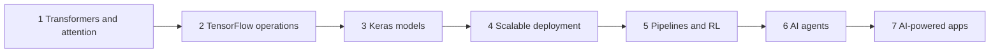

# Track 4 · AI Architecture and Agents

> 🧭 [⬆ Up](../README.md) · Generative AI › **Track 4 · AI Architecture and Agents**

Prepared by **Hamna Zahid Khan**, Junior Lecturer

## 📌 About this track

AI Architecture and Agents is the engineering track. You will open up the machinery behind modern generative AI: how **transformers** and attention work, how to build and train deep networks with **TensorFlow and Keras**, how to **deploy** models at scale with TF Serving, TF Lite, Kubernetes and TFX, how **reinforcement learning** and monitoring keep AI systems improving, how **AI agents** plan and use tools, and finally how to build real apps on **local open models** (Qwen 2.5, DeepSeek-R1) with Ollama and RAG.

Every session is backed by **real, executed code**: NumPy attention, Keras CNNs and LSTMs, transfer learning, SavedModel and TF Lite exports, an autoscaling simulator, a mini TFX pipeline, Q-learning and policy-gradient agents, a ReAct agent, a LangGraph-style workflow and a RAG chatbot.

**By the end you will be able to:**

- Explain self-attention, multi-head attention and positional encoding, and compare transformers with RNNs and CNNs.
- Work fluently with tensors, graphs, gradients, losses and optimisers in TensorFlow, and relate them to PyTorch.
- Build, evaluate and fine-tune CNNs, RNNs and transfer-learning models with the Keras API.
- Export, serve, quantise and autoscale models, and design a validated retraining pipeline.
- Implement basic RL agents, monitor data drift, and explain where quantum ML stands today.
- Design AI agents with tools, memory, guardrails and human approval, and choose between AutoGen, BeeAI, LangGraph, CrewAI and AutoGPT.
- Run open LLMs locally and build a summariser and a grounded chatbot.

## 🧭 Learning path

## 🛠️ Setup

- **Python 3.10+** with `pip install tensorflow scikit-learn matplotlib` (the examples were executed with TensorFlow 2.21, Keras 3 and Python 3.12 on CPU). Session 2's mini project also uses PyTorch (`pip install torch`). Google Colab has all of these pre-installed: use the badge at the top of each session.
- **Session 7** works fully offline; to get real LLM replies install [Ollama](https://ollama.com) and run `ollama pull qwen2.5:7b` (or `qwen2.5:1.5b` on a small laptop) and `ollama pull deepseek-r1:7b`.
- Optional for Session 4: Docker and a local Kubernetes cluster (minikube or kind) to try the serving commands.
- See [code/README.md](code/README.md) for every file and how to run it.

## 🗂️ Sessions

| # | Session | Time |
|---|---|---|
| 1 | [Transformers and the Attention Mechanism](session-01-transformers-and-attention.md) | 2 hours |
| 2 | [TensorFlow for Deep Learning Operations](session-02-tensorflow-deep-learning-operations.md) | 2 hours |
| 3 | [Mastering the Keras API for Model Development](session-03-keras-api-model-development.md) | 2 hours |
| 4 | [Scalable Deployment: Serving, Lite, Kubernetes and TFX](session-04-scalable-deployment.md) | 2 hours |
| 5 | [Real-World AI Pipelines and Reinforcement Learning](session-05-ai-pipelines-and-reinforcement-learning.md) | 2 hours |
| 6 | [Understanding AI Agents and Agent Frameworks](session-06-understanding-ai-agents.md) | 2 hours |
| 7 | [Building AI-Powered Apps: Local LLMs, Summariser, Chatbot and RAG](session-07-building-ai-powered-applications.md) | 2 hours |

📝 **Module practice test:** [practice-test.md](practice-test.md) — 20 MCQs + 3 scenario questions with solutions.

## 📋 One-page cheat sheet

| Topic | Remember |
|---|---|
| Attention | `softmax(QKᵀ / √d_k) · V`; rows sum to 1; causal mask for generation |
| Q, K, V | Query asks, Key advertises, Value delivers |
| Transformer layer | Multi-head attention → Add & Norm → feed-forward → Add & Norm |
| Positional encoding | Sinusoidal, learned or RoPE; attention alone is order-blind |
| vs RNN/CNN | Parallel, 1-step long-range path, but O(n²) cost in length |
| Tensors | Shape + dtype; batch first; `tf.Variable` for weights; `tf.cast` to mix types |
| Graphs | TF2 eager by default; `@tf.function` traces a graph; TF1 used `tf.Session` |
| Gradients | `GradientTape` → `tape.gradient` → `optimizer.apply_gradients` |
| Losses | MSE regression · BCE binary · (sparse) CCE multi-class |
| Optimisers | SGD · momentum · RMSprop · Adam; tune the learning rate first |
| Keras APIs | Sequential (stack) · Functional (graphs, multi-input) · Subclassing (custom) |
| CNN / RNN | Conv2D + pooling for images · LSTM/GRU for short sequences |
| Transfer learning | As-is → frozen base + new head → fine-tune with LR ≈ 1e-4; compare with scratch |
| Evaluation | Validation curves · EarlyStopping · confusion matrix · precision/recall · baseline |
| Serving | SavedModel `models/name/1/` → TF Serving REST 8501 / gRPC 8500 |
| Edge | TF Lite / LiteRT; int8 quantisation ≈ 4× smaller; re-check accuracy |
| Kubernetes | Deployment · Service · readiness probe · HPA `ceil(pods × util ÷ target)` |
| TFX | ExampleGen → StatisticsGen → SchemaGen → ExampleValidator → Transform → Trainer → Evaluator → Pusher |
| Drift | PSI < 0.10 stable · 0.10–0.25 watch · > 0.25 retrain |
| RL | State · action · reward · policy · γ · ε-greedy; `Q += α(r + γ max Q′ − Q)` |
| Quantum ML | Variational circuits as Keras layers (TFQ); simulators grow as 2ⁿ; research-stage |
| Agents | LLM brain + tools + memory + planning + guardrails + human approval |
| ReAct | Thought → Action → Observation → … → Final answer |
| Frameworks | AutoGen (conversing agents) · BeeAI (IBM) · LangGraph (state graphs) · CrewAI (role crews) · AutoGPT (autonomous) |
| Local LLMs | Ollama on port 11434 · `/api/chat` · memory ≈ params × bits ÷ 8 × 1.2 |
| RAG | Chunk → embed → retrieve → grounded prompt with citations → "I don't know" below threshold |

## ✅ Track checklist

- [ ] Finished all 7 sessions, their lab tasks and mini projects
- [ ] Ran every script in `code/` (or every notebook in Colab) and compared your output with the session page
- [ ] Scored at least 4/5 on every session quiz
- [ ] Attempted the [practice test](practice-test.md) in 60 minutes
- [ ] Built one end-to-end project: a Keras model exported as a SavedModel, plus a local RAG chatbot or agent that uses it as a tool

---
Prepared by **Hamna Zahid Khan**, Junior Lecturer
