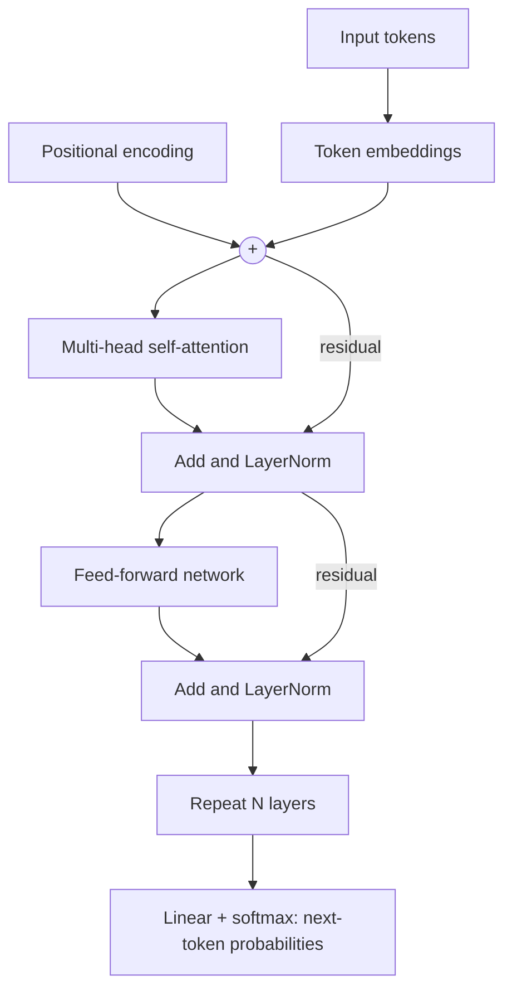
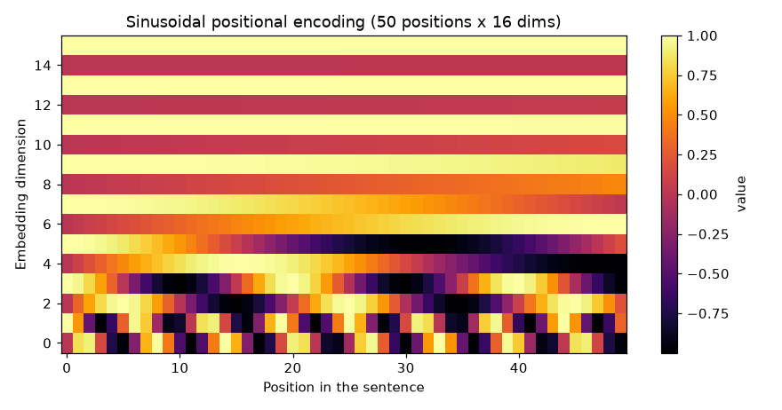
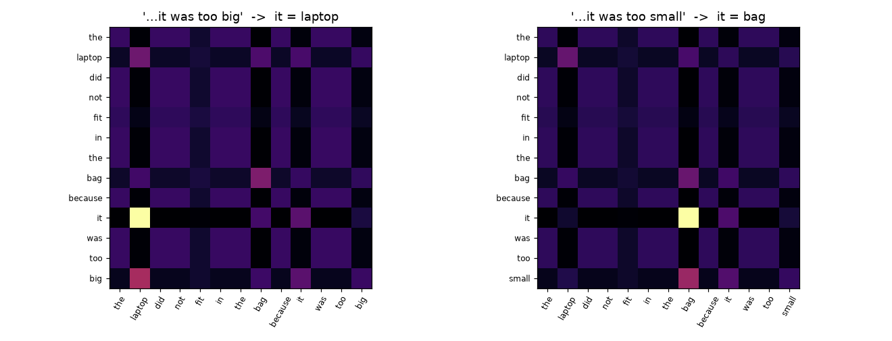
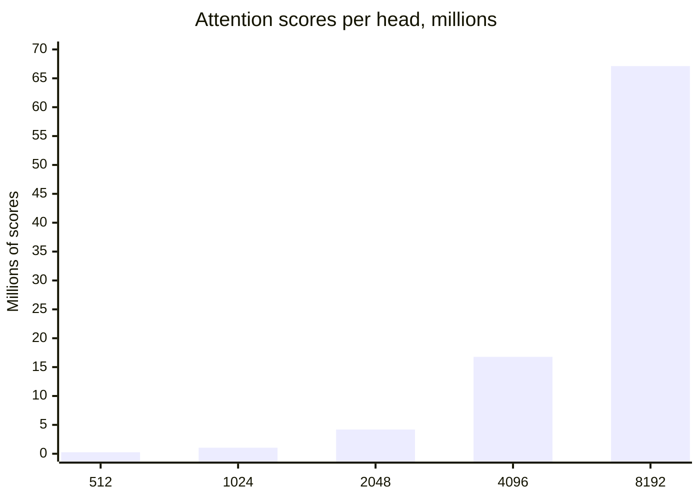

# Session 1 · Transformers and the Attention Mechanism

[](https://colab.research.google.com/github/Hamnakhan123/Generative-AI/blob/main/04-ai-architecture-and-agents/code/session-01-transformers-and-attention.ipynb)

> 🧭 [Generative AI](../README.md) › [Track 4 · AI Architecture and Agents](README.md) › **Session 1**
>
> ⏱️ **Estimated time:** 2 hours · 📋 **Prerequisites:** Python, NumPy basics

[⬅ Previous](../03-innovate-with-generative-ai/session-07-analyzing-and-optimizing-content.md) · [🏠 Track home](README.md) · [Next ➡](session-02-tensorflow-deep-learning-operations.md)

---

## 🎯 Learning objectives

- Explain the **building blocks of a transformer**: embeddings, positional encoding, self-attention, multi-head attention, feed-forward layers, residual connections and layer normalisation.
- Compute **scaled dot-product attention** by hand and in NumPy, and read an attention matrix.
- Describe how self-attention gives NLP models **contextual understanding** (the same word gets a different vector in a different sentence).
- Compare transformers with **RNN** and **CNN** architectures on parallelism, long-range context and cost.
- Explain why **positional encoding** is needed and how the sinusoidal version keeps word order.

## 📖 Concepts

### 1. The problem transformers solved

Before 2017, language models mostly read text **one word at a time** with recurrent networks (RNNs, LSTMs, GRUs). That has two weaknesses:

1. **Slow training** — step 50 cannot start until step 49 is done, so GPUs sit idle.
2. **Fading memory** — information from word 1 must survive dozens of updates to reach word 100.

The paper *"Attention Is All You Need"* (Vaswani et al., 2017) removed recurrence completely. A **transformer** lets every word look at every other word **in one step**, in parallel. GPT, BERT, T5, Llama, Qwen, Gemini and Claude are all built from this idea.

> 🧠 **Analogy — the classroom discussion.** An RNN is a game of "pass the message": each student whispers to the next, and the message degrades. A transformer is an open discussion: every student can hear every other student directly and decides *whom to listen to* for the point they are making.

### 2. The building blocks

| Block | What it does | Everyday picture |
|---|---|---|
| **Tokenizer** | Splits text into tokens (words or word pieces) and maps them to IDs | Cutting a sentence into puzzle pieces |
| **Embedding** | Turns each token ID into a vector of numbers that captures meaning | A word's "coordinates" on a map of meaning |
| **Positional encoding** | Adds a position signal so order is not lost | Seat numbers in a cinema |
| **Self-attention** | Each token mixes in information from the tokens most relevant to it | Listening to the classmates who matter for your point |
| **Multi-head attention** | Several attention "heads" in parallel, each learning a different relation (grammar, coreference, topic) | Several reviewers reading the same essay for different things |
| **Feed-forward network** | A small two-layer network applied to each token separately | Each student privately thinking over what they heard |
| **Residual connection + LayerNorm** | `x + sublayer(x)`, then normalise; keeps training stable in deep stacks | Keeping your original notes while adding new ones |
| **Output head** | Turns the final vectors into next-token probabilities or class labels | Picking the answer |

**Three families:**

| Family | Attention type | Good at | Examples |
|---|---|---|---|
| **Encoder-only** | Bidirectional (sees left and right) | Understanding: classification, search, NER | BERT, RoBERTa |
| **Decoder-only** | Causal (sees only the left) | Generating text token by token | GPT, Llama, Qwen, Mistral |
| **Encoder–decoder** | Encoder bidirectional + decoder causal + cross-attention | Translation, summarisation | Original Transformer, T5, BART |

### 3. Self-attention, step by step

Every token's embedding **x** is multiplied by three learned matrices to make:

- **Query (Q)** — "what am I looking for?"
- **Key (K)** — "what do I contain?"
- **Value (V)** — "what will I hand over if you pick me?"

Then:

1. **Score** every pair: `score = Q · Kᵀ` (a dot product: big when query and key point the same way).
2. **Scale** by `√d_k` so scores do not grow with vector size and push softmax into extreme 0/1 values.
3. **Softmax** each row so the weights are positive and sum to 1.
4. **Mix**: output = weights · V, a weighted average of the value vectors.

> 🧠 **Analogy — the library.** Your **query** is the question you type into the catalogue, each book's **key** is its catalogue card, and the **value** is the book's content. Attention reads mostly from the books whose cards best match your question.

**Contextual understanding.** In "the river **bank** flooded" and "the **bank** approved my loan", the word *bank* starts with the same embedding, but attention mixes in *river* in one sentence and *loan* in the other, so the output vectors differ. That is why transformer embeddings are called **contextual embeddings**, unlike older static ones such as word2vec.

**Masking.** A decoder must not peek at future words while learning to predict them, so scores above the diagonal are set to −∞ before softmax (a **causal mask**). A **padding mask** hides the blank tokens added to make sentences in a batch the same length.

### 4. Multi-head attention

Instead of one attention with 512-dimensional vectors, the model runs, say, **8 heads of 64 dimensions** each, then concatenates and projects the results. The cost is about the same, but each head can specialise: one tracks subject–verb agreement, another which noun a pronoun refers to, another nearby words.

### 5. Positional encoding: keeping word order

Attention compares **sets** of vectors; it has no built-in idea of first or last. "Dog bites man" and "man bites dog" would produce the same vector for *dog*. The fix is to **add a position vector** to each embedding before the first layer. The original paper used sine and cosine waves of different frequencies:

`PE(pos, 2i) = sin(pos / 10000^(2i/d))` and `PE(pos, 2i+1) = cos(pos / 10000^(2i/d))`

Each position gets a unique pattern, nearby positions look similar (so relative distance is encoded), values stay between −1 and 1, and the formula works for any length.

Modern models often use **learned** position embeddings (BERT, GPT-2) or **rotary position embeddings (RoPE)** that rotate Q and K by an angle depending on position (Llama, Qwen, Mistral). The goal is the same: put order back in.

### 6. Transformers vs RNNs vs CNNs

| Aspect | RNN / LSTM | CNN (1-D for text) | Transformer |
|---|---|---|---|
| How it reads | One token after another | Sliding windows of k tokens | All tokens at once |
| Parallel training | ❌ sequential | ✅ | ✅ |
| Path between distant words | n − 1 steps | about n ÷ (k − 1) layers | **1 step** |
| Long-range context | Weak (vanishing gradients) | Needs many layers | Strong |
| Cost per layer | O(n · d²) | O(k · n · d²) | **O(n² · d)** — grows with the square of length |
| Memory of order | Built in | Built in (local) | Needs positional encoding |
| Best today for | Small streaming/edge tasks | Images, audio, local patterns | Language, code, multimodal, long context |

The **weakness** of transformers is that quadratic cost: doubling the context length quadruples the attention work. That is why long-context models use tricks such as sliding-window attention, FlashAttention and KV caching.

## 🪜 Step-by-step: what happens to one sentence

1. **Tokenize**: "The cat sat" → `[464, 3797, 3332]`.
2. **Embed**: each ID → a vector of size `d_model` (e.g. 768).
3. **Add positions**: vector + PE(position).
4. **Encoder/decoder layer × N** (12 in BERT-base, 32 in Llama-3-8B): multi-head self-attention → Add & Norm → feed-forward → Add & Norm.
5. **Output head and decode**: softmax over the vocabulary gives next-token probabilities; pick one, append it, repeat.

## 🧭 Diagrams




## 💻 Worked examples (basic → advanced)

### Example 1 (basic) — Attention by hand with two words

Let `q_it = [1, 0]`, `k_laptop = [2, 0]`, `k_bag = [0, 2]`, `d_k = 2`.

| Step | laptop | bag |
|---|---|---|
| Dot product q·k | 1×2 + 0×0 = **2** | 1×0 + 0×2 = **0** |
| ÷ √2 | 1.414 | 0 |
| e^x | 4.11 | 1.00 |
| Softmax | 4.11 ÷ 5.11 = **0.80** | **0.20** |

So "it" takes 80% of its new meaning from *laptop*. If `v_laptop = [10, 0]` and `v_bag = [0, 10]`, the output is `0.8·[10,0] + 0.2·[0,10] = [8, 2]`.

### Example 2 (intermediate) — Self-attention in NumPy

```python
# file: session-01_attention_numpy.py
"""
Session 1 · Example 2 — Scaled dot-product self-attention, step by step in NumPy.

Self-attention lets every word look at every other word and decide how much
each one matters for its own meaning:
    scores  = Q · K^T / sqrt(d_k)      (how well each query matches each key)
    weights = softmax(scores)          (each row sums to 1)
    output  = weights · V              (a weighted mix of the value vectors)

Run:  python session-01_attention_numpy.py
"""
import numpy as np

np.set_printoptions(precision=2, suppress=True)
rng = np.random.default_rng(7)

words = ["the", "cat", "sat", "down"]
d_model, d_k = 6, 4

# 1) Toy embeddings: one row per word (in a real model these are learned)
X = rng.normal(size=(len(words), d_model))

# 2) Learned projection matrices (random here) turn each embedding into Q, K, V
W_q = rng.normal(size=(d_model, d_k))
W_k = rng.normal(size=(d_model, d_k))
W_v = rng.normal(size=(d_model, d_k))
Q, K, V = X @ W_q, X @ W_k, X @ W_v
print("Shapes  X:", X.shape, " Q/K/V:", Q.shape)


def softmax(z, axis=-1):
    z = z - z.max(axis=axis, keepdims=True)   # subtract max for numerical stability
    e = np.exp(z)
    return e / e.sum(axis=axis, keepdims=True)


# 3) Raw scores, scaled by sqrt(d_k) so softmax does not saturate
scores = Q @ K.T / np.sqrt(d_k)
weights = softmax(scores)
output = weights @ V

print("\nAttention weights (row = word looking, column = word looked at)")
print("        " + "  ".join(f"{w:>5}" for w in words))
for w, row in zip(words, weights):
    print(f"{w:>6}  " + "  ".join(f"{v:5.2f}" for v in row))
print("\nEach row sums to:", weights.sum(axis=1))

for w, row in zip(words, weights):
    print(f"'{w}' attends most to '{words[int(row.argmax())]}' ({row.max():.0%})")

# 4) Why scale? Compare the sharpness of softmax with and without the sqrt(d_k)
big_d = 512
q = rng.normal(size=big_d); keys = rng.normal(size=(4, big_d))
raw = keys @ q
print(f"\nWith d_k={big_d}: unscaled max weight = {softmax(raw).max():.3f}, "
      f"scaled max weight = {softmax(raw / np.sqrt(big_d)).max():.3f}")

# 5) Causal (decoder) mask: a word may not look at future words
mask = np.triu(np.ones((4, 4)), k=1).astype(bool)
masked = np.where(mask, -1e9, scores)
print("\nCausal weights (upper triangle is zero):")
print(softmax(masked))
print("Output vectors shape:", output.shape)
```

**Output**

```text
Shapes  X: (4, 6)  Q/K/V: (4, 4)

Attention weights (row = word looking, column = word looked at)
          the    cat    sat   down
   the   0.32   0.52   0.14   0.02
   cat   0.00   0.00   0.00   1.00
   sat   0.17   0.75   0.08   0.00
  down   0.46   0.54   0.00   0.00

Each row sums to: [1. 1. 1. 1.]
'the' attends most to 'cat' (52%)
'cat' attends most to 'down' (100%)
'sat' attends most to 'cat' (75%)
'down' attends most to 'cat' (54%)

With d_k=512: unscaled max weight = 1.000, scaled max weight = 0.557

Causal weights (upper triangle is zero):
[[1.   0.   0.   0.  ]
 [0.93 0.07 0.   0.  ]
 [0.17 0.75 0.08 0.  ]
 [0.46 0.54 0.   0.  ]]
Output vectors shape: (4, 4)
```

**Reading it:** each row is one word's "listening budget" split across the sentence. The scaling test shows why we divide by √d_k: with 512 dimensions and no scaling, softmax gives one key 100% and the gradients for the rest vanish. The causal matrix is what a GPT-style decoder uses.

### Example 3 (intermediate) — Positional encoding fixes word order

```python
# file: session-01_positional_encoding.py
"""
Session 1 · Example 3 — Sinusoidal positional encoding and why word order needs it.

Attention by itself is order-blind: shuffling the words shuffles the outputs but
does not change them. Transformers add a position signal to each embedding:
    PE[pos, 2i]   = sin(pos / 10000^(2i/d))
    PE[pos, 2i+1] = cos(pos / 10000^(2i/d))

Run:  python session-01_positional_encoding.py
Creates: session-01_positional_encoding.png
"""
import numpy as np
import matplotlib
matplotlib.use("Agg")
import matplotlib.pyplot as plt

np.set_printoptions(precision=3, suppress=True)


def positional_encoding(n_pos, d):
    pos = np.arange(n_pos)[:, None]
    i = np.arange(d // 2)[None, :]
    angle = pos / np.power(10000, 2 * i / d)
    pe = np.zeros((n_pos, d))
    pe[:, 0::2] = np.sin(angle)
    pe[:, 1::2] = np.cos(angle)
    return pe


pe = positional_encoding(50, 16)
print("PE shape:", pe.shape)
print("Position 0:", pe[0, :6])
print("Position 1:", pe[1, :6])

# 1) Order-blindness demo: plain self-attention (Q=K=V=X) on two word orders
def self_attend(X):
    s = X @ X.T / np.sqrt(X.shape[1])
    w = np.exp(s - s.max(1, keepdims=True)); w /= w.sum(1, keepdims=True)
    return w @ X

rng = np.random.default_rng(0)
emb = {w: rng.normal(size=16) for w in ["dog", "bites", "man"]}
a = np.stack([emb[w] for w in ["dog", "bites", "man"]])
b = np.stack([emb[w] for w in ["man", "bites", "dog"]])
out_a, out_b = self_attend(a), self_attend(b)
print("\nWithout positions, 'dog' gets the same vector in both sentences:",
      np.allclose(out_a[0], out_b[2]))
out_a, out_b = self_attend(a + pe[:3]), self_attend(b + pe[:3])
print("With positions added, the vectors differ:", not np.allclose(out_a[0], out_b[2]))

# 2) Nearby positions are more similar than distant ones
def cos(u, v): return float(u @ v / (np.linalg.norm(u) * np.linalg.norm(v)))
print("\nCosine similarity of position 10 with:")
for p in [9, 11, 15, 30, 49]:
    print(f"  position {p:2d}: {cos(pe[10], pe[p]):.3f}")

plt.figure(figsize=(8, 4.2))
plt.imshow(pe.T, aspect="auto", cmap="inferno", origin="lower")
plt.colorbar(label="value")
plt.xlabel("Position in the sentence"); plt.ylabel("Embedding dimension")
plt.title("Sinusoidal positional encoding (50 positions x 16 dims)")
plt.tight_layout(); plt.savefig("session-01_positional_encoding.png", dpi=110)
print("\nSaved chart: session-01_positional_encoding.png")
```

**Output**

```text
PE shape: (50, 16)
Position 0: [0. 1. 0. 1. 0. 1.]
Position 1: [0.841 0.54  0.311 0.95  0.1   0.995]

Without positions, 'dog' gets the same vector in both sentences: True
With positions added, the vectors differ: True

Cosine similarity of position 10 with:
  position  9: 0.936
  position 11: 0.936
  position 15: 0.767
  position 30: 0.722
  position 49: 0.595

Saved chart: session-01_positional_encoding.png
```



**Reading it:** without positions, "dog bites man" and "man bites dog" give *dog* the identical vector; adding PE breaks the tie. Similarity falls as positions get further apart, so distance is encoded smoothly.

### Example 4 (advanced) — Multi-head attention and an encoder block in Keras

```python
# file: session-01_multihead_compare.py
"""
Session 1 · Example 4 — Multi-head attention with Keras, and transformers vs RNNs vs CNNs.

Part A builds a real Keras MultiHeadAttention layer and a full encoder block.
Part B counts how many steps each architecture needs to connect two distant words.

Run:  python session-01_multihead_compare.py
"""
import os
os.environ["TF_CPP_MIN_LOG_LEVEL"] = "3"
import numpy as np
import keras
from keras import layers

keras.utils.set_random_seed(42)

# ---------- Part A: multi-head attention and an encoder block ----------
seq_len, d_model, heads = 10, 32, 4
x = np.random.default_rng(1).normal(size=(2, seq_len, d_model)).astype("float32")

mha = layers.MultiHeadAttention(num_heads=heads, key_dim=d_model // heads)
out, scores = mha(x, x, return_attention_scores=True)
print("Input  (batch, tokens, d_model):", x.shape)
print("Output (batch, tokens, d_model):", tuple(out.shape))
print("Scores (batch, heads, tokens, tokens):", tuple(scores.shape))
print("Each head's rows sum to 1:", np.allclose(np.asarray(scores).sum(-1), 1, atol=1e-5))


def encoder_block(inputs, d_model=32, heads=4, d_ff=64, rate=0.1):
    """Self-attention + Add&Norm + feed-forward + Add&Norm (the original encoder layer)."""
    attn = layers.MultiHeadAttention(num_heads=heads, key_dim=d_model // heads)(inputs, inputs)
    x = layers.LayerNormalization(epsilon=1e-6)(inputs + layers.Dropout(rate)(attn))
    ff = layers.Dense(d_ff, activation="relu")(x)
    ff = layers.Dense(d_model)(ff)
    return layers.LayerNormalization(epsilon=1e-6)(x + layers.Dropout(rate)(ff))


inp = keras.Input(shape=(seq_len, d_model))
model = keras.Model(inp, encoder_block(inp), name="encoder_block")
print(f"\nEncoder block parameters: {model.count_params():,}")

# ---------- Part B: path length between word 1 and word n ----------
print("\nSteps for information to travel from the first to the last token")
print(f"{'tokens':>7} | {'RNN (sequential)':>16} | {'CNN k=3 layers':>14} | {'Transformer':>11}")
for n in [10, 100, 1000]:
    rnn = n - 1                      # one hidden-state update per token, in order
    cnn = int(np.ceil((n - 1) / 2))  # each kernel-3 layer widens the view by 2
    print(f"{n:>7} | {rnn:>16} | {cnn:>14} | {1:>11}")
```

**Output**

```text
Input  (batch, tokens, d_model): (2, 10, 32)
Output (batch, tokens, d_model): (2, 10, 32)
Scores (batch, heads, tokens, tokens): (2, 4, 10, 10)
Each head's rows sum to 1: True

Encoder block parameters: 8,544

Steps for information to travel from the first to the last token
 tokens | RNN (sequential) | CNN k=3 layers | Transformer
     10 |                9 |              5 |           1
    100 |               99 |             50 |           1
   1000 |              999 |            500 |           1
```

**Reading it:** Keras returns one 10×10 attention map **per head**. A full encoder layer here has 8,544 parameters; BERT-base stacks 12 much wider ones (about 110 million parameters). Part B is the core argument for transformers: one step between any two tokens, at the price of n² scores.

### Example 5 (advanced) — Choosing an architecture

| Task | Choice | Reason |
|---|---|---|
| Classify 50,000 short product reviews | Encoder (fine-tuned BERT/DistilBERT) | Understanding, bidirectional, cheap |
| Chatbot that writes answers | Decoder-only LLM | Generates token by token |
| Translate Urdu to English | Encoder–decoder (or a large decoder LLM) | Input and output are different sequences |
| Keyword spotting on a tiny microcontroller | Small CNN/RNN | Tight memory, short input |
| Summarise a 300-page contract | Long-context decoder + chunking | n² cost: split or use a long-context model |

## 🏗️ Real-life problem: which noun is "it"? (full solution)

**Scenario.** A support bot reads: *"The laptop did not fit in the bag because it was too big."* To reply correctly ("Try a larger bag") it must know *it* = laptop. Change one word ("…too **small**") and *it* = bag. We build a transparent attention model with readable features, resolve both sentences and plot the attention maps.

```python
# file: session-01_project_pronoun_resolver.py
"""
Session 1 · Mini project (full solution) — Resolve "it" with self-attention.

Real-life problem: a support bot reads "The laptop did not fit in the bag because
it was too big." Which noun is "it"? Humans use meaning; transformers use
attention. Here we hand-design small feature embeddings (size, container,
object...) so that the attention pattern is easy to read, then:
  1. compute self-attention for two sentences that differ by ONE word,
  2. report which noun "it" attends to,
  3. draw both attention maps as a heatmap PNG.

Run:  python session-01_project_pronoun_resolver.py
Creates: session-01_attention_heatmap.png
"""
import numpy as np
import matplotlib
matplotlib.use("Agg")
import matplotlib.pyplot as plt

# Feature axes: [is_object, is_container, is_big, is_small, is_pronoun, is_function_word]
VOCAB = {
    "the": [0, 0, 0, 0, 0, 1], "laptop": [1, 0, .6, .2, 0, 0], "did": [0, 0, 0, 0, 0, 1],
    "not": [0, 0, 0, 0, 0, 1], "fit": [0, 0, 0, 0, 0, .5], "in": [0, 0, 0, 0, 0, 1],
    "bag": [.3, 1, .2, .6, 0, 0], "because": [0, 0, 0, 0, 0, 1], "it": [0, 0, 0, 0, 1, 0],
    "was": [0, 0, 0, 0, 0, 1], "too": [0, 0, 0, 0, 0, 1], "big": [0, 0, 1, 0, 0, 0],
    "small": [0, 0, 0, 1, 0, 0],
}
NOUNS = {"laptop", "bag"}


def contextual_embed(words):
    """Give 'it' the meaning of the adjective that describes it (a stand-in for lower layers)."""
    E = np.array([VOCAB[w] for w in words], dtype=float)
    adj = words[-1]
    E[words.index("it")] += np.array(VOCAB[adj]) * 2   # 'it ... was too big' -> it is big
    return E


def attention(E, W_q, W_k):
    s = (E @ W_q) @ (E @ W_k).T / np.sqrt(W_q.shape[1])
    w = np.exp(s - s.max(1, keepdims=True))
    return w / w.sum(1, keepdims=True)


# Query/key projections: a big pronoun looks for an object; a small pronoun for a container
W_q = np.array([[0, 0], [0, 0], [1.2, 0], [0, 1.2], [.5, .5], [-1, -1]], dtype=float)
W_k = np.array([[1.2, 0], [0, 1.2], [.4, 0], [0, .4], [0, 0], [-1, -1]], dtype=float)

base = "the laptop did not fit in the bag because it was too".split()
results = {}
fig, axes = plt.subplots(1, 2, figsize=(12, 4.6))
for ax, adj in zip(axes, ["big", "small"]):
    words = base + [adj]
    A = attention(contextual_embed(words), W_q, W_k)
    row = A[words.index("it")]
    noun_scores = {w: row[i] for i, w in enumerate(words) if w in NOUNS}
    winner = max(noun_scores, key=noun_scores.get)
    results[adj] = winner
    print(f"Sentence: {' '.join(words)}.")
    print("  attention from 'it' ->", ", ".join(f"{w}: {s:.2f}" for w, s in noun_scores.items()))
    print(f"  resolved: 'it' = the {winner}\n")
    ax.imshow(A, cmap="inferno")
    ax.set_xticks(range(len(words))); ax.set_xticklabels(words, rotation=60, fontsize=8)
    ax.set_yticks(range(len(words))); ax.set_yticklabels(words, fontsize=8)
    ax.set_title(f"'...it was too {adj}'  ->  it = {winner}")
plt.tight_layout(); plt.savefig("session-01_attention_heatmap.png", dpi=110)

assert results == {"big": "laptop", "small": "bag"}, results
print("Both sentences resolved correctly. Saved chart: session-01_attention_heatmap.png")
```

**Output**

```text
Sentence: the laptop did not fit in the bag because it was too big.
  attention from 'it' -> laptop: 0.61, bag: 0.13
  resolved: 'it' = the laptop

Sentence: the laptop did not fit in the bag because it was too small.
  attention from 'it' -> laptop: 0.06, bag: 0.68
  resolved: 'it' = the bag

Both sentences resolved correctly. Saved chart: session-01_attention_heatmap.png
```



**What to notice:** only one word changed, but the bright cell in the *it* row moved from *laptop* to *bag*. In a real transformer nobody hand-writes these features: lower layers learn them, and certain heads in middle layers specialise in exactly this kind of coreference.

## 📊 Where the cost goes



## ⚠️ Common mistakes

| Mistake | Fix |
|---|---|
| Thinking attention weights are "the model's reasoning" | They show where information flowed, not why; use them as a hint only |
| Forgetting the √d_k scaling | Softmax saturates and training stalls |
| Assuming transformers know order automatically | They need positional encodings (sinusoidal, learned or RoPE) |
| Using a decoder without a causal mask in training | The model cheats by reading the answer |
| Feeding very long documents unchanged | Cost is n²; chunk, summarise or use a long-context model |

## ✅ Best practices

- Start with a **pre-trained** transformer; training one from scratch needs huge data and compute.
- Pick the **family by task**: encoder to understand, decoder to generate, encoder–decoder to transform.
- Visualise attention to **debug** (wrong padding mask, truncated input), not to explain decisions to users.
- Watch the **context length** budget: doubling tokens quadruples attention work.

## 🧪 Lab / practice tasks

**Task 1 · 🟢 Easy** — Redo Example 1 with `q_it = [0, 1]`. Which noun wins and with what weight?

<details><summary>💡 Hint</summary>

Swap which dot product is 2 and which is 0.

</details>

**Task 2 · 🟢 Easy** — In `session-01_attention_numpy.py`, change the sentence to five words and re-run. What changes in the shapes?

<details><summary>💡 Hint</summary>

Add a word to `words`; X becomes 5×6 and weights 5×5.

</details>

**Task 3 · 🟡 Medium** — Change `heads` in `session-01_multihead_compare.py` to 8. Does the parameter count of MultiHeadAttention change? Why?

<details><summary>💡 Hint</summary>

`key_dim = d_model // heads` shrinks as heads grow, so total projection size stays d_model.

</details>

**Task 4 · 🟡 Medium** — Plot the positional encoding for 200 positions and 64 dimensions. Which dimensions change fastest?

<details><summary>💡 Hint</summary>

Call `positional_encoding(200, 64)`; low dimensions use high frequencies.

</details>

**Task 5 · 🔴 Challenge** — Add a third sentence to the mini project: "The trophy did not fit in the suitcase because it was too big." Add the words to `VOCAB` and make the code resolve it.

<details><summary>💡 Hint</summary>

Give *trophy* the same features as *laptop* and *suitcase* those of *bag*; generalise `base` into a list of sentences.

</details>


<details><summary>✅ Lab solutions and model answers</summary>

**Task 1:** scores are 0 (laptop) and 2 (bag) → softmax 0.20 / **0.80**, so *bag* wins.

**Task 2:** with five words: X (5, 6), Q/K/V (5, 4), weights (5, 5), output (5, 4). The projection matrices do not change size; only the number of rows does.

**Task 3:** no. With 8 heads `key_dim = 4`, so Q, K and V projections are still 32 × (8×4) each; the parameter count stays 4,224. More heads = more, smaller views of the same total width.

**Task 4:** dimension 0/1 oscillate fastest (wavelength 2π ≈ 6.3 positions); the last dimensions change very slowly (wavelength up to 10000·2π).

**Task 5:**

```python
VOCAB.update({"trophy": VOCAB["laptop"], "suitcase": VOCAB["bag"]})
NOUNS |= {"trophy", "suitcase"}
for sent in ["the trophy did not fit in the suitcase because it was too big"]:
    words = sent.split()
    A = attention(contextual_embed(words), W_q, W_k)
    row = A[words.index("it")]
    best = max((w for w in words if w in NOUNS), key=lambda w: row[words.index(w)])
    print(sent, "->", best)   # trophy
```

</details>

## ✅ Quick quiz

**Q1. Why do transformers train faster than RNNs on GPUs?**

- A) They skip embeddings
- B) They use smaller vocabularies
- C) All tokens are processed in parallel
- D) They have fewer parameters

<details><summary>Show answer</summary>

✅ **C) All tokens are processed in parallel** — No step waits for the previous token.

</details>

**Q2. In attention, the Query of a token represents...**

- A) The information it hands over
- B) Its frequency in the corpus
- C) Its position
- D) What it is looking for

<details><summary>Show answer</summary>

✅ **D) What it is looking for** — Keys advertise, values deliver.

</details>

**Q3. Why divide attention scores by √d_k?**

- A) To make them integers
- B) To stop softmax becoming extreme as vector size grows
- C) To add position
- D) To remove padding

<details><summary>Show answer</summary>

✅ **B) To stop softmax becoming extreme as vector size grows** — Keeps gradients healthy.

</details>

**Q4. Without positional encoding, a transformer...**

- A) Doubles its cost
- B) Becomes an RNN
- C) Cannot be trained
- D) Treats "dog bites man" and "man bites dog" alike

<details><summary>Show answer</summary>

✅ **D) Treats "dog bites man" and "man bites dog" alike** — Attention is order-blind.

</details>

**Q5. Which family is GPT?**

- A) Encoder–decoder
- B) CNN
- C) Decoder-only
- D) Encoder-only

<details><summary>Show answer</summary>

✅ **C) Decoder-only** — Causal self-attention, generates left to right.

</details>


## 📝 Summary / cheat-sheet

- Transformer = **embeddings + positions + N × (multi-head attention → Add & Norm → feed-forward → Add & Norm)**.
- Attention: `softmax(QKᵀ / √d_k) · V`; rows sum to 1; causal mask for generation.
- **Self-attention** gives **contextual** vectors: the same word means different things in different sentences.
- **Multi-head** = several attention views in parallel, concatenated.
- **Positional encoding** (sinusoidal, learned, RoPE) puts word order back.
- vs RNN/CNN: parallel, 1-step long-range paths, but **O(n²)** cost in sequence length.

**Viva / interview questions**

1. Walk through scaled dot-product attention with a small numeric example.
2. What are Q, K and V and where do they come from?
3. Why do transformers need positional encoding, and name two ways to provide it.
4. Compare transformers with RNNs and CNNs for long documents.
5. What is a causal mask and when is it used?
6. Why is multi-head attention better than one big head?

---

[⬅ Previous](../03-innovate-with-generative-ai/session-07-analyzing-and-optimizing-content.md) · [🏠 Track home](README.md) · [Next ➡](session-02-tensorflow-deep-learning-operations.md)

<sub>Prepared by **Hamna Zahid Khan**, Junior Lecturer</sub>
