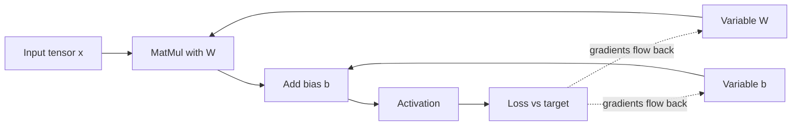
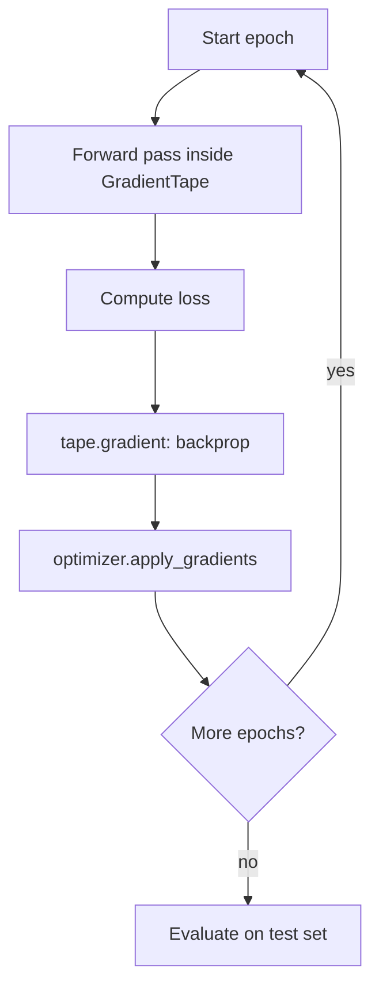
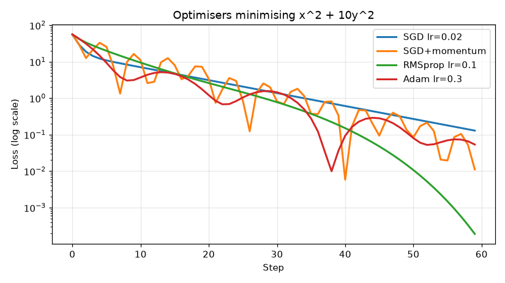
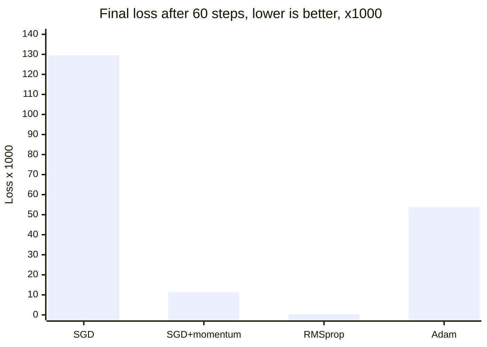

# Session 2 · TensorFlow for Deep Learning Operations

[](https://colab.research.google.com/github/Hamnakhan123/Generative-AI/blob/main/04-ai-architecture-and-agents/code/session-02-tensorflow-deep-learning-operations.ipynb)

> 🧭 [Generative AI](../README.md) › [Track 4 · AI Architecture and Agents](README.md) › **Session 2**
>
> ⏱️ **Estimated time:** 2 hours · 📋 **Prerequisites:** Previous session

[⬅ Previous](session-01-transformers-and-attention.md) · [🏠 Track home](README.md) · [Next ➡](session-03-keras-api-model-development.md)

---

## 🎯 Learning objectives

- Describe **tensors** (rank, shape, dtype) and the core **tensor operations** used in deep learning.
- Explain **computational graphs**, eager execution and `tf.function`, and what TF1 **sessions** were.
- Use `tf.GradientTape` to compute gradients and write a **custom training loop**.
- Choose suitable **loss functions** and **optimisers**, and read their behaviour.
- Compare **TensorFlow with PyTorch, JAX and scikit-learn**, and outline key implementation differences.

> 🛠️ **Setup.** `pip install tensorflow` (CPU is fine). Examples were run with TensorFlow 2.21 and PyTorch 2.x on Python 3.12. In Google Colab both are pre-installed.

## 📖 Concepts

### 1. What TensorFlow is

**TensorFlow** is an open-source library from Google for building and running machine-learning models. It gives you:

- **Tensors** and fast maths on CPU, GPU and TPU.
- **Automatic differentiation** (gradients without calculus by hand).
- **Keras**, a high-level API for layers and models (Session 3).
- **Deployment tools**: SavedModel, TF Serving, TF Lite, TFX (Session 4).

> 🧠 **Analogy — a kitchen.** Tensors are the ingredients in labelled containers (shape and type on the label). Operations are the recipes. The computational graph is the written recipe card a restaurant can hand to any branch. Gradients are the taste-test that tells the chef how much to adjust each ingredient.

### 2. Tensors

| Rank | Name | Example | Shape |
|---|---|---|---|
| 0 | Scalar | a loss value | `()` |
| 1 | Vector | one house's 3 features | `(3,)` |
| 2 | Matrix | 400 houses × 3 features | `(400, 3)` |
| 3 | 3-D tensor | batch of 32 sentences × 50 tokens × 768 dims | `(32, 50, 768)` |
| 4 | 4-D tensor | batch of 64 RGB images 224×224 | `(64, 224, 224, 3)` |

Key facts:

- **dtype** matters: `float32` for weights, `int32/int64` for labels and IDs. TF refuses to add an int to a float without `tf.cast`.
- `tf.constant` is **immutable**; `tf.Variable` holds **trainable state** (weights) that optimisers update.
- **Broadcasting** stretches smaller tensors to match larger ones (adding a bias to every row).
- The **first dimension is usually the batch**.

### 3. Operations you will use daily

| Category | Ops |
|---|---|
| Element-wise | `+ - * /`, `tf.exp`, `tf.nn.relu`, `tf.sigmoid` |
| Linear algebra | `tf.matmul` (`@`), `tf.transpose`, `tf.linalg.matvec` |
| Reductions | `tf.reduce_sum`, `tf.reduce_mean`, `tf.argmax` |
| Shape | `tf.reshape`, `tf.expand_dims`, `tf.squeeze`, `tf.concat`, `tf.stack` |
| Neural | `tf.nn.softmax`, `tf.nn.conv2d`, `tf.nn.dropout` |

### 4. Computational graphs, eager mode and sessions

A **computational graph** is a network of operations (nodes) connected by tensors (edges). Graphs let TF optimise (fuse ops, prune unused parts), run on other devices and be **saved without Python**.

| | TensorFlow 1.x | TensorFlow 2.x |
|---|---|---|
| Default mode | Build a static graph first | **Eager**: run line by line |
| Running it | `with tf.Session() as sess: sess.run(fetch, feed_dict=…)` | Just call the function |
| Getting a graph | Always | Decorate with **`@tf.function`** (traced once per input signature) |
| Debugging | Hard (print nodes) | Easy (normal Python, `print`, debugger) |

**Session management** in TF1 meant creating a `tf.Session`, initialising variables, feeding placeholders and closing the session to free memory. TF2 removed this: `tf.function` traces your Python code into a graph and manages execution for you. You still meet the word "session" in old tutorials and in `tf.compat.v1`.

### 5. Automatic differentiation

Training = repeatedly nudging weights **against the gradient** of the loss. `tf.GradientTape` records operations in its block, then `tape.gradient(loss, variables)` applies the **chain rule** backwards (backpropagation).

### 6. Loss functions

| Task | Output layer | Loss | Intuition |
|---|---|---|---|
| Regression (price, temperature) | Linear | **MSE** (or MAE, Huber) | Average squared error; MAE is less sensitive to outliers |
| Binary classification (spam?) | Sigmoid | **Binary cross-entropy** | −log(probability given to the true answer) |
| Multi-class, integer labels | Softmax | **Sparse categorical cross-entropy** | Same, for many classes |
| Multi-class, one-hot labels | Softmax | **Categorical cross-entropy** | Same, labels as vectors |

Cross-entropy punishes **confident mistakes** heavily: predicting 0.01 for the true class costs 4.6, predicting 0.9 costs only 0.1.

### 7. Optimisers

| Optimiser | Idea | Analogy |
|---|---|---|
| **SGD** | Step = −learning rate × gradient | Walking downhill one careful step at a time |
| **SGD + momentum** | Keeps a running velocity | A ball rolling downhill, carrying speed |
| **RMSprop** | Divides by a running average of squared gradients | Smaller steps where the ground is steep |
| **Adam** | Momentum + RMSprop with bias correction | The popular default: adaptive and quick |

The **learning rate** is the most important hyper-parameter: too small and training crawls, too large and the loss bounces or explodes.

### 8. TensorFlow vs other frameworks

| Aspect | TensorFlow / Keras | PyTorch | JAX | scikit-learn |
|---|---|---|---|---|
| Style | Keras layers; `tf.function` graphs | Pythonic, dynamic graphs (define-by-run) | Functional, `jit` + `grad` | Classic ML estimators |
| Gradients | `GradientTape` | `loss.backward()` | `jax.grad(f)` | Not exposed |
| Training loop | `model.fit` or custom | Usually written by you (or Lightning) | Written by you | `model.fit` |
| Deployment | **SavedModel, TF Serving, TF Lite, TF.js, TFX** | TorchScript/ExportedProgram, TorchServe, ONNX, ExecuTorch | XLA export | pickle/joblib, ONNX |
| Popular in | Production, mobile, Google ecosystem | Research, most new LLM code | Large-scale research (TPUs) | Tabular data |

**Key implementation differences:** TF updates weights with `optimizer.apply_gradients(zip(grads, vars))`; PyTorch needs `optimizer.zero_grad()` before each `backward()` because gradients **accumulate**. TF images default to **channels-last** `(N, H, W, C)`, PyTorch to **channels-first** `(N, C, H, W)`.

## 🪜 Step-by-step: a custom training loop

1. **Prepare data** as float32 tensors; standardise features (mean 0, std 1).
2. **Create variables** for weights and bias.
3. **Pick a loss** (MSE for regression) and an **optimiser** (Adam).
4. For each epoch: open a `GradientTape`, compute predictions and loss.
5. `grads = tape.gradient(loss, vars)`; `optimizer.apply_gradients(zip(grads, vars))`.
6. Wrap the step in `@tf.function` for speed.
7. **Evaluate** on held-out test data (RMSE, accuracy).

## 🧭 Diagrams





## 💻 Worked examples (basic → advanced)

### Example 1 (basic) — Tensors, shapes and Variables

```python
# file: session-02_tensors_basics.py
"""
Session 2 · Example 1 — Tensors: creating, shaping, broadcasting and Variables in TensorFlow.

A tensor is an n-dimensional array with a dtype and a shape. Every image batch,
sentence batch and weight matrix in a neural network is a tensor.

Run:  python session-02_tensors_basics.py
"""
import os
os.environ["TF_CPP_MIN_LOG_LEVEL"] = "3"
import tensorflow as tf

print("TensorFlow", tf.__version__, "| eager mode:", tf.executing_eagerly())

# 1) Rank 0..3 tensors
scalar = tf.constant(7)
vector = tf.constant([1.0, 2.0, 3.0])
matrix = tf.constant([[1, 2], [3, 4]], dtype=tf.float32)
batch = tf.zeros([2, 28, 28])            # e.g. 2 grey images of 28x28
for name, t in [("scalar", scalar), ("vector", vector), ("matrix", matrix), ("batch", batch)]:
    print(f"{name:7s} rank={t.ndim} shape={t.shape} dtype={t.dtype.name}")

# 2) Element-wise ops vs matrix multiplication
a = tf.constant([[1., 2.], [3., 4.]])
b = tf.constant([[5., 6.], [7., 8.]])
print("\na * b (element-wise):\n", (a * b).numpy())
print("a @ b (matmul):\n", tf.matmul(a, b).numpy())

# 3) Broadcasting: add a bias vector to every row of a batch
x = tf.reshape(tf.range(6, dtype=tf.float32), [3, 2])
bias = tf.constant([10., 100.])
print("\nx:\n", x.numpy(), "\nx + bias:\n", (x + bias).numpy())

# 4) Reductions and reshaping
scores = tf.constant([[2., 9., 4.], [7., 1., 8.]])
print("\nsum all:", float(tf.reduce_sum(scores)), "| mean per row:", tf.reduce_mean(scores, axis=1).numpy())
print("argmax per row:", tf.argmax(scores, axis=1).numpy(), "| softmax row 0:", tf.nn.softmax(scores[0]).numpy().round(3))
print("reshape (2,3)->(3,2):", tf.reshape(scores, [3, 2]).shape, "| transpose:", tf.transpose(scores).shape)

# 5) Casting: TF does NOT silently mix int and float
try:
    tf.constant(1) + tf.constant(1.5)
except Exception as e:
    print("\nMixing int32 + float32 ->", type(e).__name__)
print("After tf.cast:", float(tf.cast(tf.constant(1), tf.float32) + 1.5))

# 6) Tensors are immutable; Variables hold trainable state
w = tf.Variable([[0.5], [-0.5]])
w.assign_add([[0.1], [0.1]])
print("\nVariable after assign_add:", w.numpy().ravel(), "| trainable:", w.trainable)

# 7) NumPy interop
import numpy as np
n = np.array([1, 2, 3]); t = tf.convert_to_tensor(n)
print("NumPy -> tensor -> NumPy:", t.numpy(), type(t.numpy()).__name__)
```

**Output**

```text
TensorFlow 2.21.0 | eager mode: True
scalar  rank=0 shape=() dtype=int32
vector  rank=1 shape=(3,) dtype=float32
matrix  rank=2 shape=(2, 2) dtype=float32
batch   rank=3 shape=(2, 28, 28) dtype=float32

a * b (element-wise):
 [[ 5. 12.]
 [21. 32.]]
a @ b (matmul):
 [[19. 22.]
 [43. 50.]]

x:
 [[0. 1.]
 [2. 3.]
 [4. 5.]] 
x + bias:
 [[ 10. 101.]
 [ 12. 103.]
 [ 14. 105.]]

sum all: 31.0 | mean per row: [5.        5.3333335]
argmax per row: [1 2] | softmax row 0: [0.001 0.992 0.007]
reshape (2,3)->(3,2): (3, 2) | transpose: (3, 2)

Mixing int32 + float32 -> InvalidArgumentError
After tf.cast: 2.5

Variable after assign_add: [ 0.6 -0.4] | trainable: True
NumPy -> tensor -> NumPy: [1 2 3] ndarray
```

**Reading it:** `a * b` multiplies matching cells; `a @ b` is matrix multiplication. Broadcasting added the bias to all three rows. The int + float attempt fails on purpose: TF wants explicit casts.

### Example 2 (intermediate) — Graphs and gradients

```python
# file: session-02_graphs_and_gradients.py
"""
Session 2 · Example 2 — Computational graphs with tf.function and automatic differentiation.

TensorFlow 2 runs eagerly (line by line, like NumPy). Wrapping a Python
function in @tf.function TRACES it once into a graph that TF can optimise,
save and run on other devices. tf.GradientTape records operations so TF can
compute derivatives by the chain rule (backpropagation).

Run:  python session-02_graphs_and_gradients.py
"""
import os
os.environ["TF_CPP_MIN_LOG_LEVEL"] = "3"
import tensorflow as tf

# 1) A graph is traced once per input signature
trace_count = 0

@tf.function
def affine(x, w, b):
    global trace_count
    trace_count += 1          # Python side effect: runs only while tracing
    return tf.matmul(x, w) + b

x = tf.ones([4, 3]); w = tf.ones([3, 2]); b = tf.zeros([2])
for _ in range(3):
    affine(x, w, b)
print("Called 3 times with the same shape -> traced", trace_count, "time(s)")
affine(tf.ones([8, 3]), w, b)
print("Called with a new shape          -> traced", trace_count, "time(s)")

graph = affine.get_concrete_function(x, w, b).graph
ops = [op.type for op in graph.get_operations()]
print("Ops inside the graph:", [o for o in ops if o not in ("Placeholder", "NoOp", "Identity")])

# 2) Gradients: y = x^3 + 2x at x = 2  ->  dy/dx = 3x^2 + 2 = 14
x = tf.Variable(2.0)
with tf.GradientTape() as tape:
    y = x ** 3 + 2 * x
print("\ny =", float(y), "| dy/dx =", float(tape.gradient(y, x)))

# 3) Chain rule through a tiny network: loss = (sigmoid(w*x + b) - target)^2
w, b = tf.Variable(0.5), tf.Variable(0.0)
xin, target = tf.constant(2.0), tf.constant(1.0)
with tf.GradientTape() as tape:
    z = w * xin + b
    pred = tf.sigmoid(z)
    loss = (pred - target) ** 2
dw, db = tape.gradient(loss, [w, b])
print(f"pred={float(pred):.4f} loss={float(loss):.4f} dL/dw={float(dw):.4f} dL/db={float(db):.4f}")
# check by hand: dL/dz = 2(pred-target)*pred*(1-pred); dL/dw = dL/dz * x
dz = 2 * (float(pred) - 1) * float(pred) * (1 - float(pred))
print(f"by hand:                    dL/dw={dz*2:.4f} dL/db={dz:.4f}")

# 4) One gradient-descent step lowers the loss
lr = 0.5
w.assign_sub(lr * dw); b.assign_sub(lr * db)
new_loss = (tf.sigmoid(w * xin + b) - target) ** 2
print(f"after one step: loss {float(loss):.4f} -> {float(new_loss):.4f}")

# 5) TF1 'sessions' vs TF2: the same graph, now run by calling the function
print("\nTF1 style: build graph, then sess.run(fetches, feed_dict)")
print("TF2 style: result = my_tf_function(inputs)  # session handled for you")
```

**Output**

```text
Called 3 times with the same shape -> traced 1 time(s)
Called with a new shape          -> traced 2 time(s)
Ops inside the graph: ['MatMul', 'AddV2']

y = 12.0 | dy/dx = 14.0
pred=0.7311 loss=0.0723 dL/dw=-0.2115 dL/db=-0.1058
by hand:                    dL/dw=-0.2115 dL/db=-0.1058
after one step: loss 0.0723 -> 0.0485

TF1 style: build graph, then sess.run(fetches, feed_dict)
TF2 style: result = my_tf_function(inputs)  # session handled for you
```

**Reading it:** the function was traced only once for three calls of the same shape, and again for a new shape (this is why passing changing Python numbers into a `tf.function` can cause slow re-tracing). The graph holds just `MatMul` and `AddV2`. TF's gradient matches the hand-computed chain rule exactly, and one update step reduced the loss.

### Example 3 (intermediate) — Losses and optimisers

```python
# file: session-02_losses_optimizers.py
"""
Session 2 · Example 3 — Loss functions by hand vs tf.keras.losses, and optimisers compared.

Run:  python session-02_losses_optimizers.py
Creates: session-02_optimizers.png
"""
import os
os.environ["TF_CPP_MIN_LOG_LEVEL"] = "3"
import numpy as np
import tensorflow as tf
import matplotlib
matplotlib.use("Agg")
import matplotlib.pyplot as plt

# 1) Regression loss: Mean Squared Error and Mean Absolute Error
y_true = np.array([3.0, 5.0, 2.0]); y_pred = np.array([2.5, 5.5, 4.0])
mse = np.mean((y_true - y_pred) ** 2); mae = np.mean(np.abs(y_true - y_pred))
print(f"MSE by hand {mse:.4f} | Keras {float(tf.keras.losses.MeanSquaredError()(y_true, y_pred)):.4f}")
print(f"MAE by hand {mae:.4f} | Keras {float(tf.keras.losses.MeanAbsoluteError()(y_true, y_pred)):.4f}")

# 2) Binary cross-entropy: punishes confident wrong answers hard
t = np.array([1., 0., 1.]); p = np.array([0.9, 0.2, 0.6])
bce = -np.mean(t * np.log(p) + (1 - t) * np.log(1 - p))
print(f"BCE by hand {bce:.4f} | Keras {float(tf.keras.losses.BinaryCrossentropy()(t, p)):.4f}")
for prob in [0.9, 0.5, 0.1, 0.01]:
    print(f"  true=1, predicted {prob:<4} -> loss {-np.log(prob):.3f}")

# 3) Categorical cross-entropy with integer labels (3 classes)
labels = np.array([0, 2]); probs = np.array([[0.7, 0.2, 0.1], [0.1, 0.3, 0.6]])
cce = -np.mean(np.log(probs[np.arange(2), labels]))
print(f"Sparse CCE by hand {cce:.4f} | Keras {float(tf.keras.losses.SparseCategoricalCrossentropy()(labels, probs)):.4f}")

# 4) Optimisers on a stretched bowl f(x,y) = x^2 + 10*y^2, starting at (-4, 2)
def run(opt, steps=60):
    v = tf.Variable([-4.0, 2.0]); hist = []
    for _ in range(steps):
        with tf.GradientTape() as tape:
            loss = v[0] ** 2 + 10 * v[1] ** 2
        opt.apply_gradients([(tape.gradient(loss, v), v)])
        hist.append(float(loss))
    return hist

opts = {
    "SGD lr=0.02": tf.keras.optimizers.SGD(0.02),
    "SGD+momentum": tf.keras.optimizers.SGD(0.02, momentum=0.9),
    "RMSprop lr=0.1": tf.keras.optimizers.RMSprop(0.1),
    "Adam lr=0.3": tf.keras.optimizers.Adam(0.3),
}
print("\nLoss after 10 / 30 / 60 steps (start = 56.0)")
plt.figure(figsize=(7.5, 4.2))
for name, opt in opts.items():
    h = run(opt)
    print(f"  {name:15s} {h[9]:9.4f} {h[29]:9.4f} {h[59]:9.5f}")
    plt.plot(h, label=name, lw=2)
plt.yscale("log"); plt.xlabel("Step"); plt.ylabel("Loss (log scale)")
plt.title("Optimisers minimising x^2 + 10y^2"); plt.legend(); plt.grid(alpha=.3)
plt.tight_layout(); plt.savefig("session-02_optimizers.png", dpi=110)
print("Saved chart: session-02_optimizers.png")
```

**Output**

```text
MSE by hand 1.5000 | Keras 1.5000
MAE by hand 1.0000 | Keras 1.0000
BCE by hand 0.2798 | Keras 0.2798
  true=1, predicted 0.9  -> loss 0.105
  true=1, predicted 0.5  -> loss 0.693
  true=1, predicted 0.1  -> loss 2.303
  true=1, predicted 0.01 -> loss 4.605
Sparse CCE by hand 0.4338 | Keras 0.4338

Loss after 10 / 30 / 60 steps (start = 56.0)
  SGD lr=0.02        7.6777    1.4992   0.12946
  SGD+momentum      16.3910    1.9903   0.01116
  RMSprop lr=0.1    10.9083    0.8875   0.00019
  Adam lr=0.3        3.1494    1.5617   0.05369
Saved chart: session-02_optimizers.png
```



**Reading it:** every hand-computed loss equals the Keras value. On this stretched bowl, momentum overshoots early but ends lower than plain SGD; RMSprop reaches almost zero; Adam drops fastest at first and then oscillates because its learning rate is high. There is no universal winner: try Adam first, tune the learning rate, and compare.

## 🏗️ Real-life problem: student-housing rent predictor (full solution)

**Scenario.** The student housing office wants a quick rent estimate (in thousand rupees) from flat size, distance to campus and rooms, and wants to know whether moving from TensorFlow to PyTorch would change results. We build a synthetic but realistic dataset, train a linear model with a custom TF loop, read the learned formula, estimate one flat, and repeat in PyTorch.

```python
# file: session-02_project_rent_predictor.py
"""
Session 2 · Mini project (full solution) — Rent predictor trained with a custom TF loop, then PyTorch.

Real-life problem: a student housing office wants a quick estimate of monthly
rent (thousand Rs) from flat size (100 sq ft units), distance to campus (km)
and number of rooms. We:
  1. generate a realistic synthetic dataset with a known formula + noise,
  2. standardise features and train a linear model with tf.GradientTape + Adam,
  3. report learned weights, train/test RMSE and a sample prediction,
  4. train the same model in PyTorch to compare the two frameworks side by side.

Run:  python session-02_project_rent_predictor.py
"""
import os
os.environ["TF_CPP_MIN_LOG_LEVEL"] = "3"
import numpy as np
import tensorflow as tf
import torch

rng = np.random.default_rng(42)
tf.random.set_seed(42); torch.manual_seed(42)

# 1) Data: rent = 8 + 4*size - 1.5*distance + 3*rooms + noise
n = 400
size = rng.uniform(4, 15, n); dist = rng.uniform(0.5, 20, n); rooms = rng.integers(1, 5, n)
rent = 8 + 4 * size - 1.5 * dist + 3 * rooms + rng.normal(0, 3, n)
X = np.column_stack([size, dist, rooms]).astype("float32"); y = rent.astype("float32")
idx = rng.permutation(n); tr, te = idx[:320], idx[320:]
mu, sd = X[tr].mean(0), X[tr].std(0)
Xs = (X - mu) / sd

# 2) TensorFlow: explicit training loop
W = tf.Variable(tf.zeros([3])); b = tf.Variable(0.0)
opt = tf.keras.optimizers.Adam(0.5)

@tf.function
def train_step(xb, yb):
    with tf.GradientTape() as tape:
        pred = tf.linalg.matvec(xb, W) + b
        loss = tf.reduce_mean((pred - yb) ** 2)
    opt.apply_gradients(zip(tape.gradient(loss, [W, b]), [W, b]))
    return loss

for epoch in range(300):
    loss = train_step(Xs[tr], y[tr])
    if epoch in (0, 49, 299):
        print(f"[TF] epoch {epoch+1:3d}  train MSE {float(loss):8.3f}")

def rmse(pred, target): return float(np.sqrt(np.mean((pred - target) ** 2)))
tf_pred = Xs @ W.numpy() + b.numpy()
w_raw = W.numpy() / sd; b_raw = b.numpy() - (W.numpy() * mu / sd).sum()
print(f"[TF] test RMSE {rmse(tf_pred[te], y[te]):.2f} thousand Rs")
print("[TF] learned formula: rent = {:.2f} + {:.2f}*size {:+.2f}*km {:+.2f}*rooms".format(b_raw, *w_raw))
print("     true formula:    rent = 8.00 + 4.00*size -1.50*km +3.00*rooms")

flat = np.array([[9.0, 3.0, 2]], dtype="float32")   # 900 sq ft, 3 km, 2 rooms
print(f"[TF] estimate for 900 sq ft, 3 km, 2 rooms: Rs {(((flat-mu)/sd) @ W.numpy() + b.numpy()).item()*1000:,.0f}")

# 3) PyTorch: same model, same data, same optimiser
model = torch.nn.Linear(3, 1)
topt = torch.optim.Adam(model.parameters(), lr=0.5)
xt, yt = torch.tensor(Xs[tr]), torch.tensor(y[tr]).unsqueeze(1)
for epoch in range(300):
    topt.zero_grad()
    loss = torch.mean((model(xt) - yt) ** 2)
    loss.backward(); topt.step()
with torch.no_grad():
    pt_pred = model(torch.tensor(Xs)).squeeze(1).numpy()
print(f"\n[PyTorch] test RMSE {rmse(pt_pred[te], y[te]):.2f} thousand Rs")
print(f"Largest TF vs PyTorch difference on a test flat: Rs {abs(pt_pred[te]-tf_pred[te]).max()*1000:.2f}")
```

**Output**

```text
[TF] epoch   1  train MSE 1703.799
[TF] epoch  50  train MSE  269.297
[TF] epoch 300  train MSE    8.663
[TF] test RMSE 3.08 thousand Rs
[TF] learned formula: rent = 6.59 + 4.13*size -1.47*km +2.93*rooms
     true formula:    rent = 8.00 + 4.00*size -1.50*km +3.00*rooms
[TF] estimate for 900 sq ft, 3 km, 2 rooms: Rs 45,234

[PyTorch] test RMSE 3.08 thousand Rs
Largest TF vs PyTorch difference on a test flat: Rs 0.01
```

**What to notice:** standardising features let Adam converge in 300 steps; the learned coefficients are close to the true ones (+4 per 100 sq ft, −1.5 per km, +3 per room). Test RMSE ≈ 3 thousand rupees is the noise we put in, so the model has learned all it can. TF and PyTorch (forward pass → `backward()` → `step()`) agree to the paisa: frameworks differ in style, not in maths.

## 📊 Optimiser results after 60 steps (from Example 3)



## ⚠️ Common mistakes

| Mistake | Fix |
|---|---|
| Mixing int and float tensors | `tf.cast(x, tf.float32)` |
| Shape mismatch in `matmul` | Print `.shape`; inner dimensions must match |
| Forgetting to standardise features | Large raw values make gradients huge; scale to mean 0, std 1 |
| Learning rate too high or too low | Try 1e-3 for Adam first; plot the loss |
| Python side effects inside `tf.function` | They run only during tracing; use `tf.print` |
| Evaluating on training data only | Keep a test split |

## ✅ Best practices

- Use **`float32`**, batch-first shapes and **standardised** inputs.
- Start eager to debug; add `@tf.function` once the code is correct.
- Match **loss to output layer** (sigmoid ↔ BCE, softmax ↔ CCE, linear ↔ MSE).

## 🧪 Lab / practice tasks

**Task 1 · 🟢 Easy** — Create a rank-4 tensor for a batch of 16 RGB images of 64×64 and print its shape and number of elements.

<details><summary>💡 Hint</summary>

`tf.zeros([16, 64, 64, 3])`; `tf.size(t)`.

</details>

**Task 2 · 🟢 Easy** — Use GradientTape to find dy/dx of y = 5x² − 3x + 1 at x = 4, and check by hand.

<details><summary>💡 Hint</summary>

dy/dx = 10x − 3.

</details>

**Task 3 · 🟡 Medium** — Add the Huber loss to Example 3 and compare it with MSE when one prediction is badly wrong.

<details><summary>💡 Hint</summary>

`tf.keras.losses.Huber(delta=1.0)`; MSE grows with the square of the error, Huber only linearly after delta.

</details>

**Task 4 · 🟡 Medium** — In the mini project, train with Adam learning rates 0.01, 0.1 and 0.5 for 300 epochs and record test RMSE.

<details><summary>💡 Hint</summary>

Loop over learning rates; recreate W, b and the optimiser each time.

</details>

**Task 5 · 🔴 Challenge** — Add a fourth feature "has_generator" (0/1, adds Rs 5,000) to the rent data and retrain both frameworks.

<details><summary>💡 Hint</summary>

Change the data formula, add a column to X, use `tf.zeros([4])` and `torch.nn.Linear(4, 1)`.

</details>


<details><summary>✅ Lab solutions and model answers</summary>

**Task 1:** `t = tf.zeros([16, 64, 64, 3]); print(t.shape, int(tf.size(t)))` → `(16, 64, 64, 3) 196608`.

**Task 2:**

```python
x = tf.Variable(4.0)
with tf.GradientTape() as tape:
    y = 5 * x**2 - 3 * x + 1
print(float(tape.gradient(y, x)))   # 37.0  (10*4 - 3)
```

**Task 3:** with `y_true=[3,5,2]` and `y_pred=[3,5,12]`: MSE = 100/3 ≈ 33.3; Huber(δ=1) = (10 − 0.5)/3 ≈ 3.17. Huber is far less dominated by the single outlier.

**Task 4:** measured test RMSE after 300 epochs: lr 0.01 → **36.8**, lr 0.1 → **14.5**, lr 0.5 → **3.1** (the noise level). With a fixed epoch budget, the learning rate decides whether training finishes.

**Task 5:** add `gen = rng.integers(0, 2, n)` and `+ 5 * gen` to the formula, stack it as a fourth column; the learned weight on `gen` should come out near 5.

</details>

## ✅ Quick quiz

**Q1. A batch of 32 RGB images of 224×224 in TensorFlow has shape...**

- A) (224, 224, 32)
- B) (32, 224, 224, 3)
- C) (32, 3, 224, 224)
- D) (3, 224, 224)

<details><summary>Show answer</summary>

✅ **B) (32, 224, 224, 3)** — TF is channels-last by default.

</details>

**Q2. Which object holds trainable weights in TensorFlow?**

- A) tf.Session
- B) tf.Variable
- C) tf.constant
- D) tf.function

<details><summary>Show answer</summary>

✅ **B) tf.Variable** — Variables are mutable; optimisers update them.

</details>

**Q3. What does @tf.function do?**

- A) Trains the model
- B) Creates a session manually
- C) Traces Python code into an optimised graph
- D) Downloads data

<details><summary>Show answer</summary>

✅ **C) Traces Python code into an optimised graph** — Graphs can be optimised and saved.

</details>

**Q4. Best loss for a 10-class classifier with integer labels?**

- A) Sparse categorical cross-entropy
- B) MSE
- C) Binary cross-entropy
- D) MAE

<details><summary>Show answer</summary>

✅ **A) Sparse categorical cross-entropy** — Softmax output + integer labels.

</details>

**Q5. In PyTorch, why call optimizer.zero_grad() each step?**

- A) To save the model
- B) Because gradients accumulate by default
- C) To reset weights
- D) To change the learning rate

<details><summary>Show answer</summary>

✅ **B) Because gradients accumulate by default** — Otherwise old gradients are added in.

</details>


## 📝 Summary / cheat-sheet

- **Tensor** = n-D array with **shape** and **dtype**; batch dimension first; `Variable` for weights.
- **Graphs**: TF2 is eager; `@tf.function` traces a graph; TF1 needed `tf.Session().run()`.
- **GradientTape** → `tape.gradient(loss, vars)` → `opt.apply_gradients(...)`.
- Loss by task: **MSE** regression, **BCE** binary, **(sparse) CCE** multi-class.
- Optimisers: **SGD, momentum, RMSprop, Adam**; tune the learning rate first.
- TF vs PyTorch: same maths; TF is strong in deployment, PyTorch in research.

**Viva / interview questions**

1. What is a tensor? Give examples of rank 0–4 tensors from real data.
2. Explain eager execution vs graph execution and the role of `tf.function`.
3. What was a TF1 session and why did TF2 drop it?
4. How does `GradientTape` compute gradients?
5. Which loss and output activation would you use for spam detection, house prices and digit recognition?
6. Compare TensorFlow and PyTorch for a production mobile app.

---

[⬅ Previous](session-01-transformers-and-attention.md) · [🏠 Track home](README.md) · [Next ➡](session-03-keras-api-model-development.md)

<sub>Prepared by **Hamna Zahid Khan**, Junior Lecturer</sub>
