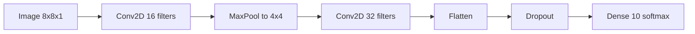
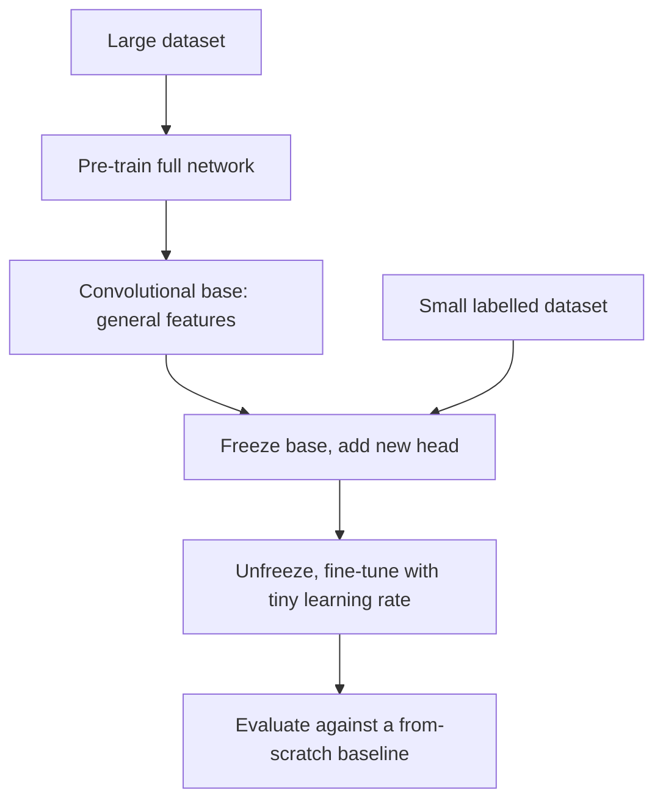
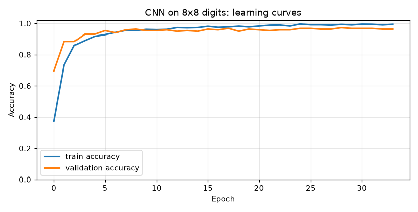
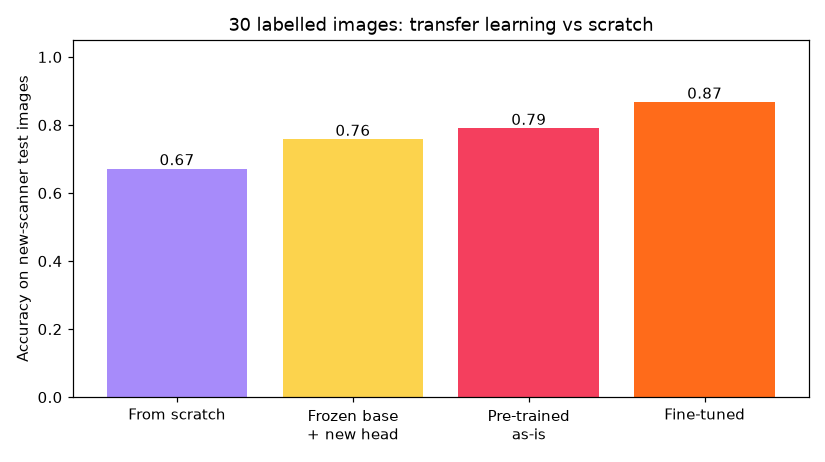

# Session 3 · Mastering the Keras API for Model Development

[](https://colab.research.google.com/github/Hamnakhan123/Generative-AI/blob/main/04-ai-architecture-and-agents/code/session-03-keras-api-model-development.ipynb)

> 🧭 [Generative AI](../README.md) › [Track 4 · AI Architecture and Agents](README.md) › **Session 3**
>
> ⏱️ **Estimated time:** 2 hours · 📋 **Prerequisites:** Previous session

[⬅ Previous](session-02-tensorflow-deep-learning-operations.md) · [🏠 Track home](README.md) · [Next ➡](session-04-scalable-deployment.md)

---

## 🎯 Learning objectives

- Build models with the three **Keras APIs**: Sequential, Functional and Subclassing.
- Describe how to build **CNNs** (convolution, pooling) and **RNNs** (LSTM/GRU) in Keras.
- Apply **transfer learning**: feature extraction with a frozen base, then fine-tuning.
- Use **callbacks** (EarlyStopping) and **evaluate** models with accuracy, confusion matrices, precision, recall and baselines.

## 📖 Concepts

### 1. Keras in one paragraph

**Keras** is the high-level API of TensorFlow (Keras 3 can also run on JAX or PyTorch). You describe layers, then call `compile` (optimizer + loss + metrics), `fit` (train), `evaluate` (test) and `predict` (use). Under the hood it runs the `GradientTape` loop you wrote in Session 2.

> 🧠 **Analogy — LEGO.** Layers are LEGO bricks. Sequential is a single tower; Functional lets you build bridges with branches and joins; Subclassing is moulding your own custom brick.

| API | Use when | Limitation |
|---|---|---|
| **Sequential** | A plain stack, one input, one output | No branches, no multiple inputs |
| **Functional** | Multiple inputs/outputs, shared layers, skip connections | Graph must be static |
| **Subclassing** | Custom control flow in `call()`, research models | Harder to inspect and save |

### 2. Convolutional Neural Networks (CNNs)

A **convolution** slides a small filter (e.g. 3×3) over the image and records how strongly each patch matches it. Early filters learn edges; deeper ones learn strokes, shapes and objects.

| Layer | Job | Typical setting |
|---|---|---|
| `Conv2D(filters, kernel)` | Detect local patterns | 32–256 filters, 3×3, ReLU |
| `MaxPooling2D(2)` | Halve width and height, keep strongest signal | After 1–2 conv layers |
| `Flatten` / `GlobalAveragePooling2D` | Turn feature maps into a vector | Before the classifier |
| `Dropout(0.3)` | Randomly switch off units in training to reduce overfitting | Before dense layers |
| `Dense(classes, softmax)` | Output probabilities | Last layer |

> 🧠 **Analogy — a torch in a dark room.** Each filter is a torch with a stencil. You sweep it across the wall; it glows wherever the wall matches the stencil.

### 3. Recurrent Neural Networks (RNNs)

An RNN reads a sequence **one step at a time** and carries a **hidden state** (memory). Plain RNNs forget quickly; **LSTM** adds gates (forget, input, output) and a cell state that can keep information for longer; **GRU** is a lighter version with two gates. Input shape is `(batch, timesteps, features)`.

Use RNNs for **short, streaming sequences** (sensor data, small time series, on-device text). For long text, transformers (Session 1) usually win.

### 4. Transfer learning

Training a big network from zero needs a lot of labelled data. **Transfer learning** reuses a network trained on a large dataset (e.g. ImageNet: 1.2 million images) for your smaller task.

| Strategy | What you train | When |
|---|---|---|
| **Use as-is** | Nothing | Same classes, similar images |
| **Feature extraction** | Freeze the base (`base.trainable = False`), train a new head | Very little data, new classes |
| **Fine-tuning** | Unfreeze some/all layers, retrain with a **tiny learning rate** (1e-4 to 1e-5) | After feature extraction, or when the data look different |

In Keras the pre-trained bases live in `keras.applications` (MobileNetV2, ResNet50, EfficientNet…):

```python
base = keras.applications.MobileNetV2(input_shape=(224, 224, 3), include_top=False, weights="imagenet")
base.trainable = False
model = keras.Sequential([base, layers.GlobalAveragePooling2D(), layers.Dense(5, activation="softmax")])
```

(Weights download on first use; in Colab this takes seconds. The mini project shows the same idea fully offline.)

> 🧠 **Analogy — a trained cook changing cuisine.** A chef trained in Pakistani cooking already knows knife skills and heat control (the frozen base). Learning Thai food needs only new recipes (the new head) and a little adjustment of habits (fine-tuning), not cooking school from scratch.

### 5. Evaluating models in Keras

| Tool | Tells you |
|---|---|
| `validation_split` / validation data | Overfitting: training accuracy rises while validation falls |
| `EarlyStopping(restore_best_weights=True)` | Stops when validation stops improving and keeps the best weights |
| `model.evaluate(X_test, y_test)` | Final loss and metrics on unseen data |
| **Confusion matrix** | Which classes are mixed up |
| **Precision / recall / F1** | Precision: of predicted X, how many were X. Recall: of real X, how many we found |
| **Baseline** | A trivial rule (majority class, "same as yesterday"); your model must beat it |

## 🪜 Step-by-step: the Keras workflow

1. **Prepare data**: scale (0–1 or standardise), add channel axis for images, split train/test.
2. **Define** the model (Sequential/Functional).
3. **Compile**: `optimizer="adam"`, loss matched to the output, `metrics=["accuracy"]`.
4. **Fit** with `validation_split` and callbacks.
5. **Evaluate** on the test set; inspect the confusion matrix; compare with a baseline.
6. **Improve and save**: augmentation, dropout, transfer learning; then `model.save("model.keras")` (Session 4 exports for serving).

## 🧭 Diagrams





## 💻 Worked examples (basic → advanced)

### Example 1 (basic) — Three APIs, one model

```python
# file: session-03_three_apis.py
"""
Session 3 · Example 1 — One model, three Keras APIs: Sequential, Functional and Subclassing.

All three build the same 64 -> 32 -> 10 classifier. Pick Sequential for plain
stacks, Functional for branches/multiple inputs, Subclassing for custom logic.

Run:  python session-03_three_apis.py
"""
import os
os.environ["TF_CPP_MIN_LOG_LEVEL"] = "3"
import numpy as np
import keras
from keras import layers

keras.utils.set_random_seed(0)

# 1) Sequential: a simple stack of layers
seq = keras.Sequential([
    keras.Input(shape=(64,)),
    layers.Dense(32, activation="relu"),
    layers.Dense(10, activation="softmax"),
], name="sequential_api")

# 2) Functional: layers are called on tensors, so graphs can branch and merge
inp = keras.Input(shape=(64,))
h = layers.Dense(32, activation="relu")(inp)
out = layers.Dense(10, activation="softmax")(h)
func = keras.Model(inp, out, name="functional_api")

# 3) Subclassing: write call() yourself (custom control flow allowed)
class Classifier(keras.Model):
    def __init__(self):
        super().__init__(name="subclassed_api")
        self.hidden = layers.Dense(32, activation="relu")
        self.out = layers.Dense(10, activation="softmax")

    def call(self, x, training=False):
        return self.out(self.hidden(x))

sub = Classifier(); sub(np.zeros((1, 64), "float32"))   # build by calling once

for m in (seq, func, sub):
    print(f"{m.name:16s} params = {m.count_params():,}")
print("Check: 64*32+32 + 32*10+10 =", 64 * 32 + 32 + 32 * 10 + 10)

# 4) A Functional model Sequential cannot express: two inputs, one output
text = keras.Input(shape=(20,), name="review_features")
meta = keras.Input(shape=(3,), name="price_stars_days")
merged = layers.concatenate([layers.Dense(16, activation="relu")(text),
                             layers.Dense(4, activation="relu")(meta)])
score = layers.Dense(1, activation="sigmoid", name="will_return")(merged)
multi = keras.Model([text, meta], score, name="two_input_model")
print("\nTwo-input model layers:")
for lyr in multi.layers:
    print(f"  {lyr.name:18s} -> output shape {lyr.output.shape}")
pred = multi.predict([np.ones((2, 20)), np.ones((2, 3))], verbose=0)
print("Prediction shape for 2 customers:", pred.shape)
```

**Output**

```text
sequential_api   params = 2,410
functional_api   params = 2,410
subclassed_api   params = 2,410
Check: 64*32+32 + 32*10+10 = 2410

Two-input model layers:
  review_features    -> output shape (None, 20)
  price_stars_days   -> output shape (None, 3)
  dense_6            -> output shape (None, 16)
  dense_7            -> output shape (None, 4)
  concatenate        -> output shape (None, 20)
  will_return        -> output shape (None, 1)
Prediction shape for 2 customers: (2, 1)
```

**Reading it:** all three styles give 2,410 parameters (weights + biases), matching the hand count. The two-input model joins review features and price/stars/days, which only the Functional (or Subclassing) API can express.

### Example 2 (intermediate) — CNN with evaluation

```python
# file: session-03_cnn_digits.py
"""
Session 3 · Example 2 — A CNN in Keras on handwritten digits, with proper evaluation.

Uses scikit-learn's built-in 8x8 digits (1,797 images, no download needed).
Shows: Conv2D + pooling, compile/fit with a validation split, EarlyStopping,
then evaluate(), a confusion matrix and per-class precision/recall.

Run:  python session-03_cnn_digits.py
Creates: session-03_cnn_training.png
"""
import os
os.environ["TF_CPP_MIN_LOG_LEVEL"] = "3"
import numpy as np
import keras
from keras import layers
from sklearn.datasets import load_digits
from sklearn.model_selection import train_test_split
from sklearn.metrics import confusion_matrix, classification_report
import matplotlib
matplotlib.use("Agg")
import matplotlib.pyplot as plt

keras.utils.set_random_seed(42)
X, y = load_digits(return_X_y=True)
X = (X / 16.0).reshape(-1, 8, 8, 1).astype("float32")      # scale 0..1, add channel axis
X_tr, X_te, y_tr, y_te = train_test_split(X, y, test_size=0.2, random_state=42, stratify=y)
print("train", X_tr.shape, "test", X_te.shape)

model = keras.Sequential([
    keras.Input(shape=(8, 8, 1)),
    layers.Conv2D(16, 3, padding="same", activation="relu"),   # 16 small pattern detectors
    layers.MaxPooling2D(2),                                     # 8x8 -> 4x4
    layers.Conv2D(32, 3, padding="same", activation="relu"),
    layers.Flatten(),
    layers.Dropout(0.3),
    layers.Dense(10, activation="softmax"),
])
model.compile(optimizer="adam", loss="sparse_categorical_crossentropy", metrics=["accuracy"])
print(f"CNN parameters: {model.count_params():,}")

stop = keras.callbacks.EarlyStopping(monitor="val_loss", patience=5, restore_best_weights=True)
hist = model.fit(X_tr, y_tr, validation_split=0.15, epochs=60, batch_size=32, callbacks=[stop], verbose=0)
print("epochs run:", len(hist.history["loss"]), "(early stopping)")

loss, acc = model.evaluate(X_te, y_te, verbose=0)
print(f"test loss {loss:.3f} | test accuracy {acc:.3f}")

pred = model.predict(X_te, verbose=0).argmax(1)
cm = confusion_matrix(y_te, pred)
print("\nConfusion matrix (rows = true digit, cols = predicted):")
print("    " + " ".join(f"{d:3d}" for d in range(10)))
for d, row in enumerate(cm):
    print(f"{d:3d} " + " ".join(f"{v:3d}" for v in row))
print("\n" + classification_report(y_te, pred, digits=3))

plt.figure(figsize=(7.5, 3.8))
plt.plot(hist.history["accuracy"], label="train accuracy", lw=2)
plt.plot(hist.history["val_accuracy"], label="validation accuracy", lw=2)
plt.xlabel("Epoch"); plt.ylabel("Accuracy"); plt.ylim(0, 1.02)
plt.title("CNN on 8x8 digits: learning curves"); plt.legend(); plt.grid(alpha=.3)
plt.tight_layout(); plt.savefig("session-03_cnn_training.png", dpi=110)
print("Saved chart: session-03_cnn_training.png")
```

**Output**

```text
train (1437, 8, 8, 1) test (360, 8, 8, 1)
CNN parameters: 9,930
epochs run: 34 (early stopping)
test loss 0.082 | test accuracy 0.983

Confusion matrix (rows = true digit, cols = predicted):
      0   1   2   3   4   5   6   7   8   9
  0  35   0   0   0   1   0   0   0   0   0
  1   0  36   0   0   0   0   0   0   0   0
  2   0   0  35   0   0   0   0   0   0   0
  3   0   0   0  36   0   1   0   0   0   0
  4   0   0   0   0  36   0   0   0   0   0
  5   0   0   0   0   0  37   0   0   0   0
  6   0   0   0   0   0   0  35   0   1   0
  7   0   0   0   0   0   0   0  36   0   0
  8   0   2   0   0   0   0   0   1  32   0
  9   0   0   0   0   0   0   0   0   0  36

              precision    recall  f1-score   support

           0      1.000     0.972     0.986        36
           1      0.947     1.000     0.973        36
           2      1.000     1.000     1.000        35
           3      1.000     0.973     0.986        37
           4      0.973     1.000     0.986        36
           5      0.974     1.000     0.987        37
           6      1.000     0.972     0.986        36
           7      0.973     1.000     0.986        36
           8      0.970     0.914     0.941        35
           9      1.000     1.000     1.000        36

    accuracy                          0.983       360
   macro avg      0.984     0.983     0.983       360
weighted avg      0.984     0.983     0.983       360

Saved chart: session-03_cnn_training.png
```



**Reading it:** EarlyStopping halted training once validation loss stopped improving. Test accuracy is about 98%. The confusion matrix shows the main confusion: some **8s** read as **1s**, so recall for 8 is the lowest. That tells you where to add data.

### Example 3 (intermediate) — LSTM forecasting vs a baseline

```python
# file: session-03_lstm_forecast.py
"""
Session 3 · Example 3 — An RNN (LSTM) in Keras that forecasts next-hour electricity demand.

Synthetic hourly demand = daily cycle + weekly cycle + noise. The model reads
the last 24 hours and predicts the next hour. We compare it with the naive
"same as last hour" baseline: a model is only useful if it beats the baseline.

Run:  python session-03_lstm_forecast.py
"""
import os
os.environ["TF_CPP_MIN_LOG_LEVEL"] = "3"
import numpy as np
import keras
from keras import layers

keras.utils.set_random_seed(1)
rng = np.random.default_rng(1)

hours = np.arange(24 * 60)                                   # 60 days of hourly data
demand = (500 + 120 * np.sin(2 * np.pi * (hours - 6) / 24)   # daily peak in the afternoon
          + 40 * np.sin(2 * np.pi * hours / (24 * 7))        # weekly pattern
          + rng.normal(0, 15, hours.size))
mu, sd = demand[:24 * 48].mean(), demand[:24 * 48].std()
z = (demand - mu) / sd

WINDOW = 24
X = np.stack([z[i:i + WINDOW] for i in range(len(z) - WINDOW)])[..., None]
y = z[WINDOW:]
split = 24 * 48 - WINDOW                                      # first 48 days train, last 12 test
X_tr, y_tr, X_te, y_te = X[:split], y[:split], X[split:], y[split:]
print("windows: train", X_tr.shape, "test", X_te.shape)

model = keras.Sequential([
    keras.Input(shape=(WINDOW, 1)),
    layers.LSTM(32),            # reads the 24 hours in order, keeps a memory state
    layers.Dense(1),
])
model.compile(optimizer=keras.optimizers.Adam(0.005), loss="mse", metrics=["mae"])
model.fit(X_tr, y_tr, epochs=15, batch_size=64, validation_split=0.1, verbose=0)

pred = model.predict(X_te, verbose=0).ravel() * sd + mu
true = y_te * sd + mu
naive = X_te[:, -1, 0] * sd + mu                               # "same as last hour"
mae = lambda a, b: float(np.mean(np.abs(a - b)))
print(f"LSTM  MAE: {mae(pred, true):6.1f} MW")
print(f"Naive MAE: {mae(naive, true):6.1f} MW")
print(f"LSTM is {100 * (1 - mae(pred, true) / mae(naive, true)):.0f}% better than the naive baseline")
print("\nFirst 6 test hours (true vs LSTM):")
for t, p in zip(true[:6], pred[:6]):
    print(f"  {t:6.1f}  {p:6.1f}")
print(f"\nLSTM parameters: {model.count_params():,}  (4 gates x (32*(32+1)+32) + dense)")
```

**Output**

```text
windows: train (1128, 24, 1) test (288, 24, 1)
LSTM  MAE:   15.7 MW
Naive MAE:   26.7 MW
LSTM is 41% better than the naive baseline

First 6 test hours (true vs LSTM):
   322.9   351.5
   329.7   350.5
   399.2   358.0
   360.4   386.3
   421.4   402.0
   430.1   433.2

LSTM parameters: 4,385  (4 gates x (32*(32+1)+32) + dense)
```

**Reading it:** the LSTM reads 24 hours and cuts the error by about 40% compared with "same as last hour". Always report a baseline: an impressive-sounding MAE means nothing without one.

## 🏗️ Real-life problem: a new scanner with only 30 labels (full solution)

**Scenario.** A bank's cheque reader was trained on clean digit scans. A new branch installs a cheaper scanner whose images are blurred, shifted and noisy, and staff have labelled only **3 examples per digit**. Should we retrain from scratch, reuse the old model, or fine-tune it? We test all options on 869 held-out new-scanner images.

```python
# file: session-03_project_transfer_learning.py
"""
Session 3 · Mini project (full solution) — Transfer learning when labels are scarce.

Real-life problem: a bank's cheque reader was trained on thousands of clean
digit scans. A new branch installs a cheaper scanner whose images are noisy,
blurred and shifted, and only 3 labelled examples per digit exist (30 images).
We:
  1. pre-train a CNN on the clean scans (the "source" task),
  2. measure it as-is, then reuse its frozen base with a new head,
  3. fine-tune the whole pre-trained network with a tiny learning rate,
  4. compare against training the same CNN from scratch on the 30 images.
This is what keras.applications (MobileNetV2, ResNet50 ... pre-trained on
ImageNet) does at large scale.

Run:  python session-03_project_transfer_learning.py
Creates: session-03_transfer_learning.png
"""
import os
os.environ["TF_CPP_MIN_LOG_LEVEL"] = "3"
import numpy as np
import keras
from keras import layers
from sklearn.datasets import load_digits
from sklearn.model_selection import train_test_split
import matplotlib
matplotlib.use("Agg")
import matplotlib.pyplot as plt

keras.utils.set_random_seed(7)
rng = np.random.default_rng(7)
X, y = load_digits(return_X_y=True)
X = (X / 16.0).reshape(-1, 8, 8, 1).astype("float32")
X_src, X_new, y_src, y_new = train_test_split(X, y, test_size=0.5, random_state=7, stratify=y)


def new_scanner(imgs):
    """Simulate the cheap scanner: blur, shift by one pixel, add noise, lower contrast."""
    out = imgs.copy()
    out = (out + np.roll(out, 1, axis=2) + np.roll(out, 1, axis=1)) / 3     # blur + smear
    out = np.roll(out, rng.choice([-1, 1]), axis=2)                          # shift
    out = 0.8 * out + 0.1 + rng.normal(0, 0.08, out.shape)                   # contrast + noise
    return np.clip(out, 0, 1).astype("float32")


X_new = new_scanner(X_new)
few = np.concatenate([np.where(y_new == d)[0][:3] for d in range(10)])      # 3 per digit
test = np.setdiff1d(np.arange(len(y_new)), few)
print(f"clean source scans: {len(y_src)} | new-scanner labelled: {len(few)} | new-scanner test: {len(test)}")


def conv_base():
    return keras.Sequential([
        keras.Input(shape=(8, 8, 1)),
        layers.Conv2D(16, 3, padding="same", activation="relu"),
        layers.MaxPooling2D(2),
        layers.Conv2D(32, 3, padding="same", activation="relu"),
        layers.Flatten(),
        layers.Dense(64, activation="relu"),
    ], name="conv_base")


def acc(model):
    return float(model.evaluate(X_new[test], y_new[test], verbose=0)[1])

# 1) Pre-train on clean scans, with augmentation (shifts + noise) so features are robust
base = conv_base()
augment = keras.Sequential([layers.RandomTranslation(0.15, 0.15), layers.GaussianNoise(0.1)])  # train-time only
source_model = keras.Sequential([keras.Input(shape=(8, 8, 1)), augment, base, layers.Dense(10, activation="softmax")])
source_model.compile("adam", "sparse_categorical_crossentropy", metrics=["accuracy"])
source_model.fit(X_src, y_src, epochs=60, batch_size=32, verbose=0)
acc_asis = acc(source_model)
print(f"0) clean-scan model used as-is on the new scanner: {acc_asis:.3f}")

# 2) Feature extraction: freeze the base, train only a new head on 30 images
base.trainable = False
tl = keras.Sequential([base, layers.Dense(10, activation="softmax")])
tl.compile("adam", "sparse_categorical_crossentropy", metrics=["accuracy"])
tl.fit(X_new[few], y_new[few], epochs=150, batch_size=10, verbose=0)
acc_frozen = acc(tl)
print(f"1) frozen base + new head : {acc_frozen:.3f}")

# 3) Fine-tuning: start from the full pre-trained model (same 10 classes, so keep its head),
#    unfreeze everything and train on the 30 new images with a much smaller learning rate
base.trainable = True
source_model.compile(keras.optimizers.Adam(1e-4), "sparse_categorical_crossentropy", metrics=["accuracy"])
source_model.fit(X_new[few], y_new[few], epochs=60, batch_size=10, verbose=0)
acc_ft = acc(source_model)
print(f"2) fine-tuned full model  : {acc_ft:.3f}")

# 4) Baseline: same architecture, random weights, same 30 images
scratch = keras.Sequential([conv_base(), layers.Dense(10, activation="softmax")])
scratch.compile("adam", "sparse_categorical_crossentropy", metrics=["accuracy"])
scratch.fit(X_new[few], y_new[few], epochs=150, batch_size=10, verbose=0)
acc_scratch = acc(scratch)
print(f"3) from scratch (baseline): {acc_scratch:.3f}")
print(f"\nFine-tuned transfer vs scratch: {100 * (acc_ft - acc_scratch):+.1f} percentage points")

names = ["From scratch", "Frozen base\n+ new head", "Pre-trained\nas-is", "Fine-tuned"]
vals = [acc_scratch, acc_frozen, acc_asis, acc_ft]
plt.figure(figsize=(7.5, 4.2))
bars = plt.bar(names, vals, color=["#A78BFA", "#FCD34D", "#F43F5E", "#FF6B1A"])
for b_, v in zip(bars, vals):
    plt.text(b_.get_x() + b_.get_width() / 2, v + 0.01, f"{v:.2f}", ha="center")
plt.ylim(0, 1.05); plt.ylabel("Accuracy on new-scanner test images")
plt.title("30 labelled images: transfer learning vs scratch")
plt.tight_layout(); plt.savefig("session-03_transfer_learning.png", dpi=110)
print("Saved chart: session-03_transfer_learning.png")
```

**Output**

```text
clean source scans: 898 | new-scanner labelled: 30 | new-scanner test: 869
0) clean-scan model used as-is on the new scanner: 0.791
1) frozen base + new head : 0.758
2) fine-tuned full model  : 0.868
3) from scratch (baseline): 0.672

Fine-tuned transfer vs scratch: +19.6 percentage points
Saved chart: session-03_transfer_learning.png
```



**What to notice:**

- Training from scratch on 30 images reaches only about 67%.
- Pre-training **with augmentation** (random shifts and noise) made the old model fairly robust even before seeing the new scanner.
- Replacing the head threw away a useful trained classifier; since the classes are the same, **fine-tuning the whole model with a tiny learning rate** was best (about +20 points over scratch). Transfer learning is not one recipe: try the options and measure on the target data.

## ⚠️ Common mistakes

| Mistake | Fix |
|---|---|
| Wrong input shape for Conv2D | Images need `(H, W, channels)`; add the channel axis |
| `softmax` output with `binary_crossentropy` for 10 classes | Use sparse categorical cross-entropy |
| Fine-tuning with the normal learning rate | Use 1e-4 or lower, or you destroy the pre-trained features |
| Forgetting to **recompile** after changing `trainable` | Always recompile |

## ✅ Best practices

- Use **EarlyStopping** with `restore_best_weights=True`.
- For images with little data: **pre-trained base + augmentation**, then fine-tune.
- Report a **confusion matrix and per-class recall**, not only accuracy.

## 🧪 Lab / practice tasks

**Task 1 · 🟢 Easy** — Add a third Dense layer (16 units) to the Sequential model in Example 1 and predict the new parameter count before running.

<details><summary>💡 Hint</summary>

Each Dense adds inputs × units + units.

</details>

**Task 2 · 🟢 Easy** — In Example 2, remove the Dropout layer. Does test accuracy change? Look at the gap between curves.

<details><summary>💡 Hint</summary>

Compare train vs validation accuracy at the end.

</details>

**Task 3 · 🟡 Medium** — Replace `LSTM(32)` with `GRU(32)` in Example 3 and compare MAE and parameter count.

<details><summary>💡 Hint</summary>

GRU has 3 gate blocks instead of 4.

</details>

**Task 4 · 🟡 Medium** — Turn the CNN into the Functional API without changing behaviour.

<details><summary>💡 Hint</summary>

`inp = keras.Input(...)`, chain `x = layer(x)`, then `keras.Model(inp, out)`.

</details>

**Task 5 · 🔴 Challenge** — In the mini project, try 1, 3 and 10 labels per digit. Plot scratch vs fine-tuned accuracy against labels per digit.

<details><summary>💡 Hint</summary>

Wrap the experiment in a function of `k`; the gap usually shrinks as data grows.

</details>


<details><summary>✅ Lab solutions and model answers</summary>

**Task 1:** 64→32 (2,080) + 32→16 (528) + 16→10 (170) = **2,778** parameters.

**Task 2:** without dropout the training accuracy reaches ~100% faster and the train/validation gap widens slightly; test accuracy usually drops by a point or stays similar because the dataset is easy. Dropout matters more on bigger, noisier data.

**Task 3:** GRU(32) has 3 × (32·(1+32) + 32) + extra bias terms ≈ 3,360 parameters vs 4,352 for LSTM; MAE is similar (both beat the baseline). Choose GRU when speed/memory matter.

**Task 4:**

```python
inp = keras.Input(shape=(8, 8, 1))
x = layers.Conv2D(16, 3, padding="same", activation="relu")(inp)
x = layers.MaxPooling2D(2)(x)
x = layers.Conv2D(32, 3, padding="same", activation="relu")(x)
x = layers.Dropout(0.3)(layers.Flatten()(x))
model = keras.Model(inp, layers.Dense(10, activation="softmax")(x))
```

**Task 5:** expected pattern: with 1 label per digit scratch is near guessing while fine-tuning stays high; with 10 per digit scratch catches up a lot. Transfer learning matters most when labels are scarce.

</details>

## ✅ Quick quiz

**Q1. Which Keras API is needed for a model with two inputs?**

- A) Only Subclassing
- B) Sequential only
- C) Functional (or Subclassing)
- D) Neither

<details><summary>Show answer</summary>

✅ **C) Functional (or Subclassing)** — Sequential handles one input stack.

</details>

**Q2. What does MaxPooling2D(2) do to a 8×8 feature map?**

- A) Removes channels
- B) Makes it 4×4
- C) Makes it 16×16
- D) Adds filters

<details><summary>Show answer</summary>

✅ **B) Makes it 4×4** — Halves width and height.

</details>

**Q3. In transfer learning, base.trainable = False means...**

- A) The base is deleted
- B) It is retrained from scratch
- C) Its weights are not updated during training
- D) It trains faster with a bigger LR

<details><summary>Show answer</summary>

✅ **C) Its weights are not updated during training** — Frozen feature extractor.

</details>

**Q4. Why use a tiny learning rate when fine-tuning?**

- A) To increase dropout
- B) Because Keras requires it
- C) To avoid destroying useful pre-trained weights
- D) To finish faster

<details><summary>Show answer</summary>

✅ **C) To avoid destroying useful pre-trained weights** — Small adjustments only.

</details>

**Q5. Validation accuracy falls while training accuracy rises. This is...**

- A) Perfect training
- B) A data-loading bug always
- C) Overfitting
- D) Underfitting

<details><summary>Show answer</summary>

✅ **C) Overfitting** — Use dropout, augmentation, EarlyStopping.

</details>


## 📝 Summary / cheat-sheet

- Workflow: **define → compile → fit → evaluate → predict → save**.
- APIs: **Sequential** (stack), **Functional** (graphs, multi-input), **Subclassing** (custom `call`).
- **CNN** = Conv2D + pooling + dense head; **RNN/LSTM/GRU** = sequence with memory.
- **Transfer learning**: as-is → frozen base + new head → fine-tune with tiny LR; always compare with scratch.
- Evaluate with **validation curves, EarlyStopping, confusion matrix, precision/recall and a baseline**.

**Viva / interview questions**

1. Compare the Sequential, Functional and Subclassing APIs with examples.
2. Explain convolution and pooling to a non-technical person.
3. Why do LSTMs remember longer than simple RNNs?
4. Describe the two stages of transfer learning and why the learning rate changes.
5. Your model has 99% training and 70% validation accuracy. What do you do?
6. Why is a baseline important when reporting a model's error?

---

[⬅ Previous](session-02-tensorflow-deep-learning-operations.md) · [🏠 Track home](README.md) · [Next ➡](session-04-scalable-deployment.md)

<sub>Prepared by **Hamna Zahid Khan**, Junior Lecturer</sub>
