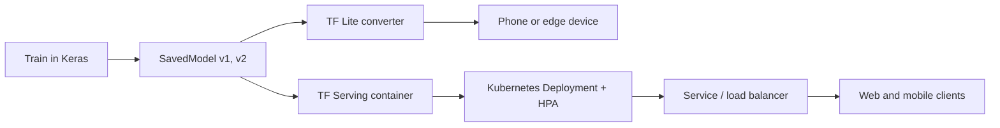
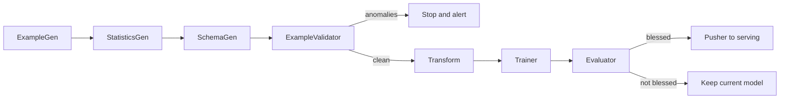
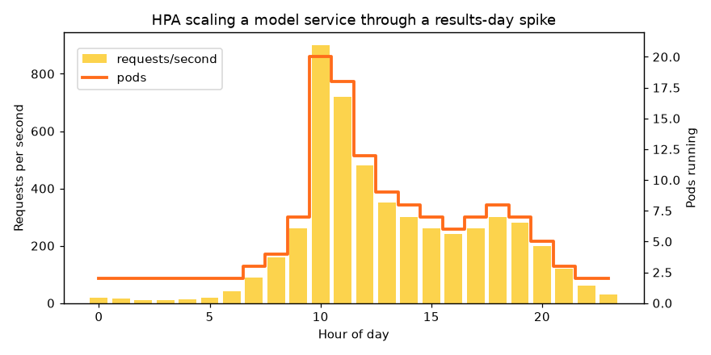

# Session 4 · Scalable Deployment: Serving, Lite, Kubernetes and TFX

[](https://colab.research.google.com/github/Hamnakhan123/Generative-AI/blob/main/04-ai-architecture-and-agents/code/session-04-scalable-deployment.ipynb)

> 🧭 [Generative AI](../README.md) › [Track 4 · AI Architecture and Agents](README.md) › **Session 4**
>
> ⏱️ **Estimated time:** 2 hours · 📋 **Prerequisites:** Previous session

[⬅ Previous](session-03-keras-api-model-development.md) · [🏠 Track home](README.md) · [Next ➡](session-05-ai-pipelines-and-reinforcement-learning.md)

---

## 🎯 Learning objectives

- Describe the architecture of **scalable model deployment**: SavedModel, **TF Serving**, **TF Lite**, containers and **Kubernetes**.
- Export a model, serve it over **REST/gRPC**, and convert it to TF Lite with **quantisation**.
- Explain how Kubernetes **autoscaling** keeps latency low and cost down.
- Describe the key components of a **TFX pipeline** (ingestion, validation, transformation, training, evaluation, serving) and its role in the AI lifecycle.
- Compare TensorFlow deployment tools with **alternative stacks** (TorchServe, ONNX Runtime, Triton, FastAPI, managed cloud services).

## 📖 Concepts

### 1. From notebook to product

A model in a notebook helps one person. A deployed model answers thousands of requests per second, reliably, and is updated safely. That needs a **save format** (SavedModel, `.tflite`, ONNX), a **server** (TF Serving, TorchServe, Triton, FastAPI), a **place to run** (containers, Kubernetes, phones), **scaling** (replicas, autoscaling) and **safe updates** (pipelines, versioning, monitoring).

> 🧠 **Analogy — a restaurant chain.** The recipe card is the **SavedModel**. The kitchen that cooks orders is **TF Serving**. Each branch is a **container**. Head office opening and closing branches as crowds change is **Kubernetes**. A food truck with a cut-down menu is **TF Lite**. The quality-control process that tests every new recipe before branches use it is **TFX**.

### 2. SavedModel and TF Serving

- **SavedModel** = graph + weights + **signatures** (named input/output functions). It loads without your Python code.
- **TF Serving** is a high-performance C++ server. It watches a folder like `models/iris/1/`, `models/iris/2/` and **hot-swaps** to the newest version with no downtime.
- APIs: **REST** on port 8501 (`POST /v1/models/iris:predict` with `{"instances": [...]}`) and **gRPC** on 8500 (faster, binary).
- **Batching**: it can group many small requests into one GPU batch for throughput.
- Put **preprocessing inside the model** (e.g. a `Normalization` layer) so every client gets identical treatment: no training/serving skew.

### 3. TF Lite (LiteRT) for edge devices

| Technique | Size | Speed | Accuracy |
|---|---|---|---|
| Float32 `.tflite` | 1× | Fast | Same as Keras |
| **Dynamic-range quantisation** (int8 weights) | ~¼ | Faster on CPU | Usually almost unchanged |
| Full integer quantisation (needs sample data) | ~¼ | Fastest; runs on Edge TPU/NPUs | Small drop possible |
| Float16 | ~½ | GPU-friendly | Almost unchanged |

Edge benefits: works **offline**, **low latency**, **privacy** (data stays on the phone), no server cost. Google now ships the interpreter as **LiteRT** (`ai_edge_litert` package); `tf.lite.Interpreter` still works but prints a deprecation warning.

### 4. Containers and Kubernetes

- **Docker** packages the server, model and dependencies into one image that runs the same everywhere.
- **Kubernetes (K8s)** runs many containers across machines:

| K8s object | Job |
|---|---|
| **Pod** | One running copy of the container |
| **Deployment** | Keeps N pods alive, rolls out new versions gradually |
| **Service / Ingress** | One stable address that load-balances across pods |
| **HorizontalPodAutoscaler (HPA)** | Adds/removes pods to hold CPU (or custom metrics) near a target |
| **Readiness probe** | Sends traffic only to pods whose model has loaded |
| **PersistentVolume** | Shared storage for model versions |

HPA rule: `desired = ceil(current_pods × current_utilisation ÷ target_utilisation)`, kept within min/max.

### 5. TFX: the production pipeline

**TensorFlow Extended (TFX)** turns "train a model" into a repeatable, audited pipeline (run by Airflow, Kubeflow Pipelines or Vertex AI):

| Component | Job |
|---|---|
| **ExampleGen** | Ingest data and split train/eval |
| **StatisticsGen** | Compute feature statistics (TF Data Validation) |
| **SchemaGen** | Infer expected types, ranges, missing-value rules |
| **ExampleValidator** | Flag anomalies, skew and drift against the schema |
| **Transform** | Feature engineering that is reused identically at serving time (TF Transform) |
| **Trainer / Tuner** | Train (and tune) the model |
| **Evaluator** | Compute metrics (TF Model Analysis, also per slice) and **bless** the model only if it beats the current one |
| **InfraValidator** | Check the model actually loads and serves |
| **Pusher** | Copy the blessed SavedModel to the serving location |

**Lifecycle support:** every run stores artefacts and metadata (**ML Metadata**), so you can answer "which data and code produced the model now in production?". Combined with monitoring, the pipeline re-runs on new data: **continuous training**.

### 6. Comparing deployment stacks

| Stack | Strength | Watch out |
|---|---|---|
| **TF Serving** | Fast, versioning, batching, gRPC for TF models | TF models only |
| **TF Lite / LiteRT** | Phones, microcontrollers, offline | Limited op set; convert and test |
| **ONNX Runtime** | One format from many frameworks; fast CPU inference | Conversion step can fail for exotic ops |
| **NVIDIA Triton** | Multi-framework, GPU, dynamic batching, ensembles | More setup |
| **FastAPI + model in Python** | Simplest, flexible, custom logic | You build batching, versioning and scaling yourself |
| **Managed (Vertex AI, SageMaker, Azure ML)** | Autoscaling and monitoring built in | Cost and lock-in |
| **vLLM / Ollama / TGI** | Serving large language models | LLM-specific (Session 7) |

## 🪜 Step-by-step: shipping a model

1. **Bake preprocessing into the model**; train and evaluate.
2. **Export** a versioned SavedModel: `model.export("models/iris/1")`.
3. **Test locally** with `tf.saved_model.load` and with Docker TF Serving.
4. **Containerise**, push the image to a registry.
5. **Deploy on Kubernetes** with a Deployment, Service, readiness probe and HPA.
6. **Automate** retraining with a pipeline (TFX) that validates data and blesses models.
7. **Monitor** latency, errors, input drift and accuracy; roll back by pointing to the previous version.
8. For phones: **convert to TF Lite**, quantise, check accuracy, ship inside the app.

## 🧭 Diagrams





## 💻 Worked examples (basic → advanced)

### Example 1 (basic) — Export and serve a SavedModel

```python
# file: session-04_savedmodel_export.py
"""
Session 4 · Example 1 — Export a Keras model as a versioned SavedModel, the format TF Serving loads.

TF Serving loads folders like models/iris/1/ and answers POST /v1/models/iris:predict.
We export, reload without any Keras code (as a server would) and show the REST JSON.

Run:  python session-04_savedmodel_export.py
"""
import os, io, json, tempfile, contextlib
os.environ["TF_CPP_MIN_LOG_LEVEL"] = "3"
import numpy as np
import tensorflow as tf
import keras
from sklearn.datasets import load_iris

keras.utils.set_random_seed(3)
iris = load_iris()
X, y = iris.data.astype("float32"), iris.target
mean, std = X.mean(0), X.std(0)

# Put preprocessing INSIDE the model so clients can send raw measurements
model = keras.Sequential([
    keras.Input(shape=(4,), name="measurements"),
    keras.layers.Normalization(mean=mean, variance=std ** 2),
    keras.layers.Dense(16, activation="relu"),
    keras.layers.Dense(3, activation="softmax"),
])
model.compile("adam", "sparse_categorical_crossentropy", metrics=["accuracy"])
model.fit(X, y, epochs=200, verbose=0)
print(f"training accuracy: {model.evaluate(X, y, verbose=0)[1]:.3f}")

root = tempfile.mkdtemp()
export_dir = os.path.join(root, "models", "iris", "1")          # <model_name>/<version>
with contextlib.redirect_stdout(io.StringIO()):                  # silence the export log
    model.export(export_dir)
print("\nSavedModel folder (version 1):")
for dirpath, _, files in sorted(os.walk(export_dir)):
    rel = os.path.relpath(dirpath, root)
    for f in sorted(files):
        print(f"  {rel}/{f}")

# Reload with plain TensorFlow: no Keras class or training code needed
loaded = tf.saved_model.load(export_dir)
serve = loaded.signatures["serving_default"]
print("\nSignature inputs :", {k: v.shape for k, v in serve.structured_input_signature[1].items()})
print("Signature outputs:", {k: v.shape for k, v in serve.structured_outputs.items()})

flowers = [[5.1, 3.5, 1.4, 0.2], [6.7, 3.0, 5.2, 2.3]]
out = list(serve(tf.constant(flowers, dtype=tf.float32)).values())[0].numpy()

request = {"signature_name": "serving_default", "instances": flowers}
response = {"predictions": [[round(float(v), 4) for v in row] for row in out]}
print("\nREST request body  ->", json.dumps(request))
print("REST response body <-", json.dumps(response))
for f, p in zip(flowers, out):
    print(f"  {f} -> {iris.target_names[p.argmax()]} ({p.max():.0%})")

print("\nServe it:  docker run -p 8501:8501 -v \"$PWD/models/iris:/models/iris\" -e MODEL_NAME=iris tensorflow/serving")
```

**Output**

```text
training accuracy: 0.973

SavedModel folder (version 1):
  models/iris/1/fingerprint.pb
  models/iris/1/saved_model.pb
  models/iris/1/variables/variables.data-00000-of-00001
  models/iris/1/variables/variables.index

Signature inputs : {'measurements': TensorShape([None, 4])}
Signature outputs: {'output_0': TensorShape([None, 3])}

REST request body  -> {"signature_name": "serving_default", "instances": [[5.1, 3.5, 1.4, 0.2], [6.7, 3.0, 5.2, 2.3]]}
REST response body <- {"predictions": [[0.9989, 0.0011, 0.0], [0.0, 0.007, 0.9929]]}
  [5.1, 3.5, 1.4, 0.2] -> setosa (100%)
  [6.7, 3.0, 5.2, 2.3] -> virginica (99%)

Serve it:  docker run -p 8501:8501 -v "$PWD/models/iris:/models/iris" -e MODEL_NAME=iris tensorflow/serving
```

**Reading it:** the folder layout `models/iris/1/` is exactly what TF Serving expects. The reloaded model needs no Keras code, and because normalisation is inside the model, clients send raw measurements. The JSON shown is the real REST contract.

### Example 2 (intermediate) — TF Lite conversion and quantisation

```python
# file: session-04_tflite_convert.py
"""
Session 4 · Example 2 — Convert a Keras model to TensorFlow Lite, quantise it and run it with the interpreter.

TF Lite (LiteRT) runs models on phones and microcontrollers; dynamic-range
quantisation stores weights as int8 (about 4x smaller).

Run:  python session-04_tflite_convert.py
"""
import os, io, contextlib
os.environ["TF_CPP_MIN_LOG_LEVEL"] = "3"
import numpy as np
import tensorflow as tf
import keras
from sklearn.datasets import load_digits
from sklearn.model_selection import train_test_split

keras.utils.set_random_seed(5)
X, y = load_digits(return_X_y=True)
X = (X / 16.0).astype("float32")
X_tr, X_te, y_tr, y_te = train_test_split(X, y, test_size=0.25, random_state=5, stratify=y)

model = keras.Sequential([
    keras.Input(shape=(64,)),
    keras.layers.Dense(256, activation="relu"),
    keras.layers.Dense(128, activation="relu"),
    keras.layers.Dense(10, activation="softmax"),
])
model.compile("adam", "sparse_categorical_crossentropy", metrics=["accuracy"])
model.fit(X_tr, y_tr, epochs=25, batch_size=32, verbose=0)
keras_acc = model.evaluate(X_te, y_te, verbose=0)[1]
print(f"Keras model: {model.count_params():,} params | test accuracy {keras_acc:.4f}")


def convert(quantize):
    conv = tf.lite.TFLiteConverter.from_keras_model(model)
    if quantize:
        conv.optimizations = [tf.lite.Optimize.DEFAULT]      # dynamic-range int8 weights
    with contextlib.redirect_stdout(io.StringIO()):
        return conv.convert()


def tflite_predict(blob, data):
    interp = tf.lite.Interpreter(model_content=blob)
    inp = interp.get_input_details()[0]; out = interp.get_output_details()[0]
    interp.resize_tensor_input(inp["index"], data.shape); interp.allocate_tensors()
    interp.set_tensor(inp["index"], data); interp.invoke()
    return interp.get_tensor(out["index"])


keras_pred = model.predict(X_te, verbose=0).argmax(1)
print(f"\n{'format':22s} {'size KB':>8s} {'accuracy':>9s} {'agrees with Keras':>18s}")
sizes = {}
for name, q in [("TFLite float32", False), ("TFLite dynamic int8", True)]:
    blob = convert(q)
    pred = tflite_predict(blob, X_te).argmax(1)
    sizes[name] = len(blob) / 1024
    print(f"{name:22s} {sizes[name]:8.1f} {np.mean(pred == y_te):9.4f} {np.mean(pred == keras_pred):17.1%}")
print(f"\nQuantised model is {sizes['TFLite float32'] / sizes['TFLite dynamic int8']:.1f}x smaller.")

# Raw weight storage, for intuition
n = model.count_params()
print(f"Weights alone: {n * 4 / 1024:.1f} KB as float32 vs {n / 1024:.1f} KB as int8")
```

**Output**

```text
Keras model: 50,826 params | test accuracy 0.9733

format                  size KB  accuracy  agrees with Keras
TFLite float32            200.7    0.9733            100.0%
TFLite dynamic int8        57.7    0.9733            100.0%

Quantised model is 3.5x smaller.
Weights alone: 198.5 KB as float32 vs 49.6 KB as int8
```

**Reading it:** quantisation shrank the model about 3.5× (the file also stores graph structure, so it is a little less than the 4× weight saving) while every test prediction stayed identical. Always measure accuracy after converting.

### Example 3 (intermediate) — Kubernetes manifests

The file [`code/session-04_k8s_deployment.yaml`](code/session-04_k8s_deployment.yaml) holds three ready-to-apply objects for the iris model: a **Deployment** (2 TF Serving pods, CPU/memory requests and limits, a readiness probe on `/v1/models/iris`, a volume with the model versions), a **Service** of type LoadBalancer on port 8501, and an **HPA** (2–20 pods, target 70% CPU). Apply it with `kubectl apply -f session-04_k8s_deployment.yaml` on any cluster (minikube or kind work on a laptop).

### Example 4 (advanced) — Autoscaling through a traffic spike

```python
# file: session-04_autoscaling.py
"""
Session 4 · Example 3 — How a Kubernetes HorizontalPodAutoscaler sizes a model service over a day.

HPA rule: desired = ceil(pods * utilisation / target). One pod serves ~60 req/s at 100% CPU;
target 70%. We simulate a results-day spike and compare cost with a fixed fleet.

Run:  python session-04_autoscaling.py
Creates: session-04_autoscaling.png
"""
import math
import matplotlib
matplotlib.use("Agg")
import matplotlib.pyplot as plt

POD_CAPACITY_RPS = 60          # requests/second one pod can serve at 100% CPU
TARGET = 0.70                  # HPA target utilisation
MIN_PODS, MAX_PODS = 2, 20
COST_PER_POD_HOUR = 0.05       # USD, illustrative cloud price

# Requests per second each hour (results announced at 10:00 -> spike)
traffic = [20, 15, 10, 10, 12, 20, 40, 90, 160, 260, 900, 720, 480,
           350, 300, 260, 240, 260, 300, 280, 200, 120, 60, 30]

pods = MIN_PODS
history = []
print(f"{'hour':>4} {'rps':>5} {'util before':>12} {'pods':>5} {'util after':>11}")
for hour, rps in enumerate(traffic):
    util = rps / (pods * POD_CAPACITY_RPS)                       # what the HPA observes
    desired = math.ceil(pods * util / TARGET)
    pods_new = max(MIN_PODS, min(MAX_PODS, desired))
    after = rps / (pods_new * POD_CAPACITY_RPS)
    flag = "  <- capped at max, requests queue" if after > 1 else ""
    if 6 <= hour <= 14:                                          # print the busy part of the day
        print(f"{hour:4d} {rps:5d} {util:12.0%} {pods_new:5d} {after:11.0%}{flag}")
    pods = pods_new
    history.append(pods)

peak_pods = math.ceil(max(traffic) / (POD_CAPACITY_RPS * TARGET))
auto_cost = sum(history) * COST_PER_POD_HOUR
fixed_cost = min(peak_pods, MAX_PODS) * 24 * COST_PER_POD_HOUR
print(f"\nPod-hours with autoscaling: {sum(history)} -> ${auto_cost:.2f}/day")
print(f"Fixed fleet sized for peak ({min(peak_pods, MAX_PODS)} pods): {min(peak_pods, MAX_PODS) * 24} pod-hours -> ${fixed_cost:.2f}/day")
print(f"Saving: {100 * (1 - auto_cost / fixed_cost):.0f}%")

fig, ax1 = plt.subplots(figsize=(8, 4))
ax1.bar(range(24), traffic, color="#FCD34D", label="requests/second")
ax1.set_xlabel("Hour of day"); ax1.set_ylabel("Requests per second")
ax2 = ax1.twinx()
ax2.step(range(24), history, where="mid", color="#FF6B1A", lw=2.5, label="pods")
ax2.set_ylabel("Pods running"); ax2.set_ylim(0, MAX_PODS + 2)
ax1.set_title("HPA scaling a model service through a results-day spike")
fig.legend(loc="upper left", bbox_to_anchor=(0.1, 0.88))
fig.tight_layout(); fig.savefig("session-04_autoscaling.png", dpi=110)
print("Saved chart: session-04_autoscaling.png")
```

**Output**

```text
hour   rps  util before  pods  util after
   6    40          33%     2         33%
   7    90          75%     3         50%
   8   160          89%     4         67%
   9   260         108%     7         62%
  10   900         214%    20         75%
  11   720          60%    18         67%
  12   480          44%    12         67%
  13   350          49%     9         65%
  14   300          56%     8         62%

Pod-hours with autoscaling: 142 -> $7.10/day
Fixed fleet sized for peak (20 pods): 480 pod-hours -> $24.00/day
Saving: 70%
Saved chart: session-04_autoscaling.png
```



**Reading it:** at 10:00 results go live and traffic jumps to 900 req/s. HPA scales from 7 to the 20-pod maximum, then shrinks back as traffic falls, using 142 pod-hours instead of 480 for a fleet sized for the peak: a 70% saving. Real HPAs react within minutes, so schedule extra pods ahead of known spikes.

## 🏗️ Real-life problem: a weekly retraining pipeline that refuses bad data (full solution)

**Scenario.** A lender retrains its loan-default model weekly. One week a broken form sends income in **thousands** and leaves ages blank. That batch must not reach production, and a new model is pushed only if it beats the current one. We implement each TFX component as a small function and run three weeks.

```python
# file: session-04_project_mini_tfx_pipeline.py
"""
Session 4 · Mini project (full solution) — A mini TFX-style pipeline with validation gates.

Real-life problem: a lender retrains its loan-default model weekly. Broken data must never
reach production, and a new model is pushed only if it beats the serving one. Each TFX
component (ExampleGen, StatisticsGen, SchemaGen, ExampleValidator, Transform, Trainer,
Evaluator, Pusher) is a small function with the same job. Three weeks are processed.

Run:  python session-04_project_mini_tfx_pipeline.py
"""
import os, io, json, tempfile, contextlib
os.environ["TF_CPP_MIN_LOG_LEVEL"] = "3"
import numpy as np
import keras

keras.utils.set_random_seed(11)
SERVING_DIR = os.path.join(tempfile.mkdtemp(), "serving", "loan_default")
FEATURES = ["age", "monthly_income", "loan_amount", "years_employed"]


def make_week(seed, n=1500, broken=False):
    r = np.random.default_rng(seed)
    age = r.integers(21, 65, n).astype(float)
    income = r.lognormal(np.log(90_000), 0.5, n)
    loan = r.uniform(50_000, 1_500_000, n)
    years = np.clip(age - 21 - r.integers(0, 5, n), 0, None)
    logit = -2.2 + 2.2 * (loan / (income * 12)) - 0.04 * years - 0.01 * (age - 40)
    default = (r.random(n) < 1 / (1 + np.exp(-logit))).astype(int)
    X = np.column_stack([age, income, loan, years])
    if broken:
        X[:, 1] /= 1000                       # income sent in thousands
        X[r.random(n) < 0.08, 0] = np.nan     # 8% missing ages
    return X, default

# ---------------- components ----------------
def example_gen(X, y, seed):
    idx = np.random.default_rng(seed).permutation(len(y)); cut = int(0.8 * len(y))
    return {"train": (X[idx[:cut]], y[idx[:cut]]), "eval": (X[idx[cut:]], y[idx[cut:]])}

def statistics_gen(X):
    return {f: {"mean": float(np.nanmean(X[:, i])), "min": float(np.nanmin(X[:, i])),
                "max": float(np.nanmax(X[:, i])), "missing": float(np.isnan(X[:, i]).mean())}
            for i, f in enumerate(FEATURES)}

def schema_gen(stats):
    """Infer allowed ranges from the first (trusted) week, with 50% head-room."""
    return {f: {"min": s["min"] * 0.5, "max": s["max"] * 1.5, "max_missing": 0.0} for f, s in stats.items()}

def example_validator(stats, schema, ref_stats):
    anomalies = []
    for f in FEATURES:
        s, rule = stats[f], schema[f]
        if s["missing"] > rule["max_missing"]:
            anomalies.append(f"{f}: {s['missing']:.0%} missing")
        if s["min"] < rule["min"] or s["max"] > rule["max"]:
            anomalies.append(f"{f}: values {s['min']:.0f}..{s['max']:.0f} outside schema")
        drift = abs(s["mean"] - ref_stats[f]["mean"]) / (abs(ref_stats[f]["mean"]) + 1e-9)
        if drift > 0.25:
            anomalies.append(f"{f}: mean drifted {drift:.0%}")
    return anomalies

def transform(train_X):
    mu, sd = train_X.mean(0), train_X.std(0)
    return keras.layers.Normalization(mean=mu, variance=sd ** 2)   # becomes part of the model

def trainer(splits):
    X, y = splits["train"]
    model = keras.Sequential([keras.Input((4,)), transform(X),
                              keras.layers.Dense(16, activation="relu"),
                              keras.layers.Dense(1, activation="sigmoid")])
    model.compile("adam", "binary_crossentropy", metrics=[keras.metrics.AUC(name="auc")])
    model.fit(X, y, epochs=30, batch_size=64, verbose=0)
    return model

def evaluator(model, splits, baseline_auc, min_auc=0.70):
    X, y = splits["eval"]
    auc = float(model.evaluate(X, y, verbose=0)[1])
    blessed = auc >= min_auc and auc >= baseline_auc - 0.01      # small tolerance
    return auc, blessed

def pusher(model, version):
    path = os.path.join(SERVING_DIR, str(version))
    with contextlib.redirect_stdout(io.StringIO()):
        model.export(path)
    return path

# ---------------- pipeline run ----------------
ref_stats, schema, serving = None, None, {"version": 0, "auc": 0.0}
weeks = [("Week 1", make_week(1)), ("Week 2", make_week(2)), ("Week 3", make_week(3, broken=True))]
for name, (X, y) in weeks:
    print(f"=== {name}: {len(y)} applications, default rate {y.mean():.1%}")
    stats = statistics_gen(X)
    if schema is None:
        ref_stats, schema = stats, schema_gen(stats)
        print("  SchemaGen        : schema inferred from this trusted batch")
    anomalies = example_validator(stats, schema, ref_stats)
    if anomalies:
        print("  ExampleValidator : BLOCKED ->", "; ".join(anomalies))
        print(f"  Pusher           : skipped, production stays on v{serving['version']}\n")
        continue
    print("  ExampleValidator : no anomalies")
    splits = example_gen(X, y, seed=len(name))
    model = trainer(splits)
    auc, blessed = evaluator(model, splits, serving["auc"])
    print(f"  Trainer/Evaluator: eval AUC {auc:.3f} vs serving {serving['auc']:.3f} -> {'BLESSED' if blessed else 'not blessed'}")
    if blessed:
        version = serving["version"] + 1
        pusher(model, version)
        serving = {"version": version, "auc": auc}
        print(f"  Pusher           : exported SavedModel version {version}")
    print()

print("Versions in the serving folder:", sorted(os.listdir(SERVING_DIR)))
print("Production model:", json.dumps({"version": serving["version"], "eval_auc": round(serving["auc"], 3)}))
```

**Output**

```text
=== Week 1: 1500 applications, default rate 27.2%
  SchemaGen        : schema inferred from this trusted batch
  ExampleValidator : no anomalies
  Trainer/Evaluator: eval AUC 0.780 vs serving 0.000 -> BLESSED
  Pusher           : exported SavedModel version 1

=== Week 2: 1500 applications, default rate 27.7%
  ExampleValidator : no anomalies
  Trainer/Evaluator: eval AUC 0.846 vs serving 0.780 -> BLESSED
  Pusher           : exported SavedModel version 2

=== Week 3: 1500 applications, default rate 28.1%
  ExampleValidator : BLOCKED -> age: 8% missing; monthly_income: values 20..628 outside schema; monthly_income: mean drifted 100%
  Pusher           : skipped, production stays on v2

Versions in the serving folder: ['1', '2']
Production model: {"version": 2, "eval_auc": 0.846}
```

**What to notice:** week 2's model beat week 1's AUC, so it was **blessed** and pushed as version 2. Week 3 was **stopped at ExampleValidator** before any training: missing ages, impossible incomes and a 100% mean drift. Production stayed on v2. Real TFX does the same with TF Data Validation, TF Transform and TF Model Analysis, plus metadata tracking and orchestration.

## ⚠️ Common mistakes

| Mistake | Fix |
|---|---|
| Preprocessing done differently in training and in the app | Put it inside the model or use TF Transform |
| Overwriting the model folder | Use numbered versions; roll back by version |
| No readiness probe | Pods get traffic before the model loads → errors |
| Quantising without re-checking accuracy | Always evaluate the `.tflite` file |

## ✅ Best practices

- Treat models like code: **versioned, tested, reviewed, reproducible**.
- Keep **min replicas ≥ 2** for availability; set CPU/memory requests and limits.
- Start with REST for simplicity; move to gRPC and batching for throughput.
- Use **canary** or shadow deployments before sending all traffic to a new model.

## 🧪 Lab / practice tasks

**Task 1 · 🟢 Easy** — Export the iris model as version 2 next to version 1 and list both folders.

<details><summary>💡 Hint</summary>

Change the export path to `.../iris/2`; TF Serving would switch to 2 automatically.

</details>

**Task 2 · 🟢 Easy** — Using the HPA formula, how many pods are needed for 450 req/s with 60 req/s per pod at a 70% target, starting from 5 pods?

<details><summary>💡 Hint</summary>

Current utilisation = 450 ÷ 300 = 150%; desired = ceil(5 × 1.5 ÷ 0.7).

</details>

**Task 3 · 🟡 Medium** — Add float16 quantisation to Example 2 and compare its size.

<details><summary>💡 Hint</summary>

`conv.optimizations = [tf.lite.Optimize.DEFAULT]` plus `conv.target_spec.supported_types = [tf.float16]`.

</details>

**Task 4 · 🟡 Medium** — Change the HPA target to 50% in `session-04_autoscaling.py`. What happens to pod-hours and to headroom?

<details><summary>💡 Hint</summary>

Lower target → more pods → more cost but more spare capacity for sudden spikes.

</details>

**Task 5 · 🔴 Challenge** — Add an "InfraValidator" step to the mini pipeline that reloads the exported SavedModel and checks it returns a probability for one sample before pushing.

<details><summary>💡 Hint</summary>

Use `tf.saved_model.load(path).signatures["serving_default"]` and assert 0 ≤ p ≤ 1.

</details>


<details><summary>✅ Lab solutions and model answers</summary>

**Task 1:** `model.export(os.path.join(root, "models", "iris", "2"))`; listing shows `models/iris/1/...` and `models/iris/2/...`.

**Task 2:** utilisation = 450 ÷ (5 × 60) = 1.5; desired = ceil(5 × 1.5 ÷ 0.7) = ceil(10.71) = **11 pods** (new utilisation 450 ÷ 660 ≈ 68%).

**Task 3:** set `conv.optimizations = [tf.lite.Optimize.DEFAULT]` and `conv.target_spec.supported_types = [tf.float16]` before `convert()`; the file is roughly half the float32 size and accuracy is unchanged.

**Task 4:** with a 50% target the autoscaler keeps more pods at every hour (more pod-hours and cost) but each pod runs cooler, leaving room to absorb a spike while new pods start.

**Task 5:** after `pusher` returns the path, load it with `tf.saved_model.load(path).signatures["serving_default"]`, call it on `X[:1]` and check the single output lies between 0 and 1; if not, delete the version folder and keep the previous model.

</details>

## ✅ Quick quiz

**Q1. What does TF Serving load?**

- A) A .py training script
- B) A versioned SavedModel folder
- C) A CSV file
- D) A Docker image only

<details><summary>Show answer</summary>

✅ **B) A versioned SavedModel folder** — models/name/version/.

</details>

**Q2. Dynamic-range quantisation mainly...**

- A) Doubles accuracy
- B) Stores weights as 8-bit integers to shrink the model ~4x
- C) Converts to PyTorch
- D) Adds GPUs

<details><summary>Show answer</summary>

✅ **B) Stores weights as 8-bit integers to shrink the model ~4x** — Smaller, faster on CPU.

</details>

**Q3. Which Kubernetes object adds pods when CPU is high?**

- A) HorizontalPodAutoscaler
- B) Namespace
- C) ConfigMap
- D) Service

<details><summary>Show answer</summary>

✅ **A) HorizontalPodAutoscaler** — HPA scales replicas.

</details>

**Q4. Which TFX component decides whether a new model is good enough to push?**

- A) Transform
- B) SchemaGen
- C) ExampleGen
- D) Evaluator

<details><summary>Show answer</summary>

✅ **D) Evaluator** — It blesses or rejects the model.

</details>

**Q5. Why put the Normalization layer inside the exported model?**

- A) It is required by Docker
- B) It trains faster
- C) Clients cannot apply different preprocessing (no training/serving skew)
- D) It reduces file size

<details><summary>Show answer</summary>

✅ **C) Clients cannot apply different preprocessing (no training/serving skew)** — Same treatment everywhere.

</details>


## 📝 Summary / cheat-sheet

- **SavedModel** (graph + weights + signatures) → **TF Serving** (REST 8501, gRPC 8500, versions, batching).
- **TF Lite / LiteRT** for edge: convert, **quantise**, re-check accuracy.
- **Docker + Kubernetes**: Deployment, Service, readiness probe, **HPA** `ceil(pods × util ÷ target)`.
- **TFX**: ExampleGen → StatisticsGen → SchemaGen → ExampleValidator → Transform → Trainer → Evaluator → Pusher; metadata for lineage.
- Alternatives: TorchServe, ONNX Runtime, Triton, FastAPI, managed cloud, vLLM/Ollama for LLMs.

**Viva / interview questions**

1. Walk through deploying a Keras model from notebook to a Kubernetes cluster.
2. What is training/serving skew and how do you prevent it?
3. When would you choose TF Lite over TF Serving?
4. Explain the HPA formula with a numeric example.
5. Name the TFX components and what each one guards against.
6. Compare TF Serving, ONNX Runtime and a FastAPI app for a startup's first model.

---

[⬅ Previous](session-03-keras-api-model-development.md) · [🏠 Track home](README.md) · [Next ➡](session-05-ai-pipelines-and-reinforcement-learning.md)

<sub>Prepared by **Hamna Zahid Khan**, Junior Lecturer</sub>
