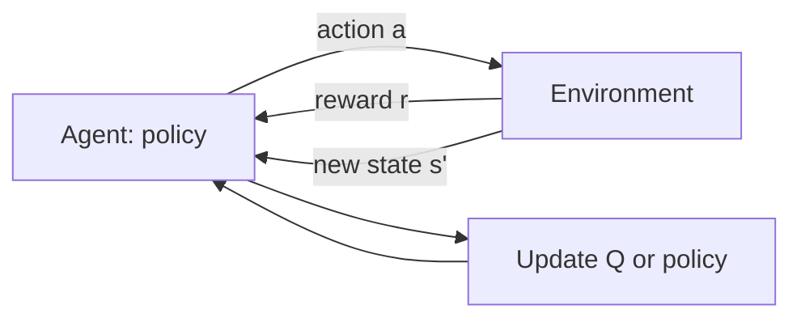
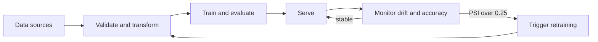
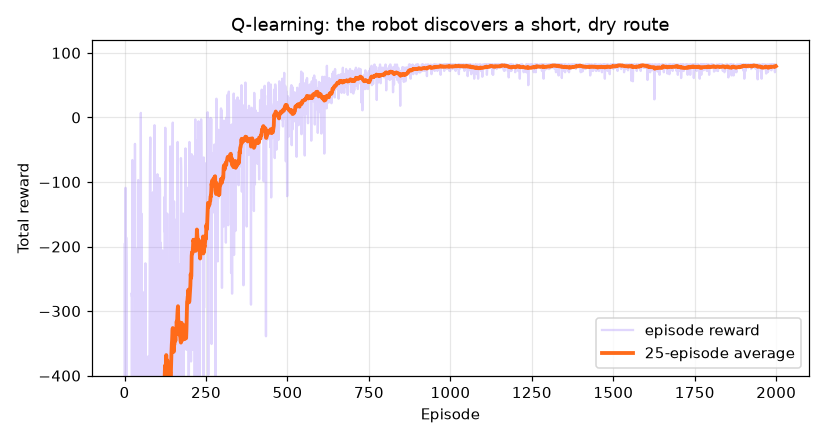
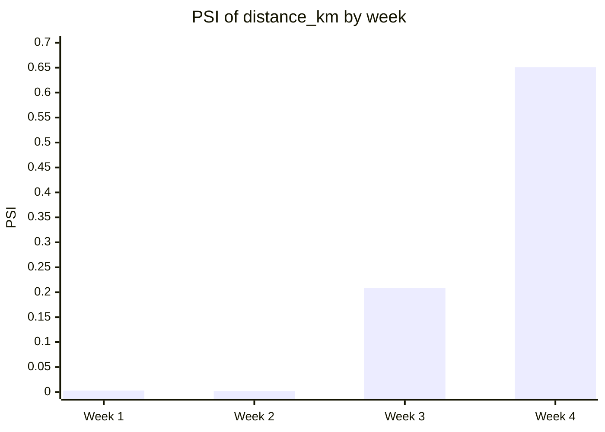

# Session 5 · Real-World AI Pipelines and Reinforcement Learning

[](https://colab.research.google.com/github/Hamnakhan123/Generative-AI/blob/main/04-ai-architecture-and-agents/code/session-05-ai-pipelines-and-reinforcement-learning.ipynb)

> 🧭 [Generative AI](../README.md) › [Track 4 · AI Architecture and Agents](README.md) › **Session 5**
>
> ⏱️ **Estimated time:** 2 hours · 📋 **Prerequisites:** Previous session

[⬅ Previous](session-04-scalable-deployment.md) · [🏠 Track home](README.md) · [Next ➡](session-06-understanding-ai-agents.md)

---

## 🎯 Learning objectives

- Describe a **real-world AI pipeline** end to end, including **monitoring for drift** after deployment.
- Outline the fundamental concepts of **reinforcement learning (RL)**: agent, environment, state, action, reward, policy, value, exploration.
- Implement **Q-learning** and a **policy-gradient** agent, the latter with TensorFlow.
- Explain the significance of **TensorFlow Quantum** and quantum machine learning, and its current limits.

## 📖 Concepts

### 1. Real-world AI pipelines

Session 4 showed a training pipeline. In production, the full loop is:

| Stage | Questions it answers | Typical tools |
|---|---|---|
| **Collect & label** | Where does data come from? Is it consented and representative? | Databases, event logs, labelling tools |
| **Validate & transform** | Is this batch sane? Are features computed the same way everywhere? | TF Data Validation, TF Transform, feature stores |
| **Train & tune** | Which model and settings? | Keras, Keras Tuner, PyTorch |
| **Evaluate** | Better than production? Fair across groups? | TF Model Analysis, slice metrics |
| **Deploy** | How is it served and scaled? | TF Serving, Kubernetes, TF Lite |
| **Monitor** | Is live data still like training data? Is accuracy holding? | Drift metrics (PSI, KL), dashboards, alerts |
| **Retrain** | When and on what? | Scheduled or drift-triggered pipeline runs |

**Data drift** = the inputs change (prices rise, new suburbs). **Concept drift** = the relationship changes (customers react differently to discounts). Both silently degrade a model, which is why monitoring is part of the pipeline, not an extra.

> 🧠 **Analogy — a car's dashboard.** Training is building the car; monitoring is the dashboard lights. PSI is the warning light that says "the road is different from the test track: get a service (retrain)".

### 2. Reinforcement learning: learning by doing

In supervised learning someone gives the right answer. In **RL** an **agent** acts in an **environment**, receives **rewards**, and learns which actions pay off **over time**.

| Term | Meaning | Delivery-robot example |
|---|---|---|
| **State (s)** | What the agent observes | Robot's grid cell |
| **Action (a)** | What it can do | Move up/down/left/right |
| **Reward (r)** | Immediate feedback | −1 per move, −15 wet floor, +100 at desk |
| **Policy (π)** | Rule: state → action | Arrow in each cell |
| **Return** | Sum of future rewards, discounted by **γ** | Total battery saved |
| **Value V(s) / Q(s,a)** | Expected return from a state / state-action | How good is "go right" here? |
| **Episode** | One run from start to end | One parcel delivery |
| **Exploration vs exploitation** | Try new actions vs use the best known | **ε-greedy**: random action with probability ε |

> 🧠 **Analogy — learning to ride a bicycle.** No one gives you a labelled dataset of "correct handlebar angles". You try, wobble (negative reward), stay upright (positive reward) and slowly build a policy.

**The RL loop** follows the **Markov Decision Process (MDP)**: observe s → choose a → environment returns r and s′ → update → repeat.

### 3. Families of RL algorithms

| Family | Learns | Example algorithms | Good for |
|---|---|---|---|
| **Value-based** | Q(s,a), then acts greedily | Q-learning, **DQN** (Q-values from a neural net) | Discrete actions, games |
| **Policy-based** | π(a\|s) directly | **REINFORCE**, PPO | Continuous or stochastic actions |
| **Actor-critic** | Both a policy and a value | A2C, PPO, SAC | Robotics, most modern RL |
| **Multi-armed bandits** | Best single action, no states | ε-greedy, UCB, Thompson sampling | Ads, banners, A/B tests |

**Q-learning update:** `Q[s,a] ← Q[s,a] + α · (r + γ · maxₐ′ Q[s′,a′] − Q[s,a])` (α = learning rate, γ = discount).

**RL with TensorFlow:** a neural network replaces the Q-table (DQN) or represents the policy (policy gradients). TensorFlow provides the `GradientTape`, optimisers and Keras layers; the **TF-Agents** library adds ready-made DQN, PPO, SAC agents, replay buffers and environments. RL also powers **RLHF**, which aligns LLMs such as ChatGPT with human preferences.

**Business applications:** dynamic pricing, recommendation and ad placement (bandits), warehouse robotics, data-centre cooling, traffic-signal control, inventory reordering.

### 4. TensorFlow Quantum (TFQ) and quantum ML

| Idea | Plain meaning |
|---|---|
| **Qubit** | Like a bit, but its state is a combination of 0 and 1 until measured |
| **Gate / rotation** | Operation that changes a qubit's state, e.g. RY(θ) |
| **Parameterised (variational) circuit** | A circuit with tunable angles θ, the "weights" of a quantum model |
| **Measurement** | Gives 0 or 1 randomly; we average many shots to get an expectation like ⟨Z⟩ |
| **Hybrid model** | Classical network + quantum circuit layer, trained together |

**TensorFlow Quantum** lets you write circuits in **Cirq** and use them as **Keras layers**, with gradients via the **parameter-shift rule**. Its significance: researchers can prototype hybrid quantum–classical models with familiar tools, ahead of large quantum computers.

**Honest limits (2026):** today's quantum hardware is small and noisy; most TFQ work runs on **simulators**, whose memory grows as 2ⁿ for n qubits. No general quantum advantage for everyday ML has been shown yet. TFQ's releases have also lagged behind recent TensorFlow versions, so check compatibility before installing; the concepts below are what matter.

## 🪜 Step-by-step: designing an RL solution

1. **Define the goal** as a reward (and check it cannot be "gamed").
2. **Define states and actions**; start small and discrete.
3. **Build or choose a simulator** (real-world trial and error is costly).
4. **Pick an algorithm**: bandit (no state) → Q-learning (small tables) → DQN/PPO (large states).
5. **Tune exploration** (ε schedule), learning rate α and discount γ.
6. **Plot reward per episode**; inspect the learned policy for unsafe shortcuts.
7. **Deploy with guardrails** and keep monitoring, like any pipeline.

## 🧭 Diagrams





## 💻 Worked examples (basic → advanced)

### Example 1 (basic) — Q-learning update by hand

Robot in cell s takes action "right": r = −1, lands in s′ where `max Q[s′] = 50`. Current `Q[s, right] = 20`, α = 0.5, γ = 0.9.

Target = −1 + 0.9 × 50 = **44**. New Q = 20 + 0.5 × (44 − 20) = **32**. The estimate moved halfway toward the target.

### Example 2 (intermediate) — Drift monitoring with PSI

```python
# file: session-05_drift_monitor.py
"""
Session 5 · Example 1 — Monitoring a live AI pipeline for data drift with the Population Stability Index (PSI).

After deployment, the world changes: prices rise, new customer groups arrive.
PSI compares the distribution of a feature in live traffic with training data:
    PSI = sum over bins of (live% - train%) * ln(live% / train%)
Rule of thumb: < 0.10 stable · 0.10-0.25 moderate shift (watch) · > 0.25 major shift (retrain)

Run:  python session-05_drift_monitor.py
"""
import numpy as np

rng = np.random.default_rng(21)


def psi(train, live, bins=10):
    edges = np.quantile(train, np.linspace(0, 1, bins + 1))
    edges[0], edges[-1] = -np.inf, np.inf
    t = np.histogram(train, edges)[0] / len(train)
    l = np.histogram(live, edges)[0] / len(live)
    t, l = np.clip(t, 1e-4, None), np.clip(l, 1e-4, None)      # avoid log(0)
    return float(np.sum((l - t) * np.log(l / t)))


def verdict(v):
    return "stable" if v < 0.10 else ("WATCH" if v < 0.25 else "RETRAIN")


# Training data for a food-delivery ETA model
train = {
    "order_value_rs": rng.normal(1500, 400, 20000),
    "distance_km": rng.gamma(2.0, 2.0, 20000),
    "hour_of_day": rng.integers(10, 24, 20000).astype(float),
}

# Four weeks of live traffic: inflation slowly raises order values; a new
# suburb opens in week 3 and lengthens distances.
weeks = {
    "week 1": dict(order_value_rs=(1500, 400), distance_shape=2.0, hours=(10, 24)),
    "week 2": dict(order_value_rs=(1560, 410), distance_shape=2.0, hours=(10, 24)),
    "week 3": dict(order_value_rs=(1650, 420), distance_shape=2.6, hours=(10, 24)),
    "week 4": dict(order_value_rs=(1800, 450), distance_shape=3.2, hours=(8, 24)),
}
print(f"{'':8s} {'order_value_rs':>16s} {'distance_km':>14s} {'hour_of_day':>14s}")
for wk, cfg in weeks.items():
    live = {
        "order_value_rs": rng.normal(*cfg["order_value_rs"], 3000),
        "distance_km": rng.gamma(cfg["distance_shape"], 2.0, 3000),
        "hour_of_day": rng.integers(*cfg["hours"], 3000).astype(float),
    }
    cells = []
    for f in train:
        v = psi(train[f], live[f])
        cells.append(f"{v:.3f} {verdict(v):>7s}")
    print(f"{wk:8s} " + " ".join(f"{c:>15s}" for c in cells))

print("\nAction: trigger the retraining pipeline (Session 4) when any feature shows RETRAIN.")
```

**Output**

```text
           order_value_rs    distance_km    hour_of_day
week 1     0.003  stable   0.003  stable   0.004  stable
week 2     0.017  stable   0.002  stable   0.002  stable
week 3     0.146   WATCH   0.209   WATCH   0.003  stable
week 4     0.483 RETRAIN   0.651 RETRAIN   0.120   WATCH

Action: trigger the retraining pipeline (Session 4) when any feature shows RETRAIN.
```

**Reading it:** weeks 1–2 are stable. In week 3 a new suburb raises distances (WATCH); by week 4 inflation and distance both cross 0.25, so the pipeline should retrain. Hour of day only starts to move when the service opens earlier.

### Example 3 (intermediate) — Policy gradient with TensorFlow

```python
# file: session-05_policy_gradient_tf.py
"""
Session 5 · Example 3 — Reinforcement learning with TensorFlow: a policy-gradient (REINFORCE) agent.

Problem: an online shop can show one of 4 discount banners. Each banner has an
unknown chance of a purchase (the reward). The agent's policy is a tiny
TensorFlow network (softmax over banners). REINFORCE increases the
log-probability of actions in proportion to (reward - baseline).

Run:  python session-05_policy_gradient_tf.py
"""
import os
os.environ["TF_CPP_MIN_LOG_LEVEL"] = "3"
import numpy as np
import tensorflow as tf

tf.random.set_seed(4)
rng = np.random.default_rng(4)
BANNERS = ["5% off", "free delivery", "buy 1 get 1", "10% off"]
TRUE_RATE = np.array([0.04, 0.09, 0.06, 0.07])      # hidden from the agent

logits = tf.Variable(tf.zeros(len(BANNERS)))        # the policy's parameters
opt = tf.keras.optimizers.Adam(0.05)
baseline = 0.0

for step in range(1, 3001):
    probs = tf.nn.softmax(logits)
    a = int(rng.choice(len(BANNERS), p=probs.numpy()))
    r = float(rng.random() < TRUE_RATE[a])           # 1 = purchase
    baseline = 0.99 * baseline + 0.01 * r            # running average reward
    with tf.GradientTape() as tape:
        logp = tf.math.log(tf.nn.softmax(logits)[a])
        loss = -logp * (r - baseline)                # REINFORCE objective
    opt.apply_gradients([(tape.gradient(loss, logits), logits)])
    if step in (1, 500, 1500, 3000):
        p = tf.nn.softmax(logits).numpy()
        print(f"step {step:4d}  policy: " + "  ".join(f"{b}={x:.2f}" for b, x in zip(BANNERS, p)))

best = BANNERS[int(np.argmax(tf.nn.softmax(logits).numpy()))]
print(f"\nAgent prefers: {best} | truly best: {BANNERS[int(TRUE_RATE.argmax())]}")
print(f"Expected purchase rate of learned policy: {float(tf.nn.softmax(logits).numpy() @ TRUE_RATE):.3f} "
      f"(random policy: {TRUE_RATE.mean():.3f})")
```

**Output**

```text
step    1  policy: 5% off=0.25  free delivery=0.25  buy 1 get 1=0.25  10% off=0.25
step  500  policy: 5% off=0.02  free delivery=0.46  buy 1 get 1=0.25  10% off=0.28
step 1500  policy: 5% off=0.01  free delivery=0.89  buy 1 get 1=0.02  10% off=0.08
step 3000  policy: 5% off=0.00  free delivery=0.99  buy 1 get 1=0.00  10% off=0.00

Agent prefers: free delivery | truly best: free delivery
Expected purchase rate of learned policy: 0.090 (random policy: 0.065)
```

**Reading it:** the policy starts uniform and, from purchase/no-purchase feedback only, shifts almost all probability to "free delivery", the truly best banner, lifting the expected purchase rate from 6.5% to 9%. The baseline (running average reward) reduces noise in the updates.

### Example 4 (advanced) — A quantum classifier, simulated

```python
# file: session-05_quantum_toy.py
"""
Session 5 · Example 4 — What TensorFlow Quantum does, simulated with NumPy: a one-qubit variational classifier.

A quantum ML model is a circuit with tunable rotation angles (parameters).
Data is encoded as a rotation, a trainable rotation follows, and we measure
the expectation <Z> in [-1, 1]. A classical optimiser tunes the angle using the
parameter-shift rule:  d<Z>/dθ = (<Z>(θ + π/2) - <Z>(θ - π/2)) / 2
TensorFlow Quantum wraps exactly this loop (circuits from Cirq as Keras layers).

Run:  python session-05_quantum_toy.py
"""
import numpy as np

rng = np.random.default_rng(8)


def ry(angle):
    """Single-qubit rotation about the Y axis."""
    c, s = np.cos(angle / 2), np.sin(angle / 2)
    return np.array([[c, -s], [s, c]])


def expect_z(x, theta):
    state = ry(theta) @ ry(x) @ np.array([1.0, 0.0])     # start in |0>, encode x, apply θ
    return float(state[0] ** 2 - state[1] ** 2)          # <Z> = P(0) - P(1)


# Data: class +1 near angle 0.3, class -1 near angle 2.6 (e.g. two sensor states)
x = np.concatenate([rng.normal(0.3, 0.25, 40), rng.normal(2.6, 0.25, 40)])
y = np.concatenate([np.ones(40), -np.ones(40)])
# Shift the data so the untrained circuit is poor: the classifier must learn θ
x = x + 1.4

theta, lr = 0.0, 0.3
for epoch in range(31):
    preds = np.array([expect_z(xi, theta) for xi in x])
    loss = np.mean((preds - y) ** 2)
    grad = np.mean([2 * (expect_z(xi, theta) - yi) *
                    (expect_z(xi, theta + np.pi / 2) - expect_z(xi, theta - np.pi / 2)) / 2
                    for xi, yi in zip(x, y)])
    if epoch % 10 == 0:
        acc = np.mean(np.sign(preds) == y)
        print(f"epoch {epoch:2d}  theta={theta:+.3f}  loss={loss:.3f}  accuracy={acc:.2f}")
    theta -= lr * grad

print(f"\nLearned rotation θ = {theta:.3f} rad (ideal ≈ -1.40, undoing the shift)")
print("Simulating n qubits needs 2^n amplitudes:", {n: 2 ** n for n in (1, 10, 30, 50)})
```

**Output**

```text
epoch  0  theta=+0.000  loss=0.725  accuracy=0.69
epoch 10  theta=-1.160  loss=0.026  accuracy=1.00
epoch 20  theta=-1.267  loss=0.022  accuracy=1.00
epoch 30  theta=-1.284  loss=0.022  accuracy=1.00

Learned rotation θ = -1.284 rad (ideal ≈ -1.40, undoing the shift)
Simulating n qubits needs 2^n amplitudes: {1: 2, 10: 1024, 30: 1073741824, 50: 1125899906842624}
```

**Reading it:** one trainable angle learned to rotate the data so that measuring ⟨Z⟩ separates the classes perfectly. TFQ does this with real circuits as Keras layers. The last line shows why simulating many qubits is hard: 50 qubits need about 10¹⁵ amplitudes.

## 🏗️ Real-life problem: a warehouse robot that learns its route (full solution)

**Scenario.** A robot carries parcels from the dock (S) to the packing desk (G). Shelves (#) block the way and a wet-floor zone (~) drains battery. Routes change whenever shelves move, so we want the robot to **learn** a good route rather than have one hard-coded.

```python
# file: session-05_project_delivery_agent.py
"""
Session 5 · Mini project (full solution) — Q-learning delivery robot in a warehouse.

Real-life problem: a warehouse robot must carry parcels from the dock (S) to the
packing desk (G) while avoiding shelves (#) and a wet-floor zone (~) that costs
extra battery. Nobody writes the route: the robot LEARNS it by trial and error.

Q-learning update:  Q[s,a] += α * (r + γ * max_a' Q[s',a'] - Q[s,a])
Rewards: -1 per move, -15 per wet cell, -5 for bumping a shelf, +100 at the desk.
Exploration: ε-greedy, ε decays from 1.0 to 0.05 over 1,000 episodes.

Run:  python session-05_project_delivery_agent.py
Creates: session-05_q_learning_rewards.png
"""
import numpy as np
import matplotlib
matplotlib.use("Agg")
import matplotlib.pyplot as plt

GRID = [
    "S..#....",
    ".#.#.##.",
    ".#...#..",
    ".##~~#.#",
    "...~~...",
    "#.##.##.",
    "......#G",
]
H, W = len(GRID), len(GRID[0])
ACTIONS = {0: (-1, 0, "↑"), 1: (1, 0, "↓"), 2: (0, -1, "←"), 3: (0, 1, "→")}
start = next((r, c) for r in range(H) for c in range(W) if GRID[r][c] == "S")
goal = next((r, c) for r in range(H) for c in range(W) if GRID[r][c] == "G")


def step(state, a):
    dr, dc, _ = ACTIONS[a]
    r, c = state[0] + dr, state[1] + dc
    if not (0 <= r < H and 0 <= c < W) or GRID[r][c] == "#":
        return state, -5, False                  # bumped a wall/shelf
    if (r, c) == goal:
        return (r, c), 100, True
    return (r, c), (-15 if GRID[r][c] == "~" else -1), False   # each move costs battery


rng = np.random.default_rng(0)
Q = np.zeros((H, W, 4))
alpha, gamma, episodes = 0.3, 0.99, 2000
rewards = []
for ep in range(episodes):
    eps = max(0.05, 1.0 - ep / 1000)
    s, total = start, 0
    for _ in range(200):
        a = int(rng.integers(4)) if rng.random() < eps else int(Q[s].argmax())
        s2, r, done = step(s, a)
        Q[s][a] += alpha * (r + gamma * Q[s2].max() * (not done) - Q[s][a])
        s, total = s2, total + r
        if done:
            break
    rewards.append(total)

# Follow the learned greedy policy
s, path = start, [start]
while s != goal and len(path) < 60:
    s, _, _ = step(s, int(Q[s].argmax())); path.append(s)

print(f"Average reward, first 50 episodes: {np.mean(rewards[:50]):8.1f}")
print(f"Average reward, last 50 episodes : {np.mean(rewards[-50:]):8.1f}")
print(f"Learned route: {len(path) - 1} moves, reaches goal: {s == goal}, "
      f"wet cells crossed: {sum(GRID[r][c] == '~' for r, c in path)}")

print("\nGreedy policy (arrows) and route (*):")
for r in range(H):
    row = ""
    for c in range(W):
        ch = GRID[r][c]
        if ch in "#SG~" and (r, c) not in path[1:-1]:
            row += ch
        elif (r, c) in path[1:-1]:
            row += "*"
        else:
            row += ACTIONS[int(Q[r, c].argmax())][2]
    print("   " + " ".join(row))

smooth = np.convolve(rewards, np.ones(25) / 25, mode="valid")
plt.figure(figsize=(7.5, 4))
plt.plot(rewards, color="#A78BFA", alpha=.35, label="episode reward")
plt.plot(range(24, episodes), smooth, color="#FF6B1A", lw=2.5, label="25-episode average")
plt.xlabel("Episode"); plt.ylabel("Total reward"); plt.ylim(-400, 120)
plt.title("Q-learning: the robot discovers a short, dry route"); plt.legend(); plt.grid(alpha=.3)
plt.tight_layout(); plt.savefig("session-05_q_learning_rewards.png", dpi=110)
print("\nSaved chart: session-05_q_learning_rewards.png")
```

**Output**

```text
Average reward, first 50 episodes:   -600.7
Average reward, last 50 episodes :     78.4
Learned route: 19 moves, reaches goal: True, wet cells crossed: 0

Greedy policy (arrows) and route (*):
   S * * # * * * *
   ↑ # * # * # # *
   ↑ # * * * # * *
   ↓ # # ~ ~ # * #
   → ↓ ← ~ ~ → * *
   # ↓ # # ↑ # # *
   → → → → ↑ ← # G

Saved chart: session-05_q_learning_rewards.png
```



**What to notice:** early episodes wander and bump shelves (very negative). As ε decays, the robot exploits what it learned. It found a **19-move route that avoids the wet floor**: 6 moves longer than the shortest path, but cheaper overall (19 × −1 vs 11 × −1 + 2 × −15). With a smaller wet-floor penalty, or a lower γ, it chose the shorter wet route instead: the reward design *is* the specification.

## 📊 Drift by week (from Example 2)



## ⚠️ Common mistakes

| Mistake | Fix |
|---|---|
| Deploying and never monitoring | Track PSI/drift and live accuracy; alert and retrain |
| Reward that can be gamed (reward hacking) | Test the policy; add penalties for unsafe shortcuts |
| No exploration (ε = 0 from the start) | Decay ε gradually |
| γ too low for long tasks | Use 0.95–0.99 when the payoff is far away |
| Training RL directly on real customers or robots | Use a simulator or offline data first, then guarded rollout |
| Overselling quantum ML | Present it as research-stage; simulators scale as 2ⁿ |

## ✅ Best practices

- Treat monitoring and retraining as **pipeline stages**, with thresholds agreed in advance.
- Start RL with the **simplest formulation** (bandit before full RL).
- Plot **reward curves** and inspect the policy visually.
- Use libraries (TF-Agents, Stable-Baselines3, Gymnasium) for serious RL work.
- For quantum ML, prototype on simulators and compare honestly with a classical baseline.

## 🧪 Lab / practice tasks

**Task 1 · 🟢 Easy** — Redo Example 1 with α = 0.1. What is the new Q value?

<details><summary>💡 Hint</summary>

New Q = 20 + 0.1 × (44 − 20).

</details>

**Task 2 · 🟢 Easy** — In `session-05_drift_monitor.py`, add a week 5 where order value returns to (1500, 400). What does PSI show?

<details><summary>💡 Hint</summary>

Add an entry to `weeks`.

</details>

**Task 3 · 🟡 Medium** — Change the wet-floor penalty in the mini project to −6 and γ to 0.95. Which route is learned now and why?

<details><summary>💡 Hint</summary>

Compare total reward of both routes and the discounting of the +100.

</details>

**Task 4 · 🟡 Medium** — In the policy-gradient example, remove the baseline (use `r` instead of `r - baseline`). Does learning get noisier or slower?

<details><summary>💡 Hint</summary>

Print the policy at the same steps and compare.

</details>

**Task 5 · 🔴 Challenge** — Replace the Q-table in the mini project with a tiny Keras network that maps (row, col) one-hot to 4 Q-values (a mini DQN).

<details><summary>💡 Hint</summary>

Input size H+W, output 4; train on (s, a, target) after each step with MSE on the chosen action.

</details>


<details><summary>✅ Lab solutions and model answers</summary>

**Task 1:** 20 + 0.1 × 24 = **22.4**: a smaller α learns more slowly but more stably.

**Task 2:** order value PSI drops back near 0 (stable) while distance stays high: drift can be per-feature, so monitor each one.

**Task 3:** with −6 per wet cell and γ = 0.95, the wet 13-move route costs 11 + 12 = 23 versus 19 for the dry route, but reaching +100 six steps sooner is worth 100 × (0.95¹³ − 0.95¹⁹) ≈ 14 in discounted terms, so the robot learns the **shorter wet route**.

**Task 4:** without a baseline, every non-purchase (r = 0) produces no update and every purchase pushes up whatever was chosen, so learning is noisier and the policy may lock onto a lucky early banner. The baseline makes "better than average" the signal.

**Task 5 (sketch):**

```python
net = keras.Sequential([keras.Input((H + W,)), layers.Dense(32, activation="relu"), layers.Dense(4)])
net.compile(keras.optimizers.Adam(1e-2), "mse")
def enc(s): v = np.zeros(H + W, "float32"); v[s[0]] = 1; v[H + s[1]] = 1; return v
# after each step:
q = net(enc(s)[None]).numpy()[0]; q_next = net(enc(s2)[None]).numpy()[0]
q[a] = r + (0 if done else gamma * q_next.max())
net.train_on_batch(enc(s)[None], q[None])
```

</details>

## ✅ Quick quiz

**Q1. In RL, the policy is...**

- A) The rule that maps states to actions
- B) The environment's map
- C) The reward function
- D) The discount factor

<details><summary>Show answer</summary>

✅ **A) The rule that maps states to actions** — π(s) → a.

</details>

**Q2. ε-greedy means...**

- A) Always pick the best action
- B) Pick a random action with probability ε, otherwise the best
- C) Never explore
- D) Use ε as the learning rate

<details><summary>Show answer</summary>

✅ **B) Pick a random action with probability ε, otherwise the best** — Balances exploration and exploitation.

</details>

**Q3. A PSI of 0.40 on a key feature suggests...**

- A) Stable data
- B) Major drift: investigate and retrain
- C) Perfect accuracy
- D) A bug in Python

<details><summary>Show answer</summary>

✅ **B) Major drift: investigate and retrain** — Above 0.25 is a major shift.

</details>

**Q4. Which library provides ready-made DQN and PPO agents for TensorFlow?**

- A) TF Lite
- B) TF-Agents
- C) Keras Tuner
- D) TFX Pusher

<details><summary>Show answer</summary>

✅ **B) TF-Agents** — TF-Agents.

</details>

**Q5. TensorFlow Quantum lets you...**

- A) Encrypt models
- B) Run TensorFlow faster on GPUs
- C) Use parameterised quantum circuits as Keras layers in hybrid models
- D) Replace Kubernetes

<details><summary>Show answer</summary>

✅ **C) Use parameterised quantum circuits as Keras layers in hybrid models** — Circuits from Cirq inside Keras.

</details>


## 📝 Summary / cheat-sheet

- Production pipeline: **collect → validate → train → evaluate → deploy → monitor → retrain**; monitor **data and concept drift** (PSI < 0.10 stable, > 0.25 retrain).
- RL: **agent, environment, state, action, reward, policy, value, γ, ε**.
- **Q-learning**: `Q += α(r + γ max Q′ − Q)`; **DQN** = neural Q; **REINFORCE/PPO** = learn the policy; **bandits** for single choices.
- TF for RL: GradientTape + optimisers; **TF-Agents** for full agents.
- **TFQ**: Cirq circuits as Keras layers, parameter-shift gradients; research-stage, simulators grow as 2ⁿ.

**Viva / interview questions**

1. Draw a production ML pipeline and show where monitoring fits.
2. Difference between data drift and concept drift, with examples.
3. Explain the Q-learning update and the role of α and γ.
4. Compare value-based and policy-based RL.
5. Give two business uses of RL and one risk of reward hacking.
6. What is a variational quantum circuit, and why is quantum ML still mostly simulated?

---

[⬅ Previous](session-04-scalable-deployment.md) · [🏠 Track home](README.md) · [Next ➡](session-06-understanding-ai-agents.md)

<sub>Prepared by **Hamna Zahid Khan**, Junior Lecturer</sub>
