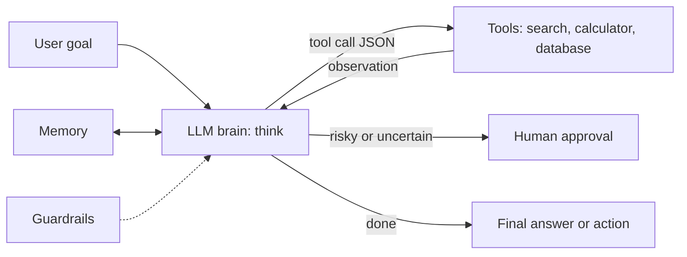
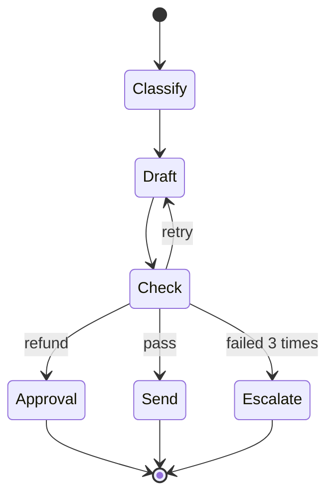
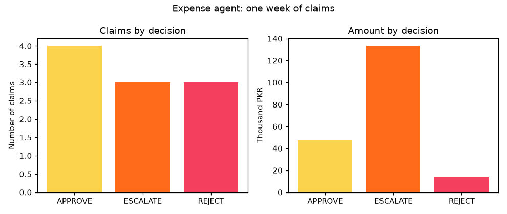

# Session 6 · Understanding AI Agents and Agent Frameworks

[](https://colab.research.google.com/github/Hamnakhan123/Generative-AI/blob/main/04-ai-architecture-and-agents/code/session-06-understanding-ai-agents.ipynb)

> 🧭 [Generative AI](../README.md) › [Track 4 · AI Architecture and Agents](README.md) › **Session 6**
>
> ⏱️ **Estimated time:** 2 hours · 📋 **Prerequisites:** Previous session

[⬅ Previous](session-05-ai-pipelines-and-reinforcement-learning.md) · [🏠 Track home](README.md) · [Next ➡](session-07-building-ai-powered-applications.md)

---

## 🎯 Learning objectives

- Define **AI agents** and explain their role in **automation and business applications**.
- Describe an agent's building blocks: **LLM "brain", tools, memory, planning and guardrails**, and the **ReAct** loop.
- Explain the functionalities of **AutoGen, IBM Bee (BeeAI), LangGraph, CrewAI and AutoGPT**, and compare their use cases.
- Describe how **generative AI is integrated into agents** through function calling, structured output and retrieval.
- Build a working agent with tools, memory, guardrails and **human-in-the-loop** escalation.

## 📖 Concepts

### 1. What is an AI agent?

An **AI agent** is software that **perceives** its situation, **decides** what to do toward a goal, and **acts** (often by calling tools), repeating until the goal is met. A chatbot *answers*; an agent *gets things done*: it looks things up, calculates, fills forms, sends messages and checks its own work.

> 🧠 **Analogy — an intern with a toolbox.** You give a capable intern a goal ("book the cheapest venue for 200 people next Friday"), a phone, a spreadsheet and the company card limit. They plan, make calls, compare, ask you before paying, and report back. The LLM is the intern's reasoning, the tools are the phone and spreadsheet, memory is their notebook, and the card limit is a guardrail.

Classic AI textbooks describe **simple reflex** agents (if-then rules, a thermostat), **model-based** (keep an internal map, a robot vacuum), **goal-based** (search for a plan, a route planner), **utility-based** (maximise expected value, dynamic pricing) and **learning** agents (improve from feedback, the RL robot of Session 5). An **LLM agent** uses a language model to reason over the goal, the available tools and what it has observed so far.

### 2. Anatomy of an LLM agent

| Component | Job | Example |
|---|---|---|
| **LLM (brain)** | Understands the goal, plans, chooses tools, writes the answer | GPT-4-class, Claude, Gemini, Qwen, Llama |
| **Tools** | Functions with a name, description and JSON arguments | Search, calculator, database query, email, calendar |
| **Memory** | Short-term: the conversation and scratchpad. Long-term: stored facts, past cases, a vector database | "Hamza already claimed this book" |
| **Planning** | Break the goal into steps; re-plan after failures | ReAct, plan-and-execute, reflection |
| **Guardrails** | Limits the agent cannot override | Step limits, allowed tools, money thresholds, input validation |
| **Human in the loop (HITL)** | Approval for risky or uncertain actions | Refunds, payments, emails to customers |

**The ReAct pattern** (Reason + Act): the model writes a **Thought**, chooses an **Action** (tool + arguments), reads the **Observation**, and repeats until it can give a **Final answer**.

### 3. Agents in automation and business

| Area | What the agent does | Why an agent (not a script)? |
|---|---|---|
| Customer support | Reads tickets, looks up orders, drafts replies, escalates refunds | Free-text input, many cases |
| Finance operations | Checks expense claims, matches invoices, flags anomalies | Policy + judgement + audit trail |
| Software | Writes code, runs tests, fixes failures | Tight act–observe loop |
| Data analysis | Writes SQL, runs it, charts results, explains | Tools + language |

**Business value:** faster turnaround, 24/7 availability, consistent policy checks, and staff time freed for exceptions. **Risks:** wrong actions with real consequences, hallucinated facts, prompt injection through tool outputs, cost of many LLM calls, and unclear accountability. That is why serious agents keep **hard limits in code** and **humans on high-stakes decisions**.

### 4. Agent frameworks

| Framework | From | Core idea | Typical use case |
|---|---|---|---|
| **AutoGen** | Microsoft | Multiple agents **converse** to solve a task (assistant, user proxy that runs code, critics); event-driven since v0.4. Microsoft is folding it into its newer Agent Framework | Multi-agent problem solving, code generation and execution |
| **Bee / BeeAI Framework** | IBM (open source, now under the Linux Foundation's BeeAI project) | Production-oriented agents in Python and TypeScript with tools, memory, observability; works well with open models such as IBM Granite and Llama | Enterprise agents with open models, interoperable agents |
| **LangGraph** | LangChain | Agent as a **graph of nodes** over shared **state**, with conditional edges, loops, checkpoints and human interrupts | Reliable, controllable workflows with branching and retries |
| **CrewAI** | CrewAI | **Role-based crews**: agents with role, goal, backstory; tasks run sequentially or under a manager agent | Content pipelines, research-and-report teams |
| **AutoGPT** | Significant Gravitas (open source) | Early (2023) **fully autonomous** loop: give a goal, it plans and acts on its own; now a platform for building agents | Experiments, inspiration; shows why guardrails matter |

**How to choose:** need tight control and auditability → **LangGraph**. A team of specialised roles → **CrewAI** or **AutoGen**. Enterprise stack with open models → **BeeAI**. Learning what autonomy looks like (and its failure modes) → **AutoGPT**. For a single tool-calling assistant, a plain loop with a provider SDK is often enough.

### 5. Integrating generative AI into agents

1. **Function (tool) calling** — you send tool **schemas** (name, description, JSON parameters); the model replies with e.g. `{"tool_calls": [{"name": "fee_lookup", "arguments": {"program": "BS-AI"}}]}`; your code runs the function and sends the result back as a `tool` message.
2. **Structured output** — force JSON matching a schema so code can trust the format.
3. **Retrieval (RAG)** — the agent searches documents or a vector database and grounds answers in them (Session 7).
4. **Reflection / LLM-as-judge** — a second call critiques the draft before it is sent.
5. **Multimodal input** — reading receipts, screenshots or voice notes.
6. **Protocols** — standards such as the **Model Context Protocol (MCP)** let one agent use tools from many providers through a common interface.

## 🪜 Step-by-step: designing a business agent

1. **Write the job description**: goal, inputs, outputs, what success looks like.
2. **List tools** with clear names, descriptions and argument types; keep each tool small.
3. **Decide memory**: what to keep per conversation and what to store long-term.
4. **Set guardrails** (max steps, allowed actions, money/data limits, input validation) and **escalation** rules (which cases go to a human).
5. **Log everything** (audit trail) and **test with tricky cases** (duplicates, missing data, injection attempts) before going live.

## 🧭 Diagrams





## 💻 Worked examples (basic → advanced)

### Example 1 (basic) — A ReAct agent with tools and guardrails

```python
# file: session-06_react_agent.py
"""
Session 6 · Example 1 — A ReAct agent loop (Reason + Act) with tools, built from scratch.

THINK -> ACT (call a tool) -> OBSERVE, until the agent can answer. In production plan()
is an LLM function-calling request; a rule-based planner keeps this offline and reproducible.

Run:  python session-06_react_agent.py
"""
import json, math, re

# ---------- tools: plain functions with a name, description and JSON arguments ----------
FX = {"USD": 280.5, "EUR": 303.2, "AED": 76.4}           # illustrative PKR rates
FEES = {"BSCS": 145_000, "BBA": 120_000, "BS-AI": 160_000}   # per semester, illustrative

def calculator(expression: str) -> str:
    if not re.fullmatch(r"[0-9+\-*/(). ]+", expression):
        return "error: only arithmetic is allowed"
    return str(round(eval(expression, {"__builtins__": {}}), 2))

def currency(amount: float, frm: str, to: str = "PKR") -> str:
    return f"{amount * FX[frm]:.0f} PKR" if to == "PKR" else f"{amount / FX[to]:.2f} {to}"

def fee_lookup(program: str) -> str:
    return f"{FEES[program]} PKR per semester" if program in FEES else "unknown programme"

TOOLS = {"calculator": calculator, "currency": currency, "fee_lookup": fee_lookup}
SCHEMAS = [
    {"name": "calculator", "description": "Evaluate an arithmetic expression", "parameters": {"expression": "string"}},
    {"name": "currency", "description": "Convert money between currencies", "parameters": {"amount": "number", "frm": "string", "to": "string"}},
    {"name": "fee_lookup", "description": "Semester fee for a programme", "parameters": {"program": "string"}},
]

# ---------- the 'LLM': decides the next step from the question and what it has seen ----------
def plan(question, scratchpad):
    seen = [s["tool"] for s in scratchpad]
    if "fee" in question.lower() and "fee_lookup" not in seen:
        prog = re.search(r"(BSCS|BBA|BS-AI)", question).group(1)
        return {"thought": f"I need the fee for {prog}.", "tool": "fee_lookup", "args": {"program": prog}}
    if "fee_lookup" in seen and "calculator" not in seen:
        fee = int(scratchpad[-1]["observation"].split()[0])
        sems = int(re.search(r"(\d+) semesters", question).group(1))
        return {"thought": f"Total = fee x {sems} semesters.", "tool": "calculator", "args": {"expression": f"{fee}*{sems}"}}
    if "dollars" in question.lower() and "currency" not in seen:
        total = float(scratchpad[-1]["observation"])
        return {"thought": "Convert the total from PKR to USD.", "tool": "currency", "args": {"amount": total, "frm": "PKR", "to": "USD"}}
    return {"thought": "I have everything I need.", "final": scratchpad[-1]["observation"]}

def run_agent(question, max_steps=5):
    print(f"QUESTION: {question}")
    scratchpad = []
    for step in range(1, max_steps + 1):
        decision = plan(question, scratchpad)
        print(f"  Thought {step}: {decision['thought']}")
        if "final" in decision:
            print(f"  FINAL ANSWER: {decision['final']}\n")
            return decision["final"]
        print(f"  Action {step}: {decision['tool']}({json.dumps(decision['args'])})")
        try:
            obs = TOOLS[decision["tool"]](**decision["args"])
        except Exception as e:                       # tools fail: the agent must see the error
            obs = f"error: {e}"
        print(f"  Observation {step}: {obs}")
        scratchpad.append({"tool": decision["tool"], "observation": obs})
    print("  Stopped: step limit reached (a guardrail against endless loops)\n")

print("Tool schemas sent to the model:")
for s in SCHEMAS:
    print("  ", json.dumps(s))
print()
run_agent("What is the total fee for BS-AI over 8 semesters?")
run_agent("What is the total fee for BBA over 8 semesters in dollars?")
print("Guardrail check -> calculator('__import__(\"os\")'):", calculator('__import__("os")'))
```

**Output**

```text
Tool schemas sent to the model:
   {"name": "calculator", "description": "Evaluate an arithmetic expression", "parameters": {"expression": "string"}}
   {"name": "currency", "description": "Convert money between currencies", "parameters": {"amount": "number", "frm": "string", "to": "string"}}
   {"name": "fee_lookup", "description": "Semester fee for a programme", "parameters": {"program": "string"}}

QUESTION: What is the total fee for BS-AI over 8 semesters?
  Thought 1: I need the fee for BS-AI.
  Action 1: fee_lookup({"program": "BS-AI"})
  Observation 1: 160000 PKR per semester
  Thought 2: Total = fee x 8 semesters.
  Action 2: calculator({"expression": "160000*8"})
  Observation 2: 1280000
  Thought 3: I have everything I need.
  FINAL ANSWER: 1280000

QUESTION: What is the total fee for BBA over 8 semesters in dollars?
  Thought 1: I need the fee for BBA.
  Action 1: fee_lookup({"program": "BBA"})
  Observation 1: 120000 PKR per semester
  Thought 2: Total = fee x 8 semesters.
  Action 2: calculator({"expression": "120000*8"})
  Observation 2: 960000
  Thought 3: Convert the total from PKR to USD.
  Action 3: currency({"amount": 960000.0, "frm": "PKR", "to": "USD"})
  Observation 3: 3422.46 USD
  Thought 4: I have everything I need.
  FINAL ANSWER: 3422.46 USD

Guardrail check -> calculator('__import__("os")'): error: only arithmetic is allowed
```

**Reading it:** the agent chains three tools for the second question and stops when it has the answer. The step limit prevents endless loops, and the calculator refuses anything that is not arithmetic: never `eval` model output without validation.

### Example 2 (intermediate) — A LangGraph-style workflow

```python
# file: session-06_workflow_graph.py
"""
Session 6 · Example 2 — A LangGraph-style agent workflow: nodes, shared state and conditional edges.

Nodes update a shared state; conditional edges choose the next node (retry loops,
human approval). Student support tickets: classify -> draft -> check -> approve/send.

Run:  python session-06_workflow_graph.py
"""
from dataclasses import dataclass, field

@dataclass
class State:
    ticket: str
    category: str = ""
    draft: str = ""
    attempts: int = 0
    needs_human: bool = False
    log: list = field(default_factory=list)

# ---------------- nodes ----------------
def classify(s: State):
    t = s.ticket.lower()
    s.category = ("refund" if "refund" in t else "it" if any(w in t for w in ["wifi", "password", "login"])
                  else "exam" if "exam" in t else "general")
    s.log.append(f"classify -> {s.category}")

def draft_reply(s: State):
    s.attempts += 1
    templates = {
        "it": "Please reset your password at the IT portal; if Wi-Fi still fails, visit Room IT-2.",
        "exam": "Your exam schedule is on the student portal under Academics > Exams.",
        "refund": "We have received your refund request. Refunds take 10 working days after approval.",
        "general": "Thanks for writing. A coordinator will reply within 2 working days.",
    }
    s.draft = templates[s.category] if s.attempts > 1 or s.category != "it" else "Try again later."
    s.log.append(f"draft (attempt {s.attempts}) -> '{s.draft[:45]}...'")

def quality_check(s: State) -> str:
    ok = len(s.draft.split()) >= 8                     # e.g. an LLM-as-judge in real systems
    s.log.append(f"quality_check -> {'pass' if ok else 'fail'}")
    return "pass" if ok else ("retry" if s.attempts < 3 else "escalate")

def human_approval(s: State):
    s.needs_human = True
    s.log.append("human_approval -> queued for a staff member (money involved)")

def send(s: State):
    s.log.append("send -> reply emailed to student")

def escalate(s: State):
    s.log.append("escalate -> handed to a human agent")

# ---------------- graph: edges, including conditional ones ----------------
def run(s: State):
    node = "classify"
    while node != "END":
        if node == "classify":
            classify(s); node = "draft"
        elif node == "draft":
            draft_reply(s); node = "check"
        elif node == "check":
            result = quality_check(s)
            node = {"retry": "draft", "escalate": "escalate"}.get(result) or ("approval" if s.category == "refund" else "send")
        elif node == "approval":
            human_approval(s); node = "END"
        elif node == "send":
            send(s); node = "END"
        elif node == "escalate":
            escalate(s); node = "END"
    return s

for ticket in ["My wifi login keeps failing in the library",
               "I want a refund for the hostel deposit",
               "When is my final exam for Data Structures?"]:
    s = run(State(ticket))
    print(f"TICKET: {ticket}")
    for line in s.log:
        print("   ", line)
    print()
```

**Output**

```text
TICKET: My wifi login keeps failing in the library
    classify -> it
    draft (attempt 1) -> 'Try again later....'
    quality_check -> fail
    draft (attempt 2) -> 'Please reset your password at the IT portal; ...'
    quality_check -> pass
    send -> reply emailed to student

TICKET: I want a refund for the hostel deposit
    classify -> refund
    draft (attempt 1) -> 'We have received your refund request. Refunds...'
    quality_check -> pass
    human_approval -> queued for a staff member (money involved)

TICKET: When is my final exam for Data Structures?
    classify -> exam
    draft (attempt 1) -> 'Your exam schedule is on the student portal u...'
    quality_check -> pass
    send -> reply emailed to student
```

**Reading it:** the first ticket's draft failed the quality check and was **retried** (a loop edge). The refund ticket went to **human approval** because money is involved. This explicit graph is what LangGraph gives you, plus persistence and visual debugging.

### Example 3 (advanced) — A multi-agent crew

```python
# file: session-06_multi_agent_crew.py
"""
Session 6 · Example 3 — A CrewAI/AutoGen-style multi-agent team: researcher, writer and reviewer.

Each agent has a role and goal; they exchange messages until the reviewer approves.
Real frameworks put an LLM behind each role; here roles are deterministic.

Run:  python session-06_multi_agent_crew.py
"""
FACTS = {  # the researcher's "knowledge base" (would be web search or RAG)
    "solar": ["Pakistan gets 8-9 hours of sunshine a day in many regions",
              "rooftop panels can cut a home's grid bill substantially",
              "net metering lets households sell surplus power back to the grid"],
}

class Agent:
    def __init__(self, name, role, goal):
        self.name, self.role, self.goal = name, role, goal
    def say(self, text):
        print(f"[{self.name} · {self.role}] {text}")

class Researcher(Agent):
    def act(self, topic):
        notes = FACTS.get(topic, [])
        self.say(f"Found {len(notes)} facts on '{topic}'.")
        return notes

class Writer(Agent):
    def act(self, notes, feedback=None):
        words = ["Going solar makes sense:"] + [n[0].upper() + n[1:] + "." for n in notes]
        if feedback and "call to action" in feedback:
            words.append("Ask a certified installer for a free rooftop survey this week.")
        post = " ".join(words)
        self.say(f"Draft v{2 if feedback else 1} ({len(post.split())} words) ready.")
        return post

class Reviewer(Agent):
    def act(self, post):
        issues = []
        if "installer" not in post:
            issues.append("add a call to action")
        if len(post.split()) > 70:
            issues.append("cut to 70 words")
        if issues:
            self.say("Changes requested: " + "; ".join(issues))
            return False, "; ".join(issues).replace("add a ", "")
        self.say("Approved for publishing.")
        return True, ""

crew = [Researcher("Ayesha", "Researcher", "collect accurate facts"),
        Writer("Bilal", "Writer", "write a short persuasive post"),
        Reviewer("Sana", "Reviewer", "check quality and policy")]
researcher, writer, reviewer = crew
print("CREW:", ", ".join(f"{a.name} ({a.goal})" for a in crew), "\n")

notes = researcher.act("solar")
post, feedback, rounds = writer.act(notes), None, 1
approved, feedback = reviewer.act(post)
while not approved and rounds < 3:
    rounds += 1
    post = writer.act(notes, feedback)
    approved, feedback = reviewer.act(post)

print(f"\nFinished in {rounds} round(s). Final post:\n{post}")
```

**Output**

```text
CREW: Ayesha (collect accurate facts), Bilal (write a short persuasive post), Sana (check quality and policy) 

[Ayesha · Researcher] Found 3 facts on 'solar'.
[Bilal · Writer] Draft v1 (35 words) ready.
[Sana · Reviewer] Changes requested: add a call to action
[Bilal · Writer] Draft v2 (46 words) ready.
[Sana · Reviewer] Approved for publishing.

Finished in 2 round(s). Final post:
Going solar makes sense: Pakistan gets 8-9 hours of sunshine a day in many regions. Rooftop panels can cut a home's grid bill substantially. Net metering lets households sell surplus power back to the grid. Ask a certified installer for a free rooftop survey this week.
```

**Reading it:** separate roles with separate goals catch each other's gaps: the reviewer sent the draft back for a call to action. CrewAI and AutoGen organise exactly this kind of collaboration, with an LLM behind each role.

## 🏗️ Real-life problem: an expense-claim agent for a finance office (full solution)

**Scenario.** The finance office receives travel and purchase claims every week. They want an agent that checks each claim against policy with tools, remembers past claims to catch duplicates, auto-approves only low-risk claims, rejects clear violations, sends uncertain or large claims to a human, and keeps an audit log with a weekly chart.

```python
# file: session-06_project_expense_agent.py
"""
Session 6 · Mini project (full solution) — An expense-claim agent with tools, memory, guardrails and a human in the loop.

Real-life problem: a finance office wants claims checked against policy with tools
(policy, receipt, budget, duplicate memory), low-risk claims auto-approved, violations
rejected, risky or large claims escalated to a human, and an audit log plus weekly chart.
Hard limits live in code; an LLM could read free-text claims and call the same tools.

Run:  python session-06_project_expense_agent.py
Creates: session-06_expense_decisions.png
"""
from collections import Counter, defaultdict
import matplotlib
matplotlib.use("Agg")
import matplotlib.pyplot as plt

POLICY = {  # category: max per claim (PKR), receipt required above (PKR)
    "travel": (40_000, 2_000), "meals": (5_000, 1_000), "books": (15_000, 0),
    "equipment": (60_000, 0), "conference": (80_000, 0),
}
AUTO_APPROVE_LIMIT = 25_000          # above this a human must sign, whatever the policy says
BUDGET_LEFT = {"CS": 150_000, "BBA": 60_000, "EE": 90_000}

CLAIMS = [
    {"id": "C01", "who": "Hamza", "dept": "CS", "cat": "books", "amount": 6_500, "receipt": True},
    {"id": "C02", "who": "Maryam", "dept": "BBA", "cat": "meals", "amount": 7_200, "receipt": True},
    {"id": "C03", "who": "Usman", "dept": "EE", "cat": "travel", "amount": 18_000, "receipt": True},
    {"id": "C04", "who": "Hamza", "dept": "CS", "cat": "books", "amount": 6_500, "receipt": True},
    {"id": "C05", "who": "Zainab", "dept": "CS", "cat": "conference", "amount": 72_000, "receipt": True},
    {"id": "C06", "who": "Ali", "dept": "BBA", "cat": "travel", "amount": 3_000, "receipt": False},
    {"id": "C07", "who": "Fatima", "dept": "EE", "cat": "equipment", "amount": 22_000, "receipt": True},
    {"id": "C08", "who": "Saad", "dept": "BBA", "cat": "equipment", "amount": 55_000, "receipt": True},
    {"id": "C09", "who": "Hina", "dept": "CS", "cat": "gifts", "amount": 4_000, "receipt": True},
    {"id": "C10", "who": "Usman", "dept": "EE", "cat": "meals", "amount": 900, "receipt": False},
]

# ---------------- tools ----------------
def policy_lookup(cat):
    return POLICY.get(cat)

def receipt_check(claim, rule):
    return claim["receipt"] or claim["amount"] <= rule[1]

def budget_check(claim):
    return BUDGET_LEFT[claim["dept"]] >= claim["amount"]

memory = defaultdict(list)                        # who -> past (cat, amount)
def duplicate_check(claim):
    return (claim["cat"], claim["amount"]) in memory[claim["who"]]

# ---------------- agent decision ----------------
def decide(claim):
    rule = policy_lookup(claim["cat"])
    if rule is None:
        return "REJECT", f"category '{claim['cat']}' is not reimbursable"
    if duplicate_check(claim):
        return "ESCALATE", "possible duplicate of an earlier claim"
    if claim["amount"] > rule[0]:
        return "REJECT", f"above the {claim['cat']} limit of Rs {rule[0]:,}"
    if not receipt_check(claim, rule):
        return "REJECT", f"receipt required above Rs {rule[1]:,}"
    if not budget_check(claim):
        return "ESCALATE", f"{claim['dept']} budget left Rs {BUDGET_LEFT[claim['dept']]:,} is too low"
    if claim["amount"] > AUTO_APPROVE_LIMIT:
        return "ESCALATE", f"over Rs {AUTO_APPROVE_LIMIT:,}: needs a human signature"
    return "APPROVE", "within policy, receipt OK, budget OK"

audit, totals = [], Counter()
print(f"{'id':4s} {'who':7s} {'dept':4s} {'category':11s} {'amount':>8s}  decision  reason")
for c in CLAIMS:
    decision, reason = decide(c)
    if decision == "APPROVE":
        BUDGET_LEFT[c["dept"]] -= c["amount"]
    memory[c["who"]].append((c["cat"], c["amount"]))
    audit.append({**c, "decision": decision, "reason": reason})
    totals[decision] += c["amount"]
    print(f"{c['id']:4s} {c['who']:7s} {c['dept']:4s} {c['cat']:11s} {c['amount']:8,}  {decision:8s}  {reason}")

counts = Counter(a["decision"] for a in audit)
print("\nSummary:", dict(counts))
print("Amounts :", {k: f"Rs {v:,}" for k, v in totals.items()})
print("Budget left after auto-approvals:", {k: f"Rs {v:,}" for k, v in BUDGET_LEFT.items()})
print(f"Human workload: {counts['ESCALATE']} of {len(CLAIMS)} claims "
      f"({counts['ESCALATE'] / len(CLAIMS):.0%}) instead of 100%")

labels = ["APPROVE", "ESCALATE", "REJECT"]
fig, axes = plt.subplots(1, 2, figsize=(9, 3.8))
axes[0].bar(labels, [counts[l] for l in labels], color=["#FCD34D", "#FF6B1A", "#F43F5E"])
axes[0].set_title("Claims by decision"); axes[0].set_ylabel("Number of claims")
axes[1].bar(labels, [totals[l] / 1000 for l in labels], color=["#FCD34D", "#FF6B1A", "#F43F5E"])
axes[1].set_title("Amount by decision"); axes[1].set_ylabel("Thousand PKR")
fig.suptitle("Expense agent: one week of claims")
fig.tight_layout(); fig.savefig("session-06_expense_decisions.png", dpi=110)
print("Saved chart: session-06_expense_decisions.png")
```

**Output**

```text
id   who     dept category      amount  decision  reason
C01  Hamza   CS   books          6,500  APPROVE   within policy, receipt OK, budget OK
C02  Maryam  BBA  meals          7,200  REJECT    above the meals limit of Rs 5,000
C03  Usman   EE   travel        18,000  APPROVE   within policy, receipt OK, budget OK
C04  Hamza   CS   books          6,500  ESCALATE  possible duplicate of an earlier claim
C05  Zainab  CS   conference    72,000  ESCALATE  over Rs 25,000: needs a human signature
C06  Ali     BBA  travel         3,000  REJECT    receipt required above Rs 2,000
C07  Fatima  EE   equipment     22,000  APPROVE   within policy, receipt OK, budget OK
C08  Saad    BBA  equipment     55,000  ESCALATE  over Rs 25,000: needs a human signature
C09  Hina    CS   gifts          4,000  REJECT    category 'gifts' is not reimbursable
C10  Usman   EE   meals            900  APPROVE   within policy, receipt OK, budget OK

Summary: {'APPROVE': 4, 'REJECT': 3, 'ESCALATE': 3}
Amounts : {'APPROVE': 'Rs 47,400', 'REJECT': 'Rs 14,200', 'ESCALATE': 'Rs 133,500'}
Budget left after auto-approvals: {'CS': 'Rs 143,500', 'BBA': 'Rs 60,000', 'EE': 'Rs 49,100'}
Human workload: 3 of 10 claims (30%) instead of 100%
Saved chart: session-06_expense_decisions.png
```



**What to notice:** the duplicate book claim (C04) was caught by **memory**; two large claims passed policy but were **escalated** because of the hard money threshold; the gift claim was rejected because the category does not exist. Humans review 30% of claims but **70% of the money**, which is the right split: automation for volume, people for risk.

## ⚠️ Common mistakes

| Mistake | Fix |
|---|---|
| Letting the LLM enforce money or safety limits | Put hard limits in code; the model cannot override them |
| Trusting tool output blindly | Treat web/email content as untrusted: it can carry prompt injections |
| Full autonomy for high-stakes actions | Human approval for payments, refunds, external emails |

## ✅ Best practices

- Start with **one agent and few tools**; add agents only when roles really differ, and show humans the agent's **reasons**.
- Prefer **explicit workflows** (graphs) for business processes; free autonomy for exploration.
- Keep a **test set of tricky cases** and re-run it whenever prompts or models change.

## 🧪 Lab / practice tasks

**Task 1 · 🟢 Easy** — Add a fourth tool `hostel_fee(room_type)` to the ReAct agent and a question that uses it.

<details><summary>💡 Hint</summary>

Add the function, its schema, and a branch in `plan()`.

</details>

**Task 2 · 🟢 Easy** — In the workflow graph, add a ticket about a "library fine" and route it to a new category.

<details><summary>💡 Hint</summary>

Extend `classify` and the `templates` dict.

</details>

**Task 3 · 🟡 Medium** — Give the reviewer in the crew a second rule: the post must mention "net metering". Which round approves now?

<details><summary>💡 Hint</summary>

Add a case-insensitive check in `Reviewer.act` (`post.lower()`); the writer already includes the fact.

</details>

**Task 4 · 🟡 Medium** — In the expense agent, lower `AUTO_APPROVE_LIMIT` to 15,000. How do the human workload and amounts change?

<details><summary>💡 Hint</summary>

C03 (18,000) and C07 (22,000) move to ESCALATE.

</details>


<details><summary>✅ Lab solutions and model answers</summary>

**Task 1:** add `HOSTEL = {"single": 45_000, "shared": 28_000}`, a function `hostel_fee(room_type)` returning `f"{HOSTEL[room_type]} PKR per semester"`, register it in `TOOLS` and `SCHEMAS`, and add a branch in `plan()` that calls it when the question mentions "hostel".

**Task 2:** add `"fine" in t` → `"library"` in `classify`, and `templates["library"] = "Library fines can be paid at the counter or online under Student Services > Fines."`

**Task 3:** with `if "net metering" not in post.lower(): issues.append(...)`, the first draft already passes (it contains "Net metering"; a case-sensitive check would wrongly fail it), so the only failed rule is still the call to action: approval comes in **round 2**, as before.

**Task 4:** escalations become C03, C04, C05, C07, C08 → **5 of 10 (50%)**; approved amount drops to Rs 7,400 (C01 + C10) and escalated rises to Rs 173,500.

</details>

## ✅ Quick quiz

**Q1. What makes an agent different from a plain chatbot?**

- A) It cannot use memory
- B) It uses bigger models
- C) It plans and acts with tools in a loop toward a goal
- D) It only answers FAQs

<details><summary>Show answer</summary>

✅ **C) It plans and acts with tools in a loop toward a goal** — Perceive, decide, act, repeat.

</details>

**Q2. In ReAct, what comes right after an Action?**

- A) The Final answer always
- B) An Observation (the tool result)
- C) A new user message
- D) A Thought

<details><summary>Show answer</summary>

✅ **B) An Observation (the tool result)** — Thought → Action → Observation.

</details>

**Q3. Which framework models an agent as a graph with shared state and conditional edges?**

- A) AutoGPT
- B) CrewAI
- C) LangGraph
- D) TF Lite

<details><summary>Show answer</summary>

✅ **C) LangGraph** — Nodes, edges, state, interrupts.

</details>

**Q4. Which framework organises agents as role-based crews with goals and backstories?**

- A) CrewAI
- B) TFX
- C) Ollama
- D) LangGraph

<details><summary>Show answer</summary>

✅ **A) CrewAI** — Roles, tasks, process.

</details>

**Q5. Where should a hard money limit (e.g. no auto-approval above Rs 25,000) be enforced?**

- A) In the prompt only
- B) In code, outside the model's control
- C) Nowhere
- D) In the tool description

<details><summary>Show answer</summary>

✅ **B) In code, outside the model's control** — The model cannot override code.

</details>


## 📝 Summary / cheat-sheet

- Agent = **LLM brain + tools + memory + planning + guardrails (+ human in the loop)**.
- **ReAct**: Thought → Action → Observation → … → Final answer.
- Frameworks: **AutoGen** (conversing agents), **BeeAI** (IBM, production, open models), **LangGraph** (stateful graphs), **CrewAI** (role crews), **AutoGPT** (autonomous loop).
- Gen AI integration: **function calling, structured output, RAG, reflection, MCP**; business rule: **automate volume, escalate risk, log everything**.

**Viva / interview questions**

1. Define an AI agent and give three business examples.
2. Explain the ReAct loop with a worked trace.
3. Compare LangGraph, CrewAI and AutoGen: when would you choose each?
4. What is function calling and why are tool descriptions important?
5. Name four guardrails for an agent that can spend money.

---

[⬅ Previous](session-05-ai-pipelines-and-reinforcement-learning.md) · [🏠 Track home](README.md) · [Next ➡](session-07-building-ai-powered-applications.md)

<sub>Prepared by **Hamna Zahid Khan**, Junior Lecturer</sub>
