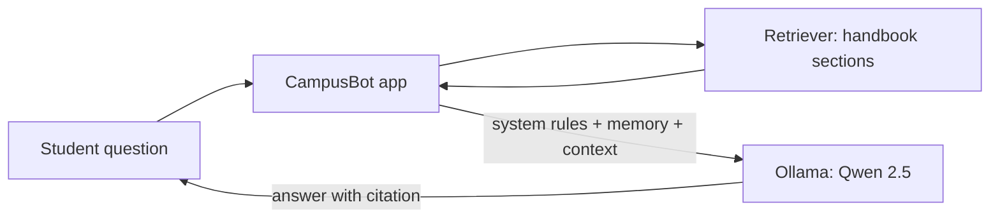
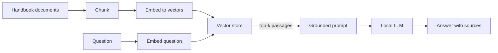
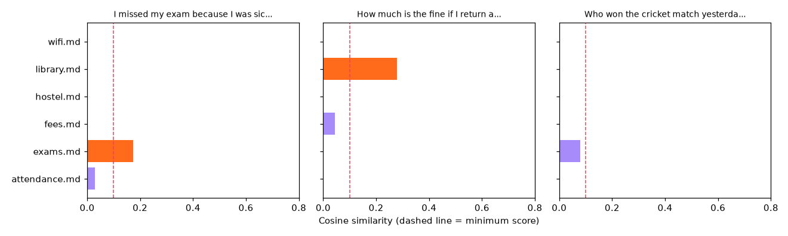

# Session 7 · Building AI-Powered Apps: Local LLMs, Summariser, Chatbot and RAG

[](https://colab.research.google.com/github/Hamnakhan123/Generative-AI/blob/main/04-ai-architecture-and-agents/code/session-07-building-ai-powered-applications.ipynb)

> 🧭 [Generative AI](../README.md) › [Track 4 · AI Architecture and Agents](README.md) › **Session 7**
>
> ⏱️ **Estimated time:** 2 hours · 📋 **Prerequisites:** Previous session

[⬅ Previous](session-06-understanding-ai-agents.md) · [🏠 Track home](README.md) · Next ➡ (end of section)

---

## 🎯 Learning objectives

- Compare the features and capabilities of **Qwen 2.5** with **GPT-4, Mistral and Llama 3**, and explain what **Ollama** is.
- Explain how to **integrate Qwen 2.5** (and other open models) into NLP applications through Ollama's REST API.
- Build a **text summariser** (extractive and LLM-based with DeepSeek-R1) and handle reasoning-model output.
- Explain **Retrieval-Augmented Generation (RAG)** and build a grounded prompt with citations.
- Develop an interactive **chatbot with Qwen 2.5 and Ollama** as a mini project, with memory and a safe fallback.

## 📖 Concepts

> 🛠️ Outputs below were produced without Ollama (offline fallbacks). On your own computer install Ollama and `ollama pull qwen2.5:7b` / `deepseek-r1:7b` to get live model replies from the same scripts.

### 1. Open vs closed models, and where Ollama fits

**Closed models** (GPT-4 family, Gemini, Claude) are used through a paid API: top-end quality, no hardware, but your data goes to the provider. **Open-weight models** (Qwen, Llama, Mistral, DeepSeek) can be downloaded and run anywhere: private, cheap per request, fully customisable (fine-tuning, quantisation), and close in quality for many tasks.

**Ollama is not a model.** It is a free tool that downloads open models, runs them locally (on CPU or GPU, using 4-bit quantised weights by default, so memory ≈ parameters × bits ÷ 8 × 1.2) and exposes a **REST API on `http://localhost:11434`**. Think of it as a "media player" for LLMs: Qwen and Llama are the films.

> 🧠 **Analogy — eating out vs cooking at home.** An API model is a restaurant: excellent food, no kitchen needed, you pay per plate and your order leaves the house. A local model with Ollama is cooking at home: you need a kitchen (RAM/GPU), but it is private, cheap per meal and you can change the recipe.

### 2. Comparing Qwen 2.5 with GPT-4, Llama 3 and Mistral

| Model | Maker / released | Sizes | Context | Licence | Notable strengths |
|---|---|---|---|---|---|
| **Qwen 2.5** | Alibaba Cloud, Sept 2024 | 0.5B, 1.5B, 3B, 7B, 14B, 32B, 72B (+ Coder and Math variants) | Up to 128K tokens | Apache 2.0 for most sizes (3B and 72B use Qwen's own licence) | Strong multilingual (29+ languages), coding, maths, structured JSON output; tiny sizes run on laptops |
| **GPT-4** (and successors like GPT-4o) | OpenAI, 2023 onwards | Not disclosed | 8K–128K (by version) | Closed, API only | Top-tier reasoning and tool use, multimodal in later versions |
| **Llama 3** | Meta, April 2024 (3.1 in July 2024) | 8B, 70B (3.1 adds 405B) | 8K (Llama 3), 128K (3.1) | Llama community licence | Huge ecosystem, many fine-tunes |
| **Mistral 7B** | Mistral AI, Sept 2023 | 7B (family adds Mixtral, larger models) | Up to 32K in later versions | Apache 2.0 | Efficient: sliding-window attention, strong for its size |
| **DeepSeek-R1** | DeepSeek, Jan 2025 | 671B MoE; distilled 1.5B–70B (on Qwen 2.5 and Llama) | Up to 128K | MIT | Step-by-step **reasoning**, shows thinking in `<think>` tags |

**How to choose:** for a private campus chatbot on modest hardware, **Qwen 2.5 7B** (or 1.5B) is a strong default, especially when Urdu or other languages matter. For maximum quality with no hardware, an API model. For heavy reasoning on maths or logic, a DeepSeek-R1 distill. Always test on *your* questions: benchmarks are only a starting point.

### 3. Integrating a model into an NLP application

| Ollama endpoint | Use |
|---|---|
| `POST /api/generate` | One prompt in, one completion out (summaries, rewriting) |
| `POST /api/chat` | A list of messages with roles (system, user, assistant) for chatbots |
| `POST /api/embed` | Turn text into vectors for search and RAG (e.g. `nomic-embed-text`) |

Ollama also offers an **OpenAI-compatible** endpoint (`/v1/chat/completions`), so code written for OpenAI's SDK can point at a local model by changing the base URL. Useful options: `temperature` (randomness), `num_ctx` (context window), `stream` (token-by-token output for responsive UIs).

### 4. Summarisation: two approaches

**Extractive** summaries pick the most informative original sentences (fast, offline, never invent facts, but can read choppy). **Abstractive** summaries are rewritten by an LLM (fluent and format-following, but can hallucinate, so check them).

Reasoning models such as **DeepSeek-R1** output their chain of thought inside `<think>…</think>` before the answer. Your app should **strip the thinking** before showing the result (and not treat it as a verified explanation).

### 5. Retrieval-Augmented Generation (RAG)

An LLM does not know your university handbook and may confidently invent rules. **RAG** grounds it:

1. **Chunk** documents into passages.
2. **Embed** passages and the question as vectors.
3. **Retrieve** the most similar passages (cosine similarity, a vector database such as Chroma, FAISS or pgvector).
4. **Augment** the prompt: "Answer ONLY from this context and cite sources; otherwise say you don't know."
5. **Generate** the answer and show the sources.

> 🧠 **Analogy — an open-book exam.** Without RAG the model answers from memory and may bluff. With RAG it may only use the pages you hand it, and must say which page it used.

## 🪜 Step-by-step: from idea to a local AI app

1. **Define the job** (summarise notices, answer handbook questions) and what must never happen (invented rules, leaked data).
2. **Pick a model** by language, hardware and quality; pull it with Ollama.
3. **Write the system prompt**: role, rules, format, refusal behaviour.
4. **Add retrieval** for anything factual about your organisation.
5. **Add memory**: a sliding window of recent turns (and a summary for long chats).
6. **Add a fallback**, **evaluate** with a fixed question set (correct, grounded, cited, refuses out-of-scope), then wrap in a UI (Streamlit, Gradio) on a campus server.

## 🧭 Diagrams





## 💻 Worked examples (basic → advanced)

### Example 1 (basic) — Sizing models and calling Ollama

```python
# file: session-07_local_llm_client.py
"""
Session 7 · Example 1 — Talking to a local LLM through Ollama's REST API, and sizing models for your laptop.

Ollama serves open models (Qwen 2.5, Llama 3, Mistral, DeepSeek-R1) at localhost:11434.
We size models for your RAM, build the /api/chat body and call it if Ollama is running.

Setup (your own machine):  install Ollama from ollama.com, then
    ollama pull qwen2.5:7b      # or qwen2.5:1.5b on a small laptop
Run:  python session-07_local_llm_client.py
"""
import json
import urllib.request

OLLAMA = "http://localhost:11434"

# 1) Memory estimate: parameters x bytes per weight x ~1.2 overhead (KV cache, runtime)
MODELS = {"qwen2.5:1.5b": 1.5, "mistral:7b": 7.2, "qwen2.5:7b": 7.6, "llama3:8b": 8.0,
          "qwen2.5:14b": 14.7, "qwen2.5:72b": 72.7}
BITS = {"FP16": 16, "Q8": 8, "Q4": 4.5}       # Q4 formats store ~4.5 bits/weight incl. scales
print(f"{'model':14s} {'params':>7s}  " + "  ".join(f"{k:>6s}" for k in BITS) + "   (GB of RAM/VRAM)")
for name, b in MODELS.items():
    gbs = [b * 1e9 * bits / 8 * 1.2 / 1e9 for bits in BITS.values()]
    print(f"{name:14s} {b:6.1f}B  " + "  ".join(f"{g:6.1f}" for g in gbs))

# 2) The request body for a chat call
body = {
    "model": "qwen2.5:7b",
    "messages": [
        {"role": "system", "content": "You are a concise teaching assistant. Answer in 2 sentences."},
        {"role": "user", "content": "What does a transformer's attention layer do?"},
    ],
    "stream": False,
    "options": {"temperature": 0.2, "num_ctx": 4096},
}
print("\nPOST /api/chat body:\n{\n" + ",\n".join(f'  "{k}": {json.dumps(v)}' for k, v in body.items()) + "\n}")


def chat(payload, timeout=60):
    req = urllib.request.Request(OLLAMA + "/api/chat", data=json.dumps(payload).encode(),
                                 headers={"Content-Type": "application/json"})
    with urllib.request.urlopen(req, timeout=timeout) as r:
        return json.loads(r.read())["message"]["content"]


def ollama_running():
    try:
        urllib.request.urlopen(OLLAMA + "/api/tags", timeout=1)
        return True
    except Exception:
        return False

# 3) Call it if available
if ollama_running():
    print("\nModel reply:\n" + chat(body))
else:
    print("\nOllama is not running on this machine, so no reply was generated.")
    print("Start it with:  ollama serve   then   ollama pull qwen2.5:7b   and run this script again.")
```

**Output**

```text
model           params    FP16      Q8      Q4   (GB of RAM/VRAM)
qwen2.5:1.5b      1.5B     3.6     1.8     1.0
mistral:7b        7.2B    17.3     8.6     4.9
qwen2.5:7b        7.6B    18.2     9.1     5.1
llama3:8b         8.0B    19.2     9.6     5.4
qwen2.5:14b      14.7B    35.3    17.6     9.9
qwen2.5:72b      72.7B   174.5    87.2    49.1

POST /api/chat body:
{
  "model": "qwen2.5:7b",
  "messages": [{"role": "system", "content": "You are a concise teaching assistant. Answer in 2 sentences."}, {"role": "user", "content": "What does a transformer's attention layer do?"}],
  "stream": false,
  "options": {"temperature": 0.2, "num_ctx": 4096}
}

Ollama is not running on this machine, so no reply was generated.
Start it with:  ollama serve   then   ollama pull qwen2.5:7b   and run this script again.
```

**Reading it:** a 7B model needs about 18 GB at 16-bit but about 5 GB at 4-bit, so it runs on a 16 GB laptop (keep ~40% of RAM free for the OS); 14B needs about 10 GB and 72B a server-class GPU. The JSON body is exactly what `/api/chat` expects; on your machine with Ollama running, the same script prints the model's reply.

### Example 2 (intermediate) — Summariser with a DeepSeek-R1 prompt

```python
# file: session-07_summarizer.py
"""
Session 7 · Example 2 — A text summariser: offline extractive engine + LLM (DeepSeek-R1 / Qwen) prompt via Ollama.

Extractive (TF-IDF sentence scores: offline, never invents facts) and abstractive
(LLM via Ollama: fluent, must be checked). DeepSeek-R1 wraps its reasoning in <think> tags.

Run:  python session-07_summarizer.py
"""
import json, math, re, urllib.request
from collections import Counter

ARTICLE = """Karachi's public transport is changing quickly. The Green Line bus rapid transit
opened at the end of 2021 and now carries large numbers of passengers every day.
Commuters say travel times on the corridor have dropped sharply compared with minibuses.
However, feeder routes are still limited, so many riders walk long distances to reach stations.
The city has also introduced electric buses on several routes to reduce noise and air pollution.
Officials plan to integrate ticketing across lines with a single smart card.
Critics argue that maintenance funding must be secured, or service quality will decline.
Experts recommend publishing ridership data so that planners can match buses to demand.""".replace("\n", " ")

STOP = set("the a an and or of to in on is are was were has have with so that or for by at as be will must can many now still also which this its".split())


def sentences(text):
    return [s.strip() for s in re.split(r"(?<=[.!?])\s+", text) if s.strip()]


def words(s):
    return [w for w in re.findall(r"[a-z]+", s.lower()) if w not in STOP]


def extractive_summary(text, k=3):
    sents = sentences(text)
    docs = [Counter(words(s)) for s in sents]
    df = Counter(w for d in docs for w in d)
    n = len(sents)
    scores = []
    for i, d in enumerate(docs):
        tfidf = sum(c * math.log(n / df[w]) for w, c in d.items())
        scores.append((tfidf / (1 + sum(d.values())) ** 0.5, i))   # mild length normalisation
    keep = sorted(i for _, i in sorted(scores, reverse=True)[:k])  # keep original order
    return [sents[i] for i in keep], {i: round(s, 2) for s, i in scores}


def strip_thinking(reply):
    return re.sub(r"<think>.*?</think>", "", reply, flags=re.S).strip()


summary, scores = extractive_summary(ARTICLE, k=3)
print(f"Article: {len(sentences(ARTICLE))} sentences, {len(ARTICLE.split())} words")
print("\nExtractive summary (3 sentences):")
for s in summary:
    print(" -", s)
print(f"Compression: {sum(len(s.split()) for s in summary)} / {len(ARTICLE.split())} words")

prompt = ("Summarise the article in exactly 3 bullet points of at most 15 words each. "
          "Use only facts from the article; do not add numbers that are not in it.\n\n"
          f'Article: """{ARTICLE}"""')
body = {"model": "deepseek-r1:7b", "prompt": prompt, "stream": False, "options": {"temperature": 0.1}}

print("\nstrip_thinking demo:", repr(strip_thinking("<think>3 bullets: Green Line, feeders...</think>\n- Green Line cut travel times.")))

try:
    urllib.request.urlopen("http://localhost:11434/api/tags", timeout=1)
    req = urllib.request.Request("http://localhost:11434/api/generate", data=json.dumps(body).encode(),
                                 headers={"Content-Type": "application/json"})
    reply = json.loads(urllib.request.urlopen(req, timeout=120).read())["response"]
    print("\nLLM summary:\n" + strip_thinking(reply))
except Exception:
    print("\n(Ollama not running here: the offline extractive summary above is the result.)")
```

**Output**

```text
Article: 8 sentences, 109 words

Extractive summary (3 sentences):
 - The Green Line bus rapid transit opened at the end of 2021 and now carries large numbers of passengers every day.
 - However, feeder routes are still limited, so many riders walk long distances to reach stations.
 - Officials plan to integrate ticketing across lines with a single smart card.
Compression: 48 / 109 words

strip_thinking demo: '- Green Line cut travel times.'

(Ollama not running here: the offline extractive summary above is the result.)
```

**Reading it:** the extractive engine kept the three most informative sentences (44% of the words) without inventing anything. With Ollama running, the same script sends the constrained prompt (3 bullets, no new numbers) to `deepseek-r1:7b` via `/api/generate`, and `strip_thinking()` removes the reasoning block before display.

### Example 3 (intermediate) — RAG retrieval and a grounded prompt

```python
# file: session-07_rag_search.py
"""
Session 7 · Example 3 — Retrieval-Augmented Generation (RAG): retrieve, then build a grounded prompt.

Retrieve the most similar handbook chunks, then build a prompt that answers ONLY from
them with citations. Real systems use neural embeddings + a vector DB; TF-IDF keeps it offline.

Run:  python session-07_rag_search.py
Creates: session-07_rag_scores.png
"""
import math, re
from collections import Counter
import matplotlib
matplotlib.use("Agg")
import matplotlib.pyplot as plt

DOCS = {
    "attendance.md": "Students must attend at least 75 percent of classes in each course. Below 75 percent the student is not allowed to sit the final exam.",
    "exams.md": "Final exams are held in the last two weeks of the semester. A student who misses an exam for medical reasons may apply for a deferred exam within 7 days with a medical certificate.",
    "fees.md": "Semester fees are due before the first day of classes. A late fee of 5,000 rupees applies after the due date. Fees can be paid in two instalments with approval.",
    "library.md": "The library is open from 8 am to 9 pm on weekdays. Students may borrow up to 4 books for 14 days. The fine for a late book is 50 rupees per day.",
    "wifi.md": "Campus wifi uses your student ID and portal password. If you cannot connect, reset your password on the portal or visit the IT help desk in Block B.",
    "hostel.md": "Hostel rooms are allocated by merit and distance from home. Guests are allowed in the common room until 8 pm. The hostel deposit is refunded within 30 days of leaving.",
}
STOP = set("the a an and or of to in on is are be for by at as it if you your may must can from with within each after per up".split())


# Keyword vectors miss synonyms ("sick" vs "medical"). Neural embeddings learn these
# links automatically; here a small synonym table plays that role.
SYNONYMS = {"sick": "medical", "ill": "medical", "missed": "misses", "pay": "paid", "books": "book",
            "take": "borrow", "internet": "wifi", "parts": "instalments"}


def tokens(text, expand=False):
    ws = [w for w in re.findall(r"[a-z0-9]+", text.lower()) if w not in STOP]
    return ws + [SYNONYMS[w] for w in ws if expand and w in SYNONYMS]


df = Counter(w for d in DOCS.values() for w in set(tokens(d)))
N = len(DOCS)


def vec(text, expand=False):
    tf = Counter(tokens(text, expand))
    return {w: c * (math.log((N + 1) / (df.get(w, 0) + 1)) + 1) for w, c in tf.items()}


def cosine(a, b):
    dot = sum(a[w] * b.get(w, 0) for w in a)
    norm = math.sqrt(sum(v * v for v in a.values())) * math.sqrt(sum(v * v for v in b.values()))
    return dot / norm if norm else 0.0


INDEX = {name: vec(text) for name, text in DOCS.items()}


def retrieve(question, k=2, min_score=0.10, expand=True):
    q = vec(question, expand)
    ranked = sorted(((cosine(q, v), name) for name, v in INDEX.items()), reverse=True)
    return ranked, [(s, n) for s, n in ranked[:k] if s >= min_score]


def grounded_prompt(question, hits):
    context = "\n".join(f"[{n}] {DOCS[n]}" for _, n in hits) or "(no relevant documents found)"
    return ("Answer the question using ONLY the context. Cite sources in [brackets]. "
            "If the context does not contain the answer, say you don't know.\n\n"
            f"Context:\n{context}\n\nQuestion: {question}\nAnswer:")


if __name__ == "__main__":      # lets session-07_project_chatbot.py import the retriever
    questions = ["I missed my exam because I was sick, what can I do?",
                 "How much is the fine if I return a library book late?",
                 "Who won the cricket match yesterday?"]
    plain = retrieve(questions[0], expand=False)[0][0]
    print(f"Keyword-only best match for question 1: {plain[1]} ({plain[0]:.2f}) -> below 0.10, nothing retrieved")
    print("With synonym expansion (what embeddings do for you):\n")
    all_ranked = {}
    for q in questions:
        ranked, hits = retrieve(q)
        all_ranked[q] = ranked
        print(f"Q: {q}")
        print("   top matches:", ", ".join(f"{n} ({s:.2f})" for s, n in ranked[:3]))
        print("   used as context:", [n for _, n in hits] or "none -> the model must say it does not know")
    print("\nGrounded prompt for question 2:\n" + grounded_prompt(questions[1], retrieve(questions[1])[1]))

    fig, axes = plt.subplots(1, 3, figsize=(12, 3.6), sharey=True)
    for ax, q in zip(axes, questions):
        ranked = sorted(all_ranked[q], key=lambda t: t[1])                     # alphabetical rows
        ax.barh([n for _, n in ranked], [sc for sc, _ in ranked], color=["#FF6B1A" if sc >= 0.10 else "#A78BFA" for sc, _ in ranked])
        ax.axvline(0.10, color="#F43F5E", ls="--", lw=1); ax.set_title(q[:34] + "...", fontsize=9); ax.set_xlim(0, 0.8)
    axes[1].set_xlabel("Cosine similarity (dashed line = minimum score)")
    fig.tight_layout(); fig.savefig("session-07_rag_scores.png", dpi=110)
    print("\nSaved chart: session-07_rag_scores.png")
```

**Output**

```text
Keyword-only best match for question 1: exams.md (0.06) -> below 0.10, nothing retrieved
With synonym expansion (what embeddings do for you):

Q: I missed my exam because I was sick, what can I do?
   top matches: exams.md (0.17), attendance.md (0.03), wifi.md (0.00)
   used as context: ['exams.md']
Q: How much is the fine if I return a library book late?
   top matches: library.md (0.28), fees.md (0.04), wifi.md (0.00)
   used as context: ['library.md']
Q: Who won the cricket match yesterday?
   top matches: exams.md (0.08), wifi.md (0.00), library.md (0.00)
   used as context: none -> the model must say it does not know

Grounded prompt for question 2:
Answer the question using ONLY the context. Cite sources in [brackets]. If the context does not contain the answer, say you don't know.

Context:
[library.md] The library is open from 8 am to 9 pm on weekdays. Students may borrow up to 4 books for 14 days. The fine for a late book is 50 rupees per day.

Question: How much is the fine if I return a library book late?
Answer:

Saved chart: session-07_rag_scores.png
```



**Reading it:** pure keyword matching missed "sick" ↔ "medical"; neural embeddings capture such links automatically, which is why real RAG uses them. The cricket question retrieves nothing above the threshold, so the grounded prompt forces "I don't know" instead of a made-up score.

## 🏗️ Real-life problem: CampusBot, a private handbook chatbot (full solution)

**Scenario.** Student affairs answers the same questions all day. They want a chatbot that answers only from the official handbook with citations, remembers the conversation for follow-ups, declines anything outside the handbook with a contact, and runs on a local Qwen 2.5 model so student data stays on campus, with an offline fallback if the model server is down.

```python
# file: session-07_project_chatbot.py
"""
Session 7 · Mini project (full solution) — "CampusBot": a RAG chatbot on Qwen 2.5 via Ollama, with an offline fallback.

Real-life problem: student affairs wants a chatbot that answers ONLY from the handbook
with citations, remembers the conversation for follow-ups, declines out-of-scope questions
with a contact, and runs on a local Qwen 2.5 model via Ollama (offline fallback if not running).
It reuses the handbook and retriever from session-07_rag_search.py (keep both files together).

Run:  python session-07_project_chatbot.py                # scripted demo
      python session-07_project_chatbot.py --interactive  # chat yourself (type 'quit')
"""
import importlib.util, json, re, sys, urllib.request
from collections import Counter, deque

try:
    spec = importlib.util.spec_from_file_location("rag", "session-07_rag_search.py")
    rag = importlib.util.module_from_spec(spec); spec.loader.exec_module(rag)   # DOCS, tokens, retrieve
except FileNotFoundError:            # in the notebook/Colab the RAG cell above already defined them
    import types; rag = types.SimpleNamespace(DOCS=DOCS, tokens=tokens, retrieve=retrieve)

CONTACT = "student.affairs@campus.example (Room A-12, 9 am to 4 pm)"
SYSTEM = ("You are CampusBot, a polite assistant for students. Answer in at most 2 sentences using ONLY "
          "the handbook context, and end with the source file in [brackets]. If the context does not "
          f"answer the question, say you don't know and suggest contacting {CONTACT}.")
MODEL = "qwen2.5:7b"


class CampusBot:
    def __init__(self, memory_turns=3):
        self.history = deque(maxlen=memory_turns * 2)    # sliding window of user/assistant messages
        self.topic = None
        try:
            urllib.request.urlopen("http://localhost:11434/api/tags", timeout=1); self.online = True
        except Exception:
            self.online = False

    def retrieve(self, question):
        ranked, hits = rag.retrieve(question, k=1)
        score = ranked[0][0]
        # A follow-up ("and how many...?", "what about it?") has no topic of its own: reuse the remembered one.
        follow_up = re.match(r"\s*(and|also|what about|how about)\b", question.lower()) or \
            re.search(r"\b(it|that|them|those)\b", question.lower())
        if not hits and self.topic and follow_up:
            return self.topic, score, True
        return (hits[0][1] if hits else None), score, False

    def _llm(self, question, doc):
        context = f"[{doc}] {rag.DOCS[doc]}" if doc else "(no relevant section)"
        messages = [{"role": "system", "content": SYSTEM}, *self.history,
                    {"role": "user", "content": f"Context:\n{context}\n\nQuestion: {question}"}]
        body = json.dumps({"model": MODEL, "messages": messages, "stream": False, "options": {"temperature": 0.1}})
        req = urllib.request.Request("http://localhost:11434/api/chat", data=body.encode(),
                                     headers={"Content-Type": "application/json"})
        return json.loads(urllib.request.urlopen(req, timeout=120).read())["message"]["content"]

    def _fallback(self, question, doc):
        if doc is None:
            return f"I'm sorry, I don't know that from the handbook. Please contact {CONTACT}."
        q = set(rag.tokens(question, expand=True))
        sents = re.split(r"(?<=\.)\s+", rag.DOCS[doc])
        return max(sents, key=lambda s: len(q & set(rag.tokens(s)))) + f" [{doc}]"   # best-overlap sentence

    def ask(self, question):
        doc, score, from_memory = self.retrieve(question)
        answer = self._llm(question, doc) if self.online else self._fallback(question, doc)
        self.topic = doc or self.topic
        self.history.extend([{"role": "user", "content": question}, {"role": "assistant", "content": answer}])
        return answer, doc, score, from_memory


if __name__ == "__main__":
    bot = CampusBot()
    print(f"CampusBot ready | engine: {'Ollama ' + MODEL if bot.online else 'offline extractive fallback'}\n")
    if "--interactive" in sys.argv:
        while (q := input("You: ").strip()).lower() not in {"quit", "exit"}:
            print("Bot:", bot.ask(q)[0], "\n")
        sys.exit()
    stats = Counter()
    for q in ["When are final exams held?", "I was sick and missed one, what now?",
              "How much is the late fine for a library book?", "And how many can I take at once?",
              "Can I pay my fees in parts?", "What is the cafeteria menu today?"]:
        answer, doc, score, mem = bot.ask(q)
        stats["answered" if doc else "declined"] += 1
        tag = f"{doc} via memory" if mem else (f"{doc}, score {score:.2f}" if doc else f"no match, best {score:.2f}")
        print(f"You: {q}\nBot: {answer}\n     ({tag})\n")
    print("Session stats:", dict(stats), f"| memory window holds {len(bot.history)} messages")
```

**Output**

```text
CampusBot ready | engine: offline extractive fallback

You: When are final exams held?
Bot: Final exams are held in the last two weeks of the semester. [exams.md]
     (exams.md, score 0.28)

You: I was sick and missed one, what now?
Bot: A student who misses an exam for medical reasons may apply for a deferred exam within 7 days with a medical certificate. [exams.md]
     (exams.md, score 0.18)

You: How much is the late fine for a library book?
Bot: The fine for a late book is 50 rupees per day. [library.md]
     (library.md, score 0.34)

You: And how many can I take at once?
Bot: Students may borrow up to 4 books for 14 days. [library.md]
     (library.md via memory)

You: Can I pay my fees in parts?
Bot: Fees can be paid in two instalments with approval. [fees.md]
     (fees.md, score 0.27)

You: What is the cafeteria menu today?
Bot: I'm sorry, I don't know that from the handbook. Please contact student.affairs@campus.example (Room A-12, 9 am to 4 pm).
     (no match, best 0.00)

Session stats: {'answered': 5, 'declined': 1} | memory window holds 6 messages
```

**What to notice:**

- CampusBot **reuses the retriever from Example 3**, and every answer carries its **source file**.
- "And how many can I take at once?" has no topic of its own; **conversation memory** linked it to `library.md`.
- "Cafeteria menu" is outside the handbook, so the bot **declines and gives a contact** rather than guessing.
- With Ollama running, the same code sends system prompt + memory + context to **Qwen 2.5** and returns a fluent, cited answer; without it, the extractive fallback keeps the service alive. Run with `--interactive` to chat yourself.

## ⚠️ Common mistakes

| Mistake | Fix |
|---|---|
| Thinking Ollama is a model | It is the runtime; choose a model (`qwen2.5:7b`, `llama3`, …) |
| Letting the bot answer from "general knowledge" about rules | RAG + "answer only from context, else say you don't know" |
| Showing `<think>` text to users | Strip it; show only the final answer |

## ✅ Best practices

- Keep a **system prompt** with role, rules, format and refusal behaviour under version control.
- **Cite sources** in every factual answer; log questions the bot could not answer to improve the handbook.
- Evaluate with a **fixed test set** whenever you change the model, prompt or documents.

## 🧪 Lab / practice tasks

**Task 1 · 🟢 Easy** — Using the formula, estimate RAM for Qwen 2.5 3B at 4-bit and 8-bit.

<details><summary>💡 Hint</summary>

params × bits ÷ 8 × 1.2.

</details>

**Task 2 · 🟢 Easy** — Add a `transport.md` entry to the handbook and ask CampusBot about it.

<details><summary>💡 Hint</summary>

Add a key to `DOCS` in `session-07_rag_search.py`; the index is rebuilt from it at start-up.

</details>

**Task 3 · 🟡 Medium** — Change the summariser to keep 2 sentences and compare which ones survive.

<details><summary>💡 Hint</summary>

Call `extractive_summary(ARTICLE, k=2)`.

</details>

**Task 4 · 🟡 Medium** — In the RAG example, raise `min_score` to 0.2. Which questions lose their context? Is that good or bad?

<details><summary>💡 Hint</summary>

Compare each question's top score with 0.2.

</details>


<details><summary>✅ Lab solutions and model answers</summary>

**Task 1:** 3B × 4.5 ÷ 8 × 1.2 ≈ **2.0 GB** at 4-bit; 3B × 8 ÷ 8 × 1.2 = **3.6 GB** at 8-bit.

**Task 2:** add `"transport.md": "University buses leave the main gate at 7:15 am and 4:30 pm. A semester bus card costs 12,000 rupees.",` to `DOCS` in `session-07_rag_search.py`. Asking CampusBot "What time does the university bus leave?" then returns the bus-time sentence tagged `[transport.md]`.

**Task 3:** with k = 2 the summary keeps the Green Line sentence and the feeder-routes sentence (the two highest scores); the smart-card sentence drops out.

**Task 4:** at 0.2 the sick-exam question (0.17) loses its context and would get "I don't know", while the library question (0.28) keeps it. A higher threshold reduces wrong context but causes more refusals; tune it on real questions.

</details>

## ✅ Quick quiz

**Q1. What is Ollama?**

- A) A tool that runs open models locally and exposes a REST API
- B) An open-source LLM made by Meta
- C) A vector database
- D) A cloud API like GPT-4

<details><summary>Show answer</summary>

✅ **A) A tool that runs open models locally and exposes a REST API** — It is the runtime, not the model.

</details>

**Q2. Roughly how much memory does a 7B model need at 4-bit?**

- A) About 1 GB
- B) About 50 GB
- C) About 5 GB
- D) About 18 GB

<details><summary>Show answer</summary>

✅ **C) About 5 GB** — 7.6B × 4.5 ÷ 8 × 1.2 ≈ 5 GB.

</details>

**Q3. Which Ollama endpoint suits a multi-turn chatbot?**

- A) /api/pull
- B) /api/embed
- C) /api/chat
- D) /api/tags

<details><summary>Show answer</summary>

✅ **C) /api/chat** — Messages with roles.

</details>

**Q4. What is the main purpose of RAG?**

- A) Train the model faster
- B) Ground answers in retrieved documents and cite them
- C) Make the model smaller
- D) Translate prompts

<details><summary>Show answer</summary>

✅ **B) Ground answers in retrieved documents and cite them** — Open-book answering.

</details>

**Q5. A DeepSeek-R1 reply begins with <think>...</think>. Your app should...**

- A) Send it back as context forever
- B) Strip it and show only the final answer
- C) Show it as the answer
- D) Raise an error

<details><summary>Show answer</summary>

✅ **B) Strip it and show only the final answer** — Thinking is not the answer.

</details>


## 📝 Summary / cheat-sheet

- **Open-weight** (Qwen 2.5, Llama 3, Mistral, DeepSeek-R1) vs **closed** (GPT-4 family): privacy and control vs top-end quality.
- **Ollama** runs models locally: `/api/generate`, `/api/chat`, `/api/embed`, port **11434**; OpenAI-compatible endpoint too.
- Memory ≈ **params × bits ÷ 8 × 1.2** (7B at 4-bit ≈ 5 GB). Summarisation: **extractive** (safe) vs **abstractive** (fluent, check facts); strip `<think>`.
- **RAG**: chunk → embed → retrieve → grounded prompt → cited answer; threshold → "I don't know". Chatbot = **system prompt + memory + RAG + fallback + evaluation**.

**Viva / interview questions**

1. Compare Qwen 2.5, Llama 3, Mistral 7B and GPT-4 for a private university chatbot.
2. What does Ollama do, and how would you call it from Python?
3. Estimate the memory needed for a 14B model at 4-bit and explain the formula.
4. Extractive vs abstractive summarisation: when would you use each?
5. Walk through the RAG pipeline and explain how it reduces hallucination.

---

[⬅ Previous](session-06-understanding-ai-agents.md) · [🏠 Track home](README.md) · Next ➡ (end of section)

<sub>Prepared by **Hamna Zahid Khan**, Junior Lecturer</sub>
