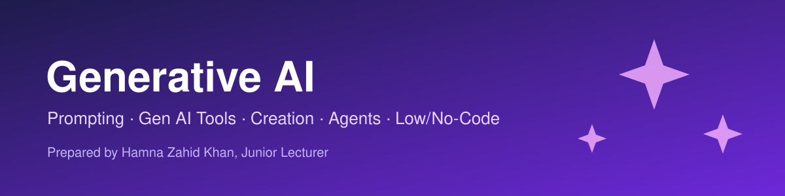

# Generative AI

Prepared by **Hamna Zahid Khan**, Junior Lecturer

## Overview

A five-track course on generative AI: writing effective prompts, using everyday Gen AI tools, creating text, images, audio and video, understanding the architecture behind modern models and AI agents, and building apps quickly with low-code and no-code tools. Each session has notes, runnable code and exercises; each track ends with a practice test.

> 🚧 This course is being built track by track. Linked sessions are ready; the rest are coming soon.

## Roadmap

## Contents

### [Track 1 · Prompt Engineering](01-prompt-engineering/README.md)

1. [Getting Started with Prompting](01-prompt-engineering/session-01-getting-started-with-prompting.md)
2. [Types of Prompts and Prompt Priming](01-prompt-engineering/session-02-types-of-prompts-and-priming.md)
3. [Unleashing the Power of Prompts: CoT, Self-Consistency, Generated Knowledge](01-prompt-engineering/session-03-unleashing-the-power-of-prompts.md)
4. [Case Studies: Content, Commercials, Social Media and Icons](01-prompt-engineering/session-04-case-studies-content-and-social-media.md)
5. [Prompting in Apps: Spreadsheets, Personal Style and Comparisons](01-prompt-engineering/session-05-prompting-in-apps-sheets-and-style.md)
6. [Comparing AI Assistants: ChatGPT, Copilot and Gemini](01-prompt-engineering/session-06-comparing-ai-assistants.md)
7. [Transforming Text into Visual Art](01-prompt-engineering/session-07-text-to-visual-art.md)
8. [Image Generation Settings: Iterate, Upscale, Remix, Aspect Ratio](01-prompt-engineering/session-08-image-generation-settings.md)
9. [Advanced Prompting Strategies and AI in Spreadsheets](01-prompt-engineering/session-09-advanced-prompting-strategies.md)
10. [Applied Prompting, Fine-Tuning Basics and Soft Prompts](01-prompt-engineering/session-10-applied-prompting-and-prompt-tuning.md)
11. [Prompt Hacking: Injection, Leaking, Jailbreaking and Defences](01-prompt-engineering/session-11-prompt-hacking-and-defences.md)
12. [Final Project: Mastering the Art of Prompting](01-prompt-engineering/session-12-final-project-mastering-prompts.md)

📝 [Practice test](01-prompt-engineering/practice-test.md)

### [Track 2 · Gen AI Accelerator](02-gen-ai-accelerator/README.md)

1. [Getting Started with Generative AI](02-gen-ai-accelerator/session-01-getting-started-with-generative-ai.md)
2. [Exploring Generative AI Tools](02-gen-ai-accelerator/session-02-exploring-gen-ai-tools.md)
3. [Boosting Productivity and Creativity with AI](02-gen-ai-accelerator/session-03-boosting-productivity-and-creativity.md)
4. [Collaborating with AI for Smart Learning](02-gen-ai-accelerator/session-04-collaborating-with-ai-for-smart-learning.md)
5. [Weighing the Pros and Cons of Generative AI](02-gen-ai-accelerator/session-05-weighing-pros-and-cons.md)
6. [Human–AI Collaboration Essentials](02-gen-ai-accelerator/session-06-human-ai-collaboration.md)
7. [Responsible AI and Ethical Considerations](02-gen-ai-accelerator/session-07-responsible-ai-and-ethics.md)

📝 [Practice test](02-gen-ai-accelerator/practice-test.md)

### [Track 3 · Innovate with Generative AI](03-innovate-with-generative-ai/README.md)

1. [Generative AI for Creators: Foundations and Toolkit](03-innovate-with-generative-ai/session-01-generative-ai-for-creators.md)
2. [Creating Textual Content with Generative AI](03-innovate-with-generative-ai/session-02-creating-textual-content.md)
3. [Creating Visual Designs: Images, Posters and Presentations](03-innovate-with-generative-ai/session-03-creating-visual-designs.md)
4. [Creating Audio and Video with Generative AI](03-innovate-with-generative-ai/session-04-creating-audio-and-video.md)
5. [Storytelling with Generative AI](03-innovate-with-generative-ai/session-05-storytelling-with-generative-ai.md)
6. [Planning Complex Tasks: Events, Campaigns and Projects](03-innovate-with-generative-ai/session-06-planning-complex-tasks.md)
7. [Analysing and Optimising Content Strategies](03-innovate-with-generative-ai/session-07-analyzing-and-optimizing-content.md)

📝 [Practice test](03-innovate-with-generative-ai/practice-test.md)

### [Track 4 · AI Architecture and Agents](04-ai-architecture-and-agents/README.md)

1. [Transformers and the Attention Mechanism](04-ai-architecture-and-agents/session-01-transformers-and-attention.md)
2. [TensorFlow for Deep Learning Operations](04-ai-architecture-and-agents/session-02-tensorflow-deep-learning-operations.md)
3. [Mastering the Keras API for Model Development](04-ai-architecture-and-agents/session-03-keras-api-model-development.md)
4. [Scalable Deployment: Serving, Lite, Kubernetes and TFX](04-ai-architecture-and-agents/session-04-scalable-deployment.md)
5. [Real-World AI Pipelines and Reinforcement Learning](04-ai-architecture-and-agents/session-05-ai-pipelines-and-reinforcement-learning.md)
6. [Understanding AI Agents and Agent Frameworks](04-ai-architecture-and-agents/session-06-understanding-ai-agents.md)
7. [Building AI-Powered Apps: Local LLMs, Summariser, Chatbot and RAG](04-ai-architecture-and-agents/session-07-building-ai-powered-applications.md)

📝 [Practice test](04-ai-architecture-and-agents/practice-test.md)

### Track 5 · Rapid App Development (Low/No-Code)

1. Foundations of No-Code and Low-Code Development — *coming soon*
2. No-Code Website Tools: Wix, Webflow and Carrd — *coming soon*
3. No-Code Web Apps with Bubble — *coming soon*
4. No-Code Mobile Apps with Glide — *coming soon*
5. Low-Code Apps with Power Apps, Replit and Python — *coming soon*
6. Automating Tasks and Integrating Tools: Zapier, Make, Landbot — *coming soon*
7. Databases for No-Code Apps: Airtable, Firebase, Google Sheets — *coming soon*

📝 Practice test — *coming soon*

## How to use this repository

- Read each session's notes in order, then open its notebook or scripts in the `code/` folder.
- Python examples run on Python 3.10+; notebooks open in Jupyter or Google Colab.
- Try the exercises before looking at the solutions.

---

Prepared by Hamna Zahid Khan, Junior Lecturer
