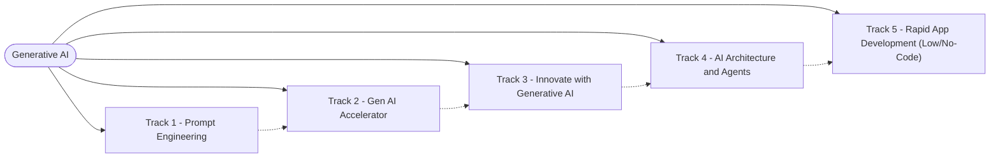

# Generative AI

Prepared by **Hamna Zahid Khan**, Junior Lecturer

## Overview

A five-track course on generative AI: writing effective prompts, using everyday Gen AI tools, creating text, images, audio and video, understanding the architecture behind modern models and AI agents, and building apps quickly with low-code and no-code tools. Each session has notes, runnable code and exercises; each track ends with a practice test.

> 🚧 This course is being built track by track. Linked sessions are ready; the rest are coming soon.

## Roadmap

## Contents

### Track 1 · Prompt Engineering

1. [Getting Started with Prompting](01-prompt-engineering/session-01-getting-started-with-prompting.md)
2. [Types of Prompts and Prompt Priming](01-prompt-engineering/session-02-types-of-prompts-and-priming.md)
3. [Unleashing the Power of Prompts: CoT, Self-Consistency, Generated Knowledge](01-prompt-engineering/session-03-unleashing-the-power-of-prompts.md)
4. [Case Studies: Content, Commercials, Social Media and Icons](01-prompt-engineering/session-04-case-studies-content-and-social-media.md)
5. [Prompting in Apps: Spreadsheets, Personal Style and Comparisons](01-prompt-engineering/session-05-prompting-in-apps-sheets-and-style.md)
6. [Comparing AI Assistants: ChatGPT, Copilot and Gemini](01-prompt-engineering/session-06-comparing-ai-assistants.md)
7. Transforming Text into Visual Art — *coming soon*
8. Image Generation Settings: Iterate, Upscale, Remix, Aspect Ratio — *coming soon*
9. Advanced Prompting Strategies and AI in Spreadsheets — *coming soon*
10. Applied Prompting, Fine-Tuning Basics and Soft Prompts — *coming soon*
11. Prompt Hacking: Injection, Leaking, Jailbreaking and Defences — *coming soon*
12. Final Project: Mastering the Art of Prompting — *coming soon*

📝 Practice test — *coming soon*

### Track 2 · Gen AI Accelerator

1. Getting Started with Generative AI — *coming soon*
2. Exploring Generative AI Tools — *coming soon*
3. Boosting Productivity and Creativity with AI — *coming soon*
4. Collaborating with AI for Smart Learning — *coming soon*
5. Weighing the Pros and Cons of Generative AI — *coming soon*
6. Human–AI Collaboration Essentials — *coming soon*
7. Responsible AI and Ethical Considerations — *coming soon*

📝 Practice test — *coming soon*

### Track 3 · Innovate with Generative AI

1. Generative AI for Creators: Foundations and Toolkit — *coming soon*
2. Creating Textual Content with Generative AI — *coming soon*
3. Creating Visual Designs: Images, Posters and Presentations — *coming soon*
4. Creating Audio and Video with Generative AI — *coming soon*
5. Storytelling with Generative AI — *coming soon*
6. Planning Complex Tasks: Events, Campaigns and Projects — *coming soon*
7. Analysing and Optimising Content Strategies — *coming soon*

📝 Practice test — *coming soon*

### Track 4 · AI Architecture and Agents

1. Transformers and the Attention Mechanism — *coming soon*
2. TensorFlow for Deep Learning Operations — *coming soon*
3. Mastering the Keras API for Model Development — *coming soon*
4. Scalable Deployment: Serving, Lite, Kubernetes and TFX — *coming soon*
5. Real-World AI Pipelines and Reinforcement Learning — *coming soon*
6. Understanding AI Agents and Agent Frameworks — *coming soon*
7. Building AI-Powered Apps: Local LLMs, Summariser, Chatbot and RAG — *coming soon*

📝 Practice test — *coming soon*

### Track 5 · Rapid App Development (Low/No-Code)

1. Foundations of No-Code and Low-Code Development — *coming soon*
2. No-Code Website Tools: Wix, Webflow and Carrd — *coming soon*
3. No-Code Web Apps with Bubble — *coming soon*
4. No-Code Mobile Apps with Glide — *coming soon*
5. Low-Code Apps with Power Apps, Replit and Python — *coming soon*
6. Automating Tasks and Integrating Tools: Zapier, Make, Landbot — *coming soon*
7. Databases for No-Code Apps: Airtable, Firebase, Google Sheets — *coming soon*

📝 Practice test — *coming soon*

## How to use this repository

- Read each session's notes in order, then open its notebook or scripts in the `code/` folder.
- Python examples run on Python 3.10+; notebooks open in Jupyter or Google Colab.
- Try the exercises before looking at the solutions.

---

Prepared by Hamna Zahid Khan, Junior Lecturer
